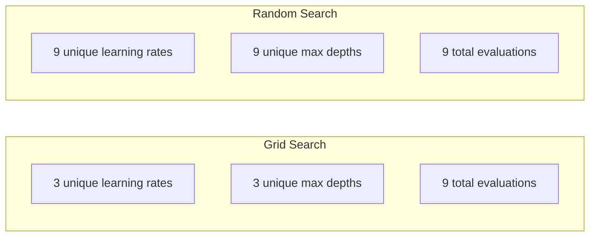
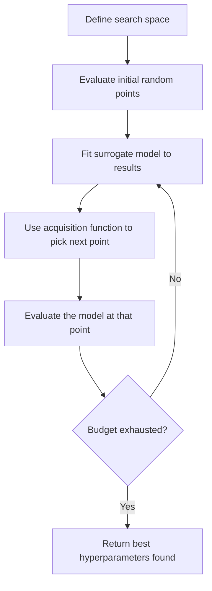
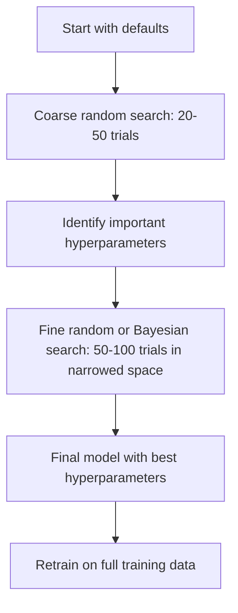
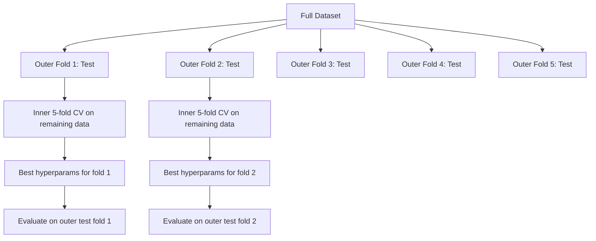

# 하이퍼파라미터 튜닝

> 하이퍼파라미터는 학습이 시작되기 전에 조정하는 다이얼과 같습니다. 이를 잘 조정하는 것이 평범한 모델과 훌륭한 모델을 가르는 차이입니다.

**유형:** Build (실습)
**Language:** Python
**선수 레슨:** Phase 2, Lesson 11 (Ensemble Methods)
**소요 시간:** ~90분

## 학습 목표

- 그리드 탐색(grid search), 랜덤 탐색(random search), 베이지안 최적화(Bayesian optimization)를 밑바닥부터 구현하고 샘플 효율성을 비교합니다
- 대부분의 하이퍼파라미터가 낮은 유효 차원수를 가질 때 랜덤 탐색이 그리드 탐색보다 우수한 성능을 내는 이유를 설명합니다
- 탐색을 유도하기 위해 대리 모델(surrogate model)과 획득 함수(acquisition function)를 사용하는 베이지안 최적화 루프를 구축합니다
- 적절한 교차 검증(cross-validation)을 통해 검증 세트에 대한 과적합(overfitting)을 방지하는 하이퍼파라미터 튜닝 전략을 설계합니다

## 문제 상황

여러분의 그래디언트 부스팅(gradient boosting) 모델에는 학습률(learning rate), 트리 개수, 최대 깊이(max depth), 리프당 최소 샘플 수(min samples per leaf), 서브샘플 비율(subsample ratio), 열 샘플링 비율(column sample ratio)이 포함되어 있습니다. 총 6개의 하이퍼파라미터입니다. 각각에 대해 합리적인 값을 5개씩만 지정해도 그리드에는 $5^6 = 15{,}625$개의 조합이 생깁니다. 각 조합을 학습시키는 데 10초가 걸린다면, 전체를 시험하는 데 43시간의 컴퓨팅 시간이 소요됩니다.

그리드 탐색은 가장 직관적인 접근 방식이지만 규모가 커질수록 최악의 선택이 됩니다. 랜덤 탐색은 더 적은 컴퓨팅으로 더 좋은 결과를 냅니다. 베이지안 최적화는 과거의 평가 결과로부터 학습하여 훨씬 더 뛰어난 성능을 보입니다. 어떤 전략을 사용해야 하는지, 그리고 어떤 하이퍼파라미터가 실제로 중요한지 파악하면 낭비되는 수일의 GPU 시간을 절약할 수 있습니다.

## 핵심 개념

### 파라미터 vs 하이퍼파라미터

파라미터(parameter)는 학습 도중에 학습됩니다(가중치, 편향, 분할 임계값 등). 하이퍼파라미터(hyperparameter)는 학습이 시작되기 전에 설정되며 학습이 진행되는 방식을 제어합니다.

| 하이퍼파라미터 | 제어 대상 | 일반적인 범위 |
|---------------|-----------------|---------------|
| Learning rate | 업데이트당 스텝 크기 | 0.001 ~ 1.0 |
| Number of trees/epochs | 학습 진행 기간 | 10 ~ 10,000 |
| Max depth | 모델 복잡도 | 1 ~ 30 |
| Regularization ($\lambda$) | 과적합 방지 | 0.0001 ~ 100 |
| Batch size | 그래디언트 추정 노이즈 | 16 ~ 512 |
| Dropout rate | 비활성화되는 뉴런의 비율 | 0.0 ~ 0.5 |

### 그리드 탐색

그리드 탐색은 지정된 값들의 모든 조합을 평가합니다. 철저하고 이해하기 쉽지만, 하이퍼파라미터 수가 늘어남에 따라 기하급수적으로 확장됩니다.

```
Grid for 2 hyperparameters:

  learning_rate: [0.01, 0.1, 1.0]
  max_depth:     [3, 5, 7]

  Evaluations: 3 x 3 = 9 combinations

  (0.01, 3)  (0.01, 5)  (0.01, 7)
  (0.1,  3)  (0.1,  5)  (0.1,  7)
  (1.0,  3)  (1.0,  5)  (1.0,  7)
```

그리드 탐색에는 근본적인 결함이 있습니다. 하나의 하이퍼파라미터만 중요하고 다른 하나는 중요하지 않은 경우 대부분의 평가가 낭비됩니다. 9번의 평가를 수행하고도 중요한 파라미터에 대해서는 3개의 고유한 값만 확인하게 됩니다.

### 랜덤 탐색

랜덤 탐색은 하이퍼파라미터를 격자(grid) 대신 분포에서 샘플링합니다. 동일한 9회의 평가 예산으로 각 하이퍼파라미터에 대해 9개의 고유한 값을 얻을 수 있습니다.



랜덤 탐색이 그리드 탐색보다 우수한 이유 (Bergstra & Bengio, 2012):

- 대부분의 하이퍼파라미터는 유효 차원수가 낮습니다. 주어진 문제에서 6개 중 보통 1~2개의 하이퍼파라미터만이 실제로 유의미합니다.
- 그리드 탐색은 중요하지 않은 차원에 평가 횟수를 낭비합니다.
- 랜덤 탐색은 동일한 예산으로 중요한 차원을 더 조밀하게 탐색합니다.
- 60회의 랜덤 트라이얼(trial)을 수행하면 탐색 공간 내에 최적점이 존재할 때 최적점의 5% 이내에 위치한 점을 찾을 확률이 95%에 달합니다.

### 베이지안 최적화

랜덤 탐색은 결과를 무시합니다. 높은 학습률이 발산을 초래한다거나, 깊이 3이 깊이 10보다 일관되게 우수한 성능을 낸다는 사실을 학습하지 못합니다. 베이지안 최적화는 과거의 평가 결과를 활용하여 다음에 탐색할 위치를 결정합니다.



두 가지 핵심 구성 요소:

**대리 모델(Surrogate model):** 비용이 많이 드는 목적 함수를 근사하는, 평가 비용이 저렴한 모델(주로 가우시안 프로세스(Gaussian process))입니다. 탐색 공간 내의 임의의 지점에서 예측값과 불확실성 추정치를 모두 제공합니다.

**획득 함수(Acquisition function):** 활용(exploitation, 이미 알려진 좋은 지점 주변 탐색)과 탐색(exploration, 불확실성이 높은 지점 탐색)의 균형을 맞추어 다음에 어디를 평가할지 결정합니다. 흔히 사용되는 선택지는 다음과 같습니다.

- **Expected Improvement (EI):** 현재 최고점 대비 이 지점에서 기대할 수 있는 개선 폭은 얼마인가?
- **Upper Confidence Bound (UCB):** 예측값에 불확실성의 배수를 더한 값입니다. UCB가 높다는 것은 유망하거나 아직 탐색되지 않았음을 의미합니다.
- **Probability of Improvement (PI):** 이 지점이 현재 최고점을 능가할 확률은 얼마인가?

베이지안 최적화는 일반적으로 랜덤 탐색보다 2~5배 적은 평가 횟수로 더 우수한 하이퍼파라미터를 찾아냅니다. 대리 모델을 피팅하는 오버헤드는 실제 모델을 학습시키는 비용에 비하면 무시할 수 있는 수준입니다.

### 조기 종료

모든 학습 실행을 끝까지 마칠 필요는 없습니다. 10 에포크가 지난 시점에 어떤 구성이 명백히 나쁜 성능을 보인다면, 해당 실행을 중단하고 다음으로 넘어갑니다. 이것이 하이퍼파라미터 탐색 맥락에서의 조기 종료(early stopping)입니다.

전략:
- **인내심 기반(Patience-based):** 검증 손실(validation loss)이 N회 연속 에포크 동안 개선되지 않으면 중단합니다
- **중앙값 가지치기(Median pruning):** 트라이얼의 중간 결과가 동일한 스텝에서 완료된 트라이얼들의 중앙값보다 나쁘면 중단합니다
- **Hyperband:** 많은 수의 구성에 작은 예산을 할당한 다음, 최상위 구성들에 점진적으로 예산을 늘려갑니다

Hyperband는 특히 효과적입니다. 81개의 구성에 대해 각각 1 에포크로 시작하여 상위 3분의 1을 남기고 이들에게 3 에포크를 부여하며, 다시 상위 3분의 1을 남기는 방식을 반복합니다. 이 방식을 통해 전체 예산으로 모든 구성을 평가하는 것보다 10~50배 빠르게 좋은 구성을 찾아냅니다.

### 학습률 스케줄러

학습률은 거의 항상 가장 중요한 하이퍼파라미터입니다. 이를 고정해 두기보다는 스케줄러(scheduler)를 사용하여 학습 도중에 조정합니다.

| 스케줄러 | 수식 | 사용 시점 |
|-----------|---------|-------------|
| Step decay | 매 N 에포크마다 0.1 곱하기 | 고전적인 CNN 학습 |
| Cosine annealing | $\text{lr} \cdot 0.5 \cdot (1 + \cos(\pi t / T))$ | 현대적인 기본값 |
| Warmup + decay | 선형 증가 후 코사인 감쇠 | Transformer |
| One-cycle | 단일 사이클 동안 증가 후 감소 | 빠른 수렴 |
| Reduce on plateau | 지표가 정체될 때 일정 비율로 감소 | 안전한 기본값 |

### 하이퍼파라미터 중요도

모든 하이퍼파라미터가 동등하게 중요한 것은 아닙니다. 랜덤 포레스트(Probst et al., 2019) 및 그래디언트 부스팅에 대한 연구는 일관된 패턴을 보여줍니다.

**높은 중요도:**
- 학습률 (항상 가장 먼저 튜닝)
- 추정기 수(Number of estimators) / 에포크 수 (튜닝 대신 조기 종료 활용)
- 규제 강도

**중간 중요도:**
- 최대 깊이 / 레이어 수
- 리프당 최소 샘플 수 / 가중치 감쇠(weight decay)
- 서브샘플 비율

**낮은 중요도:**
- 최대 특성 수(Max features, 랜덤 포레스트용)
- 구체적인 활성화 함수(activation function) 선택
- 배치 크기 (합리적인 범위 내에서)

중요한 하이퍼파라미터를 먼저 튜닝하고, 나머지는 기본값으로 두십시오.

### 실전 전략



구체적인 워크플로우:

1. **라이브러리 기본값으로 시작합니다.** 숙련된 실무자들이 선택한 기본값은 이미 80% 수준의 성능을 내는 경우가 많습니다.
2. **넓은 범위의 랜덤 탐색을 수행합니다.** 넓은 범위를 설정하고 20~50회의 트라이얼을 진행합니다. 조기 종료를 활용하여 나쁜 실행을 빠르게 중단합니다.
3. **결과를 분석합니다.** 어떤 하이퍼파라미터가 성능과 상관관계를 보입니까? 탐색 공간을 좁힙니다.
4. **정밀 탐색을 진행합니다.** 좁혀진 공간 내에서 베이지안 최적화 또는 집중 랜덤 탐색을 수행합니다(50~100회 트라이얼).
5. 찾은 최적의 하이퍼파라미터로 **전체 학습 데이터에 대해 다시 학습**합니다.
### 교차 검증 통합

단일 검증 분할(validation split)에서 하이퍼파라미터를 튜닝하는 것은 위험합니다. 최적의 하이퍼파라미터가 특정 검증 폴드에 과적합(overfitting)될 수 있기 때문입니다. 중첩 교차 검증(nested cross-validation)은 두 개의 루프를 사용하여 이 문제를 해결합니다.

- **외부 루프**(평가): 데이터를 훈련+검증 세트와 테스트 세트로 분할합니다. 편향되지 않은 성능을 보고합니다.
- **내부 루프**(튜닝): 훈련+검증 세트를 다시 훈련 및 검증 세트로 분할합니다. 최적의 하이퍼파라미터를 찾습니다.



각 외부 폴드는 독립적으로 자체 최적 하이퍼파라미터를 찾습니다. 외부 루프 점수들은 일반화 성능에 대한 편향 없는 추정치입니다.

sklearn을 사용하면 다음과 같습니다.

```python
from sklearn.model_selection import cross_val_score, GridSearchCV
from sklearn.ensemble import GradientBoostingRegressor

inner_cv = GridSearchCV(
    GradientBoostingRegressor(),
    param_grid={
        "learning_rate": [0.01, 0.05, 0.1],
        "max_depth": [2, 3, 5],
        "n_estimators": [50, 100, 200],
    },
    cv=5,
    scoring="neg_mean_squared_error",
)

outer_scores = cross_val_score(
    inner_cv, X, y, cv=5, scoring="neg_mean_squared_error"
)

print(f"Nested CV MSE: {-outer_scores.mean():.4f} +/- {outer_scores.std():.4f}")
```

이 방식은 비용이 많이 들지만(외부 5개 폴드 x 내부 5개 폴드 x 27개 그리드 포인트 = 675회 모델 피팅), 신뢰할 수 있는 성능 추정치를 제공합니다. 논문에서 최종 결과를 보고하거나 의사결정의 중요도가 높을 때 사용합니다.

### 실무 팁

**학습률(learning rate)부터 시작하십시오.** 그래디언트 기반 방법에서는 언제나 학습률이 가장 중요한 하이퍼파라미터입니다. 잘못된 학습률은 다른 모든 설정을 무의미하게 만듭니다. 다른 하이퍼파라미터는 기본값으로 고정하고 학습률부터 탐색하십시오.

**학습률과 규제(regularization)에는 로그 균등 분포(log-uniform distribution)를 사용하십시오.** 0.001과 0.01의 차이는 0.1과 1.0의 차이만큼 중요합니다. 선형적으로 탐색하면 큰 값 범위에서 예산을 낭비하게 됩니다.

**n_estimators를 튜닝하는 대신 조기 종료(early stopping)를 사용하십시오.** 부스팅 및 신경망에서는 n_estimators 또는 epoch를 크게 설정하고 조기 종료를 통해 중단 시점을 결정하도록 하십시오. 이렇게 하면 탐색해야 할 하이퍼파라미터 하나를 줄일 수 있습니다.

**예산 할당.** 튜닝 예산의 60%를 가장 중요한 상위 2개 하이퍼파라미터에 할당하십시오. 나머지 40%는 다른 모든 하이퍼파라미터에 분배합니다. 상위 2개 파라미터가 성능 변화의 대부분을 좌우합니다.

**스케일이 중요합니다.** 배치 크기(batch size)는 절대 로그 스케일로 탐색하지 마십시오(16, 32, 64 정도로 충분합니다). 학습률은 항상 로그 스케일로 탐색하십시오. 하이퍼파라미터가 모델에 미치는 영향 방식에 맞추어 탐색 분포를 설정하십시오.

| 모델 유형 | 주요 하이퍼파라미터 | 권장 탐색 방법 | 예산 |
|-----------|--------------------|--------------------|--------|
| Random Forest | n_estimators, max_depth, min_samples_leaf | 랜덤 탐색, 50회 시도 | 낮음 (빠른 훈련) |
| Gradient Boosting | learning_rate, n_estimators, max_depth | 베이즈 최적화, 100회 시도 + 조기 종료 | 중간 |
| Neural Network | learning_rate, weight_decay, batch_size | 베이즈 최적화 또는 랜덤 탐색, 100회 이상 시도 | 높음 (느린 훈련) |
| SVM | C, gamma (RBF 커널) | 로그 스케일 그리드 탐색, 25-50회 시도 | 낮음 (파라미터 2개) |
| Lasso/Ridge | alpha | 로그 스케일 1차원 탐색, 20회 시도 | 매우 낮음 |
| XGBoost | learning_rate, max_depth, subsample, colsample | 베이즈 최적화, 100-200회 시도 + 조기 종료 | 중간 |

**확신이 서지 않을 때:** 하이퍼파라미터 수의 2배에 해당하는 횟수로 랜덤 탐색을 시작하십시오(예: 하이퍼파라미터 6개 = 최소 12회 이상 시도). 50회 시도의 랜덤 탐색이 정교하게 설계된 그리드 탐색보다 더 나은 결과를 내는 경우가 많다는 점에 놀라게 될 것입니다.

```figure
k-fold-cv
```

## 직접 구현해 보기

### 1단계: 밑바닥부터 구현하는 그리드 탐색

`code/tuning.py`의 코드는 그리드 탐색, 랜덤 탐색, 그리고 간단한 베이즈 최적화 도구를 밑바닥부터 구현합니다.

```python
def grid_search(model_fn, param_grid, X_train, y_train, X_val, y_val):
    keys = list(param_grid.keys())
    values = list(param_grid.values())
    best_score = -float("inf")
    best_params = None
    n_evals = 0

    for combo in itertools.product(*values):
        params = dict(zip(keys, combo))
        model = model_fn(**params)
        model.fit(X_train, y_train)
        score = evaluate(model, X_val, y_val)
        n_evals += 1

        if score > best_score:
            best_score = score
            best_params = params

    return best_params, best_score, n_evals
```

### 2단계: 밑바닥부터 구현하는 랜덤 탐색

```python
def random_search(model_fn, param_distributions, X_train, y_train,
                  X_val, y_val, n_iter=50, seed=42):
    rng = np.random.RandomState(seed)
    best_score = -float("inf")
    best_params = None

    for _ in range(n_iter):
        params = {k: sample(v, rng) for k, v in param_distributions.items()}
        model = model_fn(**params)
        model.fit(X_train, y_train)
        score = evaluate(model, X_val, y_val)

        if score > best_score:
            best_score = score
            best_params = params

    return best_params, best_score, n_iter
```

### 3단계: 베이즈 최적화 (단순화 버전)

핵심 아이디어: 관측된 (하이퍼파라미터, 점수) 쌍에 가우시안 프로세스(Gaussian process)를 피팅한 후, 획득 함수(acquisition function)를 사용하여 다음에 탐색할 지점을 결정합니다.

```python
class SimpleBayesianOptimizer:
    def __init__(self, search_space, n_initial=5):
        self.search_space = search_space
        self.n_initial = n_initial
        self.X_observed = []
        self.y_observed = []

    def _kernel(self, x1, x2, length_scale=1.0):
        dists = np.sum((x1[:, None, :] - x2[None, :, :]) ** 2, axis=2)
        return np.exp(-0.5 * dists / length_scale ** 2)

    def _fit_gp(self, X_new):
        X_obs = np.array(self.X_observed)
        y_obs = np.array(self.y_observed)
        y_mean = y_obs.mean()
        y_centered = y_obs - y_mean

        K = self._kernel(X_obs, X_obs) + 1e-4 * np.eye(len(X_obs))
        K_star = self._kernel(X_new, X_obs)

        L = np.linalg.cholesky(K)
        alpha = np.linalg.solve(L.T, np.linalg.solve(L, y_centered))
        mu = K_star @ alpha + y_mean

        v = np.linalg.solve(L, K_star.T)
        var = 1.0 - np.sum(v ** 2, axis=0)
        var = np.maximum(var, 1e-6)

        return mu, var

    def _expected_improvement(self, mu, var, best_y):
        sigma = np.sqrt(var)
        z = (mu - best_y) / (sigma + 1e-10)
        ei = sigma * (z * norm_cdf(z) + norm_pdf(z))
        return ei

    def suggest(self):
        if len(self.X_observed) < self.n_initial:
            return sample_random(self.search_space)

        candidates = [sample_random(self.search_space) for _ in range(500)]
        X_cand = np.array([to_vector(c) for c in candidates])
        mu, var = self._fit_gp(X_cand)
        ei = self._expected_improvement(mu, var, max(self.y_observed))
        return candidates[np.argmax(ei)]

    def observe(self, params, score):
        self.X_observed.append(to_vector(params))
        self.y_observed.append(score)
```

가우시안 프로세스 대리 모델(GP surrogate)은 각 후보 지점에서 예측 점수(mu)와 불확실성(var)이라는 두 가지 정보를 제공합니다. 기댓값 개선(Expected Improvement)은 이 둘의 균형을 맞춥니다. 즉, 모델이 높은 점수를 예측하는 지점 혹은 불확실성이 높은 지점을 선호합니다. 초기에는 대부분의 지점이 높은 불확실성을 가지므로 최적화 도구가 탐색(exploration)을 수행합니다. 이후에는 가장 유망한 영역에 집중(exploitation)합니다.

### 4단계: 모든 방법 비교

동일한 합성 목적 함수(synthetic objective)에서 세 가지 방법을 모두 실행하고 비교합니다. 이 비교에서는 모델 훈련 없이 직접 목적 함수를 호출하는 간소화된 래퍼(wrapper)를 사용하므로, 위의 모델 기반 구현체들과 API가 다릅니다.

```python
def synthetic_objective(params):
    lr = params["learning_rate"]
    depth = params["max_depth"]
    return -(np.log10(lr) + 2) ** 2 - (depth - 4) ** 2 + 10

param_grid = {
    "learning_rate": [0.001, 0.01, 0.1, 1.0],
    "max_depth": [2, 3, 4, 5, 6, 7, 8],
}

grid_best = None
grid_score = -float("inf")
grid_history = []
for combo in itertools.product(*param_grid.values()):
    params = dict(zip(param_grid.keys(), combo))
    score = synthetic_objective(params)
    grid_history.append((params, score))
    if score > grid_score:
        grid_score = score
        grid_best = params

param_dist = {
    "learning_rate": ("log_float", 0.001, 1.0),
    "max_depth": ("int", 2, 8),
}

rand_best = None
rand_score = -float("inf")
rand_history = []
rng = np.random.RandomState(42)
for _ in range(28):
    params = {k: sample(v, rng) for k, v in param_dist.items()}
    score = synthetic_objective(params)
    rand_history.append((params, score))
    if score > rand_score:
        rand_score = score
        rand_best = params

optimizer = SimpleBayesianOptimizer(param_dist, n_initial=5)
bayes_history = []
for _ in range(28):
    params = optimizer.suggest()
    score = synthetic_objective(params)
    optimizer.observe(params, score)
    bayes_history.append((params, score))
bayes_score = max(s for _, s in bayes_history)

print(f"{'Method':<20} {'Best Score':>12} {'Evaluations':>12}")
print("-" * 50)
print(f"{'Grid Search':<20} {grid_score:>12.4f} {len(grid_history):>12}")
print(f"{'Random Search':<20} {rand_score:>12.4f} {len(rand_history):>12}")
print(f"{'Bayesian Opt':<20} {bayes_score:>12.4f} {len(bayes_history):>12}")
```

동일한 예산 조건에서 베이즈 최적화는 명백히 나쁜 영역에서 평가를 낭비하지 않기 때문에 보통 가장 빠르게 최고 점수를 찾습니다. 랜덤 탐색은 그리드 탐색보다 더 넓은 영역을 커버합니다. 그리드 탐색은 하이퍼파라미터가 매우 적고 철저한 전수 조사를 감당할 수 있을 때만 유리합니다.

## 실무 활용

### 실무에서의 Optuna

Optuna는 본격적인 하이퍼파라미터 튜닝에 권장되는 라이브러리입니다. 프루닝(pruning), 분산 탐색, 시각화 기능을 기본적으로 지원합니다.

```python
import optuna

def objective(trial):
    lr = trial.suggest_float("learning_rate", 1e-4, 1e-1, log=True)
    n_est = trial.suggest_int("n_estimators", 50, 500)
    max_depth = trial.suggest_int("max_depth", 2, 10)

    model = GradientBoostingRegressor(
        learning_rate=lr,
        n_estimators=n_est,
        max_depth=max_depth,
    )
    model.fit(X_train, y_train)
    return mean_squared_error(y_val, model.predict(X_val))

study = optuna.create_study(direction="minimize")
study.optimize(objective, n_trials=100)

print(f"Best params: {study.best_params}")
print(f"Best MSE: {study.best_value:.4f}")
```

Optuna의 주요 기능:
- 로그 스케일 탐색이 적합한 파라미터(학습률, 규제)를 위한 `suggest_float(..., log=True)`
- 정수 파라미터를 위한 `suggest_int`
- 이산형 선택지를 위한 `suggest_categorical`
- 성능이 나쁜 시도를 조기 종료하는 내장 MedianPruner
- 분석을 위한 `study.trials_dataframe()`

### 프루닝을 적용한 Optuna

프루닝(가지치기)은 유망하지 않은 시도를 조기에 중단하여 막대한 계산 비용을 절약합니다. 다음은 그 패턴입니다.

```python
import optuna
from sklearn.model_selection import cross_val_score

def objective(trial):
    params = {
        "learning_rate": trial.suggest_float("lr", 1e-4, 0.5, log=True),
        "max_depth": trial.suggest_int("max_depth", 2, 10),
        "n_estimators": trial.suggest_int("n_estimators", 50, 500),
        "subsample": trial.suggest_float("subsample", 0.5, 1.0),
    }

    model = GradientBoostingRegressor(**params)
    scores = cross_val_score(model, X_train, y_train, cv=3,
                             scoring="neg_mean_squared_error")
    mean_score = -scores.mean()

    trial.report(mean_score, step=0)
    if trial.should_prune():
        raise optuna.TrialPruned()

    return mean_score

pruner = optuna.pruners.MedianPruner(n_startup_trials=10, n_warmup_steps=5)
study = optuna.create_study(direction="minimize", pruner=pruner)
study.optimize(objective, n_trials=200)
```

`MedianPruner`은 특정 스텝에서의 중간값이 동일한 스텝을 완료한 전체 시도의 중앙값보다 나쁠 경우 해당 시도를 중단합니다. 프루닝을 사용하려면 중간 지표를 보고하는 `trial.report()`과 시도 중단 여부를 확인하는 `trial.should_prune()`을 호출해야 합니다. `n_startup_trials=10`은 프루닝이 적용되기 전에 최소 10회의 시도가 완전히 완료되도록 보장합니다. 이를 통해 일반적으로 전체 연산의 40~60%를 절약할 수 있습니다.

### sklearn의 내장 튜너

빠른 실험을 위해 sklearn은 `GridSearchCV`, `RandomizedSearchCV`, `HalvingRandomSearchCV`을 제공합니다.

```python
from sklearn.model_selection import RandomizedSearchCV
from scipy.stats import loguniform, randint

param_dist = {
    "learning_rate": loguniform(1e-4, 0.5),
    "max_depth": randint(2, 10),
    "n_estimators": randint(50, 500),
}

search = RandomizedSearchCV(
    GradientBoostingRegressor(),
    param_dist,
    n_iter=100,
    cv=5,
    scoring="neg_mean_squared_error",
    random_state=42,
    n_jobs=-1,
)
search.fit(X_train, y_train)
print(f"Best params: {search.best_params_}")
print(f"Best CV MSE: {-search.best_score_:.4f}")
```

학습률과 규제에는 scipy의 `loguniform`을 사용하십시오. 정수 하이퍼파라미터에는 `randint`을 사용하십시오. `n_jobs=-1` 플래그는 모든 CPU 코어에 걸쳐 작업을 병렬화합니다.

### 하이퍼파라미터 튜닝 시 흔히 하는 실수

**전처리를 통한 데이터 누출(Data leakage).** 교차 검증을 수행하기 전에 전체 데이터셋에 스케일러를 피팅하면 검증 폴드의 정보가 훈련 과정으로 누출됩니다. 전처리 작업은 항상 `Pipeline` 내부에 배치하여 훈련 폴드에만 피팅되도록 하십시오.

**검증 세트에 대한 과적합.** 수천 번의 시도를 실행하는 것은 실질적으로 검증 세트에 대해 훈련하는 것과 같습니다. 최종 성능 추정에는 중첩 교차 검증을 사용하거나, 튜닝 과정에서 전혀 건드리지 않는 별도의 테스트 세트를 확보해 두십시오.

**너무 좁은 범위 탐색.** 최적의 값이 탐색 공간의 경계에 있다면 탐색 범위를 충분히 넓게 잡지 못한 것입니다. 최적값이 설정한 범위 바깥에 존재할 수 있습니다. 항상 최적 파라미터가 경계값에 걸려 있는지 확인하십시오.

**상호작용 효과(interaction effects) 무시.** 부스팅 모델에서 학습률과 트리 개수(estimators)는 강하게 상호작용합니다. 학습률이 낮을수록 더 많은 트리가 필요합니다. 이 둘을 독립적으로 튜닝하면 함께 튜닝하는 것보다 결과가 좋지 않습니다.

**반복 기반 모델에 조기 종료를 사용하지 않는 것.** 그래디언트 부스팅과 신경망의 경우 n_estimators 또는 epoch를 큰 값으로 설정하고 조기 종료를 사용하십시오. 이는 반복 횟수 자체를 하이퍼파라미터로 튜닝하는 것보다 확실히 더 우수한 방법입니다.
## Exercises

1. 그리드 탐색(grid search)과 랜덤 탐색(random search)을 동일한 총 예산(예: 50회 평가)으로 실행해 보세요. 발견된 최고 점수를 비교합니다. 서로 다른 시드로 실험을 10회 실행해 보세요. 랜덤 탐색이 이기는 경우는 얼마나 됩니까?

2. Hyperband를 처음부터 직접 구현해 보세요. 각각 1 에포크(epoch) 동안 훈련하는 81개의 설정으로 시작합니다. 각 라운드마다 상위 1/3을 유지하고 예산을 3배로 늘립니다. 총 연산량(모든 설정에 걸친 에포크의 총합)을 81개 설정을 전체 예산으로 실행했을 때와 비교해 보세요.

3. 레슨 11의 그래디언트 부스팅(gradient boosting) 구현에 학습률 스케줄러(코사인 어닐링; cosine annealing)를 추가해 보세요. 고정 학습률과 비교했을 때 성능이 향상됩니까?

4. 실제 데이터셋(예: sklearn의 유방암 데이터셋)에서 Optuna를 사용하여 RandomForestClassifier를 튜닝해 보세요. `optuna.visualization.plot_param_importances(study)`을 사용하여 어떤 하이퍼파라미터가 가장 중요한지 확인해 보세요. 이번 레슨의 중요도 순위와 일치합니까?

5. 간단한 획득 함수(acquisition function, 기대 개선량; Expected Improvement)를 구현하고 탐색(exploration) 대 활용(exploitation)을 시연해 보세요. 대리 모델(surrogate model)의 평균과 불확실성을 플롯하고, EI가 다음에 평가할 위치를 어디로 선택하는지 보여주세요.

## Key Terms

| 용어 | 흔히 하는 말 | 실제 의미 |
|------|----------------|----------------------|
| Hyperparameter | "직접 선택하는 설정" | 데이터로부터 학습되지 않고, 학습 과정을 제어하기 위해 훈련 전에 설정하는 값 |
| Grid search | "모든 조합 시도하기" | 지정된 파라미터 그리드에 대한 전수 탐색. 지수적 비용 발생. |
| Random search | "그냥 무작위로 샘플링하기" | 분포에서 하이퍼파라미터를 샘플링. 그리드 탐색보다 중요한 차원을 더 잘 커버함. |
| Bayesian optimization | "스마트한 탐색" | 목적 함수의 대리 모델을 사용하여 탐색과 활용의 균형을 맞추며 다음에 평가할 위치를 결정 |
| Surrogate model | "비용이 적게 드는 근사 모델" | 관측된 평가 결과로부터 비용이 많이 드는 목적 함수를 근사하는 모델(주로 가우시안 프로세스) |
| Acquisition function | "다음에 살펴볼 위치" | 기대 개선량과 불확실성의 균형을 맞추어 후보 지점의 점수를 매김. EI와 UCB가 흔히 사용됨. |
| Early stopping | "시간 낭비 멈추기" | 검증 성능의 향상이 멈추면 훈련을 조기에 종료 |
| Hyperband | "설정을 위한 토너먼트 대진표" | 적응형 자원 할당: 적은 예산으로 많은 설정을 시작하고, 최고 성능의 설정을 유지하며 예산을 늘림 |
| Learning rate scheduler | "훈련 중에 lr 바꾸기" | 더 나은 수렴을 위해 훈련 과정에 걸쳐 학습률을 조정하는 함수 |

## Further Reading

- [Bergstra & Bengio: Random Search for Hyper-Parameter Optimization (2012)](https://jmlr.org/papers/v13/bergstra12a.html) -- 랜덤 탐색이 그리드 탐색보다 우수함을 보여준 논문
- [Snoek et al., Practical Bayesian Optimization of Machine Learning Algorithms (2012)](https://arxiv.org/abs/1206.2944) -- ML을 위한 베이즈 최적화 논문
- [Li et al., Hyperband: A Novel Bandit-Based Approach (2018)](https://jmlr.org/papers/v18/16-558.html) -- Hyperband 논문
- [Optuna: A Next-generation Hyperparameter Optimization Framework](https://arxiv.org/abs/1907.10902) -- Optuna 논문
- [Probst et al., Tunability: Importance of Hyperparameters (2019)](https://jmlr.org/papers/v20/18-444.html) -- 어떤 하이퍼파라미터가 중요한지 다룬 논문
