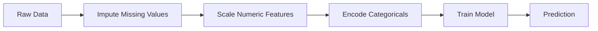
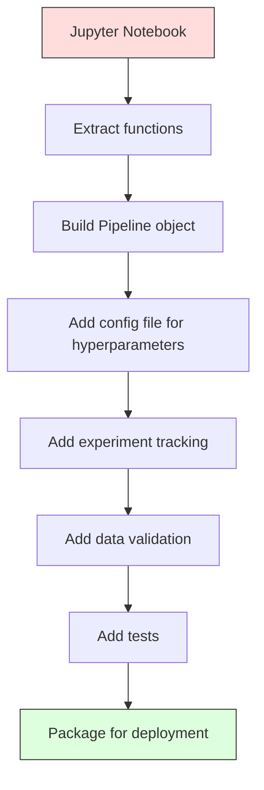

# ML 파이프라인

> 모델은 제품이 아닙니다. 파이프라인이 제품입니다. 파이프라인은 원시 데이터부터 배포된 추론까지의 모든 과정을 포괄하며, 모든 단계는 재현 가능해야 합니다.

**유형:** Build (실습)
**Language:** Python
**선수 레슨:** Phase 2, Lesson 12 (Hyperparameter Tuning)
**소요 시간:** ~120분

## 학습 목표

- 대체(imputation), 스케일링, 인코딩, 모델 학습을 하나의 재현 가능한 객체로 연결하는 ML 파이프라인을 바닥부터 구현합니다.
- 데이터 누수(data leakage) 시나리오를 식별하고, 변환기(transformer)를 학습 데이터에만 적합(fit)시킴으로써 파이프라인이 누수를 어떻게 방지하는지 설명합니다.
- 수치형 특성과 범주형 특성에 서로 다른 전처리를 적용하는 ColumnTransformer를 구축합니다.
- 파이프라인 직렬화(serialization)를 구현하고, 동일하게 적합된 파이프라인이 학습과 프로덕션 환경에서 완전히 일치하는 결과를 생성함을 입증합니다.

## 문제 상황

데이터를 로드하고, 결측값을 중앙값으로 채우고, 특성을 스케일링하고, 모델을 학습시킨 다음 정확도를 출력하는 노트북이 있습니다. 잘 동작합니다. 그대로 배포합니다.

한 달 후, 누군가 모델을 재학습시켰는데 다른 결과가 나옵니다. 중앙값이 테스트 데이터를 포함한 전체 데이터셋을 기반으로 계산되었기 때문입니다(데이터 누수). 스케일링 파라미터가 저장되지 않아 추론(inference) 시 서로 다른 통계량을 사용합니다. 특성 공학(feature engineering) 코드가 학습 코드와 서빙 코드 사이에 복사-붙여넣기되면서 두 버전이 서로 달라졌습니다. 프로덕션 환경의 범주형 열에 인코더가 한 번도 본 적 없는 새로운 값이 들어왔습니다.

이는 가상의 이야기가 아닙니다. 프로덕션 환경에서 ML 시스템이 실패하는 가장 흔한 원인들입니다. 파이프라인은 모든 변환 단계를 순서가 정해진 단일의 재현 가능한 객체로 묶어 이 모든 문제를 해결합니다.

## 핵심 개념

### 파이프라인이란 무엇인가

파이프라인은 순서가 정해진 일련의 데이터 변환과 그 뒤를 잇는 모델로 구성됩니다. 각 단계는 이전 단계의 출력을 입력으로 받습니다. 전체 파이프라인은 학습 데이터에 대해 딱 한 번만 적합됩니다. 추론 시점에는 동일하게 적합된 파이프라인이 새로운 데이터를 변환하고 예측을 생성합니다.



파이프라인이 보장하는 사항은 다음과 같습니다.
- 변환기는 학습 데이터에만 적합됩니다(누수 방지).
- 추론 시점에도 동일한 변환이 적용됩니다.
- 전체 객체를 직렬화하여 단일 아티팩트(artifact)로 배포할 수 있습니다.
- 교차 검증(cross-validation) 시 파이프라인이 폴드별로 적용되어 미세한 누수까지 방지합니다.

### 데이터 누수: 보이지 않는 암살자

데이터 누수는 테스트 세트나 미래 시점의 데이터 정보가 학습 과정을 오염시킬 때 발생합니다. 파이프라인은 가장 흔한 형태의 누수를 방지합니다.

**누수 발생 (잘못된 예):**
```python
X = df.drop("target", axis=1)
y = df["target"]

scaler = StandardScaler()
X_scaled = scaler.fit_transform(X)

X_train, X_test = X_scaled[:800], X_scaled[800:]
y_train, y_test = y[:800], y[800:]
```

스케일러가 테스트 데이터를 확인했습니다. 평균과 표준편차에 테스트 샘플이 포함된 것입니다. 이는 정확도 추정치를 부풀립니다.

**올바른 예:**
```python
X_train, X_test = X[:800], X[800:]

scaler = StandardScaler()
X_train_scaled = scaler.fit_transform(X_train)
X_test_scaled = scaler.transform(X_test)
```

파이프라인을 사용하면 이에 대해 신경 쓸 필요가 없습니다. 파이프라인이 자동으로 처리해 줍니다.

### sklearn Pipeline

sklearn의 `Pipeline`은 변환기와 추정기(estimator)를 연결합니다. 모든 단계를 순서대로 적용하는 `.fit()`, `.predict()`, `.score()` 메서드를 제공합니다.

```python
from sklearn.pipeline import Pipeline
from sklearn.preprocessing import StandardScaler
from sklearn.linear_model import LogisticRegression

pipe = Pipeline([
    ("scaler", StandardScaler()),
    ("model", LogisticRegression()),
])

pipe.fit(X_train, y_train)
predictions = pipe.predict(X_test)
```

`pipe.fit(X_train, y_train)`를 호출하면:
1. Scaler가 X_train에 대해 `fit_transform`를 호출합니다.
2. Model이 스케일링된 X_train에 대해 `fit`를 호출합니다.

`pipe.predict(X_test)`를 호출하면:
1. Scaler가 X_test에 대해 (fit_transform이 아닌) `transform`를 호출합니다.
2. Model이 스케일링된 X_test에 대해 `predict`를 호출합니다.

적합 과정에서 스케일러는 테스트 데이터를 절대 보지 못합니다. 이것이 바로 파이프라인의 핵심 목적입니다.

### ColumnTransformer: 열마다 서로 다른 파이프라인 적용

실제 데이터셋에는 서로 다른 전처리가 필요한 수치형 열과 범주형 열이 섞여 있습니다. `ColumnTransformer`가 이를 처리합니다.

```python
from sklearn.compose import ColumnTransformer
from sklearn.preprocessing import StandardScaler, OneHotEncoder
from sklearn.impute import SimpleImputer

numeric_pipe = Pipeline([
    ("impute", SimpleImputer(strategy="median")),
    ("scale", StandardScaler()),
])

categorical_pipe = Pipeline([
    ("impute", SimpleImputer(strategy="most_frequent")),
    ("encode", OneHotEncoder(handle_unknown="ignore")),
])

preprocessor = ColumnTransformer([
    ("num", numeric_pipe, ["age", "income", "score"]),
    ("cat", categorical_pipe, ["city", "gender", "plan"]),
])

full_pipeline = Pipeline([
    ("preprocess", preprocessor),
    ("model", GradientBoostingClassifier()),
])
```

OneHotEncoder의 `handle_unknown="ignore"` 옵션은 프로덕션 환경에서 매우 중요합니다. 새로운 범주가 나타났을 때(모델이 한 번도 보지 못한 도시 등), 오류로 중단되는 대신 0으로 채워진 벡터를 생성합니다.

### 실험 추적

파이프라인은 학습을 재현 가능하게 만들어 주지만, 여러 실험 전반에서 일어난 일 또한 추적해야 합니다. 어떤 하이퍼파라미터가 사용되었는지, 데이터셋 버전은 무엇이었는지, 지표는 어떠했는지, 어떤 코드가 실행되었는지 등을 기록해야 합니다.

**MLflow**는 가장 널리 사용되는 오픈소스 솔루션입니다.

```python
import mlflow

with mlflow.start_run():
    mlflow.log_param("max_depth", 5)
    mlflow.log_param("n_estimators", 100)
    mlflow.log_param("learning_rate", 0.1)

    pipe.fit(X_train, y_train)
    accuracy = pipe.score(X_test, y_test)

    mlflow.log_metric("accuracy", accuracy)
    mlflow.sklearn.log_model(pipe, "model")
```

모든 실행은 파라미터, 지표, 아티팩트, 전체 모델과 함께 기록됩니다. 실행들을 비교하고, 어떤 실험이든 재현할 수 있으며, 원하는 버전의 모델을 배포할 수 있습니다.

**Weights & Biases (wandb)**는 호스팅 대시보드와 함께 동일한 기능을 제공합니다.

```python
import wandb

wandb.init(project="my-pipeline")
wandb.config.update({"max_depth": 5, "n_estimators": 100})

pipe.fit(X_train, y_train)
accuracy = pipe.score(X_test, y_test)

wandb.log({"accuracy": accuracy})
```

### 모델 버전 관리

실험 추적 다음에는 모델 버전을 관리해야 합니다. 어떤 모델이 프로덕션에 배포되어 있는가? 스테이징(staging) 상태인 것은 무엇인가? 지난주 모델은 어느 것인가?

MLflow의 Model Registry는 다음 기능을 제공합니다.
- **버전 추적:** 저장된 모든 모델에 버전 번호가 부여됩니다.
- **단계 전환:** "Staging", "Production", "Archived"
- **승인 워크플로우:** 모델을 프로덕션으로 명시적으로 승격해야 합니다.
- **롤백:** 이전 버전으로 즉시 되돌릴 수 있습니다.

### DVC를 활용한 데이터 버전 관리

코드는 git으로 버전을 관리합니다. 데이터도 버전 관리가 필요하지만, git은 대용량 파일을 처리할 수 없습니다. DVC(Data Version Control)가 이 문제를 해결합니다.

```
dvc init
dvc add data/training.csv
git add data/training.csv.dvc data/.gitignore
git commit -m "Track training data"
dvc push
```

DVC는 실제 데이터를 원격 저장소(S3, GCS, Azure)에 보관하고, 해시값을 기록한 작은 `.dvc` 파일만 git에 유지합니다. 특정 git 커밋으로 체크아웃하면 `dvc checkout` 명령어를 통해 사용되었던 정확한 데이터를 복원합니다.

즉, 모든 git 커밋이 코드와 데이터를 모두 고정(pin)합니다. 완전한 재현성을 달성할 수 있습니다.

### 재현 가능한 실험

재현 가능한 실험을 위해서는 네 가지가 필요합니다.

1. **고정된 난수 시드:** numpy, random 및 프레임워크(torch, sklearn)의 시드를 설정합니다.
2. **고정된 의존성:** 정확한 버전이 명시된 requirements.txt 또는 poetry.lock을 사용합니다.
3. **버전이 관리되는 데이터:** DVC 또는 이와 유사한 도구를 사용합니다.
4. **설정 파일:** 모든 하이퍼파라미터를 하드코딩하지 않고 설정 파일에 둡니다.

```python
import numpy as np
import random

def set_seed(seed=42):
    random.seed(seed)
    np.random.seed(seed)
    try:
        import torch
        torch.manual_seed(seed)
        torch.cuda.manual_seed_all(seed)
        torch.backends.cudnn.deterministic = True
    except ImportError:
        pass
```

### 노트북에서 프로덕션 파이프라인으로



일반적인 진행 단계는 다음과 같습니다.

1. **노트북 탐색:** 빠른 실험, 시각화, 특성 아이디어 도출
2. **함수 추출:** 전처리, 특성 공학, 평가 로직을 모듈로 이동
3. **파이프라인 구축:** sklearn Pipeline 또는 커스텀 클래스로 변환 단계들을 연결
4. **설정 관리:** 모든 하이퍼파라미터를 YAML/JSON 설정 파일로 이전
5. **실험 추적:** MLflow 또는 wandb 로깅 추가
6. **데이터 검증:** 학습 전 스키마, 분포, 결측값 패턴 확인
7. **테스트:** 변환기에 대한 단위 테스트, 전체 파이프라인에 대한 통합 테스트
8. **배포:** 파이프라인을 직렬화하고, API(FastAPI, Flask)로 감싸 컨테이너화

### 파이프라인에서 흔히 하는 실수

| 실수 | 문제가 되는 이유 | 해결 방법 |
|------|------------------|----------|
| 분할 전 전체 데이터에 fit 적용 | 데이터 누수 발생 | cross_val_score와 함께 Pipeline 사용 |
| 파이프라인 외부에서 특성 공학 수행 | 학습과 서빙 간 변환 불일치 | 모든 변환을 Pipeline 내부로 통합 |
| 미확인 범주 미처리 | 새 값이 들어오면 프로덕션 장애 발생 | OneHotEncoder(handle_unknown="ignore") 사용 |
| 열 이름 하드코딩 | 스키마 변경 시 오류 발생 | 설정 파일의 열 이름 목록 사용 |
| 데이터 검증 부재 | 잘못된 데이터에 대해 조용히 틀린 예측 생성 | 예측 전 스키마 검사 추가 |
| 학습/서빙 왜곡(skew) | 모델이 프로덕션에서 다른 특성을 보게 됨 | 양쪽 모두에 단일 Pipeline 객체 사용 |

```figure
f3-pipeline-flow
```

## 직접 구현하기

`code/pipeline.py`의 코드는 완전한 ML 파이프라인을 바닥부터 구현합니다.

### 1단계: 커스텀 변환기

```python
class CustomTransformer:
    def __init__(self):
        self.means = None
        self.stds = None

    def fit(self, X):
        self.means = np.mean(X, axis=0)
        self.stds = np.std(X, axis=0)
        self.stds[self.stds == 0] = 1.0
        return self

    def transform(self, X):
        return (X - self.means) / self.stds

    def fit_transform(self, X):
        return self.fit(X).transform(X)
```

### 2단계: 바닥부터 구현하는 파이프라인

```python
class PipelineFromScratch:
    def __init__(self, steps):
        self.steps = steps

    def fit(self, X, y=None):
        X_current = X.copy()
        for name, step in self.steps[:-1]:
            X_current = step.fit_transform(X_current)
        name, model = self.steps[-1]
        model.fit(X_current, y)
        return self

    def predict(self, X):
        X_current = X.copy()
        for name, step in self.steps[:-1]:
            X_current = step.transform(X_current)
        name, model = self.steps[-1]
        return model.predict(X_current)
```
### Step 3: Pipeline을 활용한 교차 검증(Cross-Validation)

이 코드는 파이프라인을 사용한 교차 검증이 데이터 누수를 어떻게 방지하는지 보여줍니다. 스케일러(scaler)는 각 폴드(fold)의 훈련 데이터에 대해서만 개별적으로 적합(fit)됩니다.

### Step 4: sklearn을 활용한 완전한 프로덕션 파이프라인

`ColumnTransformer`, 여러 전처리 경로, 그리고 모델을 포함하며, 적절한 교차 검증 및 실험 로깅과 함께 훈련되는 완전한 파이프라인입니다.

## Ship It

이 레슨을 통해 제작하는 결과물은 다음과 같습니다:
- `outputs/prompt-ml-pipeline.md` -- ML 파이프라인 구축 및 디버깅을 위한 스킬
- `code/pipeline.py` -- 바닥부터 구현하여 sklearn 파이프라인까지 이어지는 완전한 파이프라인

## Exercises

1. 3개의 수치형 컬럼과 2개의 범주형 컬럼이 포함된 데이터셋을 처리하는 파이프라인을 구축하세요. `ColumnTransformer`를 사용하여 수치형 데이터에는 중앙값 대치(median imputation)와 스케일링을 적용하고, 범주형 데이터에는 최빈값 대치(most-frequent imputation)와 원-핫 인코딩(one-hot encoding)을 적용하세요. 5-겹(5-fold) 교차 검증으로 훈련하세요.

2. 의도적으로 데이터 누수를 발생시켜 보세요: 데이터를 분할하기 전에 전체 데이터셋에 대해 스케일러를 적합합니다. 누수가 발생한 교차 검증 점수와 파이프라인을 사용한 교차 검증 점수(누수 없음)를 비교해 보세요. 그 차이는 얼마나 큽니까?

3. `joblib.dump`로 파이프라인을 직렬화하세요. 별도의 스크립트에서 이를 로드한 뒤 추론(prediction)을 실행하세요. 예측 결과가 동일한지 검증하세요.

4. 가장 중요한 2개의 수치형 컬럼에 대해 2차 다항식 특성(degree 2 polynomial features)을 생성하는 커스텀 변환기(transformer)를 파이프라인에 추가하세요. 파이프라인의 어느 위치에 배치해야 합니까?

5. 파이프라인에 대한 MLflow 추적(tracking)을 설정하세요. 서로 다른 하이퍼파라미터로 5회의 실험을 실행하세요. MLflow UI(`mlflow ui`)를 사용하여 실행 결과를 비교하고 가장 우수한 모델을 선택하세요.

## Key Terms

| Term | What people say | What it actually means |
|------|----------------|----------------------|
| Pipeline | "변환과 모델의 체인" | 누수를 방지하기 위해 단일 단위로 적용되는, 적합된 변환기들과 모델의 순서화된 시퀀스 |
| Data leakage | "테스트 정보가 훈련에 유출됨" | 모델을 구축할 때 훈련 세트 외부의 정보를 사용하여 성능 추정치를 부풀리는 현상 |
| ColumnTransformer | "컬럼별로 서로 다른 전처리 적용" | 컬럼의 서로 다른 하위 집합에 각기 다른 파이프라인을 적용하고 결과를 결합함 |
| Experiment tracking | "실행 기록 로깅" | 모든 훈련 실행에 대해 매개변수, 메트릭, 아티팩트, 코드 버전을 기록하는 것 |
| MLflow | "모델 추적 및 배포" | 실험 추적, 모델 레지스트리, 배포를 위한 오픈소스 플랫폼 |
| DVC | "데이터를 위한 Git" | 대용량 데이터 파일을 위한 버전 관리 시스템으로, 해시는 git에 저장하고 데이터는 원격 스토리지에 저장함 |
| Model registry | "모델 버전 카탈로그" | 단계 라벨(staging, production, archived)을 사용하여 모델 버전을 추적하는 시스템 |
| Training/serving skew | "노트북에서는 잘 작동했는데" | 훈련 시점과 추론(inference) 시점의 데이터 처리 방식 간의 차이로 인해 감지하기 어려운 오류가 발생하는 현상 |
| Reproducibility | "동일한 코드, 동일한 결과" | 동일한 코드, 데이터, 구성을 통해 항상 일치하는 결과를 얻을 수 있는 능력 |

## Further Reading

- [scikit-learn Pipeline docs](https://scikit-learn.org/stable/modules/compose.html) -- 공식 파이프라인 레퍼런스
- [MLflow documentation](https://mlflow.org/docs/latest/index.html) -- 실험 추적 및 모델 레지스트리
- [DVC documentation](https://dvc.org/doc) -- 데이터 버전 관리
- [Sculley et al., Hidden Technical Debt in Machine Learning Systems (2015)](https://papers.nips.cc/paper/2015/hash/86df7dcfd896fcaf2674f757a2463eba-Abstract.html) -- ML 시스템 복잡성에 관한 기념비적인 논문
- [Google ML Best Practices: Rules of ML](https://developers.google.com/machine-learning/guides/rules-of-ml) -- 실무 프로덕션 ML을 위한 실질적인 조언
