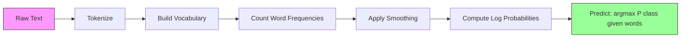

# Naive Bayes

> "나이브(naive)"하다는 가설은 틀렸지만, 그럼에도 잘 작동합니다. 바로 여기에 이 알고리즘의 묘미가 있습니다.

**유형:** Build (실습)
**Language:** Python
**선수 레슨:** Phase 2, Lessons 01-07 (classification, Bayes' theorem)
**소요 시간:** ~75분

## 학습 목표

- 텍스트 분류를 위한 라플라스 평활화(Laplace smoothing)가 적용된 다항 나이브 베이즈(Multinomial Naive Bayes)를 밑바닥부터 구현합니다.
- 나이브 독립성 가설이 수학적으로는 틀렸음에도 실제로는 올바른 클래스 순위를 산출하는 이유를 설명합니다.
- 다항, 베르누이(Bernoulli), 가우시안(Gaussian) 나이브 베이즈 변형들을 비교하고 주어진 피처 유형에 적합한 모델을 선택합니다.
- 고차원 희소(sparse) 데이터에서 나이브 베이즈를 로지스틱 회귀(logistic regression)와 비교 평가하고, 이때 작용하는 편향-분산 트레이드오프(bias-variance tradeoff)를 설명합니다.

## 문제 상황

텍스트를 분류해야 하는 상황을 가정해 보겠습니다. 이메일을 스팸 또는 정상 메일로 분류하거나, 고객 리뷰를 긍정 또는 부정으로 나누거나, 지원 티켓을 카테고리별로 분류해야 합니다. 피처는 단어당 하나씩 수천 개에 달하지만 학습 데이터는 제한적입니다.

대부분의 분류기는 이 지점에서 어려움을 겪습니다. 로지스틱 회귀는 수천 개의 가중치를 안정적으로 추정하기에 충분한 샘플이 필요합니다. 결정 트리(decision tree)는 한 번에 하나의 단어만을 기준으로 분할하므로 극심한 과적합(overfitting)이 발생합니다. 10,000차원에서의 KNN은 모든 점이 다른 모든 점과 동일하게 멀어지기 때문에 의미가 없습니다.

나이브 베이즈는 이 문제를 해결합니다. 클래스가 주어졌을 때 모든 피처가 다른 모든 피처와 독립이라는 수학적으로 틀린 가정을 도입하지만, 특히 학습 데이터 세트가 작을 때 텍스트 분류에서 "더 똑똑한" 모델들보다 뛰어난 성능을 보입니다. 데이터셋을 한 번 훑는 것(single pass)만으로 학습이 완료됩니다. 수백만 개의 피처로도 확장 가능합니다. 독립성 가정으로 인해 보정(calibration)이 잘 이루어지지 않는 경우가 많지만, 확률 추정치도 도출해 냅니다.

틀린 가정이 어떻게 좋은 예측으로 이어지는지 이해하면 머신러닝의 근본적인 원리를 배울 수 있습니다. 즉, 가장 좋은 모델이란 이론적으로 가장 올바른 모델이 아니라, 여러분의 데이터에 맞는 최적의 편향-분산 트레이드오프를 갖춘 모델이라는 점입니다.

## 핵심 개념

### 베이즈 정리(빠른 복습)

베이즈 정리(Bayes' theorem)는 조건부 확률의 조건을 뒤집습니다.

```math
P(\text{class} \mid \text{features}) = \frac{P(\text{features} \mid \text{class}) \cdot P(\text{class})}{P(\text{features})}
```

우리가 구하고자 하는 것은 `P(class | features)`입니다. 즉, 문서에 포함된 단어들이 주어졌을 때 해당 문서가 특정 클래스에 속할 확률입니다. 이는 다음 항목들로부터 계산할 수 있습니다.
- `P(features | class)` — 해당 클래스의 문서에서 이 단어들이 나타날 우도(likelihood)
- `P(class)` — 해당 클래스의 사전 확률(prior probability, 일반적인 스팸의 비율은 얼마인가?)
- `P(features)` — 증거(evidence), 모든 클래스에 대해 동일하므로 비교 시에는 무시할 수 있습니다.

`P(class | features)` 값이 가장 높은 클래스가 최종 선택됩니다.

### 나이브 독립성 가정

`P(features | class)`를 정확하게 계산하려면 모든 피처의 결합 확률(joint probability)을 함께 추정해야 합니다. 어휘집(vocabulary)에 10,000개의 단어가 있다면, 가능한 $2^{10{,}000}$가지 조합에 대한 분포를 추정해야 합니다. 이는 불가능합니다.

나이브 가정은 다음과 같습니다. 클래스가 주어지면 모든 피처는 조건부 독립(conditionally independent)입니다.

```math
P(w_1, w_2, \ldots, w_n \mid \text{class}) = P(w_1 \mid \text{class}) \cdot P(w_2 \mid \text{class}) \cdots P(w_n \mid \text{class})
```

추정 불가능한 하나의 결합 분포 대신, $n$개의 단순한 피처별 분포를 추정합니다. 각각은 빈도수를 세기만 하면 됩니다.

이 가정은 명백히 틀렸습니다. 어떤 문서에서도 "machine"과 "learning"이라는 단어는 독립적이지 않습니다. 하지만 분류기에는 정확한 확률 추정치가 필요하지 않습니다. 필요한 것은 올바른 순위(ranking), 즉 어느 클래스의 확률이 가장 높은가입니다. 독립성 가정은 체계적인 오류를 유발하지만, 이러한 오류는 모든 클래스에 유사하게 영향을 미치므로 순위는 올바르게 유지됩니다.

### 왜 여전히 잘 작동하는가

세 가지 이유가 있습니다.

1. **보정(calibration)보다 중요한 순위(ranking).** 분류에서는 가장 높은 순위의 클래스만 맞추면 됩니다. 실제 확률이 0.7일 때 $P(\text{spam}) = 0.99999$로 추정되더라도, 분류기는 여전히 스팸을 올바르게 선택합니다. 우리에게 필요한 것은 정확한 확률이 아닙니다. 정확한 승자입니다.

2. **높은 편향, 낮은 분산(High bias, low variance).** 독립성 가정은 강력한 사전 믿음(prior)입니다. 이는 모델을 강하게 제약하여 과적합을 방지합니다. 학습 데이터가 제한적일 때는 이론적으로 맞지만 극도로 불안정한 모델보다, 약간 틀리더라도 안정적인 모델이 더 낫습니다. 이것이 실제로 작동하는 편향-분산 트레이드오프입니다.

3. **피처 중복성의 상쇄 효과.** 상관관계가 있는 피처들은 중복된 증거를 제공합니다. 분류기는 이 증거를 이중으로 계산하지만, 올바른 클래스에 대해서도 똑같이 이중으로 계산합니다. "machine"과 "learning"이 항상 함께 나타난다면, 두 단어 모두 "tech" 클래스에 대한 증거를 제공합니다. 나이브 베이즈는 이를 두 번 세지만, 올바른 클래스에 대해 두 번 세는 것입니다.

네 번째 실용적인 이유는 나이브 베이즈가 매우 빠르다는 점입니다. 학습은 빈도를 세며 데이터를 한 번 훑는 단일 패스 과정입니다. 예측은 행렬 곱셈입니다. 수백만 개의 문서를 몇 초 만에 학습시킬 수 있습니다. 이러한 속도 덕분에 느린 모델에 비해 더 빠르게 반복하고, 더 많은 피처 세트를 시도하며, 더 많은 실험을 실행할 수 있습니다.

### 단계별 수학적 계산

구체적인 예시를 단계별로 살펴보겠습니다. 스팸(spam)과 정상 메일(not-spam)이라는 두 개의 클래스가 있다고 가정합니다. 어휘집에는 "free", "money", "meeting"이라는 세 단어가 있습니다.

학습 데이터:
- 스팸 이메일: "free" 80회, "money" 60회, "meeting" 10회 등장 (총 150단어)
- 정상 이메일: "free" 5회, "money" 10회, "meeting" 100회 등장 (총 115단어)
- 전체 이메일 중 40%는 스팸, 60%는 정상 메일

라플라스 평활화($\alpha=1$) 적용:

```math
\begin{aligned}
P(\text{free} \mid \text{spam}) &= (80 + 1) / (150 + 3) = 81/153 = 0.529 \\
P(\text{money} \mid \text{spam}) &= (60 + 1) / (150 + 3) = 61/153 = 0.399 \\
P(\text{meeting} \mid \text{spam}) &= (10 + 1) / (150 + 3) = 11/153 = 0.072 \\[6pt]
P(\text{free} \mid \text{not-spam}) &= (5 + 1) / (115 + 3) = 6/118 = 0.051 \\
P(\text{money} \mid \text{not-spam}) &= (10 + 1) / (115 + 3) = 11/118 = 0.093 \\
P(\text{meeting} \mid \text{not-spam}) &= (100 + 1) / (115 + 3) = 101/118 = 0.856
\end{aligned}
```

새로운 이메일의 단어 구성: "free" (2회), "money" (1회), "meeting" (0회).

```math
\begin{aligned}
\log P(\text{spam} \mid \text{email}) &= \log(0.4) + 2 \log(0.529) + 1 \log(0.399) + 0 \log(0.072) \\
&= -0.916 + 2(-0.637) + (-0.919) + 0 \\
&= -3.109 \\[6pt]
\log P(\text{not-spam} \mid \text{email}) &= \log(0.6) + 2 \log(0.051) + 1 \log(0.093) + 0 \log(0.856) \\
&= -0.511 + 2(-2.976) + (-2.375) + 0 \\
&= -8.838
\end{aligned}
```

스팸이 큰 차이로 승리합니다. "free"라는 단어가 두 번 나타난 것은 스팸에 대한 강력한 증거입니다. "meeting"이 나타나지 않은 것은 두 로그 합 모두에 0으로 기여한다는 점에 주목하십시오($0 \cdot \log P$). 다항 나이브 베이즈에서는 등장하지 않은 단어가 아무런 영향을 미치지 않습니다. 단어의 부재를 명시적으로 모델링하는 것은 베르누이 나이브 베이즈입니다.

### 세 가지 변형

나이브 베이즈에는 세 가지 종류가 있습니다. 각각은 `P(feature | class)`를 다르게 모델링합니다.

#### 다항 나이브 베이즈(Multinomial Naive Bayes)

각 피처를 빈도수(count)로 모델링합니다. 피처가 단어 빈도 또는 TF-IDF 값인 텍스트 데이터에 가장 적합합니다.

```math
P(\text{word}_i \mid \text{class}) = \frac{\text{count of } \text{word}_i \text{ in class} + \alpha}{\text{total words in class} + \alpha \cdot \text{vocab\_size}}
```

`alpha`는 라플라스 평활화입니다(아래에서 설명). 이 변형은 텍스트 분류에서 핵심적인 역할을 합니다.

#### 가우시안 나이브 베이즈(Gaussian Naive Bayes)

각 피처를 정규분포로 모델링합니다. 연속형 피처에 가장 적합합니다.

```math
P(x_i \mid \text{class}) = \frac{1}{\sqrt{2 \pi \cdot \text{var}}} \cdot \exp\left(-\frac{(x_i - \text{mean})^2}{2 \cdot \text{var}}\right)
```

각 클래스는 피처별로 고유한 평균과 분산을 갖습니다. 이는 피처가 각 클래스 내에서 실제로 종형 곡선(정규분포)을 따를 때 잘 작동합니다.

#### 베르누이 나이브 베이즈(Bernoulli Naive Bayes)

각 피처를 이진값(등장 여부, 0 또는 1)으로 모델링합니다. 짧은 텍스트나 이진 피처 벡터에 가장 적합합니다.

```math
P(\text{word}_i \mid \text{class}) = \frac{\text{docs in class containing } \text{word}_i + \alpha}{\text{total docs in class} + 2 \alpha}
```

다항 모델과 달리 베르누이 모델은 단어의 부재에 명시적으로 페널티를 부여합니다. "free"가 일반적으로 스팸에 등장하지만 이 이메일에는 없다면, 베르누이는 이를 스팸이 아니라는 증거로 간주합니다.

### 각 변형을 사용하는 시점

| 변형 | 피처 유형 | 적합한 용도 | 예시 |
|---------|-------------|----------|---------|
| 다항 (Multinomial) | 빈도수 또는 발생 횟수 | 텍스트 분류, 단어 가방(bag-of-words) | 이메일 스팸, 주제 분류 |
| 가우시안 (Gaussian) | 연속형 값 | 정규분포에 가까운 피처를 가진 정형 데이터 | 붓꽃(Iris) 분류, 센서 데이터 |
| 베르누이 (Bernoulli) | 이진값 (0/1) | 짧은 텍스트, 이진 피처 벡터 | SMS 스팸, 등장/부재 피처 |
### 라플라스 스무딩(Laplace Smoothing)

특정 클래스의 훈련 데이터에는 전혀 등장하지 않았던 단어가 테스트 데이터에 나타나면 어떻게 될까요?

스무딩이 없다면 `P(word | class) = 0/N = 0`이 됩니다. 하나의 0이 전체 곱에 곱해지면서 다른 모든 증거와 상관없이 `P(class | features) = 0`이 되어 버립니다. 다른 증거가 아무리 강력하게 뒷받침하더라도, 한 번도 보지 못한 단어 하나가 전체 예측을 망가뜨립니다.

라플라스 스무딩은 모든 특성 빈도에 작은 수치인 `alpha`(보통 1)을 더합니다.

```math
P(\text{word}_i \mid \text{class}) = \frac{\text{count}(\text{word}_i, \text{class}) + \alpha}{\text{total\_words\_in\_class} + \alpha \cdot \text{vocab\_size}}
```

$\alpha=1$를 적용하면 모든 단어가 최소한의 아주 작은 확률을 갖게 됩니다. 테스트 이메일에 "discombobulate"라는 단어가 나타나더라도 더 이상 스팸 확률을 0으로 만들지 않습니다. 이 스무딩은 베이즈 관점의 해석을 가집니다. 단어 분포에 균등 디리클레 사전분포(uniform Dirichlet prior)를 두는 것과 같습니다.

alpha가 클수록 스무딩이 강해지며(더 균등한 분포), alpha가 작을수록 모델이 데이터를 더 신뢰합니다. alpha는 사용자가 조정하는 하이퍼파라미터입니다.

alpha의 효과:

| Alpha | 효과 | 사용 시기 |
|-------|------|----------|
| 0.001 | 스무딩이 거의 없음, 데이터를 신뢰 | 훈련 세트가 매우 크고, 보지 못한 특성이 없을 것으로 예상될 때 |
| 0.1 | 약한 스무딩 | 훈련 세트가 클 때 |
| 1.0 | 표준 라플라스 스무딩 | 기본 시작점 |
| 10.0 | 강한 스무딩, 분포를 평탄화 | 훈련 세트가 매우 작고, 보지 못한 특성이 다수 예상될 때 |

### 로그 공간 계산(Log-Space Computation)

1보다 작은 수백 개의 확률을 곱하면 부동소수점 언더플로(floating-point underflow)가 발생합니다. 실제 값은 매우 작은 양수임에도 부동소수점 연산에서는 곱의 결과가 0이 됩니다.

해결책은 로그 공간에서 작업하는 것입니다. 확률을 곱하는 대신 로그를 취해 더합니다.

```math
\log P(\text{class} \mid x_1, x_2, \ldots, x_n) = \log P(\text{class}) + \sum_i \log P(x_i \mid \text{class})
```

이를 통해 예측 연산이 내적(dot product)으로 바뀝니다.

```
log_scores = X @ log_feature_probs.T + log_class_priors
prediction = argmax(log_scores)
```

행렬 곱셈입니다. 나이브 베이즈의 예측이 그토록 빠른 이유가 바로 여기에 있습니다. 단일 계층 선형 모델과 동일한 연산이기 때문입니다.

### 나이브 베이즈 vs 로지스틱 회귀(Logistic Regression)

둘 다 텍스트를 분류할 수 있는 선형 분류기입니다. 차이점은 모델링하는 대상에 있습니다.

| 측면 | 나이브 베이즈 | 로지스틱 회귀 |
|------|--------------|-------------|
| 유형 | 생성 모델($P(X \mid Y){}$을 모델링) | 판별 모델($P(Y \mid X){}$를 모델링) |
| 학습 | 빈도 계산 | 손실 함수 최적화 |
| 소규모 데이터 | 더 우수함(강한 사전분포가 도움됨) | 더 열세임(가중치 추정에 데이터 부족) |
| 대규모 데이터 | 더 열세임(잘못된 가정이 성능 저하 초래) | 더 우수함(유연한 결정 경계) |
| 특성 | 독립성을 가정함 | 상관관계를 다룰 수 있음 |
| 속도 | 1회 순회(single pass), 매우 빠름 | 반복적 최적화 |
| 캘리브레이션 | 확률 추정이 부정확함 | 확률 추정이 더 정확함 |

경험적 법칙: 나이브 베이즈로 시작하십시오. 데이터가 충분하고 나이브 베이즈의 성능이 정체되면 로지스틱 회귀로 전환하십시오.

### 분류 파이프라인



실제로는 부동소수점 언더플로를 방지하기 위해 로그 공간에서 연산합니다. 작은 확률을 여러 번 곱하는 대신 로그를 취해 더합니다.

```math
\log P(\text{class} \mid \text{features}) = \log P(\text{class}) + \sum_i \log P(\text{feature}_i \mid \text{class})
```

```figure
naive-bayes
```

## 직접 구현하기

`code/naive_bayes.py`의 코드는 MultinomialNB와 GaussianNB를 바닥부터(from scratch) 구현합니다.

### MultinomialNB

바닥부터 구현하는 과정:

1. **fit(X, y)**: 각 클래스에 대해 각 특성의 빈도를 계산합니다. 라플라스 스무딩을 더합니다. 로그 확률을 계산합니다. 클래스 사전확률(클래스 빈도의 로그값)을 저장합니다.

2. **predict_log_proba(X)**: 각 샘플에 대해 모든 클래스를 대상으로 $\log P(\text{class})$ + $\log P(\text{feature}_i \mid \text{class})$의 합을 계산합니다. 이는 행렬 곱셈 연산입니다: X @ log_probs.T + log_priors.

3. **predict(X)**: 가장 높은 로그 확률을 가진 클래스를 반환합니다.

```python
class MultinomialNB:
    def __init__(self, alpha=1.0):
        self.alpha = alpha

    def fit(self, X, y):
        classes = np.unique(y)
        n_classes = len(classes)
        n_features = X.shape[1]

        self.classes_ = classes
        self.class_log_prior_ = np.zeros(n_classes)
        self.feature_log_prob_ = np.zeros((n_classes, n_features))

        for i, c in enumerate(classes):
            X_c = X[y == c]
            self.class_log_prior_[i] = np.log(X_c.shape[0] / X.shape[0])
            counts = X_c.sum(axis=0) + self.alpha
            self.feature_log_prob_[i] = np.log(counts / counts.sum())

        return self
```

핵심 통찰: 학습이 끝나면 예측은 행렬 곱셈에 편향(bias)을 더하는 것에 불과합니다. 이것이 나이브 베이즈가 매우 빠른 이유입니다.

### GaussianNB

연속형 특성의 경우, 클래스별 특성별 평균과 분산을 추정합니다.

```python
class GaussianNB:
    def __init__(self):
        pass

    def fit(self, X, y):
        classes = np.unique(y)
        self.classes_ = classes
        self.means_ = np.zeros((len(classes), X.shape[1]))
        self.vars_ = np.zeros((len(classes), X.shape[1]))
        self.priors_ = np.zeros(len(classes))

        for i, c in enumerate(classes):
            X_c = X[y == c]
            self.means_[i] = X_c.mean(axis=0)
            self.vars_[i] = X_c.var(axis=0) + 1e-9
            self.priors_[i] = X_c.shape[0] / X.shape[0]

        return self
```

예측에는 특성별 가우시안 확률 밀도 함수(Gaussian PDF)를 사용하며, 특성 전체에 걸쳐 곱합니다(로그 공간에서는 합산).

### 데모: 텍스트 분류

이 코드는 두 개의 클래스(기술 기사 대 스포츠 기사)를 시뮬레이션하는 합성 BoW(bag-of-words) 데이터를 생성합니다. 각 클래스는 서로 다른 단어 빈도 분포를 갖습니다. MultinomialNB는 단어 수를 사용하여 이를 분류합니다.

합성 데이터는 다음과 같이 작동합니다. 200개의 "단어"(특성 열)를 생성합니다. 0~39번 단어는 기술 기사에서 빈도가 높고 스포츠에서는 낮습니다. 80~119번 단어는 스포츠에서 빈도가 높고 기술에서는 낮습니다. 40~79번 단어는 양쪽 모두에서 중간 정도의 빈도를 갖습니다. 이를 통해 일부 단어는 강력한 클래스 지표가 되고 다른 단어는 노이즈가 되는 현실적인 시나리오가 만들어집니다.

### 데모: 연속형 특성

이 코드는 Iris와 유사한 데이터(3개 클래스, 4개 특성, 가우시안 군집)를 생성합니다. GaussianNB는 클래스별 평균과 분산을 사용하여 분류합니다. 각 클래스는 서로 다른 중심(평균 벡터)과 퍼짐 정도(분산)를 가지며, 범주 간에 측정값이 체계적으로 다른 실제 데이터를 모방합니다.

이 코드는 다음 내용도 함께 시연합니다.
- **스무딩 비교:** 다양한 alpha 값으로 MultinomialNB를 학습시켜 스무딩 강도가 정확도에 미치는 영향을 확인합니다.
- **훈련 세트 크기 실험:** 훈련 데이터가 20개에서 1600개 샘플로 증가함에 따라 나이브 베이즈의 정확도가 어떻게 향상되는지 살펴봅니다. 나이브 베이즈는 매우 적은 수의 샘플로도 상당한 수준의 정확도에 도달하며, 이것이 핵심 장점입니다.
- **혼동 행렬(Confusion matrix):** 클래스별 정밀도(precision), 재현율(recall), F1 점수를 통해 나이브 베이즈가 어디에서 실수를 범하는지 보여줍니다.

### 예측 속도

나이브 베이즈의 예측은 행렬 곱셈입니다. $d$개의 특성과 $k$개의 클래스를 가진 $n$개의 샘플에 대해:
- MultinomialNB: 한 번의 행렬 곱셈 $(n \times d) \mathbin{@} (d \times k) = O(n \cdot d \cdot k)$
- GaussianNB: $n \cdot k$번의 가우시안 PDF 계산, 각각 $d$개의 특성에 대해 수행 = $O(n \cdot d \cdot k)$

두 방식 모두 모든 차원에 대해 선형적입니다. 이를 KNN(모든 훈련 지점까지의 거리 계산 필요)이나 RBF 커널을 사용하는 SVM(모든 서포트 벡터에 대한 커널 평가 필요)과 비교해 보십시오. 나이브 베이즈는 추론(inference) 시점의 속도가 수치상 비교할 수 없을 만큼 빠릅니다.

## 사용해 보기

sklearn을 사용하면 두 변형 모두 한 줄로 구현할 수 있습니다.

```python
from sklearn.naive_bayes import GaussianNB, MultinomialNB

gnb = GaussianNB()
gnb.fit(X_train, y_train)
print(f"GaussianNB accuracy: {gnb.score(X_test, y_test):.3f}")

mnb = MultinomialNB(alpha=1.0)
mnb.fit(X_train_counts, y_train)
print(f"MultinomialNB accuracy: {mnb.score(X_test_counts, y_test):.3f}")
```

sklearn을 활용한 텍스트 분류:

```python
from sklearn.feature_extraction.text import CountVectorizer
from sklearn.naive_bayes import MultinomialNB
from sklearn.pipeline import Pipeline

text_clf = Pipeline([
    ("vectorizer", CountVectorizer()),
    ("classifier", MultinomialNB(alpha=1.0)),
])

text_clf.fit(train_texts, train_labels)
accuracy = text_clf.score(test_texts, test_labels)
```

`naive_bayes.py`의 코드는 동일한 데이터에서 바닥부터 구현한 모델과 sklearn을 비교하여 정확성을 검증합니다.

### TF-IDF와 나이브 베이즈

단순 단어 빈도는 모든 단어에 발생 횟수당 동일한 가중치를 부여합니다. 그러나 "the"나 "is" 같은 흔한 단어는 모든 클래스에 자주 등장하므로 아무런 정보를 담지 못합니다. TF-IDF(Term Frequency - Inverse Document Frequency)는 흔한 단어의 가중치를 낮추고, 희귀하면서 변별력 있는 단어의 가중치를 높입니다.

```python
from sklearn.feature_extraction.text import TfidfVectorizer
from sklearn.naive_bayes import MultinomialNB
from sklearn.pipeline import Pipeline

text_clf = Pipeline([
    ("tfidf", TfidfVectorizer()),
    ("classifier", MultinomialNB(alpha=0.1)),
])
```

TF-IDF 값은 음수가 아니므로 MultinomialNB에 적용할 수 있습니다. TF-IDF + MultinomialNB 조합은 텍스트 분류에서 가장 강력한 베이스라인 중 하나입니다. 훈련 샘플이 10,000개 미만인 데이터셋에서는 더 복잡한 모델을 능가하는 경우가 빈번합니다.

### 짧은 텍스트를 위한 BernoulliNB

짧은 텍스트(트윗, SMS, 채팅 메시지)의 경우 BernoulliNB가 MultinomialNB보다 더 우수한 성능을 낼 수 있습니다. 짧은 텍스트는 단어 수가 적기 때문에 MultinomialNB가 의존하는 빈도 정보에 노이즈가 많습니다. BernoulliNB는 단어의 존재 유무(출현 여부)만 고려하므로 짧은 텍스트에서 더 신뢰할 수 있습니다.

```python
from sklearn.naive_bayes import BernoulliNB
from sklearn.feature_extraction.text import CountVectorizer

text_clf = Pipeline([
    ("vectorizer", CountVectorizer(binary=True)),
    ("classifier", BernoulliNB(alpha=1.0)),
])
```

CountVectorizer의 `binary=True` 플래그는 모든 빈도를 0 또는 1로 변환합니다. 이 플래그가 없어도 BernoulliNB는 여전히 동작하지만, 설계 목적과 맞지 않는 빈도수를 다루게 됩니다.
### NB 확률 캘리브레이션

NB 확률은 캘리브레이션(calibration)이 잘 되어 있지 않습니다. NB가 $P(\text{spam}) = 0.95$라고 예측하더라도 실제 확률은 0.7일 수 있습니다. 신뢰할 수 있는 확률 추정치가 필요한 경우(예: 임계값 설정이나 다른 모델과의 결합), sklearn의 CalibratedClassifierCV를 사용하세요.

```python
from sklearn.calibration import CalibratedClassifierCV

calibrated_nb = CalibratedClassifierCV(MultinomialNB(), cv=5, method="sigmoid")
calibrated_nb.fit(X_train, y_train)
proba = calibrated_nb.predict_proba(X_test)
```

이는 교차 검증을 사용하여 NB의 원시 점수 위에 로지스틱 회귀(logistic regression)를 적합합니다. 그 결과로 얻어지는 확률은 실제 클래스 빈도에 훨씬 더 가깝습니다.

### 흔히 발생하는 문제

1. **음수 특성값.** MultinomialNB는 음수가 아닌 특성을 요구합니다. 음수 값(특정 설정의 TF-IDF 또는 표준화된 특성 등)이 있는 경우 GaussianNB를 사용하거나 특성을 양수로 이동시켜야 합니다.

2. **분산이 0인 특성.** GaussianNB는 분산으로 나눕니다. 특정 클래스에 대해 특성의 분산이 0이면(모든 값이 동일함) 확률 계산이 실패합니다. 코드에서는 이를 방지하기 위해 모든 분산에 작은 스무딩 항(1e-9)을 추가합니다.

3. **클래스 불균형.** 이메일의 99%가 스팸이 아니라면 사전 확률(prior) $P(\text{not-spam}) = 0.99$이 너무 강해서 우도(likelihood) 증거를 압도합니다. 클래스 사전 확률을 수동으로 설정하거나 sklearn의 class_prior 매개변수를 사용할 수 있습니다.

4. **특성 스케일링.** MultinomialNB는 스케일링이 필요하지 않습니다(카운트를 기반으로 작동). GaussianNB 역시 스케일링이 필요하지 않습니다(특성별 통계량을 추정). 이는 특성 스케일에 민감한 로지스틱 회귀나 SVM에 비해 장점입니다.

## 배포하기

이 레슨에서 생성하는 산출물은 다음과 같습니다.
- `outputs/skill-naive-bayes-chooser.md` -- 적절한 NB 변형을 선택하기 위한 결정 스킬
- `code/naive_bayes.py` -- 밑바닥부터 구현한 MultinomialNB 및 GaussianNB, sklearn과의 비교 포함

### 나이브 베이즈가 실패하는 경우

NB는 독립성 가정이 (단순히 잘못된 확률뿐만 아니라) 잘못된 순위 매기기를 초래할 때 실패합니다. 이는 다음과 같은 경우에 발생합니다.

1. **강한 특성 상호작용.** 클래스가 두 특성의 조합에 의존하지만 개별 특성에는 의존하지 않는 경우(XOR 유사 패턴), NB는 이를 완전히 놓칩니다. 각 특성만으로는 아무런 증거를 제공하지 못하며, NB는 특성들을 비선형적으로 결합할 수 없습니다.

2. **상반된 증거를 지닌 강한 상관관계의 특성들.** 특성 A는 "스팸"을 가리키고 특성 B는 "스팸 아님"을 가리키지만, A와 B가 완벽하게 상관되어 있다면(실제로는 항상 일치함), NB는 실제로는 존재하지 않는 상충되는 증거를 보게 됩니다.

3. **매우 큰 훈련 세트.** 데이터가 충분히 많으면 로지스틱 회귀와 같은 판별 모델(discriminative model)이 실제 결정 경계를 학습하여 NB를 능가합니다. 적은 데이터에서 도움이 되었던 독립성 가정이 이제는 모델의 성능을 제한하게 됩니다.

실무에서 텍스트 분류의 경우 이러한 실패 모드는 드뭅니다. 텍스트 특성은 수가 많고 개별적으로는 약하며, 독립성 가정의 오류는 서로 상쇄되는 경향이 있습니다. 상관관계가 강한 특성이 적은 정형 데이터의 경우 로지스틱 회귀나 트리 기반 모델을 먼저 고려하세요.

## 연습 문제

1. **스무딩 실험.** alpha 값을 0.01, 0.1, 1.0, 10.0, 100.0으로 설정하여 텍스트 데이터에 MultinomialNB를 훈련합니다. alpha에 따른 정확도를 시각화하세요. 성능이 최고조에 달하는 지점은 어디인가요? 매우 높은 alpha가 성능을 저하시키는 이유는 무엇인가요?

2. **특성 독립성 검정.** 실제 텍스트 데이터셋을 선택합니다. 명백히 상관관계가 있는 두 단어("machine"과 "learning")를 고릅니다. $P(\text{word}_1 \mid \text{class}) \cdot P(\text{word}_2 \mid \text{class})$를 계산하고 $P(\text{word}_1 \text{ AND } \text{word}_2 \mid \text{class})$와 비교하세요. 독립성 가정은 얼마나 틀렸나요? 이것이 분류 정확도에 영향을 미치나요?

3. **베르누이 구현.** BernoulliNB 클래스를 추가하여 코드를 확장합니다. Bag-of-words를 이진형(존재/부재)으로 변환하고 텍스트 데이터에서 MultinomialNB와 정확도를 비교하세요. 베르누이가 더 우수한 경우는 언제인가요?

4. **NB 대 로지스틱 회귀.** 텍스트 데이터에서 두 모델을 모두 훈련합니다. 훈련 샘플을 100개에서 시작하여 10,000개까지 늘려봅니다. 두 모델의 훈련 세트 크기에 따른 정확도를 시각화하세요. 로지스틱 회귀가 나이브 베이즈를 앞서는 시점은 언제인가요?

5. **스팸 필터.** 완전한 스팸 분류기를 구축합니다. 원시 이메일 텍스트를 토큰화하고, 어휘 사전을 구축하고, bag-of-words 특성을 생성하고, MultinomialNB를 훈련하고, 정밀도(precision)와 재현율(recall)로 평가합니다(단순히 정확도만 사용하지 않는 이유는 무엇인가요?).

## 핵심 용어

| 용어 | 일반적인 설명 | 실제 의미 |
|------|----------------|----------------------|
| 나이브 베이즈(Naive Bayes) | "간단한 확률적 분류기" | 클래스가 주어졌을 때 특성들이 조건부 독립이라는 가정하에 베이즈 정리를 적용하는 분류기 |
| 조건부 독립(Conditional independence) | "특성들이 서로 영향을 주지 않음" | $P(A, B \mid C) = P(A \mid C) \cdot P(B \mid C)$ -- $C$를 알고 나면 $B$를 아는 것이 $A$에 대해 새로운 정보를 주지 않음 |
| 라플라스 스무딩(Laplace smoothing) | "1을 더하는 스무딩" | 0의 확률이 예측을 지배하는 것을 방지하기 위해 모든 특성에 작은 카운트를 더하는 기법 |
| 사전 확률(Prior) | "데이터를 보기 전에 믿었던 것" | $P(\text{class})$ -- 어떤 특성도 관찰하기 전 각 클래스의 확률 |
| 우도(Likelihood) | "데이터가 얼마나 잘 부합하는지" | $P(\text{features} \mid \text{class})$ -- 클래스를 알 때 이러한 특성들이 관찰될 확률 |
| 사후 확률(Posterior) | "데이터를 본 후 믿게 된 것" | $P(\text{class} \mid \text{features})$ -- 특성을 관찰한 후 갱신된 클래스의 확률 |
| 생성 모델(Generative model) | "데이터가 어떻게 생성되는지 모델링함" | $P(X \mid Y)$ 및 $P(Y)$를 학습한 다음 베이즈 정리를 사용하여 $P(Y \mid X)$를 구하는 모델 |
| 판별 모델(Discriminative model) | "결정 경계를 모델링함" | $X$가 어떻게 생성되는지 모델링하지 않고 $P(Y \mid X)$를 직접 학습하는 모델 |
| 로그 확률(Log probability) | "언더플로 방지" | 부동소수점에서 많은 작은 수의 곱이 0이 되는 것을 방지하기 위해 $P$ 대신 $\log P$로 작업하는 것 |

## 추가 자료

- [scikit-learn Naive Bayes 문서](https://scikit-learn.org/stable/modules/naive_bayes.html) -- 수학적 세부사항을 포함한 세 가지 변형 전체
- [McCallum and Nigam, A Comparison of Event Models for Naive Bayes Text Classification (1998)](https://www.cs.cmu.edu/~knigam/papers/multinomial-aaaiws98.pdf) -- 텍스트 분류에서 다항(Multinomial) 대 베르누이(Bernoulli)의 고전적인 비교
- [Rennie et al., Tackling the Poor Assumptions of Naive Bayes Text Classifiers (2003)](https://people.csail.mit.edu/jrennie/papers/icml03-nb.pdf) -- 텍스트 분류를 위한 NB 개선 방안
- [Ng and Jordan, On Discriminative vs. Generative Classifiers (2001)](https://ai.stanford.edu/~ang/papers/nips01-discriminativegenerative.pdf) -- 더 적은 데이터에서 NB가 LR보다 빠르게 수렴함을 증명한 논문
