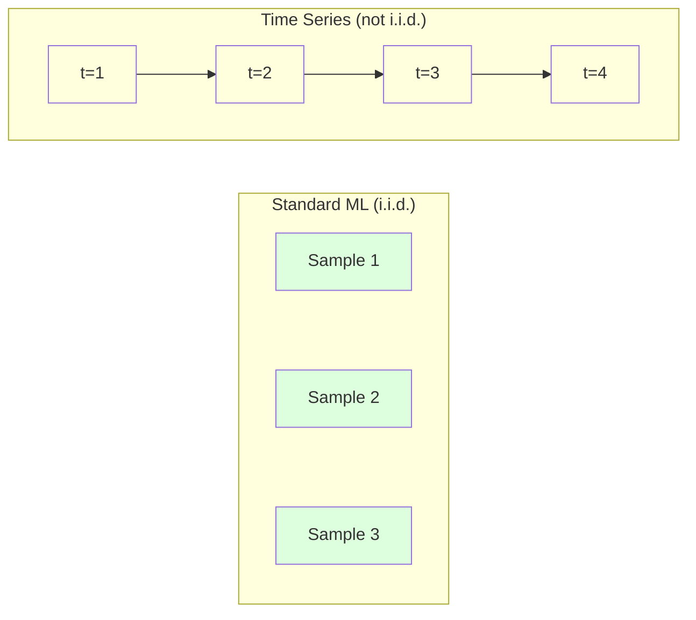
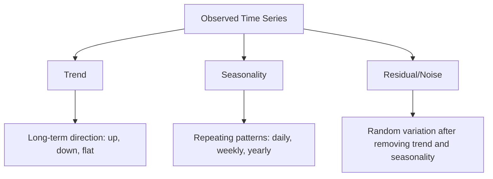
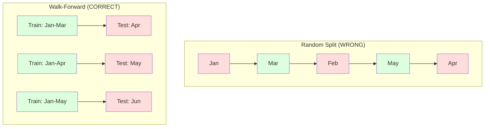

# 시계열 기초 (Time Series Fundamentals)

> 과거의 성과는 미래의 결과를 예측할 수 있습니다 -- 단, 먼저 정상성(stationarity)을 확인했을 때만 가능합니다.

**유형:** Build (실습)
**Language:** Python
**선수 레슨:** Phase 2, Lessons 01-09
**소요 시간:** ~90분

## 학습 목표 (Learning Objectives)

- 시계열을 추세(trend), 계절성(seasonality), 잔차(residual) 성분으로 분해하고 정상성을 검정합니다.
- 시차 특성(lag feature)과 이동 통계량(rolling statistics)을 구현하여 시계열을 지도 학습 문제로 변환합니다.
- 미래 데이터가 학습으로 유출되는 것을 방지하는 전진 검증(walk-forward validation) 프레임워크를 구축합니다.
- 시계열에서 무작위 훈련/테스트 분할이 유효하지 않은 이유를 설명하고, 적절한 시간 기반 분할과의 성능 격차를 입증합니다.

## 문제 (The Problem)

시간 순서대로 정렬된 데이터가 있습니다. 일별 매출, 시간별 기온, 분당 CPU 사용량, 주간 주가 등입니다. 여러분은 다음 값, 다음 주, 다음 분기를 예측하고자 합니다.

표준적인 ML 툴킷을 꺼내 듭니다. 무작위 훈련/테스트 분할, 교차 검증, 특성 행렬 입력, 예측값 출력. 하지만 이 모든 단계가 잘못되었습니다.

시계열은 표준 ML이 전제하는 가정들을 깨뜨립니다. 표본들이 독립적이지 않습니다 -- 오늘의 기온은 어제의 기온에 영향을 받습니다. 무작위 분할은 미래의 정보를 과거로 유출시킵니다. 백테스트에서 훌륭해 보이던 특성들도 시간이 지남에 따라 변하는 패턴에 의존하기 때문에 프로덕션 환경에서는 실패합니다.

무작위 교차 검증으로 95%의 정확도를 얻은 모델이 적절한 시간 기반 평가에서는 55%를 기록할 수도 있습니다. 이 차이는 사소한 문제가 아닙니다. 서류상으로만 작동하는 모델과 프로덕션 환경에서 실제로 작동하는 모델 사이의 차이입니다.

이 레슨에서는 시간 데이터가 일반 데이터와 다른 점, 모델을 정직하게 평가하는 방법, 그리고 시계열을 표준 ML 모델이 활용할 수 있는 특성으로 변환하는 방법과 같은 기본 개념을 다룹니다.

## 개념 (The Concept)

### 시계열이 일반 데이터와 다른 점

표준 ML은 i.i.d.(독립 항등 분포, independent and identically distributed)를 가정합니다. 즉, 각 표본은 다른 표본과 독립적으로 동일한 분포에서 추출된다고 봅니다. 시계열은 이 두 가지를 모두 위반합니다:

- **독립적이지 않음(Not independent).** 오늘의 주가는 어제의 주가에 영향을 받습니다. 이번 주의 매출은 지난주의 매출과 상관관계가 있습니다.
- **동일한 분포가 아님(Not identically distributed).** 분포가 시간에 따라 변화합니다. 12월의 매출은 3월의 매출과 다른 양상을 보입니다.

이러한 위반은 가벼운 문제가 아닙니다. 특성을 구축하는 방식, 모델을 평가하는 방식, 작동하는 알고리즘 자체를 완전히 바꾸어 놓습니다.



표준 ML에서는 표본들이 상호 교환 가능합니다. 표본을 섞어도 아무것도 변하지 않습니다. 하지만 시계열에서는 순서가 전부입니다. 순서를 섞으면 신호가 파괴됩니다.

### 시계열의 구성 요소

모든 시계열은 다음 요소들의 조합입니다:



- **추세(Trend)**: 장기적인 방향성입니다. 연간 10%씩 성장하는 매출, 상승하는 지구 기온 등이 해당합니다.
- **계절성(Seasonality)**: 일정한 주기로 반복되는 패턴입니다. 12월에 급증하는 소매 매출, 7월에 정점을 찍는 에어컨 사용량 등이 해당합니다.
- **잔차(Residual)**: 추세와 계절성을 제거한 후 남은 나머지입니다. 잔차가 백색 잡음(white noise)처럼 보인다면, 분해 과정에서 신호를 제대로 포착한 것입니다.

### 정상성 (Stationarity)

시계열의 통계적 특성(평균, 분산, 자기상관)이 시간에 따라 변하지 않을 때 이를 정상(stationary) 시계열이라고 합니다. 대부분의 예측 기법은 정상성을 가정합니다.

**중요한 이유:** 비정상(non-stationary) 시계열은 평균이 표류(drift)합니다. 1월 데이터로 학습된 모델은 2월에 나타날 데이터와 다른 평균을 학습하게 됩니다. 따라서 체계적인 오차가 발생합니다.

**확인 방법:** 윈도우에 걸쳐 이동 평균(rolling mean)과 이동 표준편차(rolling standard deviation)를 계산합니다. 이 값들이 표류한다면 해당 시계열은 비정상 시계열입니다.

**해결 방법:** 차분(Differencing). 원본 값을 모델링하는 대신 연속된 값 사이의 변화량을 모델링합니다:

```math
\text{diff}[t] = \text{value}[t] - \text{value}[t-1]
```

한 번의 차분으로 시계열이 정상성을 띠지 않는다면, 한 번 더 적용합니다(2차 차분). 대부분의 실제 시계열은 최대 두 번의 차분으로 충분합니다.

**예시:**

원본 시계열: [100, 102, 106, 112, 120]
1차 차분:  [2, 4, 6, 8] (여전히 상승 추세)
2차 차분:  [2, 2, 2] (일정함 -- 정상성 만족)

원본 시계열은 2차 함수 형태의 추세를 보였습니다. 1차 차분을 통해 선형 추세로 바뀌었습니다. 2차 차분을 통해 평평해졌습니다. 실제로는 두 번 이상의 차분이 필요한 경우가 거의 없습니다.

**공식 검정:** 확장 딕키-풀러(Augmented Dickey-Fuller, ADF) 검정은 정상성을 확인하는 표준 통계적 검정입니다. 귀무가설은 "시계열이 비정상이다"입니다. p-값이 0.05 미만이면 귀무가설을 기각하고 정상 시계열이라는 결론을 내릴 수 있습니다. 본 과정에서는 ADF를 밑바닥부터 직접 구현하지는 않지만(점근 분포 표가 필요함), 코드에 포함된 이동 통계량 접근법을 통해 실용적인 시각적 확인이 가능합니다.

### 자기상관 (Autocorrelation)

자기상관은 $t$ 시점의 값이 $t-k$ 시점($k$단계 과거)의 값과 얼마나 상관되어 있는지를 측정합니다. 자기상관 함수(Autocorrelation Function, ACF)는 각 시차(lag) $k$에 대한 이 상관관계를 도표로 나타냅니다.

**ACF가 알려주는 것:**
- 시계열이 과거를 얼마나 오래 기억하는지. 시차 5 이후 ACF가 0으로 떨어진다면, 5단계 이전의 값은 무의미합니다.
- 계절성이 존재하는지 여부. 월별 데이터에서 시차 12에 ACF가 급증한다면, 연간 계절성이 존재합니다.
- 생성해야 할 시차 특성의 수. ACF가 무시할 수 있는 수준이 되는 지점까지의 시차를 사용합니다.

**PACF (편자기상관 함수, Partial Autocorrelation Function)** 는 간접적인 상관관계를 제거합니다. 오늘과 3일 전의 상관관계가 오직 둘 다 어제와 상관관계가 있기 때문이라면, 시차 3에서의 PACF는 0이 되는 반면 시차 3에서의 ACF는 0이 되지 않습니다.

### 시차 특성: 시계열을 지도 학습으로 변환하기

표준 ML 모델에는 특성 행렬 X와 타깃 y가 필요합니다. 시계열은 단일 열로 이루어진 값들을 제공합니다. 이 둘을 연결해 주는 다리가 바로 시차 특성(lag feature)입니다.

시계열 [10, 12, 14, 13, 15]를 예로 들어 시차 1과 시차 2 특성을 만들어 보겠습니다:

| lag_2 | lag_1 | target |
|-------|-------|--------|
| 10    | 12    | 14     |
| 12    | 14    | 13     |
| 14    | 13    | 15     |

이제 표준적인 회귀 문제가 되었습니다. 어떤 ML 모델(선형 회귀, 랜덤 포레스트, 그래디언트 부스팅)이든 시차 특성을 바탕으로 타깃을 예측할 수 있습니다.

추가로 엔지니어링할 수 있는 특성들:
- **이동 통계량(Rolling statistics):** 최근 k개 값에 대한 평균, 표준편차, 최솟값, 최댓값
- **캘린더 특성(Calendar features):** 요일, 월, 공휴일 여부(is_holiday), 주말 여부(is_weekend)
- **차분 값(Differenced values):** 이전 단계로부터의 변화량
- **누적 통계량(Expanding statistics):** 누적 평균, 누적 합계
- **비율 특성(Ratio features):** 현재 값 / 이동 평균 (최근 평균에서 얼마나 벗어났는지)
- **상호작용 특성(Interaction features):** lag_1 * day_of_week (모멘텀에 미치는 요일 효과)

**시차는 몇 개나 사용해야 할까요?** 자기상관 함수를 활용하세요. 시차 10까지 ACF가 유의미하다면 최소 10개의 시차를 사용합니다. 주간 계절성이 있다면 시차 7(그리고 필요시 14)을 포함합니다. 시차가 많을수록 모델에 더 많은 과거 정보를 제공하지만 맞추어야 할 특성도 늘어나 과적합(overfitting)의 위험이 커집니다.

**타깃 정렬의 함정(The target alignment trap).** 시차 특성을 생성할 때, 타깃은 반드시 $t$ 시점의 값이어야 하며, 모든 특성은 $t-1$ 시점 또는 그 이전의 값만을 사용해야 합니다. 실수로 $t$ 시점의 값을 특성으로 포함하면 완벽한 예측 성능을 내지만 실제로는 완전히 쓸모없는 모델이 됩니다. 이것이 시계열 특성 엔지니어링에서 가장 흔하게 발생하는 버그입니다.
### 전진 검증(Walk-Forward Validation)

이것은 이번 단원에서 가장 중요한 개념입니다. 표준 k-겹 교차 검증(k-fold cross-validation)은 샘플을 훈련 및 테스트 세트로 무작위 배정합니다. 시계열 데이터의 경우, 이 방식은 미래 정보를 유출합니다.



전진 검증(Walk-forward validation):
1. 시점 $t$까지의 데이터로 훈련합니다.
2. 시점 $t+1$에서 예측합니다(또는 다단계 예측의 경우 $t+1$부터 $t+k$까지).
3. 윈도우를 앞으로 슬라이드합니다.
4. 반복합니다.

각 테스트 폴드에는 모든 훈련 데이터 이후에 나타나는 데이터만 포함됩니다. 미래 유출이 발생하지 않습니다. 이를 통해 모델이 배포되었을 때 어떻게 동작할지 정직하게 평가할 수 있습니다.

**확장 윈도우(Expanding window)**는 훈련에 모든 과거 데이터를 사용합니다(윈도우가 커짐). **슬라이딩 윈도우(Sliding window)**는 고정된 크기의 훈련 윈도우를 사용합니다(윈도우가 이동함). 오래된 데이터가 여전히 유효하다고 믿을 때는 확장 방식을 사용하십시오. 환경이 변화하여 오래된 데이터가 성능을 해칠 때는 슬라이딩 방식을 사용하십시오.

### ARIMA의 직관적 이해

ARIMA는 고전적인 시계열 모델입니다. 세 가지 구성 요소로 이루어져 있습니다.

- **AR (자기회귀, Autoregressive):** 과거 값으로부터 예측합니다. AR(p)는 최근 $p$개의 값을 사용합니다.
- **I (누적, Integrated):** 정상성(stationarity)을 확보하기 위한 차분입니다. I(d)는 $d$회의 차분을 적용합니다.
- **MA (이동평균, Moving Average):** 과거 예측 오차로부터 예측합니다. MA(q)는 최근 $q$개의 오차를 사용합니다.

ARIMA(p, d, q)는 이 세 가지를 결합합니다. ACF/PACF 분석이나 자동 탐색(auto-ARIMA)을 기반으로 $p$, $d$, $q$를 선택합니다.

이번 단원에서는 ARIMA를 바닥부터 직접 구현하지는 않습니다. 본 단원의 범위를 벗어나는 수치 최적화가 필요하기 때문입니다. 핵심은 각 구성 요소가 어떤 역할을 하는지 이해하여 ARIMA 결과를 해석하고 언제 사용해야 하는지 아는 것입니다.

### 상황별 기법 선택

| 접근법 | 적합한 사용처 | 계절성 처리 | 외부 특성(External Features) 처리 |
|----------|---------|-------------------|------------------------|
| 지연 특성(Lag features) + ML | 외부 특성이 많은 정형 데이터 | 캘린더 특성 활용 | 지원 |
| ARIMA | 단일 단변량 시계열, 단기 예측 | SARIMA 변형 모델 | 미지원 (ARIMAX로 제한적 지원) |
| 지수 평활법(Exponential smoothing) | 단순 추세 + 계절성 | 지원 (Holt-Winters) | 미지원 |
| Prophet | 비즈니스 예측, 공휴일 | 지원 (푸리에 항) | 제한적 지원 |
| 신경망 (LSTM, Transformer) | 긴 시퀀스, 다수의 시계열 | 학습을 통해 처리 | 지원 |

대부분의 실무 문제에서는 지연 특성 + 그래디언트 부스팅(gradient boosting)이 가장 강력한 출발점입니다. 외부 특성을 자연스럽게 다루고, 정상성을 요구하지 않으며, 디버깅하기 쉽습니다.

### 예측 기간(Horizons) 및 전략

단일 단계 예측(Single-step forecasting)은 한 시점 앞을 예측합니다. 다단계 예측(Multi-step forecasting)은 여러 시점 앞을 예측합니다. 세 가지 전략이 있습니다.

**재귀적(Recursive, 반복적) 전략:** 한 시점 앞을 예측하고, 그 예측값을 다음 시점의 입력으로 사용합니다. 단순하지만 오차가 누적됩니다. 각 예측이 이전 예측값을 사용하므로 실수가 중첩됩니다.

**직접(Direct) 전략:** 각 예측 기간마다 별도의 모델을 훈련합니다. 모델-1은 $t+1$를 예측하고, 모델-5는 $t+5$를 예측합니다. 오차 누적은 없지만 각 모델의 훈련 샘플 수가 적어지고 서로 정보를 공유하지 못합니다.

**다중 출력(Multi-output) 전략:** 모든 예측 기간을 동시에 출력하는 단일 모델을 훈련합니다. 예측 기간 간에 정보를 공유하지만 다중 출력을 지원하는 모델(또는 사용자 정의 손실 함수)이 필요합니다.

대부분의 실무 문제에서는 짧은 예측 기간(1~5단계)에는 재귀적 방식을, 더 긴 예측 기간에는 직접 방식을 사용하는 것으로 시작하십시오.

### 시계열 분석에서 자주 하는 실수

| 실수 | 발생하는 이유 | 해결 방법 |
|---------|---------------|-----------|
| 무작위 훈련/테스트 분할 | 표준 ML 방식의 관성 | 전진 검증 또는 시간 순서 기반 분할 사용 |
| 미래 특성 사용 | 실수로 시점 $t$의 특성이 포함됨 | 모든 특성의 시간적 정합성을 전수 점검 |
| 계절성에 대한 과적합 | 모델이 캘린더 패턴을 암기함 | 테스트 세트에 전체 계절 주기 하나를 온전히 분리 보관 |
| 스케일 변화 무시 | 매출은 두 배가 되었으나 패턴은 유지됨 | 절대값 대신 변동률(백분율 변화)을 모델링 |
| 과도한 지연 특성 | "과거 데이터가 많을수록 좋다"는 착각 | ACF를 사용하여 유의미한 지연 시점 파악 |
| 차분을 적용하지 않음 | "모델이 알아서 파악할 것"이라는 기대 | 트리 모델은 추세를 다룰 수 있으나, 선형 모델은 정상성이 필요함 |

```figure
f3-series-decompose
```

## 직접 구현하기

`code/time_series.py`의 코드는 핵심 구성 요소를 바닥부터 구현합니다.

### 지연 특성 생성기

```python
def make_lag_features(series, n_lags):
    n = len(series)
    X = np.full((n, n_lags), np.nan)
    for lag in range(1, n_lags + 1):
        X[lag:, lag - 1] = series[:-lag]
    valid = ~np.isnan(X).any(axis=1)
    return X[valid], series[valid]
```

이 함수는 1차원 시계열을 특성 행렬로 변환합니다. 각 행은 최근 `n_lags`개의 값을 특성으로 취하고 현재 값을 타깃으로 취합니다.

### 전진 교차 검증

```python
def walk_forward_split(n_samples, n_splits=5, min_train=50):
    assert min_train < n_samples, "min_train must be less than n_samples"
    step = max(1, (n_samples - min_train) // n_splits)
    for i in range(n_splits):
        train_end = min_train + i * step
        test_end = min(train_end + step, n_samples)
        if train_end >= n_samples:
            break
        yield slice(0, train_end), slice(train_end, test_end)
```

각 분할은 훈련 데이터가 반드시 테스트 데이터보다 앞서도록 보장합니다. 훈련 윈도우는 각 폴드마다 확장됩니다.

### 단순 자기회귀 모델

순수한 AR 모델은 지연 특성에 대한 선형 회귀일 뿐입니다.

```python
class SimpleAR:
    def __init__(self, n_lags=5):
        self.n_lags = n_lags
        self.weights = None
        self.bias = None

    def fit(self, series):
        X, y = make_lag_features(series, self.n_lags)
        # Solve via normal equations
        X_b = np.column_stack([np.ones(len(X)), X])
        theta = np.linalg.lstsq(X_b, y, rcond=None)[0]
        self.bias = theta[0]
        self.weights = theta[1:]
        return self
```

이는 개념적으로 단원 02의 선형 회귀와 동일하지만, 동일한 변수의 시간 지연 버전에 적용된 것입니다.

### 정상성 검정

이 코드는 이동 통계량(rolling statistics)을 계산하여 시각적 및 수치적으로 정상성을 평가합니다.

```python
def check_stationarity(series, window=50):
    rolling_mean = np.array([
        series[max(0, i - window):i].mean()
        for i in range(1, len(series) + 1)
    ])
    rolling_std = np.array([
        series[max(0, i - window):i].std()
        for i in range(1, len(series) + 1)
    ])
    return rolling_mean, rolling_std
```

이동 평균이 표류(drift)하거나 이동 표준편차가 변하면 해당 시계열은 비정상(non-stationary) 시계열입니다. 차분을 적용하고 다시 확인하십시오.

코드에서는 시계열의 전반부와 후반부를 비교하여 정상성을 검정하기도 합니다. 평균이 0.5 표준편차 이상 차이 나거나 분산 비율이 2배를 초과하면 해당 시계열은 비정상 시계열로 표시됩니다.

### 자기상관

```python
def autocorrelation(series, max_lag=20):
    n = len(series)
    mean = series.mean()
    var = series.var()
    acf = np.zeros(max_lag + 1)
    for k in range(max_lag + 1):
        cov = np.mean((series[:n-k] - mean) * (series[k:] - mean))
        acf[k] = cov / var if var > 0 else 0
    return acf
```

## 라이브러리 활용하기

sklearn을 사용하면 지연 특성을 모든 회귀 모델(regressor)과 직접 함께 사용할 수 있습니다.

```python
from sklearn.linear_model import Ridge
from sklearn.ensemble import GradientBoostingRegressor

X, y = make_lag_features(series, n_lags=10)

for train_idx, test_idx in walk_forward_split(len(X)):
    model = Ridge(alpha=1.0)
    model.fit(X[train_idx], y[train_idx])
    predictions = model.predict(X[test_idx])
```

ARIMA의 경우 statsmodels를 사용합니다.

```python
from statsmodels.tsa.arima.model import ARIMA

model = ARIMA(train_series, order=(5, 1, 2))
fitted = model.fit()
forecast = fitted.forecast(steps=30)
```

`time_series.py`의 코드는 두 접근법을 모두 시연하고 전진 검증을 사용하여 비교합니다.

### sklearn TimeSeriesSplit

sklearn은 전진 검증을 구현한 `TimeSeriesSplit`를 제공합니다.

```python
from sklearn.model_selection import TimeSeriesSplit

tscv = TimeSeriesSplit(n_splits=5)
for train_index, test_index in tscv.split(X):
    X_train, X_test = X[train_index], X[test_index]
    y_train, y_test = y[train_index], y[test_index]
    model.fit(X_train, y_train)
    score = model.score(X_test, y_test)
```

이는 우리가 바닥부터 작성한 `walk_forward_split`와 동일하지만 sklearn의 교차 검증 프레임워크에 통합되어 있습니다. `cross_val_score`와 함께 사용할 수 있습니다.

```python
from sklearn.model_selection import cross_val_score

scores = cross_val_score(model, X, y, cv=TimeSeriesSplit(n_splits=5))
print(f"Mean score: {scores.mean():.4f} +/- {scores.std():.4f}")
```

### 평가 지표

시계열 예측에서는 회귀 평가 지표를 사용하되, 시간을 고려한 맥락을 반영합니다.

- **MAE (평균 절대 오차, Mean Absolute Error):** $\lvert y_{\text{true}} - y_{\text{pred}} \rvert$의 평균입니다. 원래 단위로 해석하기 쉽습니다. 예: "평균적으로 예측이 3.2도 빗나갔습니다."
- **RMSE (평균 제곱근 오차, Root Mean Squared Error):** 평균 제곱 오차의 제곱근입니다. MAE보다 큰 오차에 더 큰 페널티를 부여합니다. 많은 작은 오차보다 큰 오차가 더 치명적일 때 사용합니다.
- **MAPE (평균 절대 백분율 오차, Mean Absolute Percentage Error):** |error / true_value| * 100의 평균입니다. 스케일에 독립적이어서 서로 다른 시계열 간 비교에 유용합니다. 단, 실제 값이 0일 때는 정의되지 않습니다.
- **나이브 베이스라인(Naive baseline) 비교:** 항상 단순 베이스라인과 비교하십시오. 계절성 나이브 베이스라인은 한 주기 전의 값(어제, 지난주)을 예측값으로 사용합니다. 모델이 나이브 모델조차 이기지 못한다면 무언가 잘못된 것입니다.

### 이동 특성(Rolling Features)

이 코드는 지연 특성에 이동 통계량(7일 및 14일 윈도우에 걸친 평균, 표준편차, 최솟값, 최댓값)을 추가하는 방법을 보여줍니다. 이는 지연 특성 단독으로는 포착하지 못하는 최근의 추세와 변동성에 대한 정보를 모델에 제공합니다.

예를 들어 이동 평균이 상승하고 있다면 상승 추세를 나타냅니다. 이동 표준편차가 증가하고 있다면 변동성이 커지고 있음을 나타냅니다. 이는 트리 기반 모델이 학습할 수 있지만 선형 모델은 학습할 수 없는 유형의 패턴입니다.
## Ship It

이번 레슨에서 다루는 결과물은 다음과 같습니다.
- `outputs/prompt-time-series-advisor.md` -- 시계열 문제 프레이밍을 위한 프롬프트
- `code/time_series.py` -- 래그 특성(lag features), 전진 검증(walk-forward validation), AR 모델, 정상성(stationarity) 검정

### 반드시 넘어서야 할 베이스라인

어떤 모델을 구축하기 전에 먼저 베이스라인을 수립해야 합니다.

1. **마지막 값(지속성, persistence).** 내일의 값이 오늘과 같을 것이라고 예측합니다. 많은 시계열에서 이 베이스라인을 넘어서기가 놀라울 정도로 어렵습니다.
2. **계절성 나이브(Seasonal naive).** 오늘 값이 지난주 같은 요일(또는 작년 같은 날)과 같을 것이라고 예측합니다. 모델이 이 기준을 넘어서지 못한다면 계절성 외에 유용한 패턴을 전혀 학습하지 못한 것입니다.
3. **이동 평균(Moving average).** 최근 k개 값의 평균을 예측합니다. 노이즈를 완화하지만 급격한 변화를 포착하지는 못합니다.

화려한 ML 모델이 계절성 나이브 베이스라인에 뒤처진다면 버그가 있는 것입니다. 가장 흔한 원인은 특성의 미래 정보 누출(future leakage), 잘못된 평가 방식, 또는 해당 시계열이 진정으로 무작위적이고 예측 불가능한 경우입니다.

### 실무 팁

1. **시각화부터 시작하세요.** 어떤 모델링이든 시작하기 전에 원본 시계열을 시각화해 보세요. 트렌드(trend), 계절성(seasonality), 이상치(outlier), 구조적 변화(structural break, 급격한 거동 변화)를 살펴보아야 합니다. 30초간의 육안 점검이 1시간의 자동화 분석보다 더 많은 것을 알려줄 때가 많습니다.

2. **차분을 먼저 하고 모델링을 진행하세요.** 시계열에 뚜렷한 트렌드가 있다면 래그 특성을 생성하기 전에 차분(differencing)을 적용하세요. 트리 기반 모델은 트렌드를 다룰 수 있지만, 명시적인 트렌드 항이 없는 선형 모델은 그렇지 못합니다. 시계열이 정상성을 띠면 차분을 멈추어야 합니다. 차분을 추가로 진행할 때마다 노이즈가 더해지고 수준(level) 정보가 손실됩니다.

3. **최소 한 번의 전체 계절 주기를 제외(hold out)해 두세요.** 주간 계절성이 있다면 테스트 세트에 최소 1주일 전체가 포함되어야 합니다. 월간 계절성이라면 최소 1개월 전체가 필요합니다. 그렇지 않으면 모델이 계절 패턴을 제대로 포착했는지 평가할 수 없습니다.

4. **프로덕션 환경에서 모니터링하세요.** 현실 세계가 변화함에 따라 시계열 모델의 성능은 시간이 지나면서 저하됩니다. 이동(rolling) 방식으로 예측 오차를 추적하세요. 오차가 증가하기 시작하면 최신 데이터로 모델을 재학습해야 합니다.

5. **체제 전환(regime change)에 주의하세요.** 팬데믹 이전 데이터로 훈련된 모델은 팬데믹 이후의 양상을 예측하지 못합니다. 알려진 체제 전환 지표를 특성으로 포함하거나, 오래된 데이터를 망각하는 슬라이딩 윈도우(sliding window)를 사용하세요.

6. **왜곡된(skewed) 시계열에는 로그 변환을 적용하세요.** 매출, 가격, 카운트 데이터는 오른쪽으로 꼬리가 긴(right-skewed) 경우가 많습니다. 로그를 취하면 분산이 안정되고 곱셈 패턴이 덧셈 패턴으로 변환되어 선형 모델이 처리할 수 있게 됩니다. 로그 공간에서 예측한 후 지수 함수를 취해 원래 단위로 되돌리세요.

## 연습 문제

1. **정상성 실험.** 선형 트렌드를 가진 시계열을 생성하세요. 이동 통계량(rolling statistics)으로 정상성을 확인하세요. 1차 차분을 적용하세요. 다시 확인해 보세요. 2차(quadratic) 트렌드의 경우 정상성을 얻으려면 차분을 몇 번 적용해야 할까요?

2. **래그 선택.** 계절성 시계열(주기=7)에 대해 ACF를 계산하세요. 어떤 래그에서 자기상관(autocorrelation)이 가장 높게 나타나나요? 연속적인 래그 대신 해당 래그들만 사용하여 래그 특성을 생성하세요. 1부터 7까지의 래그를 모두 사용할 때와 비교하여 정확도가 향상되나요?

3. **전진 검증 vs 무작위 분할.** 래그 특성을 바탕으로 Ridge 회귀 모델을 학습시키세요. 80/20 무작위 분할과 전진 검증으로 각각 평가해 보세요. 무작위 분할이 성능을 얼마나 과대평가하나요?

4. **특성 엔지니어링.** 래그 특성에 이동 평균(window=7), 이동 표준편차(window=7), 요일 특성을 추가하세요. 전진 검증을 사용하여 이러한 특성을 추가했을 때와 추가하지 않았을 때의 정확도를 비교해 보세요.

5. **다단계 예측.** 1단계 대신 5단계 앞을 예측하도록 AR 모델을 수정하세요. 두 가지 전략을 비교해 보세요. (a) 1단계를 예측한 뒤 그 예측값을 다음 단계의 입력으로 사용하는 방식(재귀적, recursive), (b) 각 예측 시계(horizon)마다 별도의 모델을 훈련하는 방식(직접적, direct). 어느 쪽이 더 정확한가요?

## 핵심 용어

| 용어 | 일반적인 설명 | 실제 의미 |
|------|----------------|----------------------|
| 정상성(Stationarity) | "통계량이 시간이 지나도 변하지 않는다" | 평균, 분산, 자기상관 구조가 시간에 따라 일정한 시계열 |
| 차분(Differencing) | "연속된 값끼리 뺀다" | 트렌드를 제거하고 정상성을 확보하기 위해 $y[t] - y[t-1]$을(를) 계산하는 것 |
| 자기상관(ACF) | "시계열이 자기 자신과 얼마나 상관관계를 갖는지" | 래그의 함수로서, 시계열과 래그된 자기 자신 간의 상관관계 |
| 편자기상관(PACF) | "직접적인 상관관계만 본다" | 더 짧은 모든 래그의 영향을 제거한 후의 래그 $k$에서의 자기상관 |
| 래그 특성(Lag features) | "과거 값을 입력으로 사용한다" | $y[t]$을(를) 예측하기 위해 $y[t-1], y[t-2], \ldots, y[t-k]$을(를) 특성으로 사용하는 것 |
| 전진 검증(Walk-forward validation) | "시간 순서를 지키는 교차 검증" | 훈련 데이터가 시간 순서상 항상 테스트 데이터보다 앞서도록 하는 평가 방식 |
| ARIMA | "고전적인 시계열 모델" | 자기회귀 누적 이동 평균(AutoRegressive Integrated Moving Average): 과거 값(AR), 차분(I), 과거 오차(MA)를 결합한 모델 |
| 계절성(Seasonality) | "반복되는 캘린더 패턴" | 캘린더 주기(일간, 주간, 연간)와 연계된, 시계열에서 나타나는 규칙적이고 예측 가능한 주기 |
| 트렌드(Trend) | "장기적인 방향성" | 시간에 따른 시계열 수준(level)의 지속적인 증가 또는 감소 |
| 확장 윈도우(Expanding window) | "모든 과거 기록을 사용한다" | 폴드(fold)가 진행될 때마다 훈련 세트가 커지는 전진 검증 방식 |
| 슬라이딩 윈도우(Sliding window) | "고정된 크기의 과거 기록" | 고정된 길이의 윈도우가 앞으로 이동하며 훈련 세트를 구성하는 전진 검증 방식 |

## 더 읽을거리

- [Hyndman and Athanasopoulos, Forecasting: Principles and Practice (3rd ed.)](https://otexts.com/fpp3/) -- 시계열 예측에 관한 최고의 무료 교재
- [scikit-learn Time Series Split](https://scikit-learn.org/stable/modules/generated/sklearn.model_selection.TimeSeriesSplit.html) -- scikit-learn의 전진 검증 분할기
- [statsmodels ARIMA docs](https://www.statsmodels.org/stable/generated/statsmodels.tsa.arima.model.ARIMA.html) -- 진단 도구를 포함한 ARIMA 구현 문서
- [Makridakis et al., The M5 Competition (2022)](https://www.sciencedirect.com/science/article/pii/S0169207021001874) -- ML 기법과 통계적 기법을 비교한 대규모 예측 대회
