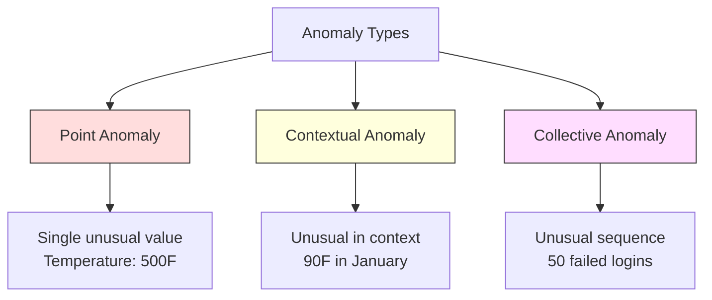
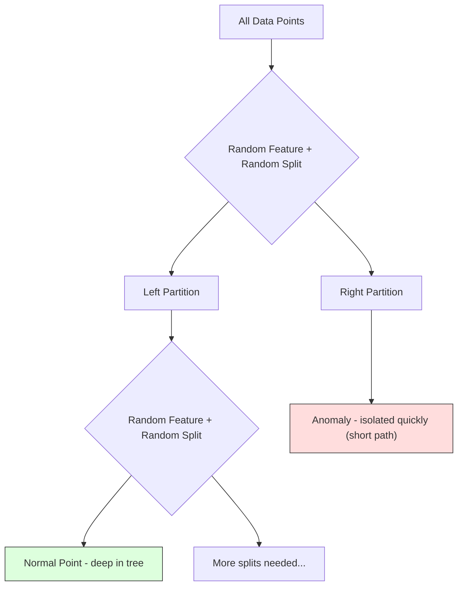
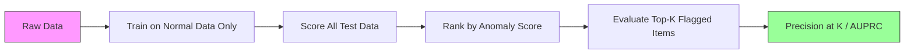

# Anomaly Detection

> Normal is easy to define. Abnormal is whatever doesn't fit.

**유형:** Build (실습)
**Language:** Python
**선수 레슨:** Phase 2, Lessons 01-09
**소요 시간:** ~75분

## 학습 목표

- Z-점수(Z-score), IQR, Isolation Forest 이상 탐지(anomaly detection) 기법을 밑바닥부터 구현합니다.
- 점 이상치(point anomaly), 맥락적 이상치(contextual anomaly), 집단 이상치(collective anomaly)를 구별하고 각각에 적합한 탐지 기법을 선택합니다.
- 이상 탐지가 이상치를 분류하는 대신 정상 데이터를 모델링하는 방식으로 정식화되는 이유를 설명합니다.
- 비지도 이상 탐지와 지도 분류를 비교하고, 새로운 유형의 이상치에 대한 탐지 범위(coverage)와 정밀도(precision) 간의 트레이드오프를 평가합니다.

## 문제 상황

어떤 신용카드가 오후 2시에 뉴욕에서 결제된 후, 오후 2시 5분에 도쿄에서 결제됩니다. 공장 센서의 정상 범위가 80~120도인데 150도를 기록합니다. 일일 평균 초당 요청 수가 200건인 서버에 초당 50,000건의 요청이 발생합니다.

이것들이 바로 이상치입니다. 이상치를 찾아내는 것은 매우 중요합니다. 사기(fraud)는 수십억 달러의 손실을 유발합니다. 장비 고장은 가동 중단(downtime) 비용을 발생시킵니다. 네트워크 침입은 데이터 유출로 이어집니다.

문제는 이상치에 대한 레이블이 지정된 예시가 거의 없다는 점입니다. 사기 거래는 전체 거래의 0.1%에 불과합니다. 장비 고장은 1년에 몇 번밖에 발생하지 않습니다. "이상치" 클래스에 학습할 데이터가 거의 없기 때문에 표준적인 분류기(classifier)를 학습시킬 수 없습니다. 일부 레이블이 있다 하더라도, 지금까지 관찰된 이상치가 앞으로 마주칠 유일한 유형은 아닙니다. 내일 나타날 새로운 사기 수법은 오늘의 수법과 다를 것입니다.

이상 탐지는 문제 접근 방식을 바꿉니다. 무엇이 비정상인지 학습하는 대신, 무엇이 정상인지를 학습합니다. 정상 범주에서 벗어나는 것은 모두 의심스러운 대상으로 간주합니다. 이 방식은 레이블 없이도 작동하고, 새로운 유형의 이상치에도 적응하며, 대규모 데이터셋으로도 확장할 수 있습니다.

## 핵심 개념

### 이상치의 유형

모든 이상치가 동일한 형태를 띠지는 않습니다.

- **점 이상치(Point anomalies).** 맥락과 관계없이 단독으로 특이한 단일 데이터 포인트입니다. 500도를 기록한 온도 측정값이나, 평소 50달러를 쓰는 계좌에서 발생한 50,000달러 결제 등이 해당합니다.
- **맥락적 이상치(Contextual anomalies).** 주어진 맥락을 고려했을 때 특이한 데이터 포인트입니다. 90도(화씨)의 온도는 여름에는 정상이지만 겨울에는 이상치입니다. 값은 같아도 맥락이 다릅니다.
- **집단 이상치(Collective anomalies).** 개별 데이터 포인트는 정상일 수 있지만, 하나의 그룹으로 모였을 때 비정상적인 데이터 포인트의 시퀀스입니다. 로그인 실패가 5번 발생한 것은 정상일 수 있습니다. 하지만 50번 연속으로 발생한다면 무차별 대입 공격(brute-force attack)입니다.

대부분의 기법은 점 이상치를 탐지합니다. 맥락적 이상치를 탐지하려면 시간이나 위치 특성(feature)이 필요합니다. 집단 이상치를 탐지하려면 시퀀스를 인식할 수 있는 기법이 필요합니다.



### 비지도 학습 관점의 프레이밍

일반적인 분류에서는 두 클래스 모두에 대한 레이블이 존재합니다. 반면 이상 탐지에서는 보통 다음 세 가지 상황 중 하나에 직면합니다.

1. **완전 비지도(Fully unsupervised).** 레이블이 전혀 없습니다. 모든 데이터를 바탕으로 탐지기를 적합(fit)시키며, 이상치가 "정상" 모델을 훼손하지 않을 만큼 드물기를 기대합니다.
2. **준지도(Semi-supervised).** 정상 데이터로만 구성된 깨끗한 데이터셋이 있습니다. 이 깨끗한 데이터셋에 모델을 적합시키고 다른 모든 데이터의 점수를 매깁니다. 가능하다면 가장 강력한 구성 방식입니다.
3. **약한 지도(Weakly supervised).** 레이블이 지정된 이상치가 소량 존재합니다. 이 데이터는 학습이 아닌 평가에 사용합니다. 비지도 방식으로 학습시킨 후, 레이블이 지정된 하위 집합에서 정밀도(precision)/재현율(recall)을 측정합니다.

핵심 인사이트는 이상 탐지가 분류와 근본적으로 다르다는 점입니다. 이상 탐지는 두 클래스 간의 결정 경계(decision boundary)를 찾는 것이 아니라 정상 데이터의 분포를 모델링합니다.

### 지도 학습 vs 비지도 학습: 트레이드오프

레이블이 지정된 이상치가 있다면, 이를 학습에 사용해야 할까요(지도 분류), 아니면 평가에만 사용해야 할까요(비지도 탐지)?

**지도 학습 (분류 문제로 취급):**
- 이전에 관찰했던 것과 정확히 일치하는 유형의 이상치를 잡아냅니다.
- 알려진 이상치 유형에 대해 더 높은 정밀도를 보입니다.
- 새로운 유형의 이상치는 완전히 놓칩니다.
- 새로운 유형의 이상치가 나타날 때마다 재학습이 필요합니다.
- 충분한 수의 이상치 예시가 필요합니다(보통 예시가 너무 적습니다).

**비지도 학습 (정상을 모델링하고 편차를 표시):**
- 새로운 유형을 포함하여 정상에서 벗어나는 모든 편차를 잡아냅니다.
- 레이블이 지정된 이상치가 필요하지 않습니다.
- 거짓 양성률(false positive rate)이 더 높습니다(특이하다고 해서 모두 나쁜 것은 아닙니다).
- 분포 변화(distribution shift)에 더 강건합니다.

실무에서는 두 방식을 결합한 시스템이 가장 효과적입니다. 넓은 탐지 범위를 확보하기 위해 비지도 탐지를 사용하고, 알려진 고위험 이상치 유형에는 지도 학습 모델을 적용하며, 모호한 사례는 사람이 직접 검토합니다.

### Z-점수 기법

가장 단순한 접근 방식입니다. 각 특성의 평균과 표준편차를 계산합니다. 평균에서 표준편차의 $k$배 이상 벗어난 데이터 포인트를 이상치로 표시합니다.

```text
z_score = (x - mean) / std
anomaly if |z_score| > threshold
```

기본 임계값(threshold)은 3.0입니다(가우시안 분포의 경우 정상 데이터의 99.7%가 3 표준편차 이내에 속합니다).

**장점:** 단순합니다. 빠릅니다. 해석하기 쉽습니다("이 값은 정상 범위에서 4.5 표준편차만큼 떨어져 있습니다").

**단점:** 데이터가 정규분포를 따른다고 가정합니다. 학습 데이터에 포함된 이상치에 민감합니다(이상치가 평균을 이동시키고 표준편차를 부풀려 탐지를 더 어렵게 만듭니다). 다봉(multimodal) 분포에서는 제대로 작동하지 않습니다.

**적합한 경우:** 데이터가 대략 종형(bell-shaped) 곡선을 띠는 단일 특성 모니터링에 적합합니다. 서버 응답 시간, 제조 공차, 안정적인 베이스라인을 가진 센서 측정값 등이 해당합니다.

**실패하는 경우:** 다중 클러스터 데이터(기준 온도가 서로 다른 두 사무실 위치), 왜도(skewness)가 있는 데이터(1,000달러 결제는 드물지만 이상치는 아닌 거래 금액), 학습 세트에 이상치가 포함된 데이터 등에서는 실패합니다.

### IQR 기법

Z-점수보다 이상치에 더 강건한(robust) 기법입니다. 평균과 표준편차 대신 사분위간 범위(interquartile range, IQR)를 사용합니다.

```
Q1 = 25th percentile
Q3 = 75th percentile
IQR = Q3 - Q1
lower_bound = Q1 - factor * IQR
upper_bound = Q3 + factor * IQR
anomaly if x < lower_bound or x > upper_bound
```

기본 배수(factor)는 1.5입니다.

**장점:** 이상치에 강건합니다(백분위수는 극단값의 영향을 받지 않습니다). 비대칭 분포에서도 잘 작동합니다. 정규성 가정이 필요 없습니다.

**단점:** 단변량(univariate)에만 적용할 수 있습니다(각 특성별로 독립적으로 적용됨). 특성들을 종합적으로 고려했을 때만 비정상적인 이상치는 탐지할 수 없습니다(개별 특성으로는 정상일지라도 결합 공간에서는 이상치일 수 있습니다).

**실무 참고 사항:** IQR의 1.5 배수는 상자 수염 그림(box plot)의 수염(whisker)에 해당합니다. 수염 바깥에 있는 데이터 포인트가 잠재적 이상치입니다. 1.5 대신 3.0을 사용하면 탐지기가 더 보수적으로 동작합니다(이상치 표시가 줄어들고 거짓 양성도 줄어듭니다). 적절한 배수는 허용 가능한 거짓 경보(false alarm) 수준에 따라 결정됩니다.
### Isolation Forest

핵심 통찰: 이상치는 소수이며 일반 데이터와 다릅니다. 데이터를 무작위로 분할할 때 이상치는 더 쉽게 고립(isolate)됩니다. 즉, 나머지 데이터로부터 분리하는 데 필요한 무작위 분할 횟수가 더 적습니다.



**동작 원리:**
1. 여러 개의 무작위 트리(isolation forest)를 구축합니다.
2. 각 노드에서 무작위 특성(feature)을 선택하고, 해당 특성의 최솟값과 최댓값 사이에서 무작위 분할 값을 선택합니다.
3. 모든 데이터 포인트가 고립될 때까지(자신만의 리프 노드에 들어갈 때까지) 분할을 계속합니다.
4. 이상치는 모든 트리에 걸쳐 평균 경로 길이(path length)가 더 짧습니다.

**잘 작동하는 이유:** 정상 데이터는 밀집된 영역에 모여 있습니다. 이웃 데이터로부터 하나를 고립시키려면 많은 무작위 분할이 필요합니다. 반면 이상치는 희소한 영역에 위치합니다. 따라서 한두 번의 무작위 분할만으로도 쉽게 고립시킬 수 있습니다.

이상치 점수(anomaly score)는 모든 트리에 걸친 평균 경로 길이를 기반으로 하며, 무작위 이진 탐색 트리(binary search tree)의 기대 경로 길이로 정규화됩니다.

```math
\text{score}(x) = 2^{-\text{average\_path\_length}(x) / c(n)}
```

여기서 `c(n)`는 $n$개 샘플에 대한 기대 경로 길이입니다. 점수가 1에 가까우면 이상치를 의미합니다. 0.5에 가까우면 정상, 0에 가까우면 매우 정상(밀집된 클러스터 깊숙이 위치함)을 의미합니다.

**장점:** 데이터 분포에 대한 가정이 필요 없습니다. 고차원에서도 잘 작동합니다. 확장성이 뛰어납니다(각 트리가 서브샘플을 사용하므로 샘플 수에 대해 선형 이하(sublinear)로 증가). 다양한 유형의 특성이 혼합되어 있어도 처리할 수 있습니다.

**단점:** 밀집된 영역에 있는 이상치(마스킹 효과, masking effect)를 탐지하기 어렵습니다. 불필요한 특성이 많은 경우 무작위 분할의 효과가 떨어집니다.

**주요 하이퍼파라미터:**
- `n_estimators`: 트리의 수입니다. 보통 100개면 충분합니다. 트리가 많을수록 점수가 더 안정적이지만 연산 속도는 느려집니다.
- `max_samples`: 트리당 샘플 수입니다. 원본 논문의 기본값은 256입니다. 값이 작을수록 개별 트리의 정확도는 떨어지지만 다양성은 증가합니다. Isolation Forest가 빠른 이유는 바로 이 서브샘플링 덕분이며, 각 트리는 데이터의 일부분만 확인합니다.
- `contamination`: 이상치의 예상 비율입니다. 임계값(threshold)을 설정하는 데만 사용되며, 점수 자체에는 영향을 주지 않습니다.

### Local Outlier Factor (LOF)

LOF는 특정 포인트 주변의 국소 밀도(local density)를 이웃 포인트들의 밀도와 비교합니다. 밀집된 영역으로 둘러싸인 희소한 영역에 있는 포인트는 이상치로 간주됩니다.

**동작 원리:**
1. 각 포인트에 대해 $k$개의 최근접 이웃(k-nearest neighbors)을 찾습니다.
2. 국소 도달 가능 밀도(local reachability density, 이웃 영역이 얼마나 밀집되어 있는지)를 계산합니다.
3. 각 포인트의 밀도를 이웃들의 밀도와 비교합니다.
4. 포인트의 밀도가 이웃보다 훨씬 낮으면 이상치(outlier)로 판정합니다.

**LOF 점수:**
- 1.0에 가까운 LOF: 이웃과 비슷한 밀도(정상)
- 1.0보다 큰 LOF: 이웃보다 낮은 밀도(이상치 가능성 있음)
- 1.0보다 훨씬 큰 LOF(예: 2.0 이상): 이웃보다 현저히 낮은 밀도(이상치일 가능성 높음)

여기서 "국소적(local)"이라는 개념이 핵심입니다. 포인트 1,000개로 이루어진 밀집된 클러스터와 포인트 50개로 이루어진 희소한 클러스터라는 두 개의 클러스터가 있는 데이터셋을 가정해 보겠습니다. 희소한 클러스터 가장자리에 있는 포인트는 전체적인 관점(global)에서는 50개의 이웃이 있으므로 특이하지 않을 수 있습니다. 하지만 직전 이웃들에 비해 밀도가 낮다면 국소적 관점에서는 특이한 포인트입니다. LOF는 전역(global) 방식이 놓치는 이러한 미묘한 차이를 포착합니다.

**장점:** 국소적 이상치(전역적으로는 특이하지 않더라도 해당 이웃 내에서 특이한 포인트)를 탐지합니다. 밀도가 서로 다른 클러스터에서도 잘 작동합니다.

**단점:** 대규모 데이터셋에서는 느립니다(단순 구현 시 $O(n^2)$). $k$ 선택에 민감합니다. 초고차원에서는 잘 작동하지 않습니다(차원의 저주(curse of dimensionality)가 거리 계산에 영향을 줌).

### 비교

| 방법 | 가정 | 속도 | 고차원 처리 | 국소 이상치 탐지 |
|--------|------------|-------|-------------------|------------------------|
| Z-score | 정규분포 | 매우 빠름 | 가능 (특성별) | 불가 |
| IQR | 없음 (특성별) | 매우 빠름 | 가능 (특성별) | 불가 |
| Isolation Forest | 없음 | 빠름 | 가능 | 부분적 |
| LOF | 유의미한 거리 척도 | 느림 | 취약 | 가능 |

### 평가 시 당면 과제

이상치 탐지기를 평가하는 것은 분류기를 평가하는 것보다 어렵습니다.

- **극심한 클래스 불균형(class imbalance).** 이상치 비율이 0.1%일 때, 모든 것을 "정상"으로 예측해도 99.9%의 정확도(accuracy)가 나옵니다. 따라서 정확도는 무의미합니다.
- **AUROC의 왜곡.** 심각한 불균형 상황에서는 모델이 실제 임계값에서 대부분의 이상치를 놓치더라도 AUROC 수치가 높게 나타날 수 있습니다.
- **더 나은 지표:** Precision@k(이상치로 분류된 상위 $k$개 항목 중 실제 이상치의 비율), AUPRC(정밀도-재현율 곡선 아래 면적), 고정된 위양성률(false positive rate)에서의 재현율(recall).



### 이상치 탐지 파이프라인

실제 업무에서 이상치 탐지는 다음과 같은 워크플로를 따릅니다.

1. **기준(baseline) 데이터 수집.** 이상치가 없거나 거의 없다고 확신할 수 있는 기간의 데이터를 확보하는 것이 이상적입니다.
2. **특성 공학(Feature engineering).** 원시(raw) 특성과 파생 특성(이동 통계량, 시간 특성, 비율 등)을 생성합니다.
3. **탐지기 학습.** 기준 데이터에 모델을 적합(fit)시킵니다. 모델은 "정상" 상태가 어떤 모습인지 학습합니다.
4. **새로운 데이터 점수화.** 새로운 각 관측값에 대해 이상치 점수를 부여합니다.
5. **임계값 선택.** 점수 기준치(cutoff)를 설정합니다. 이는 비즈니스적 결정 사항으로, 임계값을 높이면 오탐(false alarm)은 줄어들지만 놓치는 이상치가 많아집니다.
6. **경보 및 조사.** 이상치로 표시된 포인트는 사람의 검토나 자동화된 대응 절차로 전달됩니다.
7. **피드백 수집.** 감지된 항목이 실제 이상치였는지 오탐이었는지 기록합니다. 이 데이터를 사용하여 탐지기를 평가하고 시간이 지남에 따라 임계값을 조정합니다.

이 파이프라인은 결코 "완료"되지 않습니다. 데이터 분포는 변화하고, 새로운 유형의 이상치가 나타나며, 임계값 조정이 계속 필요합니다. 이상치 탐지는 일회성 모델이 아니라 지속해서 관리해야 하는 살아있는 시스템으로 다루어야 합니다.

```figure
f3-anomaly-fence
```

## 직접 구현하기

`code/anomaly_detection.py`의 코드는 Z-score, IQR, Isolation Forest를 밑바닥부터(from scratch) 구현합니다.

### Z-Score 탐지기

```python
def zscore_detect(X, threshold=3.0):
    mean = X.mean(axis=0)
    std = X.std(axis=0)
    std[std == 0] = 1.0
    z = np.abs((X - mean) / std)
    return z.max(axis=1) > threshold
```

단순하며 벡터화(vectorized)되어 있습니다. 어떤 특성이든 임계값을 초과하면 해당 포인트를 이상치로 표시합니다.

### IQR 탐지기

```python
def iqr_detect(X, factor=1.5):
    q1 = np.percentile(X, 25, axis=0)
    q3 = np.percentile(X, 75, axis=0)
    iqr = q3 - q1
    iqr[iqr == 0] = 1.0
    lower = q1 - factor * iqr
    upper = q3 + factor * iqr
    outside = (X < lower) | (X > upper)
    return outside.any(axis=1)
```

### 밑바닥부터 구현하는 Isolation Forest

밑바닥부터 구현한 이 코드는 특성 공간을 무작위로 분할하는 고립 트리(isolation tree)를 구축합니다.

```python
def _c_factor(n):
    if n <= 1:
        return 0.0
    if n == 2:
        return 1.0
    return 2.0 * (np.log(n - 1) + 0.5772156649) - 2.0 * (n - 1.0) / n


class IsolationTree:
    def __init__(self, max_depth):
        self.max_depth = max_depth

    def fit(self, X, depth=0):
        n, p = X.shape
        if depth >= self.max_depth or n <= 1:
            self.is_leaf = True
            self.size = n
            return self
        self.is_leaf = False
        self.feature = np.random.randint(p)
        x_min = X[:, self.feature].min()
        x_max = X[:, self.feature].max()
        if x_min == x_max:
            self.is_leaf = True
            self.size = n
            return self
        self.threshold = np.random.uniform(x_min, x_max)
        left_mask = X[:, self.feature] < self.threshold
        self.left = IsolationTree(self.max_depth).fit(X[left_mask], depth + 1)
        self.right = IsolationTree(self.max_depth).fit(X[~left_mask], depth + 1)
        return self

    def path_length(self, x, depth=0):
        if self.is_leaf:
            return depth + _c_factor(self.size)
        if x[self.feature] < self.threshold:
            return self.left.path_length(x, depth + 1)
        return self.right.path_length(x, depth + 1)
```

포인트를 고립시키는 데 걸리는 경로 길이가 이상치 점수를 결정합니다. 경로가 짧을수록 더 비정상적임을 의미합니다.

`IsolationForest` 클래스는 여러 트리를 래핑합니다.

```python
class IsolationForest:
    def __init__(self, n_estimators=100, max_samples=256, seed=42):
        self.n_estimators = n_estimators
        self.max_samples = max_samples
        self.seed = seed
        self.trees = []
        self.n_train = 0

    def fit(self, X):
        self.n_train = X.shape[0]
        rng = np.random.RandomState(self.seed)
        self.trees = []
        sample_size = min(self.max_samples, X.shape[0])
        max_depth = int(np.ceil(np.log2(sample_size)))
        for _ in range(self.n_estimators):
            idx = rng.choice(X.shape[0], size=sample_size, replace=False)
            tree = IsolationTree(max_depth=max_depth)
            tree.fit(X[idx])
            self.trees.append(tree)
        return self

    def anomaly_score(self, X):
        avg_path = np.zeros(X.shape[0])
        for tree in self.trees:
            for i in range(X.shape[0]):
                avg_path[i] += tree.path_length(X[i])
        avg_path /= self.n_estimators
        c = _c_factor(min(self.max_samples, self.n_train))
        return 2.0 ** (-avg_path / c) if c > 0 else np.zeros(X.shape[0])
```

정규화 계수 `c(n)`(코드의 `_c_factor`)는 $n$개의 원소를 가진 이진 탐색 트리에서 탐색 실패 시의 기대 경로 길이입니다. 이는 `2 * H(n-1) - 2*(n-1)/n`와 같으며, 여기서 `H`는 조화수(harmonic number)입니다. 코드는 원본 Isolation Forest 논문과 마찬가지로 표준 근사식 `H(i) ≈ ln(i) + 0.5772`(오일러 상수)를 사용합니다. 이 정규화를 통해 크기가 서로 다른 데이터셋 간에도 점수를 비교할 수 있습니다.

### 데모 시나리오

이 코드는 여러 테스트 시나리오를 생성합니다.

1. **이상치가 포함된 단일 클러스터.** 중심에서 멀리 떨어진 위치에 이상치가 주입된 2D 가우시안 클러스터입니다. 여기서는 모든 방법이 잘 작동해야 합니다.
2. **다봉(Multimodal) 데이터.** 크기와 밀도가 서로 다른 세 개의 클러스터입니다. 클러스터 사이에 있는 포인트들이 이상치입니다. 특성별 범위가 넓기 때문에 Z-score는 탐지에 어려움을 겪습니다.
3. **고차원 데이터.** 50개의 특성이 있지만, 이상치는 그중 단 5개 특성에서만 차이를 보입니다. 특성의 일부 하위 집합에서 나타나는 이상치를 각 방법이 찾아낼 수 있는지 테스트합니다.

각 데모는 정밀도(precision), 재현율(recall), F1, Precision@k를 사용하여 모든 방법을 비교합니다.
## 사용해 보기

sklearn 사용하기 (바닥부터 구현하는 방식이 아닌, 라이브러리 구현체 활용):

```python
from sklearn.ensemble import IsolationForest
from sklearn.neighbors import LocalOutlierFactor

iso = IsolationForest(n_estimators=100, contamination=0.05, random_state=42)
iso.fit(X_train)
predictions = iso.predict(X_test)

lof = LocalOutlierFactor(n_neighbors=20, contamination=0.05, novelty=True)
lof.fit(X_train)
predictions = lof.predict(X_test)
```

`contamination`는 예상되는 이상치(anomaly)의 비율을 설정한다는 점에 유의하십시오. 이 값을 올바르게 설정하는 것이 중요합니다. 너무 낮으면 이상치를 놓치고, 너무 높으면 오탐(false alarm)이 발생합니다.

`anomaly_detection.py`의 코드는 동일한 데이터에 대해 바닥부터 구현한 방식과 sklearn을 비교합니다.

### sklearn Contamination 매개변수

sklearn의 `contamination` 매개변수는 연속적인 이상치 점수(anomaly score)를 이진 예측으로 변환하기 위한 임계값(threshold)을 결정합니다. 이는 기저에 있는 점수 자체를 변경하지는 않습니다.

```python
iso_5 = IsolationForest(contamination=0.05)
iso_10 = IsolationForest(contamination=0.10)
```

두 방식 모두 동일한 이상치 점수를 생성합니다. 하지만 `iso_5`는 상위 5%를 이상치로 분류하는 반면, `iso_10`는 상위 10%를 이상치로 분류합니다. 실제 이상치 비율을 모른다면(보통은 알지 못합니다), contamination을 "auto"로 설정하고 원시 점수를 직접 다루십시오. 정밀도와 재현율 간의 트레이드오프, 즉 거짓 양성(false positive)과 거짓 음성(false negative) 간의 비용 트레이드오프를 기반으로 자체 임계값을 설정하십시오.

### One-Class SVM

알아둘 가치가 있는 또 다른 비지도 이상 탐지기입니다. One-Class SVM은 (커널 트릭을 사용하여) 고차원 특성 공간에서 정상 데이터를 둘러싸는 경계를 적합(fit)합니다.

```python
from sklearn.svm import OneClassSVM

oc_svm = OneClassSVM(kernel="rbf", gamma="auto", nu=0.05)
oc_svm.fit(X_train)
predictions = oc_svm.predict(X_test)
```

`nu` 매개변수는 이상치의 비율에 근사합니다. One-Class SVM은 중소 규모의 데이터셋에서는 잘 작동하지만, 초대규모 데이터에는 확장되지 않습니다(커널 행렬이 2차 함수 형태로 증가하기 때문입니다).

### 오토인코더 접근 방식 (미리보기)

오토인코더(Autoencoder)는 데이터를 압축하고 재구성하는 법을 학습하는 신경망입니다. 정상 데이터만으로 학습을 진행합니다. 네트워크가 정상 패턴만 재구성하도록 학습했기 때문에, 테스트 시점에서 이상치는 높은 재구성 오차(reconstruction error)를 갖게 됩니다.

이 내용은 파트 3(딥러닝)에서 다루지만, 원리는 동일합니다. 정상적인 것이 무엇인지 모델링하고, 여기서 벗어나는 것을 탐지하는 것입니다.

### 앙상블 이상 탐지

앙상블 기법이 분류 성능을 향상시키는 것과 마찬가지로(레슨 11), 여러 이상 탐지기를 결합하면 탐지 성능이 향상됩니다. 가장 단순한 접근 방식은 다음과 같습니다.

1. 여러 탐지기(Z-점수, IQR, Isolation Forest, LOF)를 실행합니다.
2. 각 탐지기의 점수를 [0, 1] 범위로 정규화합니다.
3. 정규화된 점수의 평균을 구합니다.
4. 평균 점수가 임계값을 넘는 데이터 포인트를 이상치로 분류합니다.

서로 다른 방법들은 각기 다른 오류 모드(failure mode)를 갖기 때문에 이 방식은 거짓 양성을 줄여줍니다. 네 가지 방법 모두에서 이상치로 분류된 포인트는 거의 확실하게 이상치입니다. 반면 한 가지 방법으로만 분류된 포인트는 해당 방법 특유의 기이한 동작일 수 있습니다.

더 정교한 앙상블은 각 탐지기의 추정된 신뢰도를 가중치로 부여합니다(알려진 이상치가 포함된 검증 세트가 있는 경우, 이를 활용해 측정).

### 프로덕션 고려 사항

1. **임계값 표류(Threshold drift).** 데이터 분포가 변화함에 따라 고정된 임계값은 유효성을 잃게 됩니다. 이상치 점수의 분포를 모니터링하고 주기적으로 조정하십시오.
2. **알림 피로(Alert fatigue).** 거짓 알람이 너무 많으면 운영자는 알람에 신경 쓰지 않게 됩니다. 높은 임계값(더 적지만 더 신뢰할 수 있는 알림)으로 시작하여 신뢰가 쌓이면 낮추십시오.
3. **앙상블 접근 방식.** 프로덕션 환경에서는 여러 탐지기를 결합하십시오. 여러 방법이 이상치라는 데 동의할 때만 해당 포인트를 이상치로 표시하십시오. 이는 거짓 양성을 크게 줄여줍니다.
4. **특성 엔지니어링(Feature engineering).** 원시 특성만으로는 충분하지 않은 경우가 많습니다. 롤링 통계량, 비율, 마지막 이벤트 이후 경과 시간 및 도메인 특화 특성을 추가하십시오. 좋은 특성 세트를 갖추는 것이 탐지기를 선택하는 것보다 더 중요합니다.
5. **피드백 루프(Feedback loop).** 운영자가 플래그가 지정된 항목을 조사하여 확인하거나 기각할 때, 이 결과를 시스템에 다시 피드백하십시오. 시간이 지남에 따라 레이블이 지정된 데이터를 축적하여 탐지기를 평가하고 개선하십시오.

## 배포하기

이번 레슨에서 도출되는 결과물은 다음과 같습니다.
- `outputs/skill-anomaly-detector.md` -- 적절한 탐지기를 선택하기 위한 의사결정 스킬
- `code/anomaly_detection.py` -- Z-점수, IQR, Isolation Forest를 바닥부터 구현하고 sklearn과 비교한 코드

### 임계값 선택하기

이상치 점수는 연속값입니다. 이진 결정을 내리려면 임계값이 필요합니다. 이는 기술적인 결정이 아니라 비즈니스적인 결정입니다.

두 가지 시나리오를 고려해 보십시오.
- **사기 탐지(Fraud detection).** 사기를 놓치는 것은 막대한 비용(지급 거절, 고객 신뢰 하락)을 초래합니다. 오탐을 조사하는 데는 인간 분석가의 시간 5분 정도가 소요됩니다. 더 많은 사기를 잡기 위해 임계값을 낮추고, 더 많은 오탐을 감수하십시오.
- **장비 유지보수.** 오탐이 발생하면 불필요한 가동 중단으로 인해 5만 달러의 비용이 듭니다. 고장을 놓치면 50만 달러의 수리 비용이 듭니다. 이러한 비용의 균형을 맞추도록 임계값을 설정하십시오.

두 경우 모두 최적의 임계값은 거짓 양성과 거짓 음성 간의 비용 비율에 따라 달라집니다. 서로 다른 임계값에서 정밀도와 재현율을 플롯하고, 비용 함수를 겹쳐 표시하여 최소 비용 지점을 선택하십시오.

### 프로덕션으로 확장하기

프로덕션 환경에서의 실시간 이상 탐지를 위한 지침입니다.

1. **배치 학습, 온라인 점수 산출(온라인 스코어링).** 최근의 정상 데이터를 바탕으로 주기적으로(매일, 매주) 모델을 학습시킵니다. 새로운 관측치가 도착할 때마다 점수를 계산합니다.
2. **특성 계산의 일치.** 30일 동안의 롤링 통계량을 사용하여 학습했다면, 새로운 관측치에 대한 특성을 계산하기 위해 30일간의 이력이 필요합니다. 필요한 이력 데이터를 버퍼에 보관하십시오.
3. **점수 분포 모니터링.** 시간에 따른 이상치 점수의 분포를 추적하십시오. 점수의 중앙값이 점차 상승한다면 데이터가 변하고 있거나 모델이 노후화된 것입니다.
4. **설명 가능성(Explainability).** 이상치를 탐지했을 때 그 이유를 설명하십시오. Z-점수: "특성 X가 정상 범위보다 4.2 표준편차 높습니다." Isolation Forest: "이 포인트는 평균 3.1회의 분할만으로 고립되었습니다(정상 포인트는 8.5회 소요)."

## 연습 문제

1. **임계값 튜닝.** Z-점수 탐지기를 1.0부터 5.0까지 0.5 간격의 임계값으로 실행해 보십시오. 각 임계값에서의 정밀도와 재현율을 시각화하십시오. 여러분의 데이터에 가장 적합한 지점(sweet spot)은 어디입니까?

2. **다변량 이상치(Multivariate anomalies).** 각 특성을 개별적으로 볼 때는 정상이지만 조합해 보면 이상치가 되는 2차원 데이터를 생성하십시오(예: 주 군집 대각선에서 멀리 떨어진 포인트). 특성별 Z-점수는 이를 놓치지만 Isolation Forest는 탐지해 냄을 보이십시오.

3. **바닥부터 구현하는 LOF.** k-최근접 이웃(k-nearest neighbors)을 사용하여 Local Outlier Factor를 구현하십시오. 동일한 데이터에 대해 sklearn의 LocalOutlierFactor와 비교하십시오. $k=10$와 $k=50$를 사용해 보고, $k$의 선택이 결과에 어떤 영향을 미치는지 확인하십시오.

4. **스트리밍 이상 탐지.** 새로운 포인트가 들어올 때마다 이동 평균과 분산을 업데이트(Welford의 온라인 알고리즘)하도록 Z-점수 탐지기를 수정하여 스트리밍 환경에서 작동하도록 만드십시오. 동일한 데이터에 대해 배치 Z-점수와 비교하십시오.

5. **실제 데이터 평가.** 이상치가 알려진 데이터셋(예: Kaggle의 신용카드 사기 데이터셋)을 가져오십시오. precision@100, precision@500, 그리고 AUPRC를 사용하여 네 가지 방법을 모두 평가하십시오. 어떤 방법이 가장 우수한 성능을 보입니까? 그 이유는 무엇입니까?
## 핵심 용어

| 용어 | 흔히 하는 표현 | 실제 의미 |
|------|----------------|----------------------|
| 이상치(Anomaly) | "특이값, 비정상적인 데이터" | 정상 데이터의 기대 패턴에서 크게 벗어난 데이터 포인트 |
| 점 이상치(Point anomaly) | "단일 이상값" | 문맥과 상관없이 그 자체로 비정상적인 개별 관측치 |
| 문맥적 이상치(Contextual anomaly) | "값은 정상이지만 문맥이 맞지 않음" | 특정 문맥(시간, 위치 등)에서는 비정상적이지만 다른 문맥에서는 정상일 수 있는 관측치 |
| Isolation Forest | "랜덤 분할로 특이값을 찾는 방식" | 정상 포인트보다 더 적은 횟수의 분할로 이상치를 고립시키는 랜덤 트리 앙상블 |
| Local Outlier Factor | "이웃과의 밀도 비교" | 국소 밀도(local density)가 이웃의 밀도보다 훨씬 낮은 포인트를 이상치로 판별하는 방법 |
| Z-score | "평균으로부터의 표준편차" | 특정 포인트가 중심에서 표준편차 단위로 얼마나 떨어져 있는지를 측정하는 $(x - \text{mean}) / \text{std}$ |
| IQR | "사분위간 범위" | 데이터 중앙 50%의 산포도를 측정하며, 로버스트한 이상치 탐지에 사용되는 $Q3 - Q1$ |
| 오염도(Contamination) | "예상되는 이상치 비율" | 데이터 중 이상치로 표시해야 할 비율을 탐지기에 지정하는 하이퍼파라미터 |
| Precision@k | "상위 k개 탐지 결과 중 실제 이상치의 비율" | 가장 의심스러운 상위 $k$개 포인트만을 대상으로 계산한 정밀도(precision)로, 불균형 이상 탐지에 유용함 |
| AUPRC | "정밀도-재현율 곡선 아래 면적" | 모든 임계값에 걸친 정밀도-재현율 성능을 요약하는 지표로, 불균형 데이터에서 AUROC보다 효과적임 |

## 추가 참고 자료

- [Liu et al., Isolation Forest (2008)](https://cs.nju.edu.cn/zhouzh/zhouzh.files/publication/icdm08b.pdf) -- 최초의 Isolation Forest 논문
- [Breunig et al., LOF: Identifying Density-Based Local Outliers (2000)](https://dl.acm.org/doi/10.1145/342009.335388) -- 최초의 LOF 논문
- [scikit-learn 이상치 탐지 문서](https://scikit-learn.org/stable/modules/outlier_detection.html) -- scikit-learn의 모든 이상치 탐지기 개요
- [Chandola et al., Anomaly Detection: A Survey (2009)](https://dl.acm.org/doi/10.1145/1541880.1541882) -- 이상 탐지 기법에 관한 종합적인 서베이 논문
- [Goldstein and Uchida, A Comparative Evaluation of Unsupervised Anomaly Detection Algorithms (2016)](https://journals.plos.org/plosone/article?id=10.1371/journal.pone.0152173) -- 실제 데이터셋에서 10가지 기법을 실증적으로 비교 평가한 논문
