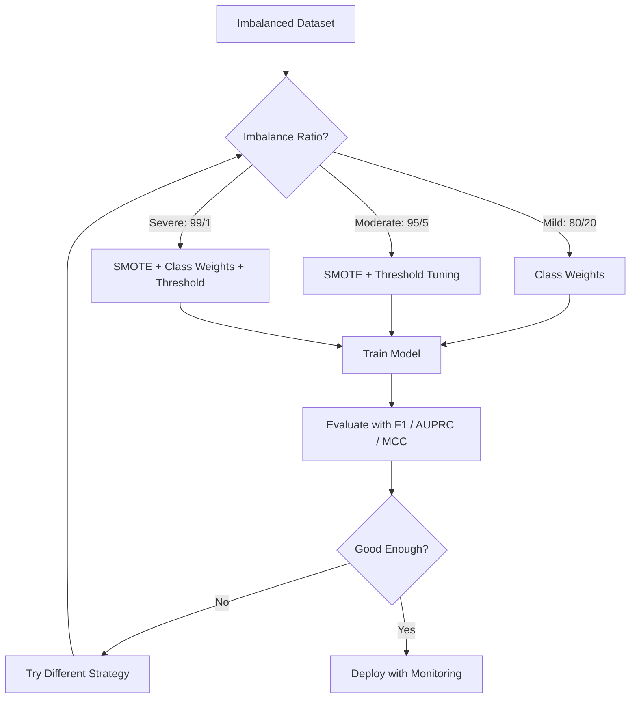
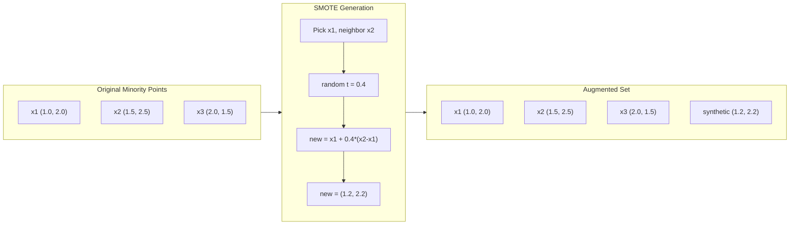
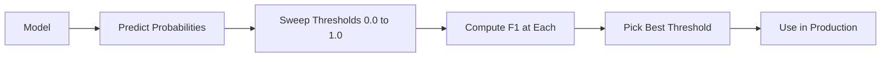
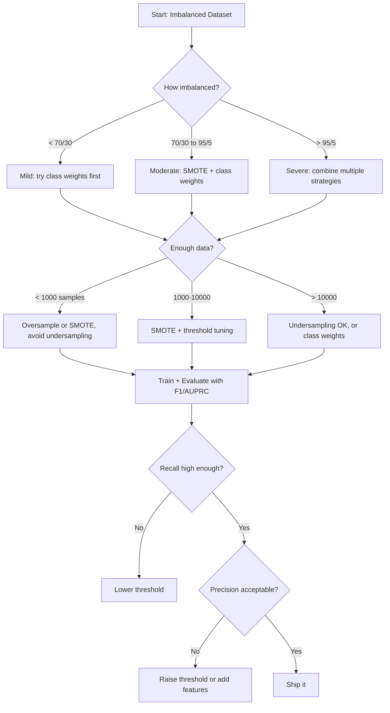

# 불균형 데이터 다루기

> 데이터의 99%가 "정상"일 때, 정확도는 거짓말입니다.

**유형:** Build (실습)
**Language:** Python
**선수 레슨:** Phase 2, Lessons 01-09 (especially evaluation metrics)
**소요 시간:** ~90분

## 학습 목표

- SMOTE를 밑바닥부터 구현하고, 합성 오버샘플링(synthetic oversampling)이 무작위 복제와 어떻게 다른지 설명합니다.
- 정확도(accuracy) 대신 F1, AUPRC, 매튜스 상관계수(Matthews Correlation Coefficient, MCC)를 사용하여 불균형 분류기를 평가합니다.
- 클래스 가중치(class weighting), 임계값 조정(threshold tuning), 리샘플링 전략을 비교하고 주어진 불균형 비율에 적합한 접근법을 선택합니다.
- SMOTE, 클래스 가중치, 임계값 최적화를 결합한 완전한 불균형 데이터 파이프라인을 구축합니다.

## 문제 상황

사기 탐지(fraud detection) 모델을 구축했습니다. 정확도가 99.9%에 달하여 기뻐했지만, 곧 모델이 모든 거래에 대해 "사기 아님"으로 예측하고 있다는 사실을 깨닫게 됩니다.

이것은 버그가 아닙니다. 거래의 0.1%만이 사기일 때 모델이 취할 수 있는 가장 합리적인 행동입니다. 모델은 다수 클래스를 항상 선택하는 것이 전체 오류를 최소화한다는 사실을 학습한 것입니다. 기술적으로는 맞지만 완전히 쓸모없는 모델입니다.

이러한 현상은 실제 분류가 중요한 거의 모든 영역에서 발생합니다. 질병 진단: 양성 비율 1%. 네트워크 침입 탐지: 공격 비율 0.01%. 제조 불량: 불량률 0.5%. 스팸 필터링: 스팸 비율 20%. 고객 이탈 예측: 이탈률 5%. 소수 클래스의 영향력이 클수록, 그 클래스는 더 희귀한 경향이 있습니다.

정확도는 모든 올바른 예측을 동일하게 취급하기 때문에 실패합니다. 정상 거래를 올바르게 분류하는 것과 사기 거래를 올바르게 잡아내는 것 모두 정확도에서는 똑같이 1점씩 반영됩니다. 하지만 사기 거래를 잡아내는 것이야말로 모델이 존재하는 본래 목적입니다. 따라서 모델이 희귀하지만 중요한 클래스에 집중하도록 강제하는 지표, 기법, 학습 전략이 필요합니다.

## 핵심 개념

### 정확도가 실패하는 이유

음성 990개, 양성 10개로 구성된 1,000개 샘플의 데이터셋을 생각해 보겠습니다. 항상 음성으로만 예측하는 모델의 혼동 행렬은 다음과 같습니다.

|  | 예측 양성 | 예측 음성 |
|--|---|---|
| 실제 양성 | 0 (TP) | 10 (FN) |
| 실제 음성 | 0 (FP) | 990 (TN) |

```math
\text{Accuracy} = (0 + 990) / 1000 = 99.0\%
```

이 모델은 단 하나의 사기, 질병, 불량도 잡아내지 못합니다. 하지만 정확도는 99%라고 말합니다. 이것이 불균형 문제에서 정확도가 위험한 이유입니다.

### 더 나은 평가 지표

**정밀도(Precision)** = $\text{TP} / (\text{TP} + \text{FP})$. 양성으로 분류된 항목 중 실제로 양성인 비율은 얼마인가? 정밀도가 높다는 것은 허위 경보(false alarm)가 적다는 것을 의미합니다.

**재현율(Recall)** = $\text{TP} / (\text{TP} + \text{FN})$. 실제 양성인 항목 중 모델이 잡아낸 비율은 얼마인가? 재현율이 높다는 것은 놓친 양성이 적다는 것을 의미합니다.

**F1 점수(F1 Score)** = $2 \cdot \text{precision} \cdot \text{recall} / (\text{precision} + \text{recall})$. 정밀도와 재현율의 조화 평균입니다. 산술 평균보다 두 지표 간의 극단적인 불균형에 더 큰 페널티를 부여합니다.

**F-베타 점수(F-beta Score)** = $(1 + \beta^2) \cdot \text{precision} \cdot \text{recall} / (\beta^2 \cdot \text{precision} + \text{recall})$. $\beta > 1$일 때는 재현율이 더 중요하고, $\beta < 1$일 때는 정밀도가 더 중요합니다. 사기 탐지에서는 F2 점수가 흔히 사용됩니다(사기를 놓치는 것이 허위 경보보다 훨씬 치명적이기 때문입니다).

**AUPRC**(Area Under Precision-Recall Curve). AUC-ROC와 유사하지만 불균형 데이터에 훨씬 더 유용합니다. 무작위 분류기의 AUPRC는 (ROC의 0.5와 달리) 양성 클래스 비율과 같습니다. 따라서 성능 개선 여부를 더 쉽게 확인할 수 있습니다.

**매튜스 상관계수(Matthews Correlation Coefficient, MCC)** = $(\text{TP} \cdot \text{TN} - \text{FP} \cdot \text{FN}) / \sqrt{(\text{TP}+\text{FP})(\text{TP}+\text{FN})(\text{TN}+\text{FP})(\text{TN}+\text{FN})}$. -1부터 +1까지의 범위를 갖습니다. 모델이 두 클래스 모두에서 우수한 성능을 보일 때만 높은 점수를 반환하며, 클래스 크기 차이가 매우 클 때도 균형 잡힌 평가를 제공합니다.

위의 "항상 음성으로 예측하는" 모델의 경우: $\text{precision} = 0/0$ (정의되지 않음, 종종 0으로 처리), $\text{recall} = 0/10 = 0$, $\text{F1} = 0$, $\text{MCC} = 0$입니다. 이러한 지표들은 모델이 쓸모없다는 사실을 올바르게 식별해 냅니다.

### 불균형 데이터 파이프라인



### SMOTE: 합성 소수자 오버샘플링 기법

무작위 오버샘플링(Random oversampling)은 기존 소수 샘플을 복제합니다. 이 방법도 효과가 있지만, 모델이 동일한 데이터 포인트를 반복해서 보게 되므로 과적합(overfitting) 위험이 발생합니다.

SMOTE는 단순 복제가 아니라 그럴듯한 새로운 합성 소수 샘플을 생성합니다. 알고리즘 동작 방식은 다음과 같습니다.

1. 각 소수 샘플 $x$에 대해 다른 소수 샘플들 중에서 $k$개의 최근접 이웃(nearest neighbors)을 찾습니다.
2. 이웃 중 하나를 무작위로 선택합니다.
3. $x$과 해당 이웃을 연결하는 선분 위에 새로운 샘플을 생성합니다.

수식: `new_sample = x + random(0, 1) * (neighbor - x)`

이 방식은 실제 소수 데이터 포인트 사이를 보간(interpolation)하여, 기존 데이터를 단순히 복사하지 않고도 특성 공간의 동일한 영역에 새로운 샘플을 생성합니다.



### 샘플링 전략 비교

**무작위 오버샘플링(Random Oversampling)**: 다수 클래스 개수에 맞추어 소수 클래스 샘플을 복제합니다.
- 장점: 단순하며 정보 손실이 없음
- 단점: 동일한 복제본으로 인해 과적합 유발, 학습 시간 증가

**무작위 언더샘플링(Random Undersampling)**: 소수 클래스 개수에 맞추어 다수 클래스 샘플을 제거합니다.
- 장점: 학습 속도가 빠르고 단순함
- 단점: 유용할 수 있는 다수 클래스 데이터 손실, 분산 증가

**SMOTE**: 보간을 통해 합성 소수 클래스 샘플을 생성합니다.
- 장점: 새로운 데이터 포인트를 생성하며, 무작위 오버샘플링에 비해 과적합 감소
- 단점: 결정 경계 근처에 노이즈 샘플이 생성될 수 있으며, 다수 클래스의 분포를 고려하지 않음

| 전략 | 데이터 변경 방식 | 위험 요소 | 사용 시기 |
|----------|-------------|------|-------------|
| 오버샘플링 | 소수 클래스 복제 | 과적합 | 작은 데이터셋, 완만한 불균형 |
| 언더샘플링 | 다수 클래스 제거 | 정보 손실 | 대규모 데이터셋, 빠른 학습이 필요할 때 |
| SMOTE | 합성 소수 샘플 추가 | 경계 노이즈 | 중간 수준의 불균형, k-NN에 충분한 소수 샘플이 있을 때 |

### 클래스 가중치

데이터 자체를 변경하는 대신, 모델이 오류를 처리하는 방식을 변경합니다. 소수 클래스를 잘못 분류했을 때 더 높은 가중치를 부여합니다.

음성 950개, 양성 50개 샘플로 구성된 이진 분류 문제의 경우:
- 음성 클래스 가중치 = $n_{\text{samples}} / (2 \cdot n_{\text{negative}}) = 1000 / (2 \cdot 950) = 0.526$
- 양성 클래스 가중치 = $n_{\text{samples}} / (2 \cdot n_{\text{positive}}) = 1000 / (2 \cdot 50) = 10.0$

양성 클래스는 19배의 가중치를 갖습니다. 양성 샘플 1개를 잘못 분류하는 것은 음성 샘플 19개를 잘못 분류하는 것과 동일한 손실 비용을 치릅니다. 이로 인해 모델은 소수 클래스에 집중하도록 강제됩니다.

로지스틱 회귀(logistic regression)에서는 손실 함수가 다음과 같이 수정됩니다.

```math
\text{weighted\_loss} = -\sum \bigl( w_i \cdot [y_i \log(p_i) + (1-y_i) \log(1-p_i)] \bigr)
```

여기서 $w_i$은 샘플 $i$의 클래스에 따라 달라집니다.

클래스 가중치는 기댓값 관점에서 오버샘플링과 수학적으로 동등하지만, 새로운 데이터 포인트를 생성하지 않습니다. 따라서 속도가 더 빠르고 샘플 복제로 인한 과적합 위험을 방지할 수 있습니다.

### 임계값 조정

대부분의 분류기는 확률을 출력합니다. 기본 임계값은 0.5로, $P(\text{positive}) \ge 0.5$이면 양성으로 예측합니다. 하지만 0.5는 임의로 정해진 값일 뿐입니다. 클래스가 불균형할 때 최적의 임계값은 대개 이보다 훨씬 낮습니다.

진행 과정:
1. 모델을 학습시킵니다.
2. 검증 세트(validation set)에서 예측 확률을 얻습니다.
3. 임계값을 0.0부터 1.0까지 탐색합니다.
4. 각 임계값에서 F1(또는 선택한 지표)을 계산합니다.
5. 해당 지표를 최대화하는 임계값을 선택합니다.



사기 거래에 대해 모델이 $P(\text{fraud}) = 0.15$의 확률을 출력할 수 있습니다. 임계값 0.5에서는 사기가 아닌 것으로 분류되지만, 임계값 0.10에서는 올바르게 잡아냅니다. 확률 보정(probability calibration) 자체보다는 순위 매기기(ranking)가 더 중요합니다. 즉, 사기 거래가 정상 거래보다 더 높은 확률을 부여받기만 한다면 두 클래스를 분리해 내는 임계값은 반드시 존재합니다.
### 비용 민감 학습 (Cost-Sensitive Learning)

클래스 가중치의 일반화입니다. 균일한 비용 대신 구체적인 오분류 비용을 할당합니다.

| | 양성 예측 | 음성 예측 |
|--|---|---|
| 실제 양성 | 0 (정답) | $C_{\text{FN}} = 100$ |
| 실제 음성 | $C_{\text{FP}} = 1$ | 0 (정답) |

사기 거래를 놓치는 것(FN)은 오경보(FP)보다 100배 더 많은 비용이 듭니다. 모델은 전체 오류 수가 아니라 총비용을 최소화하도록 최적화합니다.

이는 실제 비용을 추정할 수 있을 때 가장 원칙에 부합하는 접근 방식입니다. 암 진단을 놓치는 것은 추가 조직 검사로 이어지는 오경보와는 전혀 다른 비용을 발생시킵니다. 이러한 비용을 명시적으로 설정하면 올바른 트레이드오프를 도출할 수 있습니다.

### 의사 결정 순서도



```figure
class-imbalance
```

## 직접 만들어보기

### 1단계: 불균형 데이터셋 생성

```python
import numpy as np


def make_imbalanced_data(n_majority=950, n_minority=50, seed=42):
    rng = np.random.RandomState(seed)

    X_maj = rng.randn(n_majority, 2) * 1.0 + np.array([0.0, 0.0])
    X_min = rng.randn(n_minority, 2) * 0.8 + np.array([2.5, 2.5])

    X = np.vstack([X_maj, X_min])
    y = np.concatenate([np.zeros(n_majority), np.ones(n_minority)])

    shuffle_idx = rng.permutation(len(y))
    return X[shuffle_idx], y[shuffle_idx]
```

### 2단계: 밑바닥부터 SMOTE 구현

```python
def euclidean_distance(a, b):
    return np.sqrt(np.sum((a - b) ** 2))


def find_k_neighbors(X, idx, k):
    distances = []
    for i in range(len(X)):
        if i == idx:
            continue
        d = euclidean_distance(X[idx], X[i])
        distances.append((i, d))
    distances.sort(key=lambda x: x[1])
    return [d[0] for d in distances[:k]]


def smote(X_minority, k=5, n_synthetic=100, seed=42):
    rng = np.random.RandomState(seed)
    n_samples = len(X_minority)
    k = min(k, n_samples - 1)
    synthetic = []

    for _ in range(n_synthetic):
        idx = rng.randint(0, n_samples)
        neighbors = find_k_neighbors(X_minority, idx, k)
        neighbor_idx = neighbors[rng.randint(0, len(neighbors))]
        t = rng.random()
        new_point = X_minority[idx] + t * (X_minority[neighbor_idx] - X_minority[idx])
        synthetic.append(new_point)

    return np.array(synthetic)
```

### 3단계: 무작위 오버샘플링 및 언더샘플링

```python
def random_oversample(X, y, seed=42):
    rng = np.random.RandomState(seed)
    classes, counts = np.unique(y, return_counts=True)
    max_count = counts.max()

    X_resampled = list(X)
    y_resampled = list(y)

    for cls, count in zip(classes, counts):
        if count < max_count:
            cls_indices = np.where(y == cls)[0]
            n_needed = max_count - count
            chosen = rng.choice(cls_indices, size=n_needed, replace=True)
            X_resampled.extend(X[chosen])
            y_resampled.extend(y[chosen])

    X_out = np.array(X_resampled)
    y_out = np.array(y_resampled)
    shuffle = rng.permutation(len(y_out))
    return X_out[shuffle], y_out[shuffle]


def random_undersample(X, y, seed=42):
    rng = np.random.RandomState(seed)
    classes, counts = np.unique(y, return_counts=True)
    min_count = counts.min()

    X_resampled = []
    y_resampled = []

    for cls in classes:
        cls_indices = np.where(y == cls)[0]
        chosen = rng.choice(cls_indices, size=min_count, replace=False)
        X_resampled.extend(X[chosen])
        y_resampled.extend(y[chosen])

    X_out = np.array(X_resampled)
    y_out = np.array(y_resampled)
    shuffle = rng.permutation(len(y_out))
    return X_out[shuffle], y_out[shuffle]
```

### 4단계: 클래스 가중치를 적용한 로지스틱 회귀

```python
def sigmoid(z):
    return 1.0 / (1.0 + np.exp(-np.clip(z, -500, 500)))


def logistic_regression_weighted(X, y, weights, lr=0.01, epochs=200):
    n_samples, n_features = X.shape
    w = np.zeros(n_features)
    b = 0.0

    for _ in range(epochs):
        z = X @ w + b
        pred = sigmoid(z)
        error = pred - y
        weighted_error = error * weights

        gradient_w = (X.T @ weighted_error) / n_samples
        gradient_b = np.mean(weighted_error)

        w -= lr * gradient_w
        b -= lr * gradient_b

    return w, b


def compute_class_weights(y):
    classes, counts = np.unique(y, return_counts=True)
    n_samples = len(y)
    n_classes = len(classes)
    weight_map = {}
    for cls, count in zip(classes, counts):
        weight_map[cls] = n_samples / (n_classes * count)
    return np.array([weight_map[yi] for yi in y])
```

### 5단계: 임계값 튜닝

```python
def find_optimal_threshold(y_true, y_probs, metric="f1"):
    best_threshold = 0.5
    best_score = -1.0

    for threshold in np.arange(0.05, 0.96, 0.01):
        y_pred = (y_probs >= threshold).astype(int)
        tp = np.sum((y_pred == 1) & (y_true == 1))
        fp = np.sum((y_pred == 1) & (y_true == 0))
        fn = np.sum((y_pred == 0) & (y_true == 1))

        if metric == "f1":
            precision = tp / (tp + fp) if (tp + fp) > 0 else 0.0
            recall = tp / (tp + fn) if (tp + fn) > 0 else 0.0
            score = 2 * precision * recall / (precision + recall) if (precision + recall) > 0 else 0.0
        elif metric == "recall":
            score = tp / (tp + fn) if (tp + fn) > 0 else 0.0
        elif metric == "precision":
            score = tp / (tp + fp) if (tp + fp) > 0 else 0.0

        if score > best_score:
            best_score = score
            best_threshold = threshold

    return best_threshold, best_score
```

### 6단계: 평가 함수

```python
def confusion_matrix_values(y_true, y_pred):
    tp = np.sum((y_pred == 1) & (y_true == 1))
    tn = np.sum((y_pred == 0) & (y_true == 0))
    fp = np.sum((y_pred == 1) & (y_true == 0))
    fn = np.sum((y_pred == 0) & (y_true == 1))
    return tp, tn, fp, fn


def compute_metrics(y_true, y_pred):
    tp, tn, fp, fn = confusion_matrix_values(y_true, y_pred)
    accuracy = (tp + tn) / (tp + tn + fp + fn)
    precision = tp / (tp + fp) if (tp + fp) > 0 else 0.0
    recall = tp / (tp + fn) if (tp + fn) > 0 else 0.0
    f1 = 2 * precision * recall / (precision + recall) if (precision + recall) > 0 else 0.0

    denom = np.sqrt(float((tp + fp) * (tp + fn) * (tn + fp) * (tn + fn)))
    mcc = (tp * tn - fp * fn) / denom if denom > 0 else 0.0

    return {
        "accuracy": accuracy,
        "precision": precision,
        "recall": recall,
        "f1": f1,
        "mcc": mcc,
    }
```

### 7단계: 모든 접근 방식 비교

```python
X, y = make_imbalanced_data(950, 50, seed=42)
split = int(0.8 * len(y))
X_train, X_test = X[:split], X[split:]
y_train, y_test = y[:split], y[split:]

# Baseline: no treatment
w_base, b_base = logistic_regression_weighted(
    X_train, y_train, np.ones(len(y_train)), lr=0.1, epochs=300
)
probs_base = sigmoid(X_test @ w_base + b_base)
preds_base = (probs_base >= 0.5).astype(int)

# Oversampled
X_over, y_over = random_oversample(X_train, y_train)
w_over, b_over = logistic_regression_weighted(
    X_over, y_over, np.ones(len(y_over)), lr=0.1, epochs=300
)
preds_over = (sigmoid(X_test @ w_over + b_over) >= 0.5).astype(int)

# SMOTE
minority_mask = y_train == 1
X_minority = X_train[minority_mask]
synthetic = smote(X_minority, k=5, n_synthetic=len(y_train) - 2 * int(minority_mask.sum()))
X_smote = np.vstack([X_train, synthetic])
y_smote = np.concatenate([y_train, np.ones(len(synthetic))])
w_sm, b_sm = logistic_regression_weighted(
    X_smote, y_smote, np.ones(len(y_smote)), lr=0.1, epochs=300
)
preds_smote = (sigmoid(X_test @ w_sm + b_sm) >= 0.5).astype(int)

# Class weights
sample_weights = compute_class_weights(y_train)
w_cw, b_cw = logistic_regression_weighted(
    X_train, y_train, sample_weights, lr=0.1, epochs=300
)
probs_cw = sigmoid(X_test @ w_cw + b_cw)
preds_cw = (probs_cw >= 0.5).astype(int)

# Threshold tuning (tune on a validation slice of the training set, not the test set)
val_split = int(0.75 * len(y_train))
X_tr, X_val = X_train[:val_split], X_train[val_split:]
y_tr, y_val = y_train[:val_split], y_train[val_split:]
w_val, b_val = logistic_regression_weighted(
    X_tr, y_tr, compute_class_weights(y_tr), lr=0.1, epochs=300
)
probs_val = sigmoid(X_val @ w_val + b_val)
best_thresh, best_f1 = find_optimal_threshold(y_val, probs_val, metric="f1")
preds_thresh = (probs_cw >= best_thresh).astype(int)
```

코드 파일은 단일 스크립트에서 이 모든 과정을 실행하고 결과를 출력합니다.

## 적용해보기

scikit-learn 및 imbalanced-learn을 사용하면 이러한 기법을 한 줄로 구현할 수 있습니다.

```python
from sklearn.linear_model import LogisticRegression
from sklearn.metrics import classification_report, f1_score
from sklearn.model_selection import train_test_split
from imblearn.over_sampling import SMOTE
from imblearn.under_sampling import RandomUnderSampler
from imblearn.pipeline import Pipeline

X_train, X_test, y_train, y_test = train_test_split(X, y, stratify=y)

model_weighted = LogisticRegression(class_weight="balanced")
model_weighted.fit(X_train, y_train)
print(classification_report(y_test, model_weighted.predict(X_test)))

smote = SMOTE(random_state=42)
X_resampled, y_resampled = smote.fit_resample(X_train, y_train)
model_smote = LogisticRegression()
model_smote.fit(X_resampled, y_resampled)
print(classification_report(y_test, model_smote.predict(X_test)))

pipeline = Pipeline([
    ("smote", SMOTE()),
    ("model", LogisticRegression(class_weight="balanced")),
])
pipeline.fit(X_train, y_train)
print(classification_report(y_test, pipeline.predict(X_test)))
```

밑바닥부터 구현한 코드는 각 기법이 실제로 수행하는 작업을 명확하게 보여줍니다. SMOTE는 소수 클래스에 대한 k-NN 보간(interpolation)일 뿐입니다. 클래스 가중치는 손실에 곱해집니다. 임계값 튜닝은 기준값에 대한 for 루프입니다. 마법 같은 것은 없습니다.

## 배포하기

이 수업에서 도출되는 결과물:
- `outputs/skill-imbalanced-data.md` -- 불균형 분류 문제를 다루기 위한 의사 결정 체크리스트

## 연습 문제

1. **Borderline-SMOTE**: 결정 경계(decision boundary) 근처에 있는 소수 클래스 데이터 포인트(k-최근접 이웃에 다수 클래스 샘플이 포함된 포인트)에 대해서만 합성 샘플을 생성하도록 SMOTE 구현을 수정하세요. 클래스가 겹치는 데이터셋에서 표준 SMOTE와 결과를 비교하세요.

2. **비용 행렬 최적화**: 비용 행렬을 파라미터로 받는 비용 민감 학습을 구현하세요. 비용 행렬을 입력받아 기대 비용을 최소화하는 최적의 예측을 반환하는 함수를 만드세요. 다양한 비용 비율(1:10, 1:100, 1:1000)로 테스트하고 정밀도-재현율 트레이드오프가 어떻게 변하는지 시각화하세요.

3. **임계값 캘리브레이션 (Threshold calibration)**: Platt 스케일링(보정된 확률을 생성하기 위해 모델의 원시 출력에 로지스틱 회귀를 적합)을 구현하세요. 캘리브레이션 전후의 정밀도-재현율 곡선을 비교하세요. 캘리브레이션이 순위는 바꾸지 않지만(AUC는 동일하게 유지됨) 확률값을 더 유의미하게 만든다는 것을 보이세요.

4. **균형 배깅 앙상블 (Ensemble with balanced bagging)**: 각각 균형 잡힌 부트스트랩 샘플(전체 소수 클래스 + 다수 클래스의 무작위 부분집합)로 여러 모델을 훈련하세요. 이들의 예측을 평균화하세요. 이 접근 방식을 SMOTE를 적용한 단일 모델과 비교하세요. 여러 번의 실행에 걸쳐 성능과 분산을 모두 측정하세요.

5. **불균형 비율 실험**: 균형 잡힌 데이터셋을 가져와 불균형 비율을 점진적으로 높여보세요(50/50, 70/30, 90/10, 95/5, 99/1). 각 비율에 대해 SMOTE 적용 및 미적용 상태로 모델을 훈련하세요. 두 접근 방식 모두에 대해 F1 대 불균형 비율을 플롯하세요. 어떤 비율에서 SMOTE가 유의미한 차이를 만들기 시작하나요?

## 핵심 용어

| 용어 | 사람들이 흔히 하는 말 | 실제 의미 |
|------|----------------|----------------------|
| 클래스 불균형 (Class imbalance) | "한 클래스의 샘플이 훨씬 더 많음" | 데이터셋의 클래스 분포가 크게 왜곡되어 모델이 다수 클래스를 편향되게 선호하는 현상 |
| SMOTE | "합성 오버샘플링" | 기존 소수 클래스 샘플과 그 k-최근접 소수 이웃 간을 보간하여 새로운 소수 샘플을 생성하는 기법 |
| 클래스 가중치 (Class weights) | "희귀 클래스 오류에 더 큰 비용을 부여" | 손실 함수에 클래스별 가중치를 곱하여 모델이 소수 클래스의 오분류에 더 큰 페널티를 부여하도록 하는 기법 |
| 임계값 튜닝 (Threshold tuning) | "결정 경계 이동" | 분류를 위한 확률 기준값을 기본값인 0.5에서 원하는 지표를 최적화하는 값으로 변경하는 작업 |
| 정밀도-재현율 트레이드오프 (Precision-recall tradeoff) | "둘 다 가질 수는 없음" | 임계값을 낮추면 더 많은 양성을 포착하지만(높은 재현율) 더 많은 위양성도 나타나며(낮은 정밀도), 그 반대도 마찬가지인 관계 |
| AUPRC | "PR 곡선 아래 면적" | 정밀도-재현율 곡선을 단일 숫자로 요약한 것. 클래스가 심하게 불균형할 때 AUC-ROC보다 더 유용한 정보를 제공함 |
| 매튜스 상관계수 (Matthews Correlation Coefficient) | "균형 잡힌 지표" | 예측 라벨과 실제 라벨 간의 상관관계로, 모델이 두 클래스 모두에서 우수한 성능을 보일 때만 높은 점수를 생성함 |
| 비용 민감 학습 (Cost-sensitive learning) | "실수마다 발생하는 비용이 다름" | 오류 수가 아닌 총비용을 최적화하도록 실제 오분류 비용을 훈련 목적 함수에 통합하는 기법 |
| 무작위 오버샘플링 (Random oversampling) | "소수 클래스 복제" | 클래스 개수의 균형을 맞추기 위해 소수 클래스 샘플을 반복 복제하는 기법. 단순하지만 복제된 포인트에 과적합될 위험이 있음 |

## 더 읽을거리

- [SMOTE: Synthetic Minority Over-sampling Technique (Chawla et al., 2002)](https://arxiv.org/abs/1106.1813) -- 원본 SMOTE 논문으로, 불균형 학습 분야에서 여전히 가장 많이 인용되는 연구입니다.
- [Learning from Imbalanced Data (He & Garcia, 2009)](https://ieeexplore.ieee.org/document/5128907) -- 샘플링, 비용 민감, 알고리즘적 접근 방식을 폭넓게 다루는 포괄적인 서베이 논문입니다.
- [imbalanced-learn documentation](https://imbalanced-learn.org/stable/) -- 다양한 SMOTE 변형, 언더샘플링 전략 및 파이프라인 통합을 제공하는 Python 라이브러리 문서입니다.
- [The Precision-Recall Plot Is More Informative than the ROC Plot (Saito & Rehmsmeier, 2015)](https://journals.plos.org/plosone/article?id=10.1371/journal.pone.0118432) -- 불균형 문제에서 ROC 곡선보다 PR 곡선을 선호해야 하는 시점과 그 이유를 설명합니다.
