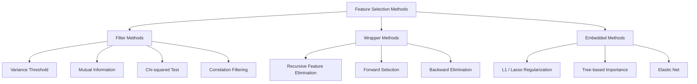
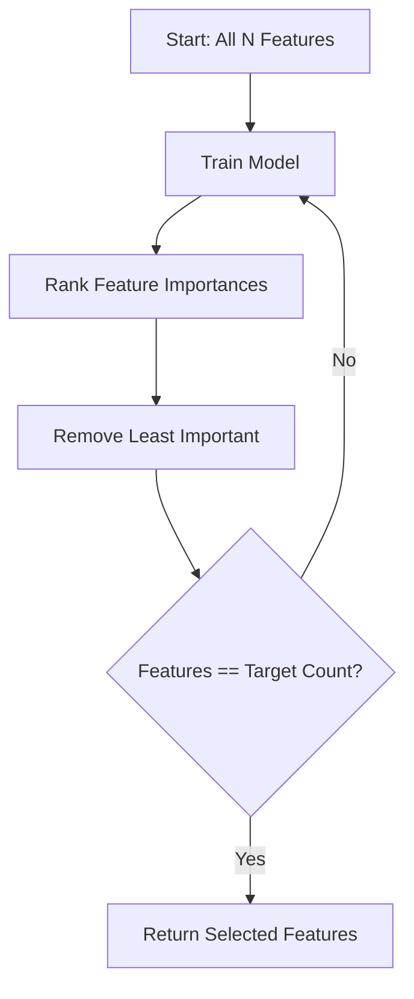
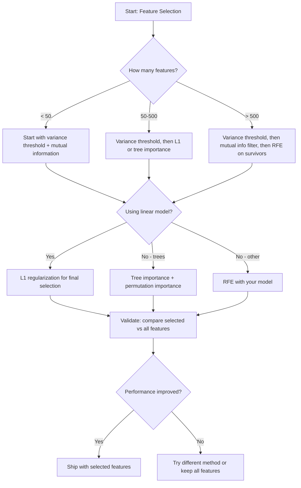

# 특성 선택 (Feature Selection)

> 특성이 더 많다고 좋은 것이 아닙니다. 올바른 특성이 있어야 더 좋습니다.

**유형:** Build (실습)
**Language:** Python
**선수 레슨:** Phase 2, Lessons 01-09, 08 (feature engineering)
**소요 시간:** ~75분

## 학습 목표

- 필터 기법(분산 임계값, 상호 정보량), 래퍼 기법(RFE), 임베디드 기법(L1, 트리 중요도)을 바닥부터 구현하고, 연습 문제를 통해 전진 선택법을 추가합니다.
- 상호 정보량이 상관계수로는 놓치는 비선형 특성-타깃 관계를 포착하는 이유를 설명합니다.
- L1 정규화(임베디드 선택)와 RFE(래퍼 선택)를 비교하고 이들의 계산 비용 측면에서의 트레이드오프를 평가합니다.
- 여러 기법을 결합한 특성 선택 파이프라인을 구축하고, 홀드아웃(held-out) 데이터에서 향상된 일반화 성능을 입증합니다.

## 문제

특성이 500개나 있습니다. 모델은 느리게 학습되고, 끊임없이 과적합(overfitting)되며, 모델이 무엇을 학습했는지 아무도 설명하지 못합니다. 성능을 개선하고자 특성을 더 추가해 보지만, 상황은 더 나빠집니다.

이것이 바로 차원의 저주(curse of dimensionality)입니다. 특성의 수가 증가함에 따라 특성 공간의 부피는 기하급수적으로 폭발합니다. 데이터 포인트는 희소(sparse)해집니다. 포인트 간 거리는 수렴합니다. 모델은 실제 패턴을 찾기 위해 지수적으로 더 많은 데이터를 필요로 합니다. 노이즈 특성이 신호 특성을 집어삼킵니다. 과적합이 기본 상태가 되어 버립니다.

특성 선택(feature selection)은 이에 대한 해독제입니다. 노이즈를 걷어내십시오. 중복을 제거하십시오. 타깃에 대한 실제 정보를 담고 있는 특성만 남기십시오. 그 결과는 더 빠른 학습, 더 나은 일반화 성능, 그리고 실제로 설명 가능한 모델입니다.

목표는 가용한 모든 정보를 사용하는 것이 아닙니다. 올바른 정보를 사용하는 것입니다.

## 개념

### 특성 선택의 세 가지 범주

모든 특성 선택 기법은 다음 세 가지 범주 중 하나에 속합니다.



**필터 기법(Filter methods)**은 통계적 측정값을 사용하여 각 특성을 독립적으로 평가합니다. 모델을 사용하지 않습니다. 빠르지만, 특성 간의 상호작용을 놓칩니다.

**래퍼 기법(Wrapper methods)**은 특성 부분집합을 평가하기 위해 모델을 직접 학습시킵니다. 모델의 성능을 점수로 사용합니다. 더 나은 결과를 얻지만, 모델을 여러 번 재학습시켜야 하므로 비용이 많이 듭니다.

**임베디드 기법(Embedded methods)**은 모델 학습의 일환으로 특성을 선택합니다. L1 정규화는 가중치를 0으로 만듭니다. 의사결정 트리(decision tree)는 가장 유용한 특성을 기준으로 분기합니다. 별도의 단계가 아니라 학습(fitting) 중에 선택이 일어납니다.

### 분산 임계값 (Variance Threshold)

가장 단순한 필터입니다. 특성이 샘플 전반에 걸쳐 거의 변하지 않는다면, 그 특성은 정보를 거의 담고 있지 않은 것입니다.

1,000개 샘플 중 999개에서 값이 0.0인 특성을 생각해 보십시오. 분산이 0에 가깝습니다. 어떤 모델도 이를 사용해 클래스를 구분할 수 없습니다. 이를 제거하십시오.

```math
\text{variance}(x) = \text{mean}\bigl((x - \text{mean}(x))^2\bigr)
```

임계값(예: 0.01)을 설정하십시오. 분산이 이보다 낮은 모든 특성을 제거합니다. 이는 타깃 변수를 전혀 보지 않고도 상수이거나 거의 상수에 가까운 특성을 제거합니다.

사용 시점: 다른 기법을 적용하기 전의 전처리 단계로 사용합니다. 거의 비용을 들이지 않고 명백히 쓸모없는 특성을 잡아냅니다.

한계: 어떤 특성은 높은 분산을 가지면서도 순전한 노이즈일 수 있습니다. 분산 임계값은 필요조건이지만 충분조건은 아닙니다.

### 상호 정보량 (Mutual Information)

상호 정보량은 특성 $X$의 값을 아는 것이 타깃 $Y$에 대한 불확실성을 얼마나 줄여주는지를 측정합니다.

```math
I(X; Y) = \sum_x \sum_y p(x, y) \cdot \log \frac{p(x, y)}{p(x) \cdot p(y)}
```

만약 $X$과 $Y$이 독립이라면, $p(x, y) = p(x) \cdot p(y)$이므로 로그 항이 0이 되어 $I(X; Y) = 0$이 됩니다. $X$이 $Y$에 대해 더 많은 정보를 알려줄수록, 상호 정보량은 더 높아집니다.

상관관계에 비해 갖는 핵심 장점: 상호 정보량은 비선형 관계를 포착합니다. 어떤 특성이 타깃과 상관관계가 0일지라도, 관계가 2차 함수 형태이거나 주기적이라면 상호 정보량은 높을 수 있습니다.

연속형 특성의 경우, 먼저 빈(bin)으로 이산화합니다(히스토그램 기반 추정). 빈의 개수는 추정치에 영향을 미칩니다. 빈이 너무 적으면 정보를 잃고, 빈이 너무 많으면 노이즈가 추가됩니다. 일반적으로 쓰이는 선택은 $\sqrt{n}$개의 빈 또는 스터지스 공식(Sturges' rule, $1 + \log_2 n$)입니다.


### 재귀적 특성 제거 (Recursive Feature Elimination, RFE)

RFE는 래퍼 기법입니다. 모델 자체의 특성 중요도를 사용하여 반복적으로 가지치기(pruning)를 수행합니다.

1. 모든 특성을 사용하여 모델을 학습시킵니다.
2. 중요도(선형 모델의 계수, 트리의 불순도 감소량)에 따라 특성의 순위를 매깁니다.
3. 가장 덜 중요한 특성(들)을 제거합니다.
4. 원하는 수의 특성이 남을 때까지 반복합니다.



RFE는 모델이 남아 있는 모든 특성을 함께 보기 때문에 특성 간의 상호작용을 고려합니다. 한 특성을 제거하면 다른 특성들의 중요도가 변합니다. 이 점 덕분에 필터 기법보다 더 철저합니다.

대가는 비용입니다. 모델을 $N - \text{target}$번 학습시켜야 합니다. 500개의 특성에서 10개를 목표로 한다면, 490번의 학습을 수행해야 합니다. 무거운 모델의 경우 이는 매우 느립니다. 단계마다 여러 특성을 한 번에 제거하여(예: 매 라운드 하위 10% 제거) 속도를 높일 수 있습니다.

### L1 (라쏘, Lasso) 정규화

L1 정규화는 손실 함수에 가중치의 절댓값을 추가합니다.

```math
\text{loss} = \text{prediction\_error} + \alpha \cdot \sum \lvert w_i \rvert
```

알파(alpha) 파라미터는 특성을 얼마나 공격적으로 가지치기할지 제어합니다. 알파가 클수록 더 많은 가중치가 정확히 0이 됩니다.

왜 정확히 0이 될까요? L1 페널티는 가중치 공간에서 다이아몬드 형태의 제약 영역을 형성합니다. 최적해는 이 다이아몬드의 꼭짓점에 위치하는 경향이 있으며, 이곳에서는 하나 이상의 가중치가 0이 됩니다. 반면 L2 정규화(릿지, ridge)는 원형 제약을 형성하므로 가중치가 줄어들기는 하지만 정확히 0이 되는 일은 드뭅니다.

이것이 바로 임베디드 특성 선택입니다. 모델은 학습 중에 어떤 특성을 무시할지 스스로 배웁니다. 가중치가 0인 특성은 사실상 제거된 것입니다.

장점: 단 한 번의 학습으로 완료되며, 상관관계가 높은 특성들을 잘 처리하고(하나를 선택하고 나머지는 0으로 만듦), 대부분의 선형 모델 구현체에 내장되어 있습니다.

한계: 선형 모델에만 작동합니다. 비선형 특성 중요도는 포착할 수 없습니다.

### 트리 기반 특성 중요도 (Tree-Based Feature Importance)

의사결정 트리와 그 앙상블(랜덤 포레스트, 그래디언트 부스팅)은 자연스럽게 특성의 순위를 매깁니다. 모든 분할은 불순도를 감소시킵니다(분류의 경우 지니 또는 엔트로피, 회귀의 경우 분산). 더 큰 불순도 감소를 만들어내는 특성이 더 중요합니다.

$T$개의 트리를 가진 랜덤 포레스트의 경우:

```math
\text{importance}(\text{feature}_j) = \frac{1}{T} \sum_{\text{all trees}} \; \sum_{\text{all nodes splitting on } \text{feature}_j} (\text{n\_samples} \cdot \text{impurity\_decrease})
```

이는 각 특성에 대해 정규화된 중요도 점수를 제공합니다. 비선형 관계와 특성 간 상호작용을 자동으로 처리합니다.

주의: 트리 기반 중요도는 고유값의 수가 많은(높은 카디널리티) 특성에 편향됩니다. 무작위 ID 열은 모든 샘플을 완벽하게 분할하기 때문에 매우 중요해 보일 수 있습니다. 유효성 검증을 위해 순열 중요도(permutation importance)를 함께 사용하십시오.

### 순열 중요도 (Permutation Importance)

모델에 구애받지 않는(model-agnostic) 기법입니다.

1. 모델을 학습시키고 검증 데이터에 대한 기준 성능을 기록합니다.
2. 각 특성에 대해: 해당 특성의 값을 무작위로 섞고(shuffle), 성능 저하를 측정합니다.
3. 성능 저하가 클수록, 그 특성은 더 중요한 것입니다.

어떤 특성을 섞어도 성능이 저하되지 않는다면, 모델은 그 특성에 의존하지 않는 것입니다. 성능이 곤두박질친다면, 그 특성은 매우 중요합니다.

순열 중요도는 트리 기반 중요도의 카디널리티 편향을 피할 수 있습니다. 하지만 느립니다. 특성당 한 번의 완전한 평가가 필요하며, 안정성을 위해 이를 여러 번 반복해야 합니다.
### 비교 표

| 방법 | 유형 | 속도 | 비선형 | 특성 상호작용 |
|--------|------|-------|-----------|---------------------|
| 분산 임계값(Variance threshold) | 필터(Filter) | 매우 빠름 | 아니오 | 아니오 |
| 상호 정보량(Mutual information) | 필터(Filter) | 빠름 | 예 | 아니오 |
| 상관관계 필터 | 필터(Filter) | 빠름 | 아니오 | 아니오 |
| RFE | 래퍼(Wrapper) | 느림 | 모델에 따라 다름 | 예 |
| L1 / Lasso | 임베디드(Embedded) | 빠름 | 아니오 (선형) | 아니오 |
| 트리 기반 중요도 | 임베디드(Embedded) | 보통 | 예 | 예 |
| 순열 중요도(Permutation importance) | 모델 무관(Model-agnostic) | 느림 | 예 | 예 |

### 결정 흐름도



```figure
f3-feature-prune
```

## 직접 구현해 보기

### 1단계: 특성 구조가 알려진 합성 데이터 생성

```python
import numpy as np


def make_feature_selection_data(n_samples=500, seed=42):
    rng = np.random.RandomState(seed)

    x1 = rng.randn(n_samples)
    x2 = rng.randn(n_samples)
    x3 = rng.randn(n_samples)
    x4 = x1 + 0.1 * rng.randn(n_samples)
    x5 = x2 + 0.1 * rng.randn(n_samples)

    informative = np.column_stack([x1, x2, x3, x4, x5])

    correlated = np.column_stack([
        x1 * 0.9 + 0.1 * rng.randn(n_samples),
        x2 * 0.8 + 0.2 * rng.randn(n_samples),
        x3 * 0.7 + 0.3 * rng.randn(n_samples),
        x1 * 0.5 + x2 * 0.5 + 0.1 * rng.randn(n_samples),
        x2 * 0.6 + x3 * 0.4 + 0.1 * rng.randn(n_samples),
    ])

    noise = rng.randn(n_samples, 10) * 0.5

    X = np.hstack([informative, correlated, noise])
    y = (2 * x1 - 1.5 * x2 + x3 + 0.5 * rng.randn(n_samples) > 0).astype(int)

    feature_names = (
        [f"info_{i}" for i in range(5)]
        + [f"corr_{i}" for i in range(5)]
        + [f"noise_{i}" for i in range(10)]
    )

    return X, y, feature_names
```

참값(ground truth)은 이미 알려져 있습니다. 특성 0~4는 유의미한 정보가 있고(또한 3과 4는 0과 1의 상관된 복사본), 특성 5~9는 유익한 특성들과 상관관계를 가지며, 특성 10~19는 순수한 노이즈입니다. 좋은 선택 방법이라면 0~4를 가장 높게, 10~19를 가장 낮게 평가해야 합니다.

### 2단계: 분산 임계값

```python
def variance_threshold(X, threshold=0.01):
    variances = np.var(X, axis=0)
    mask = variances > threshold
    return mask, variances
```

### 3단계: 상호 정보량 (이산형)

```python
def discretize(x, n_bins=10):
    min_val, max_val = x.min(), x.max()
    if max_val == min_val:
        return np.zeros_like(x, dtype=int)
    bin_edges = np.linspace(min_val, max_val, n_bins + 1)
    binned = np.digitize(x, bin_edges[1:-1])
    return binned


def mutual_information(X, y, n_bins=10):
    n_samples, n_features = X.shape
    mi_scores = np.zeros(n_features)

    y_vals, y_counts = np.unique(y, return_counts=True)
    p_y = y_counts / n_samples

    for f in range(n_features):
        x_binned = discretize(X[:, f], n_bins)
        x_vals, x_counts = np.unique(x_binned, return_counts=True)
        p_x = dict(zip(x_vals, x_counts / n_samples))

        mi = 0.0
        for xv in x_vals:
            for yi, yv in enumerate(y_vals):
                joint_mask = (x_binned == xv) & (y == yv)
                p_xy = np.sum(joint_mask) / n_samples
                if p_xy > 0:
                    mi += p_xy * np.log(p_xy / (p_x[xv] * p_y[yi]))
        mi_scores[f] = mi

    return mi_scores
```

### 4단계: 재귀적 특성 제거(RFE)

```python
def simple_logistic_importance(X, y, lr=0.1, epochs=100):
    n_samples, n_features = X.shape
    w = np.zeros(n_features)
    b = 0.0

    for _ in range(epochs):
        z = X @ w + b
        pred = 1.0 / (1.0 + np.exp(-np.clip(z, -500, 500)))
        error = pred - y
        w -= lr * (X.T @ error) / n_samples
        b -= lr * np.mean(error)

    return w, b


def rfe(X, y, n_features_to_select=5, lr=0.1, epochs=100):
    n_total = X.shape[1]
    remaining = list(range(n_total))
    rankings = np.ones(n_total, dtype=int)
    rank = n_total

    while len(remaining) > n_features_to_select:
        X_subset = X[:, remaining]
        w, _ = simple_logistic_importance(X_subset, y, lr, epochs)
        importances = np.abs(w)

        least_idx = np.argmin(importances)
        original_idx = remaining[least_idx]
        rankings[original_idx] = rank
        rank -= 1
        remaining.pop(least_idx)

    for idx in remaining:
        rankings[idx] = 1

    selected_mask = rankings == 1
    return selected_mask, rankings
```

### 5단계: L1 특성 선택

```python
def soft_threshold(w, alpha):
    return np.sign(w) * np.maximum(np.abs(w) - alpha, 0)


def l1_feature_selection(X, y, alpha=0.1, lr=0.01, epochs=500):
    n_samples, n_features = X.shape
    w = np.zeros(n_features)
    b = 0.0

    for _ in range(epochs):
        z = X @ w + b
        pred = 1.0 / (1.0 + np.exp(-np.clip(z, -500, 500)))
        error = pred - y

        gradient_w = (X.T @ error) / n_samples
        gradient_b = np.mean(error)

        w -= lr * gradient_w
        w = soft_threshold(w, lr * alpha)
        b -= lr * gradient_b

    selected_mask = np.abs(w) > 1e-6
    return selected_mask, w
```

### 6단계: 트리 기반 중요도 (단순 결정 트리)

```python
def gini_impurity(y):
    if len(y) == 0:
        return 0.0
    classes, counts = np.unique(y, return_counts=True)
    probs = counts / len(y)
    return 1.0 - np.sum(probs ** 2)


def best_split(X, y, feature_idx):
    values = np.unique(X[:, feature_idx])
    if len(values) <= 1:
        return None, -1.0

    best_threshold = None
    best_gain = -1.0
    parent_gini = gini_impurity(y)
    n = len(y)

    for i in range(len(values) - 1):
        threshold = (values[i] + values[i + 1]) / 2.0
        left_mask = X[:, feature_idx] <= threshold
        right_mask = ~left_mask

        n_left = np.sum(left_mask)
        n_right = np.sum(right_mask)

        if n_left == 0 or n_right == 0:
            continue

        gain = parent_gini - (n_left / n) * gini_impurity(y[left_mask]) - (n_right / n) * gini_impurity(y[right_mask])

        if gain > best_gain:
            best_gain = gain
            best_threshold = threshold

    return best_threshold, best_gain


def tree_importance(X, y, n_trees=50, max_depth=5, seed=42):
    rng = np.random.RandomState(seed)
    n_samples, n_features = X.shape
    importances = np.zeros(n_features)

    for _ in range(n_trees):
        sample_idx = rng.choice(n_samples, size=n_samples, replace=True)
        feature_subset = rng.choice(n_features, size=max(1, int(np.sqrt(n_features))), replace=False)

        X_boot = X[sample_idx]
        y_boot = y[sample_idx]

        tree_imp = _build_tree_importance(X_boot, y_boot, feature_subset, max_depth)
        importances += tree_imp

    total = importances.sum()
    if total > 0:
        importances /= total

    return importances


def _build_tree_importance(X, y, feature_subset, max_depth, depth=0):
    n_features = X.shape[1]
    importances = np.zeros(n_features)

    if depth >= max_depth or len(np.unique(y)) <= 1 or len(y) < 4:
        return importances

    best_feature = None
    best_threshold = None
    best_gain = -1.0

    for f in feature_subset:
        threshold, gain = best_split(X, y, f)
        if gain > best_gain:
            best_gain = gain
            best_feature = f
            best_threshold = threshold

    if best_feature is None or best_gain <= 0:
        return importances

    importances[best_feature] += best_gain * len(y)

    left_mask = X[:, best_feature] <= best_threshold
    right_mask = ~left_mask

    importances += _build_tree_importance(X[left_mask], y[left_mask], feature_subset, max_depth, depth + 1)
    importances += _build_tree_importance(X[right_mask], y[right_mask], feature_subset, max_depth, depth + 1)

    return importances
```

### 7단계: 모든 방법 실행 및 비교

코드 파일은 동일한 합성 데이터셋에서 5가지 방법을 모두 실행하고, 각 방법이 어떤 특성을 선택하는지 보여주는 비교 표를 출력합니다.

## 사용해 보기

scikit-learn을 사용하면 특성 선택이 파이프라인에 내장되어 있습니다.

```python
from sklearn.feature_selection import (
    VarianceThreshold,
    mutual_info_classif,
    RFE,
    SelectFromModel,
)
from sklearn.linear_model import Lasso, LogisticRegression
from sklearn.ensemble import RandomForestClassifier

vt = VarianceThreshold(threshold=0.01)
X_filtered = vt.fit_transform(X)

mi_scores = mutual_info_classif(X, y)
top_k = np.argsort(mi_scores)[-10:]

rfe_selector = RFE(LogisticRegression(), n_features_to_select=10)
rfe_selector.fit(X, y)
X_rfe = rfe_selector.transform(X)

lasso_selector = SelectFromModel(Lasso(alpha=0.01))
lasso_selector.fit(X, y)
X_lasso = lasso_selector.transform(X)

rf = RandomForestClassifier(n_estimators=100)
rf.fit(X, y)
importances = rf.feature_importances_
```

밑바닥부터 구현한 코드를 보면 각 방법의 내부에서 정확히 무슨 일이 일어나는지 알 수 있습니다. 분산 임계값은 단순히 `var(X, axis=0)`를 계산하고 마스크를 적용하는 것입니다. 상호 정보량은 분할표(contingency table)에서 결합 빈도와 주변 빈도를 계산하는 것입니다. RFE는 훈련, 순위 지정, 제거를 반복하는 루프입니다. L1은 소프트 임계값(soft-thresholding) 단계를 거치는 경사 하강법입니다. 트리 중요도는 분할에 따른 불순도 감소량을 누적합니다. 마법 같은 것은 없습니다. 통계와 루프일 뿐입니다.

sklearn 버전은 견고함(예: mutual_info_classif는 비닝 대신 k-NN 밀도 추정 사용), 속도(C 구현체), 파이프라인 통합 기능을 더해 줍니다.

## 배포하기

이 레슨을 통해 다음 산출물을 얻을 수 있습니다.
- `outputs/skill-feature-selector.md` -- 적합한 특성 선택 방법을 선택하기 위한 빠른 참조용 의사결정 트리

## 연습 문제

1. **전진 선택법(Forward selection)**: RFE의 반대 과정을 구현해 보세요. 특성이 없는 상태에서 시작합니다. 각 단계마다 모델 성능을 가장 많이 향상시키는 특성을 추가합니다. 특성을 추가해도 더 이상 성능이 개선되지 않으면 중단합니다. 선택된 특성을 RFE 결과와 비교해 보세요. 어느 쪽이 더 빠릅니까? 어느 쪽이 더 나은 결과를 냅니까?

2. **안정성 선택(Stability selection)**: 약간씩 다른 alpha 값을 사용하여 데이터의 80% 무작위 서브샘플에서 L1 특성 선택을 50회 실행해 보세요. 각 특성이 선택되는 횟수를 기록합니다. 80% 이상의 실행에서 선택된 특성을 "안정적(stable)"인 것으로 간주합니다. 안정적인 특성과 단일 실행 L1 선택 결과를 비교해 보세요. 어느 쪽이 더 신뢰할 수 있습니까?

3. **다중공선성(Multicollinearity) 감지**: 모든 특성에 대한 상관행렬을 계산하세요. 상관계수 임계값(예: 0.9)이 주어졌을 때, 강한 상관관계를 보이는 각 쌍에서 하나의 특성을 제거하는 함수를 구현하세요(타깃과의 상호 정보량이 더 높은 특성을 유지). 합성 데이터셋에서 테스트하고 중복된 상관 특성이 제거되는지 확인해 보세요.

4. **특성 선택 파이프라인**: 분산 임계값, 상호 정보량 필터, RFE를 하나의 파이프라인으로 연결하세요. 먼저 분산이 0에 가까운 특성을 제거하고, 상호 정보량 기준 상위 50%를 유지한 다음, 남은 특성을 대상으로 RFE를 실행합니다. 이 파이프라인을 모든 특성에 대해 RFE를 단독으로 실행한 결과와 비교해 보세요. 파이프라인이 더 빠릅니까? 정확도는 동등합니까?

5. **순열 중요도 밑바닥부터 구현하기**: 순열 중요도를 구현해 보세요. 각 특성에 대해 값을 10회 섞은 후 F1 점수의 평균 하락 폭을 측정합니다. 이 순위를 트리 기반 중요도와 비교해 보세요. 두 방법의 결과가 일치하지 않는 사례를 찾고 그 이유를 설명해 보세요(힌트: 상관된 특성).

## 핵심 용어

| 용어 | 흔히 하는 말 | 실제 의미 |
|------|----------------|----------------------|
| 필터 방법(Filter method) | "특성을 독립적으로 점수 매기기" | 모델을 훈련하지 않고 통계적 측정값을 사용해 특성의 순위를 매기며, 각 특성을 개별적으로 평가하는 특성 선택 접근 방식 |
| 래퍼 방법(Wrapper method) | "모델을 사용해 특성 선택하기" | 모델을 훈련하고 그 성능을 선택 기준으로 사용하여 특성 부분집합을 평가하는 특성 선택 접근 방식 |
| 임베디드 방법(Embedded method) | "모델이 훈련 중에 특성을 선택함" | L1 규제가 가중치를 0으로 만드는 것처럼 모델 적합(fitting) 과정의 일부로 일어나는 특성 선택 |
| 상호 정보량(Mutual information) | "한 변수가 다른 변수에 대해 얼마나 알려주는가" | $X$에 대한 지식이 주어졌을 때 $Y$의 불확실성이 감소하는 정도를 측정하는 지표로, 선형 및 비선형 의존성을 모두 포착함 |
| 재귀적 특성 제거(RFE) | "훈련, 순위 매기기, 제거, 반복" | 모델을 훈련하고, 가장 덜 중요한 특성을 제거하며, 목표 개수에 도달할 때까지 이를 반복하는 반복적 래퍼 방법 |
| L1 / Lasso 규제 | "특성을 없애는 페널티" | 손실 함수에 가중치 절댓값의 합을 추가하여 중요하지 않은 특성의 가중치를 정확히 0으로 만드는 기법 |
| 분산 임계값(Variance threshold) | "상수 특성 제거하기" | 샘플 전반에 걸친 분산이 지정된 임계값보다 낮은 특성을 제거하여 정보를 담고 있지 않은 특성을 걸러내는 기법 |
| 특성 중요도(Feature importance) | "어떤 특성이 가장 중요한가" | 분할 이득(트리) 또는 계수 크기(선형)로부터 계산되어 각 특성이 모델 예측에 얼마나 기여하는지를 나타내는 점수 |
| 순열 중요도(Permutation importance) | "섞어서 성능 저하를 측정하기" | 각 특성의 값을 무작위로 섞은 후 그로 인해 발생하는 모델 성능의 하락 폭을 측정하여 특성 중요도를 평가하는 방식 |
| 차원의 저주(Curse of dimensionality) | "특성은 너무 많고 데이터는 부족함" | 특성이 추가됨에 따라 특성 공간의 부피가 기하급수적으로 증가하여 데이터가 희소해지고 거리 개념이 무의미해지는 현상 |

## 더 읽을거리

- [An Introduction to Variable and Feature Selection (Guyon & Elisseeff, 2003)](https://jmlr.org/papers/v3/guyon03a.html) -- 특성 선택 방법에 관한 기초적인 서베이 논문으로, 여전히 널리 인용됨
- [scikit-learn Feature Selection Guide](https://scikit-learn.org/stable/modules/feature_selection.html) -- 코드 예제와 함께 필터, 래퍼, 임베디드 방법을 다루는 실용적인 가이드
- [Stability Selection (Meinshausen & Buhlmann, 2010)](https://arxiv.org/abs/0809.2932) -- 견고하고 재현 가능한 결과를 위해 서브샘플링과 특성 선택을 결합한 방법
- [Beware Default Random Forest Importances (Strobl et al., 2007)](https://bmcbioinformatics.biomedcentral.com/articles/10.1186/1471-2105-8-25) -- 트리 기반 중요도에서 카디널리티 편향(cardinality bias)을 입증하고 대안으로 조건부 중요도를 제안함
