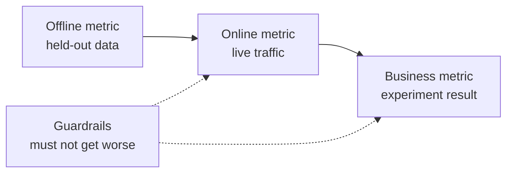

# ML 시스템 설계 — 문제 정의부터 모델 배포까지

> 모델은 시스템의 한 구성 요소일 뿐입니다. 모델이 무엇을 예측하고, 누가 그에 따라 행동하며, 비용은 얼마가 들고, 실패 시 어떻게 대처할지를 결정하는 것은 시스템 설계입니다.

**유형:** Build (실습)
**사용 언어:** Python, TypeScript
**선수 레슨:** Phase 2, Lessons 09 (Model Evaluation) and 13 (ML Pipelines)
**소요 시간:** ~110분

## 학습 목표

- 예측값, 예측값을 활용하는 의사결정, 그리고 규칙만으로는 불충분한 이유를 포함하여 비즈니스 문제를 ML 태스크로 정의합니다
- 오프라인 지표, 온라인 지표, 비즈니스 지표, 가드레일 지표를 구분하고, 모든 모델을 자명한 베이스라인(trivial baseline) 및 휴리스틱 베이스라인(heuristic baseline)과 비교합니다
- 트래픽 수치를 바탕으로 배치 및 온라인 추론(inference)의 일일 비용, 지연 시간(latency), 데이터 진부화(staleness)를 추정합니다
- 각 장애 모드에 대한 롤아웃 패턴(섀도, 카나리, A/B 테스트)과 안전한 기본값(safe default)을 선택합니다
- 모델이 다음 버전의 학습 데이터를 변화시키는 피드백 루프(feedback loop)를 식별합니다
- ML 설계 문서를 작성하고 고정된 체크리스트에 따라 점수를 매깁니다

## 문제 정의

구독 기반 서비스를 제공하는 한 회사에서 "이탈(churn) 예측 모델"을 요청했습니다. 데이터 과학자는 그래디언트 부스팅(gradient-boosted) 분류기를 학습시키고 AUC 0.91이라는 결과를 보고했습니다. 3개월 후, 아무도 그 모델을 사용하지 않았습니다.

그 원인은 알고리즘과 아무런 관련이 없었습니다. 점수에 따라 어떤 조치를 취해야 할지 아무도 결정하지 않았기 때문입니다. 점수는 일주일에 한 번 생성되는데, 고객 유지(retention) 팀은 매일 고객에게 전화를 걸었습니다. 레이블은 해지 사유도 함께 저장된 해지 테이블에서 가져왔기 때문에, 하나의 특성(feature)에 이미 정답이 포함되어 있었습니다. 또한 고객 지원 팀이 이미 사용하고 있던 규칙(2주 동안 활동이 없는 고객에게 전화하기)과 모델을 비교해 본 사람도 없었습니다.

이러한 실패는 모두 학습을 시작하기 전에 발생한 문제입니다. 이는 설계 실패이며, 한 페이지짜리 설계 문서는 이러한 질문을 하나하나 던집니다. 이번 레슨에서는 해당 설계 문서에 포함되는 의사결정들을 다룹니다. 배치 및 온라인 서빙 비용을 산출하고, 모델을 베이스라인과 비교하며, 체크리스트를 기반으로 설계 문서의 점수를 매기는 툴킷을 직접 구축해 봅니다.

## 핵심 개념

### 비즈니스 목표에서 ML 태스크로

비즈니스 목표는 ML 태스크가 아닙니다. 다음 네 가지 질문을 통해 비즈니스 목표를 ML 태스크로 전환할 수 있습니다.

1. 모델이 정확히 무엇을 예측하며, 대상 엔티티(사용자, 결제, 매장, 아이템)는 무엇인가?
2. 예측값을 활용하는 의사결정은 무엇이며, 누가 또는 무엇이 그 결정을 내리는가?
3. 예측이 필요한 시점은 언제이며, 그 시점에 어떤 데이터가 존재하는가?
4. 의사결정이 개선되었는지를 어떻게 알 수 있는가?

| 비즈니스 목표 | 예측 | 이를 활용하는 의사결정 | ML 태스크 |
|---|---|---|---|
| 이탈 감소 | 사용자가 향후 30일 이내에 해지할 확률 | 매일 밤 상위 5% 사용자에게 이탈 방지 혜택 제공 | 이진 분류(Binary classification) |
| 사기 피해 절감 | 결제가 사기(fraud)일 확률 | 100ms 이내에 승인, 검토 또는 차단 | 이진 분류 |
| 재고 유지 | 다음 주 매장별 일일 판매량 | 각 매장의 발주 수량 | 예측(Forecasting) |
| 관련성 높은 아이템 표시 | (사용자, 아이템) 쌍의 관련성 점수 | 피드 내 아이템 노출 순서 | 랭킹(Ranking) |

두 번째 열에 가장 많은 주의를 기울여야 합니다. "이탈 예측"이라는 표현은 기간, 엔티티, 조치를 모두 불분명하게 남겨둡니다. 반면 "오늘 밤 배치 작업에서 혜택을 제공할 대상을 선정할 수 있도록, 이 사용자가 향후 30일 이내에 해지할지 여부를 예측한다"는 것은 이 세 가지를 모두 명확하게 정의합니다.

### ML을 사용하지 말아야 할 때

Google의 'Rules of Machine Learning'의 규칙 1번에서는 머신러닝 없이 제품을 출시하는 것을 두려워하지 말라고 조언합니다. 머신러닝에는 데이터가 필요하며, 단순한 휴리스틱만으로도 목표의 상당 부분을 달성할 수 있는 경우가 많습니다. 다음과 같은 경우에는 ML을 사용하지 마십시오.

- 간단한 규칙으로 목표를 달성할 수 있고 그 규칙이 계속 유효한 경우. 규칙은 실행, 테스트, 설명 비용이 훨씬 저렴합니다.
- 레이블이 없으며 이를 수집할 실질적인 방법도 없는 경우.
- 예측값에 따라 아무도 행동하지 않아, 더 나은 예측을 하더라도 아무것도 바뀌지 않는 경우.
- 예측 시점에 존재하는 데이터에 유의미한 신호(signal)가 포함되어 있지 않은 경우.
- 단 한 번의 오류도 허용되지 않으며, 사람이 출력을 검토할 수도 없는 경우.
- 시스템 구축 및 운영 비용이 의사결정 개선으로 얻는 가치보다 큰 경우.

규칙이 길어지고 취약해지기 시작하면 ML이 가치를 발휘하기 시작합니다. 같은 가이드의 규칙 3번에서는 복잡한 휴리스틱보다 ML을 선호하는데, 학습된 모델이 업데이트와 유지보수가 더 쉽기 때문입니다.

### 세 가지 계층의 지표

ML 시스템은 다음 세 가지 계층의 지표와 한 세트의 제한 기준을 통해 측정합니다.

| 계층 | 측정 가능한 시점 | 이탈 예측 예시 |
|---|---|---|
| 오프라인 지표 | 출시 전, 홀드아웃(held-out)된 과거 데이터 기반 | 혜택 제공 임곗값에서의 F1, 상위 5% 정밀도(precision) |
| 온라인 지표 | 출시 중, 실시간 트래픽 기반 | 혜택 수락률, 점수가 매겨진 사용자 비율, 점수 분포 |
| 비즈니스 지표 | 출시 수 주 후, 실험을 통해 측정 | 실험군과 대조군 간의 30일 이탈률 비교 |
| 가드레일 지표 | 상시 | 방지된 사용자당 혜택 비용, 구독 취소율, p99 지연 시간 |



이 계층들은 종종 상충할 수 있습니다. 오프라인 지표는 과거 데이터를 평가하지만, 과거에는 여러분의 모델이 존재하지 않았습니다. 온라인 지표는 사람들이 그 결정에 어떻게 반응하는지에 따라 달라집니다. 비즈니스 지표는 변화가 느리고 회사의 다른 모든 요인에서 비롯된 노이즈를 포함합니다.

실제 의사결정과 일치하는 오프라인 지표를 선택하십시오. 배치 작업이 상위 5%의 사용자에게 연락하는 방식이라면, 상위 5%에서의 정밀도를 측정해야 합니다. AUC는 실제로 사용하지 않을 임곗값을 포함해 모든 임곗값에 대해 평균을 냅니다. 동일한 가이드의 규칙 2번에서는 ML 시스템이 무엇을 할지 결정하기 전에 지표를 먼저 설계하고 구현하라고 조언합니다.

### 베이스라인

지표 값 하나만으로는 아무런 의미가 없습니다. F1 점수 0.56은 최선의 대안이 0.30일 때는 훌륭하지만, 규칙 기반 시스템이 0.60을 달성한다면 형편없는 수치입니다. 모든 모델을 다음 세 가지 베이스라인과 비교하십시오.

- **자명한 베이스라인(Trivial baseline).** 항상 다수 클래스를 예측하거나 항상 학습 데이터의 평균값을 예측합니다. 모델 평가 레슨에서도 이 검증 방식을 사용했습니다.
- **휴리스틱 베이스라인(Heuristic baseline).** 도메인 지식 기반의 규칙이나, 학습 데이터에 맞춰 조정한 단일 특성 임곗값을 사용합니다.
- **현재 시스템(Current system).** 스프레드시트를 다루는 사람일지라도 현재 의사결정을 내리고 있는 기존 방식입니다.

리프트(lift)는 모델의 점수에서 가장 강력한 베이스라인의 점수를 뺀 값입니다. 결과를 확인하기 전에 최소 리프트 기준을 정해 두고, 시스템 추가 구축 비용을 정당화할 수 있을 만큼 충분히 크게 설정하십시오. 자명한 베이스라인은 보통 쉽게 넘어서지만, 넘어서기 어려운 것은 바로 휴리스틱 베이스라인입니다.

### 데이터 및 레이블 요구사항

학습 전에 다음 질문에 답해야 합니다.

- **레이블 소스(Label source).** 어떤 테이블이나 이벤트가 레이블을 정의하며, 그 소유자는 누구인가?
- **레이블 지연(Label delay).** 예측 후 실제 결과가 나오기까지 얼마나 걸리는가? 사기 결제에 대한 차지백(chargeback)은 결제 후 수 주 뒤에 발생할 수 있습니다. 이탈 레이블은 30일 기간이 끝난 후에야 확정됩니다.
- **레이블 품질(Label quality).** 레이블을 누가 부여하며, 오류 빈도는 어느 정도인가?
- **예측 시점 가용성(Availability at prediction time).** 예측 시점에 모든 특성이 존재하는가? 시스템이 결과 발생 이후에 기록하는 특성은 학습 시 레이블 누수를 일으킵니다.
- **클래스당 데이터양(Volume per class).** 양성(positive) 예시가 얼마나 존재하는가? 양성 예시가 200개뿐이라면 단순한 모델만 사용할 수 있습니다.
- **시간 기준 분할(Time split).** 가장 최근 기간을 검증용으로 홀드아웃합니다. 시계열 레슨에서 시간 기준으로 데이터를 분할했던 것과 동일한 이유입니다.
### 지연 시간, 처리량 및 비용 예산

모든 서빙 설계는 세 가지 수치로 제한됩니다.

- **지연 시간 예산(Latency budget).** p99 지연 시간은 100건의 요청 중 99건이 유지되는 시간 한도입니다. 결제 확인에는 50 ms가 필요할 수 있고, 야간 리포트는 수 시간이 걸릴 수도 있습니다.
- **최대 처리량(Peak throughput).** 일일 평균이 아니라 가장 분주한 1분을 기준으로 시스템 규모를 산정합니다. 최대 QPS는 평균의 몇 배에 달하는 경우가 많습니다.
- **비용 예산(Cost budget).** 설계를 비교할 수 있도록 일일 달러 비용이나 1,000건의 예측당 달러 비용으로 표현합니다.

리틀의 법칙(Little's law)은 앞의 두 수치를 연결합니다. 처리 중인 요청 수는 처리량에 지연 시간을 곱한 값과 같습니다. 초당 400건의 요청이 발생하고 각 요청에 50 ms가 소요된다면, 어느 순간이든 20건의 요청이 진행 중입니다.

### 배치 추론 대 온라인 추론

예측을 서빙하는 기본 방식에는 두 가지가 있습니다.

- **배치 추론(Batch inference).** 스케줄링된 작업이 모든 엔티티를 점수화(score)하여 테이블이나 키-값 저장소에 기록합니다. 애플리케이션은 요청 시점에 저장된 점수를 읽습니다.
- **온라인 추론(Online inference).** 애플리케이션이 요청 시점에 피처를 모델 서비스로 전송하고 점수를 기다립니다.

| 속성 | 배치 | 온라인 |
|---|---|---|
| 신선도 | 마지막 실행 시점의 데이터 + 실행 시간 | 요청 시점의 데이터 사용 |
| 요청 지연 시간 | 키-값 조회 1회, 수 밀리초 | 피처 조회 + 모델 실행 시간 |
| 비용 요인 | 엔티티 수 × 일일 실행 횟수 | 최대 QPS에 맞춰 산정된 복제본(replica) 수 |
| 신규 엔티티 | 다음 실행 전까지 점수 없음 | 첫 요청 시 점수 산출 |
| 장애 발생 시 | 이전 점수는 계속 읽을 수 있음 | 요청 실패 또는 타임아웃 발생 |

본 단원의 툴킷은 두 방식의 비용을 모두 계산합니다. 배치 비용은 엔티티 수와 일일 실행 횟수에 비례하여 증가합니다. 데이터 신선도 허용 한도(staleness limit)가 짧을수록 더 많은 실행이 필요합니다. 온라인 비용은 피크 트래픽에 따라 증가하는데, 피크 시간대 사이에 유휴 상태인 복제본 비용도 지불해야 하기 때문입니다. 실행에 1시간이 걸리는 배치 작업은 비용을 얼마를 들이든 1시간 미만의 신선도 한도를 충족할 수 없습니다.

하이브리드 설계도 흔히 쓰입니다. 야간 배치 작업으로 기존 사용자의 점수를 매기고, 온라인 경로에서는 신규 사용자 및 최신 데이터가 필요한 요청의 점수를 산출합니다.

### 배포 패턴

새로운 모델은 단계적으로 사용자에게 도달합니다.

1. **섀도(Shadow).** 새 모델이 실제 트래픽의 복사본을 전달받습니다. 시스템은 예측값을 로깅하기만 하고 실제로 사용하지는 않습니다. 현재 모델과 지연 시간, 에러율, 예측 분포를 비교합니다.
2. **카나리(Canary).** 새 모델이 전체 트래픽 중 일부(보통 1~5%)에 대해 실제 결정을 내립니다. 단계적으로 비중을 늘려가며, 가드레일을 벗어나면 롤백합니다.
3. **A/B 테스트(A/B test).** 무작위로 분할된 사용자가 각 모델을 경험합니다. 통계적 검정을 통해 비즈니스 지표를 측정하며, 차이를 확인하려면 충분한 트래픽과 시간이 필요합니다.

모든 단계에는 몇 분 내에 완료되는 롤백이 필요합니다. 이전 모델 버전을 계속 배포해 두고 설정(configuration)을 통해 트래픽을 전환합니다. LLM 서빙 단계에서는 언어 모델을 대상으로 동일한 세 가지 패턴을 [섀도 및 카나리 단원](../../../17-infrastructure-and-production/20-shadow-canary-progressive/docs/en.md)과 [A/B 테스트 단원](../../../17-infrastructure-and-production/21-ab-testing-llm-features/docs/en.md)에서 다룹니다.

### 피드백 루프

피드백 루프(feedback loop)는 모델의 결정이 다음 버전을 훈련할 데이터를 변경할 때 발생합니다. Sculley 등은 직접적 및 숨겨진 피드백 루프를 ML 시스템의 주요 기술 부채 원인 중 하나로 꼽습니다. 흔히 볼 수 있는 세 가지 사례는 다음과 같습니다.

- **개입이 레이블을 숨김.** 이탈 예측 모델이 혜택을 제공하고, 그 혜택 덕분에 일부 사용자가 남게 됩니다. 다음 달에는 고위험 사용자가 충성 고객처럼 보이게 되며, 재훈련된 모델은 해당 피처가 이탈을 예측하지 못한다고 학습합니다.
- **차단된 행동에는 결과가 없음.** 부정 결제(fraud) 모델이 결제를 차단하면 해당 결제는 지불 거절(chargeback) 레이블을 받지 못합니다. 재훈련된 모델은 차단된 영역에서 더 적은 사기 사례를 보게 됩니다.
- **노출이 피드백을 제한함.** 랭킹 모델이 상위 아이템만 노출하므로 해당 아이템들만 클릭을 수집합니다.

해결책은 모델의 영향을 받지 않은 데이터를 일부 유지한다는 하나의 아이디어를 공유합니다. 개입을 전혀 받지 않는 작은 무작위 그룹을 제외(holdout)해 둡니다. 트래픽의 작은 비율에는 무작위 결정을 적용합니다. 각 예제마다 점수와 결정을 함께 로깅하여, 향후 훈련 시 영향을 받은 데이터와 오염되지 않은 데이터를 구분할 수 있도록 합니다.

### 실패 모드 및 안전 기본값

시스템의 모든 구성 요소는 조만간 실패하기 마련입니다. 장애 발생 중이 아니라 설계 단계에서 각 장애에 대한 기본 동작을 결정해야 합니다.

| 장애 | 대책이 없을 때의 결과 | 안전 기본값 |
|---|---|---|
| 모델 서비스 타임아웃 | 요청 실패 | 휴리스틱 베이스라인 사용 |
| 야간 배치 작업 실패 | 점수 누락 또는 노후화 | 정해진 시간 동안 정상 처리된 마지막 점수를 제공한 후 규칙 적용 |
| 피처 누락 또는 범위 초과 | 모델이 비정상 입력값으로 점수 산출 | 문서화된 기본값을 사용하고 이벤트 로깅 |
| 이력이 없는 신규 엔티티 | 점수가 존재하지 않음 | 규칙 또는 모집단 평균 사용 |
| 점수 분포의 급격한 변동 | 대규모 오판 발생 | 자동화된 조치를 일시 중단하고 담당자에게 알림 발송 |

지표 섹션에서 정의한 휴리스틱 베이스라인은 대부분의 장애 상황에서 기본값으로도 사용되므로 가장 먼저 구축해야 합니다.

### 설계 문서

설계 문서는 훈련이 시작되기 전에 위의 모든 결정을 한곳에 기록합니다. 본 단원의 체커는 이 문서의 JSON 버전을 채점합니다. 다음 6개 항목은 시스템을 안전하지 않거나 무용지물로 만들기 때문에 검토를 차단(blocking)합니다.

| 섹션 | 다루는 질문 | 차단 여부 |
|---|---|---|
| 문제 | 무엇을 예측하고, 어떤 결정에 사용되며, 규칙만으로 충분하지 않은 이유는 무엇인가? | 결정 |
| 지표 | 어떤 오프라인, 온라인, 비즈니스, 가드레일 지표를 적용하는가? | 비즈니스 지표 |
| 베이스라인 | 어떤 단순, 휴리스틱, 현재 시스템 베이스라인을 적용하는가? | 휴리스틱 또는 현재 베이스라인 |
| 데이터 | 레이블은 어디서 언제 오며, 예측 시점에 각 피처가 존재하는가? | 누수 없음 |
| 예산 및 서빙 | 어떤 지연 시간, 최대 QPS, 비용, 신선도 한도가 적용되며, 어떤 서빙 모드가 적합한가? | 아니오 |
| 롤아웃 | 어떤 섀도, 카나리, A/B 단계를 적용하며, 어떻게 롤백하는가? | 섀도 또는 카나리, 그리고 롤백 |
| 피드백 루프 | 모델이 자신의 향후 데이터를 어떻게 변경할 수 있으며, 깨끗한 데이터를 어떻게 유지하는가? | 아니오 |
| 실패 모드 | 각 장애에 대한 기본 동작은 무엇인가? | 모든 장애에 대한 기본값 |
| 모니터링 | 출시 후 무엇을 관찰하는가? | 아니오 |

```figure
mlprod-serving-cost
```

## 직접 구현해 보기

`code/main.py`의 코드는 표준 라이브러리만 사용합니다. 서빙 비용 모델, 베이스라인 비교 도구, 설계 문서 체커라는 세 가지 도구가 포함되어 있습니다.

### 1단계: 워크로드 및 가격 정의하기

워크로드는 트래픽 수치와 예산을 보관합니다. 비용 모델은 가격을 보관합니다. 가격은 공급업체의 견적이 아닌 실습을 위한 단순화된 수치입니다.

```python
@dataclass(frozen=True)
class Workload:
    name: str
    entities: int
    requests_per_day: int
    peak_qps: float
    max_staleness_hours: float
    latency_budget_ms: float


@dataclass(frozen=True)
class CostModel:
    batch_dollars_per_million: float = 0.40
    batch_job_hours: float = 1.0
    lookup_dollars_per_million: float = 0.25
    lookup_latency_ms: float = 4.0
    replica_dollars_per_hour: float = 0.50
    replica_qps: float = 200.0
    min_replicas: int = 2
    online_latency_ms: float = 35.0
```

### 2단계: 배치 및 온라인 서빙 비용 산정하기

배치 작업은 신선도 한도 내에 완료되어야 합니다. 실행 간격은 신선도 한도에서 작업 실행 시간을 뺀 값입니다. 각 실행은 점수를 요청하는 대상이 있든 없든 모든 엔티티를 점수화합니다.

```python
def batch_plan(workload: Workload, costs: CostModel) -> ServingPlan:
    refresh_hours = workload.max_staleness_hours - costs.batch_job_hours
    if refresh_hours <= 0:
        return ServingPlan(
            "batch", False, math.inf, costs.lookup_latency_ms, math.inf, 0.0,
            "staleness limit is shorter than one batch job",
        )
    runs_per_day = 24.0 / refresh_hours
    predictions = workload.entities * runs_per_day
    dollars = (
        predictions / 1e6 * costs.batch_dollars_per_million
        + workload.requests_per_day / 1e6 * costs.lookup_dollars_per_million
    )
    ...
```

온라인 서빙은 피크를 처리할 수 있는 충분한 복제본 비용을 지불하며, 가용성을 위해 최소 2개를 유지합니다.

```python
def online_plan(workload: Workload, costs: CostModel) -> ServingPlan:
    replicas = max(costs.min_replicas, math.ceil(workload.peak_qps / costs.replica_qps))
    dollars = replicas * costs.replica_dollars_per_hour * 24.0
    feasible = costs.online_latency_ms <= workload.latency_budget_ms
    ...
```

`choose_serving`는 지연 시간 및 신선도 한도를 충족하는 계획만 남기고 가장 저렴한 계획을 반환합니다. 적합한 계획이 없으면 `None`를 반환하므로 예산을 변경해야 함을 알 수 있습니다.
### Step 3: 모델과 베이스라인 비교하기

비교기(comparator)는 모델과 모든 베이스라인을 동일한 지표로 평가합니다. 이때 가장 약한 베이스라인이 아닌 가장 강력한 베이스라인을 기준으로 성능 향상(lift)을 측정합니다.

```python
def compare_to_baselines(
    y_true: list,
    model_pred: list,
    baselines: dict[str, list],
    metric,
    metric_name: str,
    higher_is_better: bool = True,
    min_lift: float = 0.02,
) -> BaselineReport:
    if not baselines:
        raise ValueError("a model needs at least one baseline")
    scores = {name: metric(y_true, pred) for name, pred in baselines.items()}
    pick = max if higher_is_better else min
    best_name = pick(scores, key=scores.get)
    model_score = metric(y_true, model_pred)
    lift = model_score - scores[best_name] if higher_is_better else scores[best_name] - model_score
    return BaselineReport(metric_name, {"model": model_score, **scores}, best_name, lift, min_lift)
```

휴리스틱 베이스라인은 단일 피처 규칙입니다. `fit_rule`은(는) 훈련 데이터에서 해당 피처의 각 값을 임계값(threshold)으로 시도해 보고 가장 높은 F1 점수를 내는 임계값을 유지합니다. 이 데모는 합성 이탈(churn) 데이터로 소형 로지스틱 회귀를 훈련하고 이를 세 가지 베이스라인과 비교합니다.

### Step 4: 설계 문서 점수 매기기

각 체크리스트 항목에는 키, 가중치, 차단 플래그(blocking flag), 메시지, 검사 함수가 있습니다. 차단 항목의 가중치는 2입니다.

```python
CheckItem("decision", 2, True, "name the action that uses each prediction", lambda d: _text(d, "problem.decision")),
CheckItem("baselines", 2, True, "add a heuristic or current-system baseline", check_baselines),
CheckItem("no_leakage", 2, True, "confirm every feature exists at prediction time",
          lambda d: get_path(d, "data.features_available_at_prediction_time") is True),
CheckItem("serving_fit", 1, False, "pick a serving mode that meets the staleness, latency, and cost budgets",
          check_serving_fit),
```

`check_serving_fit`은(는) 비용 모델을 재사용합니다. 문서에서 워크로드 수치를 읽어와 선택된 서빙 방식의 비용을 산출합니다. 해당 방식이 데이터 최신성 제한(staleness limit), 지연 시간 예산(latency budget), 또는 일일 비용 예산을 충족하지 못하면 검사에 실패합니다. "배치(batch)"로 기재되어 있으면서 최신성 제한이 3분인 문서는 이 검사를 통과하지 못합니다. 비용 모델에는 하이브리드 계획이 없으므로, "하이브리드(hybrid)"로 기재된 문서는 연습 문제 1에서 해당 계획을 추가할 때까지 이 검사에서 실패합니다.

`review_design_doc`은(는) 통과한 항목들의 가중치를 합산한 뒤 전체 합으로 나눕니다. 점수가 0.85에 도달하고 실패한 차단 항목이 없을 때만 "검토 준비 완료(ready for review)" 판정이 내려집니다.

### Step 5: 실행하기

```bash
python3 code/main.py
npx tsx code/main.ts
```

```console
nightly churn scores
  ok batch        $0.91/day      4 ms  1.0 runs per day over 2,000,000 entities
  ok online      $24.00/day     35 ms  2 replicas sized for 40 peak QPS
  choose: batch

feed ranking, 2-hour freshness
  ok batch       $48.50/day      4 ms  24.0 runs per day over 5,000,000 entities
  ok online      $24.00/day     35 ms  2 replicas sized for 120 peak QPS
  choose: online

=== Model versus baselines (churn, metric F1) ===
  model                    0.564
  days_idle > 12.8688      0.500
  random at base rate      0.232
  majority class           0.000
  model beats the strongest baseline (days_idle > 12.8688) by +0.064
```

다수 클래스 베이스라인은 이탈을 전혀 예측하지 않으므로 F1 점수가 0입니다. 적합된 규칙(fitted rule)이 진정한 경쟁 상대입니다. 모델이 규칙보다 0.064 앞서므로, 모델은 도입될 만한 가치를 입증한 것입니다. 피처가 더 약하다면 규칙이 이길 수도 있으며, 그 경우에는 규칙이야말로 배포해야 할 올바른 시스템입니다.

설계 문서 검토에서는 6개의 차단 항목이 있는 미흡한 문서와 점수가 1.00인 완성된 문서가 출력됩니다. 경로를 전달하여 직접 작성한 문서를 검토할 수도 있습니다:

```bash
python3 code/main.py my_design_doc.json
npx tsx code/main.ts my_design_doc.json
```

## 활용하기

툴킷의 각 구성 요소는 팀들이 프로덕션 환경에서 사용하는 도구들과 직접 매핑됩니다.

**베이스라인.** scikit-learn은 기본적인 베이스라인을 추정기(estimator) 형태로 제공하므로, 모델과 동일한 파이프라인에 바로 적용할 수 있습니다:

```python
from sklearn.dummy import DummyClassifier, DummyRegressor
from sklearn.metrics import f1_score

majority = DummyClassifier(strategy="most_frequent").fit(X_train, y_train)
base_rate = DummyClassifier(strategy="stratified", random_state=0).fit(X_train, y_train)
mean_value = DummyRegressor(strategy="mean").fit(X_train, y_reg_train)

print(f1_score(y_test, majority.predict(X_test)))
```

`most_frequent`은(는) `majority_baseline`과(와) 일치하며, `stratified`은(는) `base_rate_baseline`과(와) 일치합니다. scikit-learn에는 휴리스틱 베이스라인이 없는데, 휴리스틱은 작업 도메인에서 도출되기 때문입니다.

**배치 서빙.** Apache Airflow나 Dagster 같은 워크플로 스케줄러가 스코어링 작업을 실행합니다. 작업 결과 점수는 데이터 웨어하우스 테이블이나 Redis, DynamoDB 같은 키-값 저장소에 기록됩니다.

**온라인 서빙.** KServe, BentoML, NVIDIA Triton, TorchServe 같은 모델 서버는 모델을 HTTP나 gRPC 엔드포인트 뒤에 래핑합니다. 소형 모델의 경우 모델을 로드한 일반 웹 서비스로도 충분합니다.

**롤아웃.** Argo Rollouts 같은 Kubernetes 도구는 카나리 릴리스(canary release)를 위해 트래픽을 분할합니다. GrowthBook이나 Statsig 같은 실험 플랫폼은 사용자를 A/B 그룹에 할당하고 통계를 계산합니다.

**설계 검토.** Breck 등은 프로덕션 ML 시스템을 위한 28가지 테스트 및 모니터링 요구사항 루브릭인 ML Test Score를 발표했습니다. 본 튜토리얼의 검사기는 그보다 간결하며, 해당 테스트들을 수행하기 전에 검토해야 할 설계 측면의 질문들을 다룹니다.

## 완성품 배포하기

이번 강의에서는 `outputs/skill-ml-design-review.md`을(를) 제작합니다. 이 스킬은 ML 설계 문서를 섹션별로 검토하고 차단 요인이 되는 결함을 먼저 지목합니다. 또한 본 강의의 배치 및 온라인 비용 산출법을 활용하여 서빙 방식 선택의 타당성도 검증합니다.

## 연습 문제

1. `choose_serving`에 하이브리드 계획을 추가해 보세요. 기존 사용자는 배치로 점수를 매기고 신규 사용자는 온라인으로 처리합니다. 일일 비용을 비교해 보세요.
2. 모델이 더 이상 규칙을 이기지 못할 때까지 이탈 데이터를 변경해 보세요. 성능 향상이 사라지게 만드는 가장 작은 계수(coefficient) 변화를 기록하세요.
3. 체크리스트에 `budgets.max_dollars_per_1k_predictions` 항목을 추가하세요. 해당 항목이 없으면 실패하는 테스트를 작성하세요.
4. 결제 부정 거래 탐지(fraud check)를 위한 JSON 설계 문서를 작성하세요. 검사기를 실행하고 모든 차단 항목을 해결해 보세요.
5. 이탈 피드백 루프를 시뮬레이션해 보세요. 혜택 제안(offer)을 받은 사용자의 레이블을 제거하고, 재훈련한 뒤 F1 점수의 변화를 측정하세요.

## 핵심 용어

| 용어 | 일상적인 표현 | 실제 의미 |
|------|----------------|----------------------|
| 머신러닝 작업(ML task) | "이탈 모델 만들기" | 예측 대상, 엔터티, 예측 기간, 그리고 해당 예측을 활용하는 의사결정 |
| 오프라인 지표(Offline metric) | "모델 점수" | 출시 전 별도로 분리해 둔 과거 데이터로 계산한 지표 |
| 온라인 지표(Online metric) | "라이브 수치" | 모델이 실행되는 동안 실제 트래픽에서 측정한 지표 |
| 비즈니스 지표(Business metric) | "목표" | 의사결정을 통해 변화시켜야 하는 기업의 성과로, 실험을 통해 측정됨 |
| 가드레일 지표(Guardrail metric) | "부작용 방지" | 새 모델이 출시될 때 악화되어서는 안 되는 지표 |
| 베이스라인(Baseline) | "기본 모델" | 모델이 정해진 마진 이상으로 넘어서야 하는 단순 규칙, 휴리스틱, 또는 현재 시스템 예측기 |
| 배치 추론(Batch inference) | "사전 계산된 점수" | 스케줄링된 작업이 모든 엔터티에 점수를 매기고 조회를 위해 결과를 저장하는 방식 |
| 온라인 추론(Online inference) | "실시간 모델" | 요청이 도착할 때마다 모델이 즉시 점수를 매기는 방식 |
| 섀도 배포(Shadow deployment) | "다크 론칭" | 새 모델이 실제 트래픽에 점수를 매기되, 아무도 그 출력을 사용하지 않는 방식 |
| 카나리 릴리스(Canary release) | "점진적 배포" | 롤백 준비를 갖춘 상태에서 새 모델이 트래픽의 작지만 점진적으로 늘어나는 일부를 처리하게 하는 방식 |
| 피드백 루프(Feedback loop) | "모델의 자가 학습" | 모델의 의사결정이 다음 버전 학습에 사용될 데이터를 변화시키는 현상 |

## 더 읽을거리

- [Sculley et al., Hidden Technical Debt in Machine Learning Systems (NeurIPS 2015)](https://papers.nips.cc/paper/2015/hash/86df7dcfd896fcaf2674f757a2463eba-Abstract.html): 피드백 루프, 얽힘(entanglement), 그리고 모델을 둘러싼 시스템 비용
- [Google, Rules of Machine Learning](https://developers.google.com/machine-learning/guides/rules-of-ml): 첫 모델, 지표, 훈련-서빙 일관성을 위한 실무 규칙
- [Breck et al., The ML Test Score (IEEE Big Data 2017)](https://research.google/pubs/the-ml-test-score-a-rubric-for-ml-production-readiness-and-technical-debt-reduction/): 프로덕션 준비 상태를 측정하는 28가지 테스트
- [Kohavi, Tang, and Xu, Trustworthy Online Controlled Experiments (Cambridge University Press, 2020)](https://experimentguide.com/): 올바른 결과를 도출하는 A/B 테스트 실행법
- [Sato, Wider, and Windheuser, Continuous Delivery for Machine Learning (2019)](https://martinfowler.com/articles/cd4ml.html): 버전 관리된 데이터, 모델, 배포 파이프라인
- [Google Cloud, MLOps: Continuous delivery and automation pipelines in machine learning](https://cloud.google.com/architecture/mlops-continuous-delivery-and-automation-pipelines-in-machine-learning): 훈련 및 서빙 자동화를 위한 3단계 성숙도 레벨
