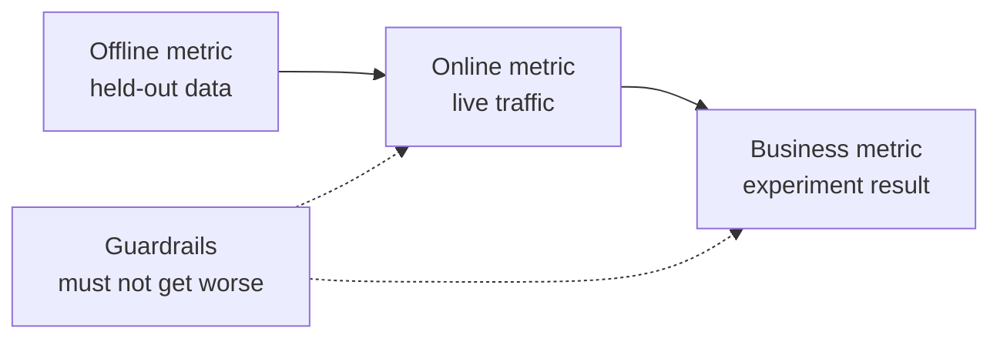

# ML 시스템 설계 — 문제 정의부터 모델 배포까지

> 모델은 시스템의 일부일 뿐입니다. 모델이 무엇을 예측하고, 누가 그에 따라 조치를 취하며, 비용이 얼마나 들고, 실패할 때 어떤 일이 발생하는지를 결정하는 것이 바로 설계입니다.

**유형:** Build (실습)
**사용 언어:** Python
**선수 레슨:** Phase 2, Lessons 09 (Model Evaluation) and 13 (ML Pipelines)
**소요 시간:** ~110분

## 학습 목표

- 비즈니스 문제를 예측, 이를 사용하는 결정, 규칙만으로는 부족한 이유를 포함한 ML 작업으로 정형화합니다.
- 오프라인, 온라인, 비즈니스 및 가드레일 메트릭을 분리하고, 모든 모델을 자명한 기준선(trivial baseline) 및 휴리스틱 기준선과 비교합니다.
- 트래픽 수치를 바탕으로 배치 및 온라인 추론(inference)의 일일 비용, 지연 시간(latency), 데이터 진부성(staleness)을 추정합니다.
- 롤아웃 패턴(섀도우, 카나리, A/B 테스트)과 각 실패 모드에 대한 안전한 기본값(safe default)을 선택합니다.
- 모델이 다음 버전의 학습 데이터를 변화시키는 피드백 루프를 식별합니다.
- ML 설계 문서를 작성하고 고정된 체크리스트에 따라 점수를 매깁니다.

## 문제 상황

어느 구독 기반 서비스 회사에서 "이탈(churn) 예측 모델"을 요청합니다. 데이터 사이언티스트는 그래디언트 부스팅 분류기(gradient-boosted classifier)를 학습시키고 AUC 0.91을 보고합니다. 3개월 후, 아무도 그 모델을 사용하지 않습니다.

그 이유는 알고리즘과 아무런 관련이 없습니다. 점수에 따라 어떤 조치를 취해야 하는지 아무도 결정하지 않았습니다. 점수는 일주일에 한 번 나오는데, 고객 유지 팀은 매일 고객에게 전화를 겁니다. 레이블은 해지 사유도 함께 저장되어 있던 해지 테이블에서 가져왔기 때문에, 하나의 특성(feature)에 이미 정답이 포함되어 있었습니다. 지원 팀이 이미 사용하고 있던 규칙, 즉 2주 동안 활동이 없는 고객에게 전화를 거는 규칙과 모델을 비교해 본 사람도 없었습니다.

이러한 실패는 모두 학습이 시작되기 전에 일어났습니다. 이는 설계의 실패이며, 한 페이지짜리 설계 문서는 이러한 각 항목에 대해 질문을 던집니다. 이 레슨에서는 해당 문서에 포함되는 결정 사항들을 학습합니다. 배치 및 온라인 서빙 비용을 계산하고, 모델을 기준선과 비교하며, 체크리스트에 따라 설계 문서를 평가하는 툴킷을 직접 구축합니다.

## 핵심 개념

### 비즈니스 목표에서 ML 작업으로

비즈니스 목표는 ML 작업이 아닙니다. 다음 네 가지 질문을 통해 비즈니스 목표를 ML 작업으로 전환할 수 있습니다.

1. 모델이 정확히 무엇을 예측하며, 어떤 엔티티(사용자, 결제, 매장, 상품)를 대상으로 하는가?
2. 어떤 결정이 그 예측을 사용하며, 누가 또는 무엇이 그 결정을 내리는가?
3. 예측이 필요한 시점은 언제이며, 그 순간에 존재하는 데이터는 무엇인가?
4. 결정이 더 나아졌다는 것을 어떻게 알 수 있는가?

| 비즈니스 목표 | 예측 | 이를 사용하는 결정 | ML 작업 |
|---|---|---|---|
| 이탈 감소 | 사용자가 향후 30일 이내에 해지할 확률 | 매일 밤 상위 5%에게 유지 혜택 제공 | 이진 분류(Binary classification) |
| 사기 손실 감소 | 결제가 사기일 확률 | 100ms 이내에 승인, 검토 또는 차단 | 이진 분류 |
| 재고 유지 | 다음 주 매장별 일일 판매량 | 각 매장의 발주 수량 결정 | 시계열 예측(Forecasting) |
| 관련 상품 노출 | (사용자, 상품) 쌍의 관련성 점수 | 피드 내 상품 순서 정렬 | 랭킹(Ranking) |

두 번째 열에 가장 많은 주의를 기울여야 합니다. "이탈 예측"이라는 표현은 기간, 엔티티, 조치를 모호하게 남겨둡니다. "오늘 밤 작업에서 혜택을 받을 대상을 선정할 수 있도록, 이 사용자가 향후 30일 이내에 해지할지 여부를 예측한다"라고 하면 세 가지 모두가 명확해집니다.

### ML을 사용하지 말아야 할 때

구글의 '머신러닝 규칙(Rules of Machine Learning)' 제1규칙은 머신러닝 없이 제품을 출시하는 것을 두려워하지 말라고 말합니다. 머신러닝에는 데이터가 필요하며, 단순한 휴리스틱만으로도 목표의 상당 부분을 달성할 수 있는 경우가 많습니다. 다음과 같은 경우에는 ML을 사용하지 마십시오.

- 짧은 규칙으로도 목표를 달성할 수 있고 정확성이 유지되는 경우. 규칙이 실행, 테스트, 설명 비용 면에서 훨씬 저렴합니다.
- 레이블이 없고 이를 수집할 실질적인 방법도 없는 경우.
- 아무도 예측에 따라 행동하지 않아 예측이 개선되어도 아무것도 바뀌지 않는 경우.
- 예측 시점에 존재하는 데이터에 유의미한 신호(signal)가 포함되어 있지 않은 경우.
- 단 한 번의 오류도 용납되지 않으며 사람이 출력을 검토할 수 없는 경우.
- 시스템을 구축하고 운영하는 비용이 더 나은 결정으로 얻는 가치보다 큰 경우.

규칙이 길어지고 취약해지기 시작할 때 ML이 진가를 발휘하기 시작합니다. 동일한 가이드의 제3규칙에서는 복잡한 휴리스틱보다 ML을 선호하는데, 학습된 모델이 업데이트하고 유지 관리하기 더 쉽기 때문입니다.

### 세 가지 계층의 메트릭

ML 시스템은 세 가지 계층의 메트릭과 한 세트의 한계 기준(limits)으로 측정합니다.

| 계층 | 측정 가능한 시점 | 이탈 예측 예시 |
|---|---|---|
| 오프라인 메트릭 | 출시 전, 분리해 둔 과거 데이터에서 측정 | 혜택 제공 임계값에서의 F1, 상위 5%에서의 정밀도(precision) |
| 온라인 메트릭 | 출시 중, 실시간 트래픽에서 측정 | 혜택 수락률, 점수가 매겨진 사용자 비율, 점수 분포 |
| 비즈니스 메트릭 | 출시 몇 주 후, 실험을 통해 측정 | 처치군(treated group) 대 대조군(holdout group)의 30일 이탈률 비교 |
| 가드레일 메트릭 | 상시 측정 | 유지된 사용자당 혜택 비용, 구독 취소율, p99 지연 시간 |



이 계층들은 서로 일치하지 않는 경우가 많습니다. 오프라인 메트릭은 과거 데이터로 점수를 매기는데, 과거에는 여러분의 모델이 존재하지 않았습니다. 온라인 메트릭은 사람들이 그 결정에 어떻게 반응하는지에 따라 달라집니다. 비즈니스 메트릭은 느리게 변하며 회사의 다른 모든 요소로부터 발생하는 노이즈를 포함합니다.

실제 결정과 일치하는 오프라인 메트릭을 선택하십시오. 작업 대상이 상위 5%의 사용자에게 연락하는 것이라면, 상위 5%에서의 정밀도를 측정해야 합니다. AUC는 전혀 사용하지 않을 임계값을 포함하여 모든 임계값에 대해 평균을 냅니다. 앞서 언급한 가이드의 제2규칙에서는 ML 시스템이 무엇을 할지 결정하기 전에 메트릭을 먼저 설계하고 구현하라고 명시하고 있습니다.

### 기준선(Baselines)

메트릭 값 하나만으로는 아무런 의미가 없습니다. F1 점수 0.56은 최선의 대안이 0.30일 때는 훌륭하지만, 단순 규칙이 0.60에 도달한다면 형편없는 수치입니다. 모든 모델을 세 가지 유형의 기준선과 비교하십시오.

- **자명한 기준선(Trivial baseline).** 항상 다수 클래스를 예측하거나 항상 학습 데이터의 평균을 예측합니다. 모델 평가 레슨에서 이 확인 방법을 사용했습니다.
- **휴리스틱 기준선(Heuristic baseline).** 도메인 지식에서 파생된 규칙이거나, 학습 데이터에 맞춘 단일 특성 임계값입니다.
- **현재 시스템(Current system).** 스프레드시트를 다루는 사람일지라도 현재 결정을 내리고 있는 주체입니다.

리프트(lift)는 모델 점수에서 가장 강력한 기준선의 점수를 뺀 값입니다. 결과를 확인하기 전에 최소 리프트를 설정하고, 시스템 추가 구축 비용을 정당화할 수 있을 만큼 충분히 크게 잡으십시오. 자명한 기준선은 대개 취약합니다. 실제로 넘어서기 어려운 것은 휴리스틱 기준선입니다.

### 데이터 및 레이블 요구사항

학습을 시작하기 전에 다음 질문에 답해야 합니다.

- **레이블 출처.** 어떤 테이블이나 이벤트가 레이블을 정의하며, 그 소유자는 누구인가?
- **레이블 지연.** 예측이 이루어진 후 실제 결과가 나오기까지 얼마나 걸리는가? 사기 결제에 대한 차지백(chargeback)은 결제 후 몇 주 뒤에 발생할 수 있습니다. 이탈 레이블은 30일 기간이 끝나는 시점에 확정됩니다.
- **레이블 품질.** 누가 레이블을 지정하며, 얼마나 자주 잘못 지정되는가?
- **예측 시점의 가용성.** 예측 순간에 모든 특성이 존재하는가? 결과가 나온 후에 시스템이 기록하는 특성은 학습 과정에 레이블을 유출(leak)시킵니다.
- **클래스당 볼륨.** 양성(positive) 예제가 몇 개나 존재하는가? 양성 예제가 200개뿐이라면 단순한 모델로 제한됩니다.
- **시간 기준 분할(Time split).** 가장 최근 기간을 테스트용으로 분리합니다. 시계열 레슨에서도 같은 이유로 데이터를 시간 기준으로 분할했습니다.
### 지연 시간, 처리량 및 비용 예산

모든 서빙(serving) 설계를 제약하는 세 가지 수치가 있습니다.

- **지연 시간 예산(Latency budget).** p99 지연 시간은 100개 요청 중 99개가 유지되는 기준 시간입니다. 결제 확인은 50 ms가 필요할 수 있고, 야간 리포트는 수 시간이 걸릴 수도 있습니다.
- **최대 처리량(Peak throughput).** 일일 평균이 아니라 가장 바쁜 분(minute)을 기준으로 시스템 규모를 산정하십시오. 최대 QPS는 평균의 몇 배에 달하는 경우가 많습니다.
- **비용 예산(Cost budget).** 설계를 비교할 수 있도록 일일 비용(달러) 또는 1,000회 예측당 비용(달러)으로 표현하십시오.

리틀의 법칙(Little's law)은 앞의 두 수치를 연결합니다. 처리 중인 요청 수는 처리량에 지연 시간을 곱한 값과 같습니다. 초당 400개의 요청이 들어오고 각 요청에 50 ms가 걸린다면, 어느 순간에든 20개의 요청이 처리 중인 상태입니다.

### 배치 추론 대 온라인 추론

예측을 서빙하는 기본 방식에는 두 가지가 있습니다.

- **배치 추론(Batch inference).** 예약된 작업이 모든 엔터티를 채점(scoring)하여 테이블이나 키-값 저장소에 점수를 기록합니다. 애플리케이션은 요청 시점에 저장된 점수를 읽어옵니다.
- **온라인 추론(Online inference).** 애플리케이션이 요청 시점에 모델 서비스로 특성(feature)을 전송하고 점수를 기다립니다.

| 속성 | 배치 | 온라인 |
|---|---|---|
| 최신성 | 마지막 실행 시점 + 실행 소요 시간만큼 지연됨 | 요청 시점의 데이터를 사용함 |
| 요청 지연 시간 | 키-값 조회 1회, 수 ms | 특성 조회 + 모델 실행 시간 |
| 비용 요인 | 엔터티 수 × 일일 실행 횟수 | 최대 QPS에 맞춰 산정된 복제본(replica) 수 |
| 신규 엔터티 | 다음 실행 때까지 점수 없음 | 첫 요청 시 즉시 채점 |
| 장애 발생 시 | 이전 점수는 계속 읽을 수 있음 | 요청이 실패하거나 타임아웃 발생 |

이 강의의 툴킷은 두 방식의 비용을 모두 계산합니다. 배치 비용은 엔터티 수와 일일 실행 횟수에 비례하여 증가합니다. 데이터 진부화(staleness) 허용 한도가 짧을수록 더 많은 실행이 필요합니다. 온라인 비용은 피크 시간대 사이에 유휴 복제본 비용을 지불해야 하므로 최대 트래픽에 비례하여 증가합니다. 실행에 1시간이 걸리는 배치 작업은 어떤 비용을 들이더라도 1시간 미만의 진부화 한도를 충족할 수 없습니다.

하이브리드 설계도 흔히 쓰입니다. 야간 배치 작업으로 기존 사용자를 채점하고, 온라인 경로를 통해 신규 사용자 및 최신 데이터가 필요한 요청을 채점합니다.

### 배포 패턴

새 모델은 다음과 같은 단계를 거쳐 사용자에게 도달합니다.

1. **섀도(Shadow).** 새 모델이 실시간 트래픽의 복사본을 받습니다. 시스템은 해당 예측을 기록만 할 뿐 실제로는 사용하지 않습니다. 현재 모델과 지연 시간, 오류율, 예측 분포를 비교합니다.
2. **카나리(Canary).** 새 모델이 주로 1~5% 정도의 소규모 트래픽 비율에 대해 실제 의사결정을 수행합니다. 점진적으로 비율을 늘려가며 가드레일이 깨지면 롤백합니다.
3. **A/B 테스트(A/B test).** 무작위로 분할된 사용자가 각 모델을 경험합니다. 통계적 검정을 통해 비즈니스 지표를 측정하며, 차이를 확인하려면 충분한 트래픽과 시간이 필요합니다.

모든 단계에는 몇 분 안에 완료되는 롤백 체계가 필요합니다. 이전 모델 버전을 계속 배포된 상태로 두고 설정 변경을 통해 트래픽을 전환하십시오. LLM 서빙 단계에서는 언어 모델에 대한 동일한 세 가지 패턴을 [섀도 및 카나리 강의](../../../17-infrastructure-and-production/20-shadow-canary-progressive/docs/en.md)와 [A/B 테스트 강의](../../../17-infrastructure-and-production/21-ab-testing-llm-features/docs/en.md)에서 다룹니다.

### 피드백 루프

모델의 결정이 다음 버전을 학습시키는 데이터를 변화시킬 때 피드백 루프(feedback loop)가 발생합니다. Sculley 등은 직접적 및 숨겨진 피드백 루프를 ML 시스템의 주요 기술 부채 원인 중 하나로 꼽았습니다. 흔히 나타나는 세 가지 사례는 다음과 같습니다.

- **개입이 레이블을 숨김.** 이탈 예측 모델이 혜택을 발송하고, 이 혜택 덕분에 일부 사용자가 남게 됩니다. 다음 달에는 이 고위험 사용자들이 충성도 높은 고객처럼 보이게 되며, 재학습된 모델은 이들의 특성이 이탈을 예측하지 않는다고 학습합니다.
- **차단된 조치는 결과를 남기지 않음.** 사기 탐지 모델이 결제를 차단하면 해당 결제는 결제 취소(chargeback) 레이블을 받지 못합니다. 재학습된 모델은 차단된 영역에서 더 적은 사기 사례를 보게 됩니다.
- **노출이 피드백을 제한함.** 랭킹 모델이 상위 아이템만 노출하므로 해당 아이템들만 클릭을 수집합니다.

해결책들은 하나의 아이디어를 공유합니다. 바로 모델의 영향을 받지 않은 데이터를 일부 유지하는 것입니다. 개입을 전혀 받지 않는 작은 무작위 그룹을 격리(hold out)하십시오. 소량의 트래픽에는 무작위 결정을 적용하십시오. 향후 학습 시 영향을 받은 데이터와 오염되지 않은(clean) 데이터를 구분할 수 있도록 각 예제마다 점수와 결정을 함께 기록하십시오.

### 실패 모드 및 안전 기본값

시스템의 모든 부분은 조만간 실패하기 마련입니다. 장애가 발생했을 때가 아니라 설계 단계에서 각 실패에 대한 기본 조치를 결정해야 합니다.

| 실패 유형 | 대책이 없을 때의 결과 | 안전 기본값 |
|---|---|---|
| 모델 서비스 타임아웃 | 요청 실패 | 휴리스틱 베이스라인 사용 |
| 야간 배치 작업 실패 | 점수가 유실되거나 진부화됨 | 일정 시간 동안 마지막 유효 점수를 서빙한 후 규칙 적용 |
| 특성 누락 또는 범위 초과 | 모델이 비정상 입력값에 대해 점수 계산 | 문서화된 기본값을 사용하고 이벤트 기록 |
| 이력이 없는 신규 엔터티 | 점수 없음 | 규칙 또는 모집단 평균 사용 |
| 점수 분포의 급격한 변동 | 대규모 잘못된 의사결정 발생 | 자동 조치를 중단하고 담당자에게 알림 |

지표 섹션에서 작성한 휴리스틱 베이스라인(heuristic baseline)은 대부분의 장애에 대한 기본값이기도 하므로 가장 먼저 구축하십시오.

### 설계 문서

설계 문서는 학습이 시작되기 전에 위의 모든 결정을 한곳에 기록합니다. 이 강의의 검사기(checker)는 이를 JSON 버전으로 평가합니다. 6개 항목은 시스템을 안전하지 않거나 쓸모없게 만들기 때문에 검토를 차단(block)합니다.

| 섹션 | 답해야 하는 질문 | 검토 차단 여부 |
|---|---|---|
| 문제 | 무엇을 예측하고, 어떤 의사결정에 사용되며, 규칙만으로는 왜 불충분한가? | 의사결정 부재 시 차단 |
| 지표 | 어떤 오프라인, 온라인, 비즈니스 및 가드레일 지표를 적용하는가? | 비즈니스 지표 부재 시 차단 |
| 베이스라인 | 어떤 단순(trivial), 휴리스틱 및 기존 시스템 베이스라인을 적용하는가? | 휴리스틱 또는 기존 베이스라인 부재 시 차단 |
| 데이터 | 레이블은 어디서 얼마나 지연되어 오며, 예측 시점에 각 특성이 존재하는가? | 누수(leakage) 없어야 함 |
| 예산 및 서빙 | 어떤 지연 시간, 최대 QPS, 비용 및 진부화 한도가 적용되며, 어떤 서빙 모드가 이에 부합하는가? | 아니요 |
| 롤아웃 | 어떤 섀도, 카나리 및 A/B 단계를 적용하며, 롤백은 어떻게 수행하는가? | 섀도 또는 카나리, 그리고 롤백 방안 부재 시 차단 |
| 피드백 루프 | 모델이 자신의 향후 데이터를 어떻게 변경할 수 있으며, 오염되지 않은 데이터를 어떻게 유지하는가? | 아니요 |
| 실패 모드 | 각 실패에 대한 기본 조치는 무엇인가? | 모든 실패에 대한 기본값 부재 시 차단 |
| 모니터링 | 출시 후 무엇을 관찰하는가? | 아니요 |

```figure
mlprod-serving-cost
```

## 직접 만들어 보기

`code/main.py`의 코드는 표준 라이브러리만 사용합니다. 서빙 비용 모델, 베이스라인 비교기, 설계 문서 검사기라는 세 가지 도구가 포함되어 있습니다.

### 1단계: 워크로드와 가격 정의하기

워크로드는 트래픽 수치와 예산을 보유합니다. 비용 모델은 가격을 보유합니다. 가격은 실습을 위한 정수 수치이며 벤더의 실제 견적이 아닙니다.

```python
@dataclass(frozen=True)
class Workload:
    name: str
    entities: int
    requests_per_day: int
    peak_qps: float
    max_staleness_hours: float
    latency_budget_ms: float


@dataclass(frozen=True)
class CostModel:
    batch_dollars_per_million: float = 0.40
    batch_job_hours: float = 1.0
    lookup_dollars_per_million: float = 0.25
    lookup_latency_ms: float = 4.0
    replica_dollars_per_hour: float = 0.50
    replica_qps: float = 200.0
    min_replicas: int = 2
    online_latency_ms: float = 35.0
```

### 2단계: 배치 및 온라인 서빙 비용 산정하기

배치 작업은 진부화 한도 내에 완료되어야 합니다. 실행 간격은 한도에서 작업 실행 시간을 뺀 값입니다. 각 실행은 점수 조회가 요청되었는지 여부와 상관없이 모든 엔터티를 채점합니다.

```python
def batch_plan(workload: Workload, costs: CostModel) -> ServingPlan:
    refresh_hours = workload.max_staleness_hours - costs.batch_job_hours
    if refresh_hours <= 0:
        return ServingPlan(
            "batch", False, math.inf, costs.lookup_latency_ms, math.inf, 0.0,
            "staleness limit is shorter than one batch job",
        )
    runs_per_day = 24.0 / refresh_hours
    predictions = workload.entities * runs_per_day
    dollars = (
        predictions / 1e6 * costs.batch_dollars_per_million
        + workload.requests_per_day / 1e6 * costs.lookup_dollars_per_million
    )
    ...
```

온라인 서빙은 가용성을 위한 최소 2개를 포함하여 피크를 처리할 수 있는 충분한 수의 복제본에 대해 비용을 지불합니다.

```python
def online_plan(workload: Workload, costs: CostModel) -> ServingPlan:
    replicas = max(costs.min_replicas, math.ceil(workload.peak_qps / costs.replica_qps))
    dollars = replicas * costs.replica_dollars_per_hour * 24.0
    feasible = costs.online_latency_ms <= workload.latency_budget_ms
    ...
```

`choose_serving`은 지연 시간 및 진부화 한도를 충족하는 계획만 남기고 가장 저렴한 계획을 반환합니다. 적합한 계획이 없으면 `None`를 반환하므로 예산을 변경해야 함을 알 수 있습니다.
### Step 3: 모델과 기준 모델 비교하기

비교기는 동일한 지표로 모델과 모든 기준 모델(baseline)을 평가합니다. 가장 약한 기준 모델이 아니라 가장 강력한 기준 모델 대비 향상도(lift)를 측정합니다.

```python
def compare_to_baselines(
    y_true: list,
    model_pred: list,
    baselines: dict[str, list],
    metric,
    metric_name: str,
    higher_is_better: bool = True,
    min_lift: float = 0.02,
) -> BaselineReport:
    if not baselines:
        raise ValueError("a model needs at least one baseline")
    scores = {name: metric(y_true, pred) for name, pred in baselines.items()}
    pick = max if higher_is_better else min
    best_name = pick(scores, key=scores.get)
    model_score = metric(y_true, model_pred)
    lift = model_score - scores[best_name] if higher_is_better else scores[best_name] - model_score
    return BaselineReport(metric_name, {"model": model_score, **scores}, best_name, lift, min_lift)
```

휴리스틱 기준 모델은 단일 피처 규칙입니다. `fit_rule`은 학습 데이터에서 해당 피처의 각 값을 임계값으로 시도해 보고 가장 높은 F1 점수를 기록한 임계값을 유지합니다. 이 데모는 합성 이탈(churn) 데이터로 소형 로지스틱 회귀(logistic regression)를 학습시키고 세 가지 기준 모델과 비교합니다.

### Step 4: 설계 문서 평가하기

각 체크리스트 항목에는 키, 가중치, 블로킹 플래그, 메시지, 검사 함수가 있습니다. 블로킹 항목은 가중치 2를 가집니다.

```python
CheckItem("decision", 2, True, "name the action that uses each prediction", lambda d: _text(d, "problem.decision")),
CheckItem("baselines", 2, True, "add a heuristic or current-system baseline", check_baselines),
CheckItem("no_leakage", 2, True, "confirm every feature exists at prediction time",
          lambda d: get_path(d, "data.features_available_at_prediction_time") is True),
CheckItem("serving_fit", 1, False, "pick a serving mode that meets the staleness, latency, and cost budgets",
          check_serving_fit),
```

`check_serving_fit`은 비용 모델을 재사용합니다. 문서에서 워크로드 수치를 읽어와 선택된 서빙 방식의 비용을 산정합니다. 해당 방식이 최신성(staleness) 한도, 지연 시간(latency) 예산 또는 일일 비용 예산을 충족하지 못하면 검사에 실패합니다. "배치(batch)"로 기재되어 있으면서 최신성 한도가 3분인 문서는 이 검사를 통과하지 못합니다. 비용 모델에 하이브리드 계획이 없으므로, 연습 문제 1에서 해당 계획을 추가하기 전까지는 "하이브리드(hybrid)"로 기재된 문서도 이 검사에 실패합니다.

`review_design_doc`는 통과한 항목의 가중치를 더하고 총합으로 나눕니다. 점수가 0.85에 도달하고 실패한 블로킹 항목이 없을 때만 "검토 준비 완료(ready for review)" 판정이 내려집니다.

### Step 5: 실행하기

```bash
python3 code/main.py
```

```console
nightly churn scores
  ok batch        $0.91/day      4 ms  1.0 runs per day over 2,000,000 entities
  ok online      $24.00/day     35 ms  2 replicas sized for 40 peak QPS
  choose: batch

feed ranking, 2-hour freshness
  ok batch       $48.50/day      4 ms  24.0 runs per day over 5,000,000 entities
  ok online      $24.00/day     35 ms  2 replicas sized for 120 peak QPS
  choose: online

=== Model versus baselines (churn, metric F1) ===
  model                    0.564
  days_idle > 12.8688      0.500
  random at base rate      0.232
  majority class           0.000
  model beats the strongest baseline (days_idle > 12.8688) by +0.064
```

다수 클래스 기준 모델(majority baseline)은 이탈을 전혀 예측하지 않으므로 F1 점수가 0입니다. 적합된 규칙(fitted rule)이 진정한 경쟁 상대입니다. 모델이 규칙보다 0.064 앞서므로, 모델은 도입될 만한 가치를 입증한 것입니다. 피처의 품질이 낮아 규칙이 모델을 이긴다면, 배포해야 할 올바른 시스템은 모델이 아니라 규칙입니다.

설계 문서 검토 결과에서는 6개의 블로킹 항목이 있는 미흡한 문서와 점수가 1.00인 완전한 문서가 출력됩니다. 경로를 전달하여 자체 문서를 검토할 수도 있습니다.

```bash
python3 code/main.py my_design_doc.json
```

## 활용하기

툴킷의 각 구성 요소는 팀들이 프로덕션에서 사용하는 도구와 대응됩니다.

**기준 모델.** scikit-learn은 기본적인 기준 모델들을 추정기(estimator) 형태로 제공하므로, 모델과 동일한 파이프라인에 바로 적용할 수 있습니다.

```python
from sklearn.dummy import DummyClassifier, DummyRegressor
from sklearn.metrics import f1_score

majority = DummyClassifier(strategy="most_frequent").fit(X_train, y_train)
base_rate = DummyClassifier(strategy="stratified", random_state=0).fit(X_train, y_train)
mean_value = DummyRegressor(strategy="mean").fit(X_train, y_reg_train)

print(f1_score(y_test, majority.predict(X_test)))
```

`most_frequent`은 `majority_baseline`과 일치하고, `stratified`는 `base_rate_baseline`과 일치합니다. scikit-learn에는 휴리스틱 기준 모델이 없는데, 휴리스틱은 해당 도메인에서 도출되기 때문입니다.

**배치 서빙.** Apache Airflow나 Dagster 같은 워크플로 스케줄러가 스코어링 작업을 실행합니다. 이 작업은 스코어를 데이터 웨어하우스 테이블이나 Redis, DynamoDB 같은 키-값 저장소에 기록합니다.

**온라인 서빙.** KServe, BentoML, NVIDIA Triton, TorchServe와 같은 모델 서버는 모델을 HTTP 또는 gRPC 엔드포인트 뒤에 래핑합니다. 소형 모델의 경우 모델을 로드한 일반 웹 서비스로도 충분합니다.

**롤아웃.** Argo Rollouts와 같은 Kubernetes 도구는 카나리 배포(canary release)를 위해 트래픽을 분할합니다. GrowthBook 및 Statsig 같은 실험 플랫폼은 사용자를 A/B 그룹에 할당하고 통계를 계산합니다.

**설계 검토.** Breck 등은 프로덕션 ML 시스템을 위한 28가지 테스트 및 모니터링 요구사항 루브릭인 ML Test Score를 발표했습니다. 본 과정의 체커는 그보다 규모가 작으며, 해당 테스트를 수행하기 전에 거쳐야 할 설계 측면의 질문들을 다룹니다.

## 배포하기

이 레슨에서는 `outputs/skill-ml-design-review.md`을 생성합니다. 이 스킬은 ML 설계 문서를 섹션별로 검토하고 블로킹 격차를 가장 먼저 제시합니다. 또한 이 레슨의 배치 및 온라인 비용 산출법을 활용하여 서빙 방식 선택이 적절한지 확인합니다.

## 연습 문제

1. `choose_serving`에 하이브리드 계획을 추가하세요. 알려진 사용자는 배치로 점수를 매기고, 신규 사용자는 온라인으로 처리합니다. 일일 비용을 비교해 보세요.
2. 모델이 더 이상 규칙을 이기지 못할 때까지 이탈 데이터를 변경해 보세요. 향상도를 사라지게 만드는 최소 계수 변화량을 보고하세요.
3. 체크리스트에 `budgets.max_dollars_per_1k_predictions` 항목을 추가하세요. 해당 항목이 없으면 실패하는 테스트를 작성하세요.
4. 결제 부정 결제(fraud) 탐지를 위한 JSON 설계 문서를 작성하세요. 체커를 실행하고 모든 블로킹 항목을 수정하세요.
5. 이탈 피드백 루프를 시뮬레이션해 보세요. 제안(offer)을 받은 사용자의 레이블을 제거하고, 재학습한 후 F1의 변화를 측정하세요.

## 핵심 용어

| 용어 | 일반적인 표현 | 의미 |
|------|----------------|----------------------|
| ML 태스크 | "이탈 모델 구축" | 예측 대상, 엔터티, 예측 기간(horizon) 및 예측을 사용하는 의사결정 |
| 오프라인 지표 | "모델 점수" | 출시 전 별도로 보관된 과거 데이터로 계산한 지표 |
| 온라인 지표 | "실시간 수치" | 모델이 실행되는 동안 실제 트래픽에서 측정한 지표 |
| 비즈니스 지표 | "목표치" | 의사결정을 통해 변화시켜야 하는 비즈니스 결과로, 실험을 통해 측정됨 |
| 가드레일 지표 | "부작용 방지" | 새 모델이 출시될 때 악화되어서는 안 되는 지표 |
| 기준 모델(Baseline) | "단순 모델" | 모델이 정해진 격차 이상으로 넘어서야 하는 단순 규칙, 휴리스틱 또는 현재 시스템 예측기 |
| 배치 추론(Batch inference) | "사전 계산된 점수" | 스케줄링된 작업이 모든 엔터티를 스코어링하고 조회를 위해 결과를 저장하는 방식 |
| 온라인 추론(Online inference) | "실시간 모델" | 요청이 도착할 때마다 모델이 각 요청을 스코어링하는 방식 |
| 섀도 배포(Shadow deployment) | "다크 론칭" | 새 모델이 실제 트래픽을 스코어링하되, 그 결과는 아무도 사용하지 않는 배포 방식 |
| 카나리 배포(Canary release) | "점진적 롤아웃" | 새 모델이 소규모로 점차 늘어나는 트래픽 비율을 처리하며, 롤백 준비를 갖춘 배포 방식 |
| 피드백 루프(Feedback loop) | "모델의 자기 학습" | 모델의 의사결정이 다음 버전 학습에 사용될 데이터를 변화시키는 현상 |

## 더 읽어보기

- [Sculley et al., Hidden Technical Debt in Machine Learning Systems (NeurIPS 2015)](https://papers.nips.cc/paper/2015/hash/86df7dcfd896fcaf2674f757a2463eba-Abstract.html): 피드백 루프, 얽힘(entanglement), 모델 주변의 시스템 비용
- [Google, Rules of Machine Learning](https://developers.google.com/machine-learning/guides/rules-of-ml): 첫 번째 모델, 지표, 학습-서빙 일관성을 위한 실무 규칙
- [Breck et al., The ML Test Score (IEEE Big Data 2017)](https://research.google/pubs/the-ml-test-score-a-rubric-for-ml-production-readiness-and-technical-debt-reduction/): 프로덕션 준비 상태를 측정하는 28가지 테스트
- [Kohavi, Tang, and Xu, Trustworthy Online Controlled Experiments (Cambridge University Press, 2020)](https://experimentguide.com/): 올바른 결과를 도출하는 A/B 테스트 실행 방법
- [Sato, Wider, and Windheuser, Continuous Delivery for Machine Learning (2019)](https://martinfowler.com/articles/cd4ml.html): 버전 관리되는 데이터, 모델 및 배포 파이프라인
- [Google Cloud, MLOps: Continuous delivery and automation pipelines in machine learning](https://cloud.google.com/architecture/mlops-continuous-delivery-and-automation-pipelines-in-machine-learning): 학습 및 서빙 자동화를 위한 3단계 성숙도 모델
