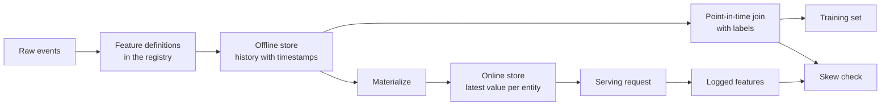

# 피처 스토어와 학습-서빙 왜곡 (Feature Stores and Training-Serving Skew)

> 피처에는 하나의 정의와 두 명의 리더(reader)가 있습니다. 학습(training)은 각 레이블 시점 기준의 이력을 읽고, 서빙(serving)은 최신 값을 읽습니다. 두 리더의 결과가 불일치하면, 모델은 한 번도 학습해 본 적 없는 입력을 보게 됩니다.

**유형:** Build (실습)
**사용 언어:** Python
**선수 레슨:** Phase 2, Lessons 08 (Feature Engineering), 13 (ML Pipelines), 15 (Time Series), and 19 (ML System Design)
**소요 시간:** ~100분

## 학습 목표 (Learning Objectives)

- 오프라인 스토어, 온라인 스토어, 엔티티(entity), 이벤트 타임스탬프, TTL의 역할과 각각의 작업 설명하기
- 시점 정확 조인(point-in-time correct join)을 구현하고, 순진한(naive) 조인이 미래 값을 학습 데이터에 어떻게 복사하는지 보여주기
- 학습-서빙 왜곡(training-serving skew)을 유발하는 4가지 원인(두 개의 코드 경로, 진부화된 피처, 서로 다른 기본값, 시간 여행) 명시하기
- 하나의 정의가 학습 경로와 서빙 경로 모두에 공급되는 피처 레지스트리(feature registry) 구축하기
- 각 날짜 이후의 데이터를 읽지 않고 과거 날짜에 대해 새 피처를 백필(backfill)하기
- 로깅된 서빙 피처와 동일한 엔티티 및 시점의 학습 경로를 비교하여 왜곡 감지하기

## 문제 상황 (The Problem)

어느 팀이 이탈(churn) 예측 모델을 구축합니다. 각 레이블은 레이블 기준일 이후 30일 동안 사용자가 구매를 전혀 하지 않았는지를 나타냅니다. 팀은 `user_id`을 기준으로 레이블을 사용자 피처 테이블과 조인하고 `days_since_last_purchase`에 기반한 규칙을 학습시킵니다. 오프라인 정확도는 0.948에 달합니다.

실제 트래픽에서 모델은 이전의 더 단순한 버전보다 성능이 떨어집니다. 피처 테이블은 각 사용자에 대해 레이블 기준일로부터 몇 주 뒤의 최신 값을 보관하고 있었습니다. 마지막 구매가 115일째였던 사용자는 175일째 스냅샷에서 60일의 비활성 일수를 보였고, 따라서 피처가 이미 정답을 포함하고 있었습니다. 한편, 다른 팀은 별도의 서비스에서 서빙 피처를 다시 작성했습니다. 그들의 30일 윈도우에는 하루가 더 포함되었고, 신규 사용자에 대한 기본값은 365 대신 -1이었습니다.

두 결함 모두 원인은 동일합니다. 학습과 서빙이 "동일한 피처"를 서로 다른 두 가지 방식으로 계산한 것입니다. 이 강의에서는 피처 스토어의 구성 요소를 바닥부터 직접 구축합니다. 레지스트리, 백필, 시점 정확 조인, TTL이 적용된 온라인 스토어, 그리고 왜곡 검사기를 작성합니다. 데모에서는 두 결함을 수치로 재현합니다.

## 핵심 개념 (The Concept)

### 동일한 피처를 읽는 두 리더

학습과 서빙은 서로 다른 형태로 피처를 요청합니다.

| 속성 | 학습 (오프라인) | 서빙 (온라인) |
|---|---|---|
| 질문 | "천만 개의 (엔티티, 시점) 쌍 각각에 대한 값은 무엇이었는가?" | "지금 이 단일 엔티티에 대한 값은 무엇인가?" |
| 시점 | 과거의 수많은 시점 | 현재 |
| 데이터양 | 작업당 수백만 개의 행 | 요청당 단일 행 |
| 지연 시간(Latency) | 수 분이 걸려도 무방함 | 수 밀리초 이내 |
| 스토리지 | 오프라인 스토어: 타임스탬프가 포함된 전체 이력, 컬럼형 파일 또는 데이터 웨어하우스에 저장 | 온라인 스토어: 엔티티당 최신 값, 키-값 데이터베이스에 저장 |

피처 스토어는 하나의 피처 정의 세트로부터 두 스토어의 데이터를 채워 넣습니다. 구체화(materialization)는 오프라인 스토어에서 온라인 스토어로 최신 값을 복사하는 작업입니다.



### 엔티티, 타임스탬프, 그리고 TTL

네 가지 용어가 모든 피처 행을 설명합니다.

- **엔티티(Entity).** 피처가 설명하는 키(예: `user_id` 또는 `card_id`).
- **이벤트 타임스탬프(Event timestamp).** 해당 값이 사실이 된 시점. "14일 기준" 구매 횟수는 14일을 이벤트 타임스탬프로 갖습니다.
- **생성 타임스탬프(Created timestamp).** 시스템이 해당 행을 기록한 시점. 오늘 실행되는 백필은 과거의 이벤트 타임스탬프와 새로운 생성 타임스탬프를 가진 행을 작성합니다.
- **TTL (time to live).** 값의 최대 유효 기간. TTL보다 오래된 값은 결측으로 간주되므로 리더는 기본값을 사용합니다.

동일한 엔티티, 소스, TTL을 공유하는 피처 그룹을 흔히 피처 뷰(feature view)라고 부릅니다.

### 시점 정확 조인 (Point-in-time correct joins)

학습 행은 레이블을 해당 레이블 시점에 존재했던 피처 값과 짝지어 줍니다. 시점 정확 조인은 각 레이블에 대해 다음을 수행합니다.

1. 동일한 엔티티의 피처 행들을 찾습니다.
2. 이벤트 타임스탬프가 레이블 타임스탬프 이전이거나 같은 행만 유지합니다.
3. 해당 행들 중 가장 최신의 행을 선택합니다.
4. 레이블 타임스탬프에서 해당 이벤트 타임스탬프를 뺀 값이 TTL보다 크면 버립니다.

여기 한 명의 사용자와 16일째의 레이블, 그리고 주간 피처 행들이 있습니다.

| 피처 행 기준일 | `purchases_30d` | 시점 정확 조인 | `user_id` 기준 순진한 조인 |
|---|---|---|---|
| 7 | 4 | | |
| 14 | 3 | 선택됨 | |
| 21 | 1 | 미래 데이터 | |
| 28 | 0 | 미래 데이터 | 선택됨 |

레이블은 사용자가 17일째부터 46일째 사이에 구매를 하는지 묻습니다. 28일째 행은 이미 레이블 기준일 이후의 비활성 일수를 카운트하고 있습니다. 이 행은 사용자가 구매를 중단했기 때문에 0건의 구매를 나타내며, 이는 레이블이 측정하려는 바로 그 이벤트입니다. 순진한 조인은 이처럼 정답을 입력에 복사해 버립니다.

시계열 강의에서 시간 기준으로 데이터를 분할한 것도 동일한 이유 때문이었습니다. 시점 정확 조인은 하나의 분할 지점이 아니라 모든 행에 걸쳐 이 규칙을 적용합니다.

### 학습-서빙 왜곡의 원인

Google의 머신러닝 규칙(Rules of Machine Learning)에서는 학습-서빙 왜곡을 학습 중 성능과 서빙 중 성능 간의 차이로 정의합니다. 여기서는 세 가지 원인을 꼽습니다. 두 파이프라인 간 서로 다른 데이터 처리, 학습과 서빙 사이의 데이터 변화, 그리고 피드백 루프입니다. 피처 파이프라인에서는 네 가지 구체적인 원인이 반복해서 나타납니다.

| 원인 | 발생하는 현상 | 데모 예시 |
|---|---|---|
| 두 개의 코드 경로 | 학습과 서빙이 서로 다른 코드로 피처를 계산함 | 서빙 윈도우에는 `now - 30`일째가 포함되고, 학습 윈도우에는 포함되지 않음 |
| 진부화된 피처 | 서빙이 읽는 값의 생성 시점이 학습에서 사용한 값의 시점과 다름 | 학습은 주간 스냅샷을 읽고, 새로운 서비스는 신선한 값을 계산함 |
| 서로 다른 기본값 | 두 경로가 결측값을 서로 다르게 채움 | 학습은 "아직 구매 없음"에 365를 사용하고, 서빙은 -1을 사용함 |
| 시간 여행 | 학습이 레이블 시점 이후의 값을 읽음 | 순진한 조인이 모든 레이블에 대해 최신 스냅샷을 읽음 |

같은 가이드의 규칙 #32에서는 가능한 한 학습 파이프라인과 서빙 파이프라인 간에 코드를 재사용하라고 명시합니다. 피처 스토어는 두 경로가 모두 호출하는 단일 정의를 통해 이 규칙을 따릅니다.

### 피처 레지스트리 (Feature Registry)

레지스트리는 피처 정의의 카탈로그입니다. 각 항목에는 이름, 엔티티, 소스, 변환 로직, 윈도우, 기본값, TTL, 소유자, 버전, 설명이 포함됩니다.

두 가지 규칙이 안정성을 유지합니다.

- 두 경로 모두 레지스트리에서 정의를 읽습니다. 어떤 서비스도 변환 로직의 비공개 복사본을 보관하지 않습니다.
- 정의를 변경하면 새 버전이 생성됩니다. 이전 버전은 그대로 유지되므로 기존 모델은 자신이 학습했던 피처를 계속 사용할 수 있습니다.
### Backfills

새로운 피처(feature)에는 이력이 없지만, 학습에는 과거의 모든 라벨 시점에서의 피처 값이 필요합니다. 백필(backfill)은 과거의 각 날짜마다 정의를 실행하여 엔티티(entity)와 날짜당 하나의 행을 작성합니다. 각 실행은 해당 날짜 이전 또는 해당 날짜의 타임스탬프를 가진 이벤트만 읽습니다.

백필에는 엔티티 수에 날짜 수를 곱한 만큼 증가하는 연산 비용이 듭니다. 또한 미묘한 데이터 누수(leak)를 유발할 수도 있습니다. 오늘 실행되는 백필은 과거의 이벤트 타임스탬프를 가진 행들을 기록하지만, 늦게 도착했거나 나중에 수정된 데이터를 읽을 수 있습니다. 엄격한 시점 기준 조인(point-in-time join)은 생성 타임스탬프(created timestamp) 역시 라벨 시점 이전인지도 확인합니다.

### Detecting skew

동일한 가이드의 규칙 #29에서는 서빙(serving) 시점에 피처를 로깅하고 이를 학습에 사용하라고 안내합니다. 로깅된 작은 샘플만으로도 일관성을 확인할 수 있습니다. 로깅된 각 값을 동일한 엔티티와 시간에 대해 학습 경로가 생성한 값과 비교합니다. 피처별로 불일치 비율과 평균 절대 오차(mean absolute difference)를 보고합니다.

원인을 찾으려면 다음 세 가지 쌍을 비교합니다.

1. 온라인 저장소(online store) 읽기 대 학습 조인. 이는 전체 시스템을 테스트하며 왜곡이 0이어야 합니다.
2. 실시간 계산(fresh computation) 대 학습 조인. 이는 데이터 최신성 저하(staleness) 문제를 분리해냅니다.
3. 보조 코드 경로(second code path) 대 실시간 계산. 이는 윈도우(window)나 기본값(default)과 같은 코드 차이를 분리해냅니다.

```figure
mlprod-pit-join
```

## Build It

`code/main.py`의 코드는 표준 라이브러리만을 사용합니다. 시간은 정수 단위의 일(day) 수입니다. 주간 배치 작업은 7일차, 14일차부터 최대 175일차까지 피처 스냅샷을 기록합니다.

### Step 1: Feature definitions and the registry

`FeatureDefinition`는 집계(aggregate), 윈도우, 기본값과 같은 변환 로직을 데이터 형태로 보관합니다. 이 클래스의 `compute` 메서드는 `as_of` 이후의 이벤트를 절대 읽지 않습니다.

```python
@dataclass(frozen=True)
class FeatureDefinition:
    name: str
    entity: str
    aggregate: str
    window_days: int | None
    default: float
    version: int = 1
    owner: str = "growth-team"
    description: str = ""

    def compute(self, events: list[Event], as_of: int) -> float:
        visible = [e for e in events if e.day <= as_of]
        if self.window_days is not None:
            visible = [e for e in visible if e.day > as_of - self.window_days]
        if self.aggregate == "count":
            return float(len(visible))
        if self.aggregate == "sum":
            return round(sum(e.amount for e in visible), 2)
        if self.aggregate == "days_since_last":
            return float(as_of - max(e.day for e in visible)) if visible else self.default
        raise ValueError(f"unknown aggregate {self.aggregate!r}")
```

`FeatureRegistry.register`는 동일한 정의가 두 번 들어오는 것은 허용하지만, 이름과 버전이 같으면서 내용이 다른 정의는 거부합니다. `fill_defaults`는 결측값에 대해 두 경로 모두에 동일한 기본값을 제공합니다.

모델은 `spend_30d@1`와 같은 참조(reference)를 통해 정의를 고정합니다. `compute` 및 `fill_defaults`는 이 참조를 해석하며, `@`이 없는 이름은 최신 버전을 읽습니다. `@`가 포함되어 있으나 버전 번호가 없는 참조는 `ValueError`를 발생시키므로, 오타로 인해 경고 없이 최신 버전을 읽게 되는 일을 방지합니다. 또한 이 참조는 저장된 각 행의 키 역할을 하므로 백필, 온라인 저장소, 서빙 시 읽기 작업 모두가 고정된 정의를 사용하게 됩니다.

### Step 2: Backfill the offline store

```python
def backfill(registry: FeatureRegistry, names: list[str], events: list[Event], days: list[int]) -> list[FeatureRow]:
    rows = []
    for entity, entity_events in sorted(group_events(events).items()):
        for day in days:
            rows.append(FeatureRow(entity, day, registry.compute(names, entity_events, day)))
    return rows
```

이 데모는 25회의 스냅샷 일자에 걸쳐 299명의 사용자에 대해 3개의 피처를 백필하여 총 7,475개의 행을 생성합니다.

### Step 3: The point-in-time join

각 엔티티의 행을 일자별로 한 번 정렬합니다. 각 라벨에 대해 `bisect_right`는 라벨 일자 이전 또는 해당 일자의 마지막 행을 찾습니다. TTL 검사는 너무 오래된 행을 삭제합니다.

```python
def point_in_time_join(labels: list[LabelRow], rows: list[FeatureRow], ttl_days: int | None = None) -> list[JoinedRow]:
    by_entity: dict[str, list[FeatureRow]] = defaultdict(list)
    for row in rows:
        by_entity[row.entity].append(row)
    days_index = {}
    for entity, entity_rows in by_entity.items():
        entity_rows.sort(key=lambda r: r.day)
        days_index[entity] = [r.day for r in entity_rows]
    joined = []
    for label in labels:
        days = days_index.get(label.entity, [])
        pos = bisect.bisect_right(days, label.day) - 1
        match = by_entity[label.entity][pos] if pos >= 0 else None
        if match is not None and ttl_days is not None and label.day - match.day > ttl_days:
            match = None
        joined.append(JoinedRow(
            label.entity, label.day, label.label,
            match.day if match else None, match.values if match else None,
        ))
    return joined
```

### Step 4: Measure the leak from a naive join

`naive_latest_join`는 엔티티만을 기준으로 조인하므로 모든 라벨에 대해 가장 최신 행을 반환합니다. 데모에서는 100일차, 120일차, 140일차에 라벨을 생성하고 각 학습 데이터셋에 단일 피처 규칙을 적합(fit)합니다. 그런 다음 시점 기준 피처를 사용하여 145일차 라벨에 대해 두 규칙을 모두 테스트합니다.

```console
  naive join used a snapshot from after the label day for 100% of rows
  offline accuracy, naive join: 0.948 (rule: idle > 53 days)
  offline accuracy, PIT join:   0.893 (rule: idle > 19 days)
  accuracy on day 145, trained with naive join: 0.763
  accuracy on day 145, trained with PIT join:   0.876
```

단순 조인은 오프라인에서는 0.893 대비 0.948로 더 좋아 보입니다. 하지만 새로운 데이터에서는 0.876 대비 0.763으로 더 나쁩니다. 누수된 피처로 인해 적합된 임계값(threshold)이 유휴 일수 19일에서 53일로 이동했습니다.

### Step 5: The online store and materialization

온라인 저장소는 엔티티당 하나의 행을 유지하며 TTL보다 오래된 행은 거부합니다. `materialize`는 일자가 작업 시점 이전이거나 해당 시점인 행만 기록합니다.

```python
class OnlineStore:
    def __init__(self, ttl_days: int):
        self.ttl_days = ttl_days
        self._latest: dict[str, FeatureRow] = {}

    def write(self, row: FeatureRow) -> None:
        current = self._latest.get(row.entity)
        if current is None or row.day >= current.day:
            self._latest[row.entity] = row

    def read(self, entity: str, now: int) -> dict[str, float] | None:
        row = self._latest.get(entity)
        if row is None or row.day > now or now - row.day > self.ttl_days:
            return None
        return dict(row.values)
```

TTL이 10일인 경우, 145일차에 읽기를 수행하면 140일차 행이 반환됩니다. 새로운 구체화(materialization)가 없는 상태에서 160일차에 읽기를 수행하면 해당 행이 20일 전 데이터이므로 기본값이 반환됩니다.

### Step 6: The skew check

`detect_skew`는 `(entity, day)`를 키로 하는 두 뷰를 비교합니다. 이 함수는 피처별 불일치율과 평균 절대 오차를 보고하고, 값이 1% 넘게 차이 나는 피처에 플래그를 지정합니다. 두 뷰의 키가 다르거나 키가 없으면 `ValueError`를 발생시킵니다. 누락된 요청은 왜곡을 숨길 수 있으며, 요청이 없는 검사로는 아무것도 확인할 수 없습니다.

```python
def detect_skew(
    training: dict[tuple[str, int], dict[str, float]],
    serving: dict[tuple[str, int], dict[str, float]],
    features: list[str],
    tolerance: float = 1e-6,
    max_mismatch_rate: float = 0.01,
) -> list[SkewReport]:
    if set(training) != set(serving):
        raise ValueError(f"{len(set(training) ^ set(serving))} keys are in only one view: log and compare the same requests")
    if not training:
        raise ValueError("no requests to compare")
    keys = sorted(training)
    reports = []
    for feature in features:
        diffs = [abs(training[k][feature] - serving[k][feature]) for k in keys]
        mismatches = sum(1 for d in diffs if d > tolerance)
        rate = mismatches / len(keys)
        mean_diff = sum(diffs) / len(keys)
        reports.append(SkewReport(feature, len(keys), rate, mean_diff, rate > max_mismatch_rate))
    return reports
```

데모는 141일차부터 150일차까지의 요청을 로깅하고 개념 섹션에서 다룬 세 가지 비교를 실행합니다. 요청 풀에는 이력이 없는 신규 사용자 20명이 포함됩니다.

```bash
python3 code/main.py
```

```console
=== Skew checks on 383 logged requests, days 141 to 150 ===
  online store read  vs  training join (one definition, same snapshots)
    ok   days_since_last_purchase   mismatch   0.0%  mean |diff|    0.00
    ok   purchases_30d              mismatch   0.0%  mean |diff|    0.00
    ok   spend_30d                  mismatch   0.0%  mean |diff|    0.00
  fresh compute      vs  training join (staleness only)
    SKEW days_since_last_purchase   mismatch  83.0%  mean |diff|    2.77
    SKEW purchases_30d              mismatch  30.5%  mean |diff|    0.38
    SKEW spend_30d                  mismatch  37.1%  mean |diff|   16.77
  second code path   vs  fresh compute (code differences only)
    SKEW days_since_last_purchase   mismatch   5.5%  mean |diff|   20.07
    SKEW purchases_30d              mismatch  12.5%  mean |diff|    0.13
    SKEW spend_30d                  mismatch  12.5%  mean |diff|    5.09
```

세 블록을 순서대로 살펴보겠습니다.

- **One definition, same snapshots.** 온라인 저장소와 학습 조인이 동일한 구체화된 행을 읽으므로 왜곡이 0입니다.
- **Staleness.** 대부분의 요청에서 실시간 값은 주간 스냅샷과 차이를 보입니다. 모델이 최대 6일 전의 값으로부터 학습했기 때문에, 여기서는 더 최신 데이터라고 해서 무조건 더 나은 것은 아닙니다.
- **Code differences.** 보조 코드 경로는 윈도우에 하루가 더 포함되어 있어 윈도우 카운트의 12.5%에서 차이가 발생합니다. `days_since_last_purchase`의 경우 신규 사용자에 대해서만 차이가 발생하지만, 365 대비 -1로 그 차이가 큽니다.

## Use It

Feast는 오픈소스 피처 스토어입니다. 바닥부터 작성한 코드의 각 부분은 Feast의 해당 기능과 대응됩니다.

| From scratch | Feast |
|---|---|
| `FeatureDefinition`, `FeatureRegistry` | `feast apply`로 등록되는 피처 리포지토리 내의 `Entity`, `FeatureView`, `Field` |
| `FeatureRow` history | Parquet 파일 또는 웨어하우스 테이블 기반의 `FileSource`와 같은 오프라인 저장소 |
| `point_in_time_join` with a TTL | `store.get_historical_features(entity_df=..., features=[...])` |
| `materialize` | `feast materialize-incremental <end time>` |
| `OnlineStore.read` | `store.get_online_features(features=[...], entity_rows=[...])` |
| Created timestamp check | 소스의 `created_timestamp_column` 및 `filter_by_created_timestamp=True` |

정의는 다음과 같습니다. 이 코드는 Feast 퀵스타트를 따르며, 이번 강의를 실행하는 데 필수는 아닙니다.

```python
from datetime import timedelta

from feast import Entity, FeatureView, Field, FileSource
from feast.types import Float32, Int64

user = Entity(name="user", join_keys=["user_id"])

user_activity_source = FileSource(
    name="user_activity_source",
    path="data/user_activity.parquet",
    timestamp_field="event_timestamp",
    created_timestamp_column="created",
)

user_activity = FeatureView(
    name="user_activity",
    entities=[user],
    ttl=timedelta(days=10),
    schema=[
        Field(name="purchases_30d", dtype=Int64),
        Field(name="spend_30d", dtype=Float32),
        Field(name="days_since_last_purchase", dtype=Int64),
    ],
    source=user_activity_source,
)
```

그런 다음 학습과 서빙 모두 동일한 피처 뷰를 읽습니다.

```python
from feast import FeatureStore

store = FeatureStore(repo_path=".")

training_df = store.get_historical_features(
    entity_df=labels_df,
    features=["user_activity:purchases_30d", "user_activity:days_since_last_purchase"],
    filter_by_created_timestamp=True,
).to_df()

online = store.get_online_features(
    features=["user_activity:purchases_30d", "user_activity:days_since_last_purchase"],
    entity_rows=[{"user_id": 42}],
).to_dict()
```

`labels_df`는 `user_id`, `event_timestamp` 및 라벨을 포함하여 라벨당 하나의 행을 갖습니다. Feast 문서에 따르면 TTL은 쿼리 시점이 아니라 엔티티 데이터프레임의 각 타임스탬프를 기준으로 적용됩니다. 이는 `point_in_time_join`의 TTL 검사와 일치합니다. 동일한 페이지에서는 백필된 값이 학습 데이터로 누출되는 것을 방지하는 `filter_by_created_timestamp=True`도 설명합니다. 모든 오프라인 저장소가 이 옵션을 지원하는 것은 아닙니다. 지원하지 않는 저장소는 옵션을 무시하는 대신 오류를 발생시킵니다.

Tecton, Hopsworks 및 대규모 클라우드 ML 플랫폼의 피처 스토어들도 오프라인 저장소와 온라인 저장소를 이와 동일하게 분리하여 사용합니다. 왜곡 검사의 경우, TensorFlow Data Validation을 사용하여 학습 데이터와 서빙 데이터를 비교함으로써 왜곡을 감지할 수 있습니다. Breck 등의 연구진은 학습-서빙 왜곡(training-serving skew)을 포함하여 Google의 엔드투엔드 ML 플랫폼인 TFX의 데이터 검증 시스템을 설명합니다.

## Ship It

이번 강의를 통해 `outputs/skill-feature-skew-audit.md`를 완성합니다. 이 스킬은 시간 여행(time travel) 및 학습-서빙 왜곡에 대해 피처 파이프라인을 점검합니다. 조인, 정의, 기본값, 각 경로의 최신성, 왜곡 검사에 필요한 로깅을 단계별로 검토합니다.

## Exercises

1. 스냅샷 간격을 7일에서 1일로 변경합니다. 최신성 비교를 다시 실행하고 그 결과를 설명하세요.
2. TTL을 3일로 설정합니다. 피처를 잃고 기본값을 받게 되는 학습 데이터 행의 수를 세어보세요.
3. `FeatureRow`에 생성 일자를 추가합니다. 조인 시 라벨 일자 이후에 기록된 행을 무시하도록 만드세요.
4. `spend_7d`를 `spend_30d`의 버전 2로 등록합니다. 이를 백필하고 레지스트리에서 두 버전을 모두 출력하세요.
5. 세 번째 왜곡 검사를 통과할 때까지 `legacy_serving_features`를 수정하세요. 변경 사항을 각각 나열하세요.
## 핵심 용어

| 용어 | 흔히 부르는 표현 | 실제 의미 |
|------|----------------|----------------------|
| 피처 스토어(Feature store) | "피처용 데이터베이스" | 단일 정의 세트로부터 피처를 계산하여 학습과 서빙에 모두 제공하는 시스템 |
| 오프라인 스토어(Offline store) | "학습 데이터" | 이벤트 타임스탬프가 포함된 전체 피처 이력으로, 학습 작업 및 백필에서 읽음 |
| 온라인 스토어(Online store) | "피처 캐시" | 엔티티별 최신 값으로, 서빙 경로에서 밀리초 단위로 읽음 |
| 엔티티(Entity) | "ID" | 사용자나 카드처럼 피처가 설명하는 대상의 키 |
| 이벤트 타임스탬프(Event timestamp) | "발생 시점" | 피처 값이 실제 발생하거나 유효해진 시점 |
| 시점 기반 조인(Point-in-time join) | "as-of 조인" | 각 레이블을 해당 레이블 시점 또는 그 직전의 가장 최신 피처 행과 연결하는 조인 |
| TTL | "만료 기간" | 피처 값을 결측(missing)으로 간주하기 전까지 허용되는 최대 유효 기간 |
| 머티리얼라이제이션(Materialization) | "온라인 동기화" | 오프라인 스토어의 최신 피처 값을 온라인 스토어로 복사하는 작업 |
| 백필(Backfill) | "과거 이력 계산" | 과거 날짜를 기준으로 피처 정의를 실행하여 해당 이력을 생성하는 작업 |
| 학습-서빙 왜곡(Training-serving skew) | "오프라인에선 잘 됐는데" | 학습 환경과 서빙 환경 사이의 피처 또는 동작 차이 |

## 더 읽을거리

- [Feast, Point-in-time joins](https://docs.feast.dev/getting-started/concepts/point-in-time-joins): TTL 시맨틱 및 생성 타임스탬프 필터
- [Feast 문서](https://docs.feast.dev/): 피처 뷰, 오프라인 스토어, 온라인 스토어 및 머티리얼라이제이션
- [Google, Rules of Machine Learning](https://developers.google.com/machine-learning/guides/rules-of-ml): 규칙 #29부터 규칙 #37까지의 학습-서빙 왜곡 규칙
- [Breck et al., Data Validation for Machine Learning (SysML 2019)](https://research.google/pubs/data-validation-for-machine-learning/): 학습-서빙 왜곡을 포함한 Google의 데이터 검증
- [TensorFlow Data Validation 가이드](https://www.tensorflow.org/tfx/guide/tfdv): 스키마 검사, 왜곡(skew) 감지 및 드리프트(drift) 감지
- [Sculley et al., Hidden Technical Debt in Machine Learning Systems (NeurIPS 2015)](https://papers.nips.cc/paper/2015/hash/86df7dcfd896fcaf2674f757a2463eba-Abstract.html): 모델을 둘러싼 데이터 의존성과 파이프라인 기술 부채
