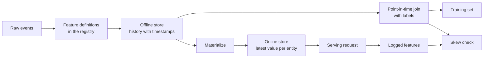

# Feature Store와 학습-서빙 왜곡

> 피처는 하나의 정의와 두 개의 리더(reader)를 갖습니다. 학습은 각 레이블 시점 기준의 피처 이력을 읽고, 서빙은 피처의 최신값을 읽습니다. 두 리더가 일치하지 않으면, 모델은 한 번도 학습한 적 없는 입력을 마주하게 됩니다.

**유형:** Build (실습)
**사용 언어:** Python, TypeScript
**선수 레슨:** Phase 2, Lessons 08 (Feature Engineering), 13 (ML Pipelines), 15 (Time Series), and 19 (ML System Design)
**소요 시간:** ~100분

## 학습 목표

- 오프라인 스토어, 온라인 스토어, 엔티티, 이벤트 타임스탬프, TTL의 개념과 각각의 역할을 설명할 수 있습니다.
- 시점 일치 조인(point-in-time correct join)을 구현하고, 순진한 방식의 조인이 어떻게 미래 값을 학습 데이터에 복사하는지 보여줄 수 있습니다.
- 학습-서빙 왜곡(training-serving skew)을 일으키는 네 가지 원인인 두 개의 코드 경로, 신선하지 않은(stale) 피처, 서로 다른 기본값, 시간 여행(time travel)을 설명할 수 있습니다.
- 하나의 정의로 학습 경로와 서빙 경로를 모두 지원하는 피처 레지스트리(feature registry)를 구축할 수 있습니다.
- 각 날짜 이후의 데이터를 읽지 않고도 과거 날짜에 대한 새 피처를 백필(backfill)할 수 있습니다.
- 동일한 엔티티와 시간에 대해 로깅된 서빙 피처와 학습 경로를 비교하여 왜곡을 감지할 수 있습니다.

## 문제 상황

어느 팀이 이탈(churn) 예측 모델을 구축합니다. 각 레이블은 특정 기준일(label day) 이후 30일 동안 사용자가 구매를 전혀 하지 않았는지를 나타냅니다. 팀은 `user_id`을 기준으로 레이블을 사용자 피처 테이블과 조인하고 `days_since_last_purchase`을 기반으로 규칙을 학습시킵니다. 오프라인 정확도는 0.948이 나옵니다.

그러나 실제 트래픽에서 모델은 이전의 더 단순한 버전보다 성능이 떨어집니다. 피처 테이블에는 기준일로부터 수 주가 지난 시점의 최신 사용자별 값만 보관되어 있었습니다. 마지막 구매가 115일째였던 사용자의 경우 175일째 스냅샷에는 미활동 일수가 60일로 표시되었으므로, 피처가 이미 정답을 포함하고 있었던 것입니다. 한편 다른 팀에서는 별도의 서비스에서 서빙용 피처를 다시 작성했습니다. 이들의 30일 윈도우에는 하루가 추가로 포함되어 있었고, 신규 사용자에 대한 기본값도 365가 아닌 -1을 사용했습니다.

두 결함 모두 원인은 동일합니다. 학습과 서빙이 "동일한 피처"를 서로 다른 두 가지 방식으로 계산했기 때문입니다. 이 레슨에서는 피처 스토어(feature store)의 구성 요소를 처음부터 직접 구축합니다. 레지스트리, 백필, 시점 일치 조인, TTL이 적용된 온라인 스토어, 왜곡 검사를 직접 작성해 봅니다. 데모를 통해 두 결함을 수치로 재현해 봅니다.

## 핵심 개념

### 동일한 피처의 두 리더

학습과 서빙은 서로 다른 형태의 피처를 요구합니다.

| 속성 | 학습 (오프라인) | 서빙 (온라인) |
|---|---|---|
| 질의 | "1,000만 개의 (엔티티, 시간) 쌍 각각에 대한 값은 무엇이었는가?" | "이 하나의 엔티티에 대한 현재 값은 무엇인가?" |
| 시점 | 과거의 수많은 시점 | 현재 |
| 처리량 | 잡(job)당 수백만 개의 행 | 요청당 단일 행 |
| 지연 시간 | 수 분이 걸려도 무방함 | 수 밀리초 이내 |
| 저장소 | 오프라인 스토어: 타임스탬프가 포함된 전체 이력, 컬럼형 파일이나 데이터 웨어하우스에 저장 | 온라인 스토어: 엔티티별 최신값, 키-값 데이터베이스에 저장 |

피처 스토어는 하나의 피처 정의 세트로부터 두 저장소 모두를 최신 상태로 유지합니다. 실체화(materialization)는 오프라인 스토어에서 온라인 스토어로 최신값을 복사하는 작업입니다.



### 엔티티, 타임스탬프, TTL

모든 피처 행은 네 가지 용어로 설명됩니다.

- **엔티티(Entity).** 피처가 설명하는 키로, `user_id`이나 `card_id` 등이 해당합니다.
- **이벤트 타임스탬프(Event timestamp).** 해당 값이 실제로 유효해진 시점입니다. "14일차 기준" 구매 건수의 이벤트 타임스탬프는 14일차입니다.
- **생성 타임스탬프(Created timestamp).** 시스템이 해당 행을 기록한 시점입니다. 오늘 실행되는 백필은 과거의 이벤트 타임스탬프와 새로운 생성 타임스탬프를 가진 행을 기록합니다.
- **TTL (time to live, 유효 기간).** 값의 최대 수명입니다. TTL보다 오래된 값은 결측치로 간주되므로 리더는 기본값을 사용합니다.

동일한 엔티티, 소스, TTL을 공유하는 피처들의 그룹을 피처 뷰(feature view)라고 부릅니다.

### 시점 일치 조인

학습 행은 레이블 시점에 실제로 존재했던 피처 값과 레이블을 짝지어야 합니다. 시점 일치 조인은 각 레이블에 대해 다음 단계를 수행합니다.

1. 동일한 엔티티의 피처 행들을 찾습니다.
2. 이벤트 타임스탬프가 레이블 타임스탬프 이하인 행들만 남깁니다.
3. 그중 가장 최신의 행을 선택합니다.
4. 레이블 타임스탬프에서 해당 이벤트 타임스탬프를 뺀 값이 TTL을 초과하면 이를 제외합니다.

한 사용자에 대해 16일차 레이블과 주간 피처 행이 있는 예시입니다.

| 피처 행 일자 | `purchases_30d` | 시점 일치 조인 | `user_id` 기준의 순진한 조인 |
|---|---|---|---|
| 7 | 4 | | |
| 14 | 3 | 선택됨 | |
| 21 | 1 | 미래 | |
| 28 | 0 | 미래 | 선택됨 |

레이블은 17일차부터 46일차 사이에 사용자가 무언가를 구매하는지 묻고 있습니다. 28일차 행은 레이블 기준일 이후의 미활동 기간을 이미 집계하고 있습니다. 사용자가 구매를 중단했기 때문에 구매 건수가 0으로 나타나며, 이는 바로 레이블이 측정하려는 사건입니다. 순진한 조인은 입력 데이터에 정답을 그대로 복사해 버립니다.

시계열 레슨에서 데이터를 시간 기준으로 분할했던 것도 동일한 이유 때문입니다. 시점 일치 조인은 단일 분할 지점 대신 모든 행에 이 규칙을 적용합니다.

### 학습-서빙 왜곡의 원인

Google의 머신러닝 규칙(Rules of Machine Learning)에서는 학습-서빙 왜곡을 학습 시의 성능과 서빙 시의 성능 간 차이로 정의합니다. 여기서는 세 가지 원인을 꼽습니다. 두 파이프라인 간 데이터 처리 방식의 차이, 학습과 서빙 사이의 데이터 변화, 그리고 피드백 루프입니다. 피처 파이프라인에서는 네 가지 구체적인 원인이 반복해서 나타납니다.

| 원인 | 발생하는 현상 | 데모 예시 |
|---|---|---|
| 두 개의 코드 경로 | 학습과 서빙이 서로 다른 코드로 피처를 계산함 | 서빙 윈도우에는 `now - 30`일차가 포함되나, 학습 윈도우에는 포함되지 않음 |
| 신선하지 않은 피처 | 서빙이 읽는 값의 생성 시점이 학습에 사용된 값의 생성 시점과 다름 | 학습은 주간 스냅샷을 읽고, 새로운 서비스는 신선한 값을 직접 계산함 |
| 서로 다른 기본값 | 두 경로가 결측치를 채우는 방식이 다름 | 학습에서는 "구매 이력 없음"에 365를 사용하고, 서빙에서는 -1을 사용함 |
| 시간 여행 | 학습 과정에서 레이블 시점 이후의 값을 읽음 | 순진한 조인이 모든 레이블에 대해 최신 스냅샷을 읽음 |

동일 가이드의 규칙 #32에서는 가능한 한 학습 파이프라인과 서빙 파이프라인 간에 코드를 재사용하라고 명시합니다. 피처 스토어는 두 경로가 모두 호출하는 단일 정의를 통해 이 규칙을 따릅니다.

### 피처 레지스트리

레지스트리는 피처 정의의 카탈로그입니다. 각 항목에는 이름, 엔티티, 소스, 변환 로직, 윈도우, 기본값, TTL, 소유자, 버전, 설명이 저장됩니다.

두 가지 규칙을 통해 안정성을 유지합니다.

- 두 경로 모두 레지스트리에서 정의를 읽습니다. 어떤 서비스도 변환 로직의 개별 사본을 보관하지 않습니다.
- 정의를 변경하면 새 버전이 생성됩니다. 이전 버전은 유지되므로 기존 모델은 자신이 학습했던 피처를 그대로 사용할 수 있습니다.
### 백필(Backfill)

새로운 피처에는 이전 이력이 없지만, 모델 훈련에는 과거의 모든 레이블 시점에 해당하는 피처 값이 필요합니다. 백필은 과거의 각 날짜마다 피처 정의를 실행하여 엔티티와 날짜의 조합마다 한 행씩 기록합니다. 각 실행 시에는 해당 날짜 이하의 타임스탬프를 가진 이벤트만 읽습니다.

백필에는 엔티티 수에 날짜 수를 곱한 만큼 증가하는 연산 비용이 듭니다. 또한 미묘한 데이터 누수가 발생할 수도 있습니다. 오늘 실행되는 백필은 과거의 이벤트 타임스탬프를 가진 행들을 기록하지만, 늦게 도착했거나 나중에 수정된 데이터를 읽어 들일 수 있습니다. 엄격한 시점 기준 조인(point-in-time join)은 데이터 생성 타임스탬프(created timestamp) 역시 레이블 시점 이하인지 확인합니다.

### 왜곡(Skew) 감지

같은 가이드의 규칙 #29에서는 서빙 시점에 피처를 로깅하고 이를 훈련에 사용할 것을 권장합니다. 로깅된 샘플의 크기가 작더라도 일관성을 검사할 수 있습니다. 로깅된 각 값과 훈련 경로가 동일한 엔티티 및 시점에 대해 생성하는 값을 비교합니다. 각 피처별로 불일치 비율과 평균 절대 오차(mean absolute difference)를 보고합니다.

원인을 찾으려면 다음 세 가지 쌍을 비교합니다.

1. 온라인 저장소 조회값 대 훈련 조인값. 이는 전체 시스템을 테스트하며 왜곡이 0이어야 합니다.
2. 실시간 계산값 대 훈련 조인값. 이를 통해 신선도(staleness) 문제를 격리합니다.
3. 보조 코드 경로 계산값 대 실시간 계산값. 이를 통해 윈도우나 기본값 같은 코드 간의 차이를 격리합니다.

```figure
mlprod-pit-join
```

## 직접 만들어보기

`code/main.py`의 코드는 표준 라이브러리만을 사용합니다. 시간은 정수 단위의 일수(day)입니다. 주간 배치 작업은 7일, 14일부터 최대 175일까지 7일 간격으로 피처 스냅샷을 기록합니다.

### 1단계: 피처 정의와 레지스트리

`FeatureDefinition`는 집계 방식, 윈도우, 기본값과 같은 변환 로직을 데이터 형태로 보관합니다. 이 클래스의 `compute` 메서드는 `as_of` 이후의 이벤트를 절대 읽지 않습니다.

```python
@dataclass(frozen=True)
class FeatureDefinition:
    name: str
    entity: str
    aggregate: str
    window_days: int | None
    default: float
    version: int = 1
    owner: str = "growth-team"
    description: str = ""

    def compute(self, events: list[Event], as_of: int) -> float:
        visible = [e for e in events if e.day <= as_of]
        if self.window_days is not None:
            visible = [e for e in visible if e.day > as_of - self.window_days]
        if self.aggregate == "count":
            return float(len(visible))
        if self.aggregate == "sum":
            return round(sum(e.amount for e in visible), 2)
        if self.aggregate == "days_since_last":
            return float(as_of - max(e.day for e in visible)) if visible else self.default
        raise ValueError(f"unknown aggregate {self.aggregate!r}")
```

`FeatureRegistry.register`는 동일한 정의가 중복 등록되는 것은 허용하지만, 이름과 버전이 같으면서 내용이 다른 정의는 거부합니다. `fill_defaults`는 두 경로 모두에 결측값에 대한 동일한 기본값을 제공합니다.

모델은 `spend_30d@1`와 같은 참조(reference)를 통해 정의를 고정(pin)합니다. `compute` 및 `fill_defaults`는 이 참조를 해석하며, `@`가 없는 이름은 최신 버전을 읽습니다. `@` 뒤에 버전 번호가 없는 참조는 `ValueError`를 발생시키므로, 오타로 인해 경고 없이 최신 버전을 읽는 일을 방지합니다. 이 참조는 저장되는 각 행의 키 역할도 하므로 백필, 온라인 저장소, 서빙 조회가 모두 고정된 정의를 사용하게 됩니다.

### 2단계: 오프라인 저장소 백필

```python
def backfill(registry: FeatureRegistry, names: list[str], events: list[Event], days: list[int]) -> list[FeatureRow]:
    rows = []
    for entity, entity_events in sorted(group_events(events).items()):
        for day in days:
            rows.append(FeatureRow(entity, day, registry.compute(names, entity_events, day)))
    return rows
```

이 데모는 25회의 스냅샷 날짜에 걸쳐 299명의 사용자에 대한 세 가지 피처를 백필하여 총 7,475개의 행을 생성합니다.

### 3단계: 시점 기준 조인

각 엔티티의 행을 날짜순으로 한 번 정렬합니다. 각 레이블에 대해 `bisect_right`는 레이블 날짜 이하의 가장 최근 행을 찾습니다. TTL 검사를 통해 너무 오래된 행은 제외합니다.

```python
def point_in_time_join(labels: list[LabelRow], rows: list[FeatureRow], ttl_days: int | None = None) -> list[JoinedRow]:
    by_entity: dict[str, list[FeatureRow]] = defaultdict(list)
    for row in rows:
        by_entity[row.entity].append(row)
    days_index = {}
    for entity, entity_rows in by_entity.items():
        entity_rows.sort(key=lambda r: r.day)
        days_index[entity] = [r.day for r in entity_rows]
    joined = []
    for label in labels:
        days = days_index.get(label.entity, [])
        pos = bisect.bisect_right(days, label.day) - 1
        match = by_entity[label.entity][pos] if pos >= 0 else None
        if match is not None and ttl_days is not None and label.day - match.day > ttl_days:
            match = None
        joined.append(JoinedRow(
            label.entity, label.day, label.label,
            match.day if match else None, match.values if match else None,
        ))
    return joined
```

### 4단계: 단순 조인으로 인한 누수 측정

`naive_latest_join`는 엔티티만으로 조인하므로 모든 레이블에 대해 가장 최신 행을 반환합니다. 데모에서는 100일, 120일, 140일 차에 레이블을 생성하고 각 훈련 세트에 단일 피처 규칙을 적합(fit)합니다. 그런 다음 시점 기준 피처를 사용하여 145일 차의 레이블에 대해 두 규칙을 모두 테스트합니다.

```console
  naive join used a snapshot from after the label day for 100% of rows
  offline accuracy, naive join: 0.948 (rule: idle > 53 days)
  offline accuracy, PIT join:   0.893 (rule: idle > 19 days)
  accuracy on day 145, trained with naive join: 0.763
  accuracy on day 145, trained with PIT join:   0.876
```

단순 조인은 오프라인에서 0.893 대비 0.948로 성능이 더 좋아 보입니다. 그러나 새로운 데이터에서는 0.876 대비 0.763으로 성능이 떨어집니다. 누수된 피처로 인해 적합된 임계값이 19일의 미활동 일수에서 53일로 이동했기 때문입니다.

### 5단계: 온라인 저장소와 구체화(Materialization)

온라인 저장소는 엔티티당 하나의 행을 유지하며 TTL보다 오래된 행은 거부합니다. `materialize`는 해당 작업 시점 이하의 날짜를 가진 행만 기록합니다.

```python
class OnlineStore:
    def __init__(self, ttl_days: int):
        self.ttl_days = ttl_days
        self._latest: dict[str, FeatureRow] = {}

    def write(self, row: FeatureRow) -> None:
        current = self._latest.get(row.entity)
        if current is None or row.day >= current.day:
            self._latest[row.entity] = row

    def read(self, entity: str, now: int) -> dict[str, float] | None:
        row = self._latest.get(entity)
        if row is None or row.day > now or now - row.day > self.ttl_days:
            return None
        return dict(row.values)
```

TTL이 10일인 경우, 145일 차의 조회는 140일 차의 행을 반환합니다. 새로운 구체화 작업이 없는 상태에서 160일 차에 조회하면 해당 행이 20일 전의 것이므로 기본값을 반환합니다.

### 6단계: 왜곡 검사

`detect_skew`는 `(entity, day)`를 키로 사용하는 두 뷰를 비교합니다. 피처별 불일치 비율과 평균 절대 오차를 보고하며, 값의 차이가 1%를 초과하는 피처에 플래그를 지정합니다. 두 뷰의 키가 일치하지 않거나 키가 전혀 없는 경우 `ValueError`를 발생시킵니다. 요청이 누락되면 왜곡이 감춰질 수 있고, 요청이 아예 없는 검사는 아무것도 보여주지 못하기 때문입니다.

```python
def detect_skew(
    training: dict[tuple[str, int], dict[str, float]],
    serving: dict[tuple[str, int], dict[str, float]],
    features: list[str],
    tolerance: float = 1e-6,
    max_mismatch_rate: float = 0.01,
) -> list[SkewReport]:
    if set(training) != set(serving):
        raise ValueError(f"{len(set(training) ^ set(serving))} keys are in only one view: log and compare the same requests")
    if not training:
        raise ValueError("no requests to compare")
    keys = sorted(training)
    reports = []
    for feature in features:
        diffs = [abs(training[k][feature] - serving[k][feature]) for k in keys]
        mismatches = sum(1 for d in diffs if d > tolerance)
        rate = mismatches / len(keys)
        mean_diff = sum(diffs) / len(keys)
        reports.append(SkewReport(feature, len(keys), rate, mean_diff, rate > max_mismatch_rate))
    return reports
```

데모는 141일부터 150일까지의 요청을 로깅하고 개념 섹션에서 다룬 세 가지 비교를 실행합니다. 요청 풀에는 이력이 없는 신규 사용자 20명이 포함되어 있습니다.

```bash
python3 code/main.py
npx tsx code/main.ts
```

```console
=== Skew checks on 383 logged requests, days 141 to 150 ===
  online store read  vs  training join (one definition, same snapshots)
    ok   days_since_last_purchase   mismatch   0.0%  mean |diff|    0.00
    ok   purchases_30d              mismatch   0.0%  mean |diff|    0.00
    ok   spend_30d                  mismatch   0.0%  mean |diff|    0.00
  fresh compute      vs  training join (staleness only)
    SKEW days_since_last_purchase   mismatch  83.0%  mean |diff|    2.77
    SKEW purchases_30d              mismatch  30.5%  mean |diff|    0.38
    SKEW spend_30d                  mismatch  37.1%  mean |diff|   16.77
  second code path   vs  fresh compute (code differences only)
    SKEW days_since_last_purchase   mismatch   5.5%  mean |diff|   20.07
    SKEW purchases_30d              mismatch  12.5%  mean |diff|    0.13
    SKEW spend_30d                  mismatch  12.5%  mean |diff|    5.09
```

세 블록을 순서대로 살펴봅니다.

- **동일한 정의, 동일한 스냅샷.** 온라인 저장소와 훈련 조인이 구체화된 동일한 행을 읽으므로 왜곡은 0입니다.
- **신선도.** 실시간 계산값은 대부분의 요청에서 주간 스냅샷과 차이를 보입니다. 모델이 최대 6일 전의 값을 기반으로 학습했기 때문에, 여기서는 더 신선한 데이터라고 해서 무조건 더 좋은 것은 아닙니다.
- **코드 차이.** 보조 코드 경로는 윈도우에 하루가 더 포함되어 있어 윈도우 카운트의 12.5%에서 차이가 납니다. `days_since_last_purchase`의 경우 신규 사용자에 대해서만 차이가 발생하지만, -1 대 365로 그 차이가 매우 큽니다.

## 적용해보기

Feast는 오픈소스 피처 저장소입니다. 밑바닥부터 작성한 코드의 각 요소는 Feast의 기능과 다음과 같이 대응됩니다.

| 직접 구현 | Feast |
|---|---|
| `FeatureDefinition`, `FeatureRegistry` | 피처 저장소 내의 `Entity`, `FeatureView`, `Field` (`feast apply`로 등록) |
| `FeatureRow` 이력 | Parquet 파일 기반의 `FileSource` 또는 데이터 웨어하우스 테이블과 같은 오프라인 저장소 |
| TTL이 적용된 `point_in_time_join` | `store.get_historical_features(entity_df=..., features=[...])` |
| `materialize` | `feast materialize-incremental <end time>` |
| `OnlineStore.read` | `store.get_online_features(features=[...], entity_rows=[...])` |
| 생성 타임스탬프 검사 | 소스의 `created_timestamp_column` 및 `filter_by_created_timestamp=True` |

피처 정의는 다음과 같은 형태를 띱니다. 이 코드는 Feast 빠른 시작(quickstart) 가이드를 따르며, 본 실습을 실행하는 데 필수는 아닙니다.

```python
from datetime import timedelta

from feast import Entity, FeatureView, Field, FileSource
from feast.types import Float32, Int64

user = Entity(name="user", join_keys=["user_id"])

user_activity_source = FileSource(
    name="user_activity_source",
    path="data/user_activity.parquet",
    timestamp_field="event_timestamp",
    created_timestamp_column="created",
)

user_activity = FeatureView(
    name="user_activity",
    entities=[user],
    ttl=timedelta(days=10),
    schema=[
        Field(name="purchases_30d", dtype=Int64),
        Field(name="spend_30d", dtype=Float32),
        Field(name="days_since_last_purchase", dtype=Int64),
    ],
    source=user_activity_source,
)
```

이후 훈련과 서빙에서 동일한 피처 뷰를 읽습니다.

```python
from feast import FeatureStore

store = FeatureStore(repo_path=".")

training_df = store.get_historical_features(
    entity_df=labels_df,
    features=["user_activity:purchases_30d", "user_activity:days_since_last_purchase"],
    filter_by_created_timestamp=True,
).to_df()

online = store.get_online_features(
    features=["user_activity:purchases_30d", "user_activity:days_since_last_purchase"],
    entity_rows=[{"user_id": 42}],
).to_dict()
```

`labels_df`는 `user_id`, `event_timestamp`, 레이블을 포함하여 레이블당 하나의 행을 가집니다. Feast 문서에 따르면 TTL은 쿼리 시점이 아니라 엔티티 데이터프레임의 각 타임스탬프를 기준으로 적용됩니다. 이는 `point_in_time_join`의 TTL 검사와 일치합니다. 같은 문서에서는 백필된 값이 훈련 데이터로 누수되는 것을 방지하는 `filter_by_created_timestamp=True`에 대해서도 설명합니다. 모든 오프라인 저장소가 이 옵션을 지원하는 것은 아닙니다. 지원하지 않는 저장소는 옵션을 무시하는 대신 에러를 발생시킵니다.

Tecton, Hopsworks, 그리고 주요 클라우드 ML 플랫폼의 피처 저장소들도 오프라인 저장소와 온라인 저장소를 이와 동일하게 분리하여 사용합니다. 왜곡 검사의 경우, TensorFlow Data Validation을 사용하여 훈련 데이터와 서빙 데이터를 비교함으로써 왜곡을 감지할 수 있습니다. Breck 등은 훈련-서빙 왜곡을 포함하여 Google의 엔드투엔드 ML 플랫폼인 TFX의 데이터 검증 시스템을 설명합니다.

## 배포하기

이 레슨의 결과물은 `outputs/skill-feature-skew-audit.md`입니다. 이 스킬은 피처 파이프라인의 시간 여행(time travel) 및 훈련-서빙 왜곡을 감사(audit)합니다. 조인, 정의, 기본값, 각 경로의 신선도, 그리고 왜곡 검사에 필요한 로깅을 차례대로 점검합니다.

## 연습 문제

1. 스냅샷 주기를 7일에서 1일로 변경해 보세요. 신선도 비교를 다시 실행하고 그 결과를 설명해 보세요.
2. TTL을 3일로 설정해 보세요. 피처를 잃고 기본값을 받게 되는 훈련 데이터 행의 수를 세어 보세요.
3. `FeatureRow`에 생성 날짜(created day)를 추가해 보세요. 조인 시 레이블 날짜 이후에 기록된 행을 무시하도록 만들어 보세요.
4. `spend_7d`를 `spend_30d`의 버전 2로 등록해 보세요. 이를 백필하고 레지스트리에서 두 버전을 모두 출력해 보세요.
5. 세 번째 왜곡 검사를 통과할 때까지 `legacy_serving_features`를 수정해 보세요. 변경한 사항을 각각 나열해 보세요.
## 주요 용어

| 용어 | 흔히 하는 말 | 실제 의미 |
|------|----------------|----------------------|
| 피처 스토어(Feature store) | "피처를 위한 데이터베이스" | 단일 정의 세트로부터 피처를 계산하여 학습 및 서빙 환경 모두에 제공하는 시스템 |
| 오프라인 스토어(Offline store) | "학습 데이터" | 학습 작업과 백필에서 읽는, 이벤트 타임스탬프가 포함된 전체 피처 이력 |
| 온라인 스토어(Online store) | "피처 캐시" | 서빙 경로에서 수 밀리초 내에 읽을 수 있는 엔티티별 최신값 |
| 엔티티(Entity) | "ID" | 사용자나 카드 등 피처가 설명하는 대상의 키 |
| 이벤트 타임스탬프(Event timestamp) | "발생 시점" | 피처 값이 참이 된 시점 |
| 시점 조인(Point-in-time join) | "as-of 조인" | 각 레이블을 해당 레이블 시점 또는 그 이전에 유효했던 최신 피처 행과 짝지어 주는 조인 |
| TTL | "만료 기간" | 리더(reader)가 결측치로 취급하기 전까지 피처 값이 유지될 수 있는 최대 유효 기간 |
| 구체화(Materialization) | "온라인 동기화" | 오프라인 스토어의 최신 피처 값을 온라인 스토어로 복사하는 작업 |
| 백필(Backfill) | "이력 계산" | 과거 일자를 기준으로 피처 정의를 실행하여 해당 이력을 생성하는 작업 |
| 학습-서빙 왜곡(Training-serving skew) | "오프라인에서는 잘 됐는데" | 학습 환경과 서빙 환경 간의 피처 또는 동작 차이 |

## 추가 참고 자료

- [Feast, Point-in-time joins](https://docs.feast.dev/getting-started/concepts/point-in-time-joins): TTL 시맨틱 및 생성 타임스탬프 필터
- [Feast documentation](https://docs.feast.dev/): 피처 뷰, 오프라인 스토어, 온라인 스토어 및 구체화
- [Google, Rules of Machine Learning](https://developers.google.com/machine-learning/guides/rules-of-ml): 규칙 #29부터 규칙 #37까지의 학습-서빙 왜곡 관련 규칙
- [Breck et al., Data Validation for Machine Learning (SysML 2019)](https://research.google/pubs/data-validation-for-machine-learning/): 학습-서빙 왜곡을 포함한 Google의 데이터 검증
- [TensorFlow Data Validation guide](https://www.tensorflow.org/tfx/guide/tfdv): 스키마 검사, 왜곡(skew) 감지 및 드리프트(drift) 감지
- [Sculley et al., Hidden Technical Debt in Machine Learning Systems (NeurIPS 2015)](https://papers.nips.cc/paper/2015/hash/86df7dcfd896fcaf2674f757a2463eba-Abstract.html): 모델 주변의 데이터 의존성 및 파이프라인 부채
