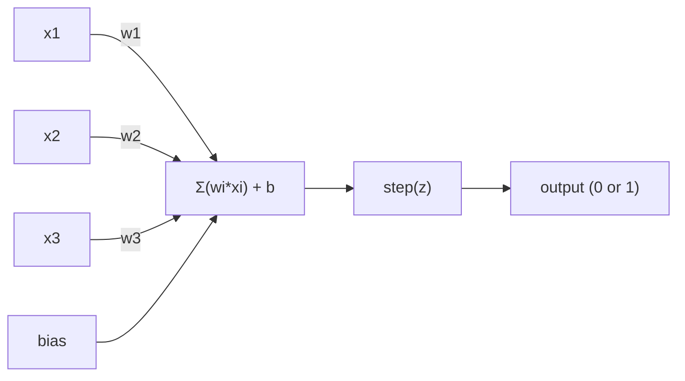
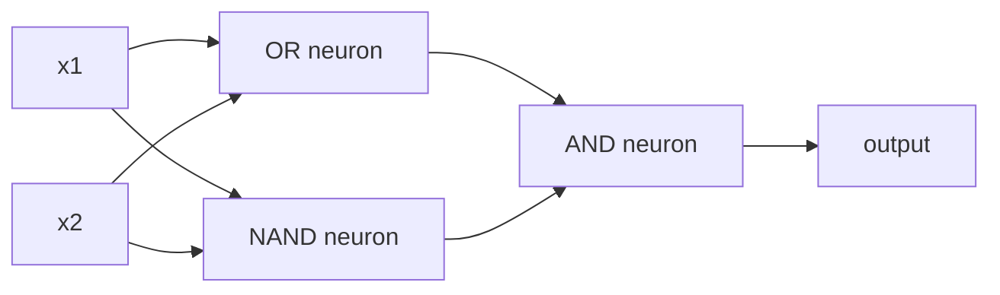

# 퍼셉트론

> 퍼셉트론은 신경망의 원자입니다. 이를 쪼개어 들여다보면 가중치, 편향, 그리고 결정이 나타납니다.

**유형:** Build (실습)
**사용 언어:** Python
**선수 레슨:** Phase 1 (Linear Algebra Intuition)
**소요 시간:** ~60분

## 학습 목표

- 가중치 업데이트 규칙과 계단 활성화 함수(step activation function)를 포함한 퍼셉트론을 Python으로 밑바닥부터 구현합니다.
- 단일 퍼셉트론이 선형 분리 가능한 문제만 해결할 수 있는 이유를 설명하고 XOR 실패 사례를 살펴봅니다.
- OR, NAND, AND 게이트를 조합하여 XOR을 해결하는 다층 퍼셉트론(multi-layer perceptron)을 구성합니다.
- 시그모이드(sigmoid) 활성화 함수와 역전파(backpropagation)를 사용하는 2계층 신경망을 학습시켜 XOR을 자동으로 학습하도록 만듭니다.

## 문제

여러분은 이미 벡터와 내적을 알고 있습니다. 또한 행렬이 입력을 출력으로 변환한다는 사실도 압니다. 하지만 기계는 어떤 변환을 사용해야 하는지 어떻게 *학습*할까요?

퍼셉트론이 이에 대한 답을 제시합니다. 퍼셉트론은 가장 단순한 형태의 학습 기계입니다. 입력을 받아 가중치를 곱하고 편향을 더한 뒤, 이진 결정을 내립니다. 그런 다음 가중치를 조정합니다. 이것이 전부입니다. 지금까지 만들어진 모든 신경망은 이 개념을 층층이 쌓아 올린 것입니다.

퍼셉트론을 이해한다는 것은 코드에서 "학습"이 실제로 무엇을 의미하는지 이해하는 것입니다. 즉, 출력이 실제와 일치할 때까지 숫자를 조정하는 과정입니다.

## 개념

### 하나의 뉴런, 하나의 결정

퍼셉트론은 $n$개의 입력을 받아 각각 가중치를 곱하고, 모두 더한 후 편향을 더하여 그 결과를 활성화 함수(activation function)에 통과시킵니다.



계단 함수는 매정할 만큼 단순합니다. 가중합에 편향을 더한 값이 $\ge 0$이면 1을 출력하고, 그렇지 않으면 0을 출력합니다.

```math
\text{step}(z) = \begin{cases} 1 & \text{if } z \ge 0 \\ 0 & \text{if } z < 0 \end{cases}
```

이것이 바로 선형 분류기(linear classifier)입니다. 가중치와 편향은 입력 공간을 두 영역으로 나누는 직선(고차원에서는 초평면)을 정의합니다.

### 결정 경계

두 개의 입력에 대해 퍼셉트론은 2차원 공간을 가로지르는 직선을 그립니다.

```
  x2
  ┤
  │  Class 1        /
  │    (0)          /
  │                /
  │               / w1·x1 + w2·x2 + b = 0
  │              /
  │             /     Class 2
  │            /        (1)
  ┼───────────/──────────── x1
```

직선의 한쪽에 있는 모든 것은 0을 출력하고, 다른 쪽에 있는 모든 것은 1을 출력합니다. 학습은 이 직선이 클래스들을 올바르게 분리할 때까지 직선의 위치를 이동시킵니다.

### 학습 규칙

퍼셉트론 학습 규칙은 간단합니다.

```
For each training example (x, y_true):
    y_pred = predict(x)
    error = y_true - y_pred

    For each weight:
        w_i = w_i + learning_rate * error * x_i
    bias = bias + learning_rate * error
```

예측이 맞으면($\text{error} = 0$) 아무것도 변하지 않습니다. 0으로 예측했지만 실제로는 1이어야 한다면 가중치가 증가합니다. 1로 예측했지만 실제로는 0이어야 한다면 가중치가 감소합니다. 학습률(learning rate)은 매 조정의 크기를 제어합니다.

### XOR 문제

여기서 한계가 드러납니다. 다음 논리 게이트들을 살펴보겠습니다.

```
AND gate:           OR gate:            XOR gate:
x1  x2  out         x1  x2  out         x1  x2  out
0   0   0           0   0   0           0   0   0
0   1   0           0   1   1           0   1   1
1   0   0           1   0   1           1   0   1
1   1   1           1   1   1           1   1   0
```

AND와 OR은 선형 분리가 가능합니다. 즉, 직선 하나로 0과 1을 분리할 수 있습니다. 하지만 XOR은 그렇지 않습니다. 단 하나의 직선으로는 [0,1], [1,0]을 [0,0], [1,1]로부터 분리할 수 없습니다.

```
AND (separable):        XOR (not separable):

  x2                      x2
  1 ┤  0     1            1 ┤  1     0
    │     /                 │
  0 ┤  0 / 0              0 ┤  0     1
    ┼──/──────── x1         ┼──────────── x1
       line works!          no single line works!
```

이는 근본적인 한계입니다. 단일 퍼셉트론은 선형 분리 가능한 문제만 해결할 수 있습니다. 민스키(Minsky)와 페퍼트(Papert)는 1969년에 이를 증명했고, 이로 인해 신경망 연구는 거의 10년 동안 침체기를 겪었습니다.

해결책은 퍼셉트론을 층(layer)으로 쌓는 것입니다. 다층 퍼셉트론은 두 개의 선형 결정을 결합하여 비선형 결정을 만들어냄으로써 XOR을 해결할 수 있습니다.

```figure
perceptron-boundary
```

## 직접 만들기

### 1단계: Perceptron 클래스

```python
class Perceptron:
    def __init__(self, n_inputs, learning_rate=0.1):
        self.weights = [0.0] * n_inputs
        self.bias = 0.0
        self.lr = learning_rate

    def predict(self, inputs):
        total = sum(w * x for w, x in zip(self.weights, inputs))
        total += self.bias
        return 1 if total >= 0 else 0

    def train(self, training_data, epochs=100):
        for epoch in range(epochs):
            errors = 0
            for inputs, target in training_data:
                prediction = self.predict(inputs)
                error = target - prediction
                if error != 0:
                    errors += 1
                    for i in range(len(self.weights)):
                        self.weights[i] += self.lr * error * inputs[i]
                    self.bias += self.lr * error
            if errors == 0:
                print(f"Converged at epoch {epoch + 1}")
                return
        print(f"Did not converge after {epochs} epochs")
```

### 2단계: 논리 게이트 학습

```python
and_data = [
    ([0, 0], 0),
    ([0, 1], 0),
    ([1, 0], 0),
    ([1, 1], 1),
]

or_data = [
    ([0, 0], 0),
    ([0, 1], 1),
    ([1, 0], 1),
    ([1, 1], 1),
]

not_data = [
    ([0], 1),
    ([1], 0),
]

print("=== AND Gate ===")
p_and = Perceptron(2)
p_and.train(and_data)
for inputs, _ in and_data:
    print(f"  {inputs} -> {p_and.predict(inputs)}")

print("\n=== OR Gate ===")
p_or = Perceptron(2)
p_or.train(or_data)
for inputs, _ in or_data:
    print(f"  {inputs} -> {p_or.predict(inputs)}")

print("\n=== NOT Gate ===")
p_not = Perceptron(1)
p_not.train(not_data)
for inputs, _ in not_data:
    print(f"  {inputs} -> {p_not.predict(inputs)}")
```

### 3단계: XOR 실패 확인하기

```python
xor_data = [
    ([0, 0], 0),
    ([0, 1], 1),
    ([1, 0], 1),
    ([1, 1], 0),
]

print("\n=== XOR Gate (single perceptron) ===")
p_xor = Perceptron(2)
p_xor.train(xor_data, epochs=1000)
for inputs, expected in xor_data:
    result = p_xor.predict(inputs)
    status = "OK" if result == expected else "WRONG"
    print(f"  {inputs} -> {result} (expected {expected}) {status}")
```

절대 수렴하지 않습니다. 이는 단일 퍼셉트론이 XOR을 학습할 수 없다는 확실한 증거입니다.

### 4단계: 2개 계층으로 XOR 해결하기

요령은 다음과 같습니다: $\text{XOR} = (x_1 \text{ OR } x_2) \text{ AND NOT } (x_1 \text{ AND } x_2)$. 세 개의 퍼셉트론을 조합합니다.



```python
def xor_network(x1, x2):
    or_neuron = Perceptron(2)
    or_neuron.weights = [1.0, 1.0]
    or_neuron.bias = -0.5

    nand_neuron = Perceptron(2)
    nand_neuron.weights = [-1.0, -1.0]
    nand_neuron.bias = 1.5

    and_neuron = Perceptron(2)
    and_neuron.weights = [1.0, 1.0]
    and_neuron.bias = -1.5

    hidden1 = or_neuron.predict([x1, x2])
    hidden2 = nand_neuron.predict([x1, x2])
    output = and_neuron.predict([hidden1, hidden2])
    return output


print("\n=== XOR Gate (multi-layer network) ===")
for inputs, expected in xor_data:
    result = xor_network(inputs[0], inputs[1])
    print(f"  {inputs} -> {result} (expected {expected})")
```

네 가지 경우 모두 정확합니다. 퍼셉트론을 층으로 쌓으면 단일 퍼셉트론으로는 만들 수 없는 결정 경계(decision boundary)가 만들어집니다.

### 5단계: 2계층 신경망 학습시키기

4단계에서는 가중치를 수작업으로 직접 지정했습니다. 이는 XOR에서는 통하지만, 적절한 가중치를 미리 알 수 없는 실제 문제에는 통하지 않습니다. 해결책은 계단 함수를 시그모이드로 대체하고 역전파를 통해 가중치를 자동으로 학습하는 것입니다.

```python
class TwoLayerNetwork:
    def __init__(self, learning_rate=0.5):
        import random
        random.seed(0)
        self.w_hidden = [[random.uniform(-1, 1), random.uniform(-1, 1)] for _ in range(2)]
        self.b_hidden = [random.uniform(-1, 1), random.uniform(-1, 1)]
        self.w_output = [random.uniform(-1, 1), random.uniform(-1, 1)]
        self.b_output = random.uniform(-1, 1)
        self.lr = learning_rate

    def sigmoid(self, x):
        import math
        x = max(-500, min(500, x))
        return 1.0 / (1.0 + math.exp(-x))

    def forward(self, inputs):
        self.inputs = inputs
        self.hidden_outputs = []
        for i in range(2):
            z = sum(w * x for w, x in zip(self.w_hidden[i], inputs)) + self.b_hidden[i]
            self.hidden_outputs.append(self.sigmoid(z))
        z_out = sum(w * h for w, h in zip(self.w_output, self.hidden_outputs)) + self.b_output
        self.output = self.sigmoid(z_out)
        return self.output

    def train(self, training_data, epochs=10000):
        for epoch in range(epochs):
            total_error = 0
            for inputs, target in training_data:
                output = self.forward(inputs)
                error = target - output
                total_error += error ** 2

                d_output = error * output * (1 - output)

                saved_w_output = self.w_output[:]
                hidden_deltas = []
                for i in range(2):
                    h = self.hidden_outputs[i]
                    hd = d_output * saved_w_output[i] * h * (1 - h)
                    hidden_deltas.append(hd)

                for i in range(2):
                    self.w_output[i] += self.lr * d_output * self.hidden_outputs[i]
                self.b_output += self.lr * d_output

                for i in range(2):
                    for j in range(len(inputs)):
                        self.w_hidden[i][j] += self.lr * hidden_deltas[i] * inputs[j]
                    self.b_hidden[i] += self.lr * hidden_deltas[i]
```

```python
net = TwoLayerNetwork(learning_rate=2.0)
net.train(xor_data, epochs=10000)
for inputs, expected in xor_data:
    result = net.forward(inputs)
    predicted = 1 if result >= 0.5 else 0
    print(f"  {inputs} -> {result:.4f} (rounded: {predicted}, expected {expected})")
```

4단계와 비교했을 때 두 가지 핵심적인 차이점이 있습니다. 첫째, 계단 함수 대신 시그모이드를 사용합니다. 시그모이드는 매끄러우므로 기울기(gradient)가 존재합니다. 둘째, `train` 메서드가 오차를 출력층에서 은닉층으로 역전파하여, 각 가중치가 오차에 기여한 정도에 비례해 가중치를 조정합니다. 이것이 바로 20줄로 구현한 역전파입니다.

이는 레슨 03으로 이어지는 징검다리입니다. `d_output`과 `hidden_deltas` 이면의 수학적 원리는 네트워크 그래프에 적용된 연쇄 법칙(chain rule)입니다. 레슨 03에서 이를 본격적으로 유도해 볼 것입니다.

## 활용하기

지금까지 밑바닥부터 구현한 모든 기능은 단 하나의 import 문으로 사용할 수 있습니다.

```python
from sklearn.linear_model import Perceptron as SkPerceptron
import numpy as np

X = np.array([[0,0],[0,1],[1,0],[1,1]])
y = np.array([0, 0, 0, 1])

clf = SkPerceptron(max_iter=100, tol=1e-3)
clf.fit(X, y)
print([clf.predict([x])[0] for x in X])
```

단 다섯 줄입니다. 여러분이 작성한 30줄짜리 `Perceptron` 클래스도 동일한 작업을 수행합니다. sklearn 버전은 수렴 확인, 다양한 손실 함수(loss function), 희소 입력 지원 등을 추가로 제공하지만, 핵심 루프는 가중합, 계단 함수, 오차 기반 가중치 업데이트로 완전히 동일합니다.

진정한 차이는 규모가 커질 때 나타납니다. 프로덕션 신경망에서 달라지는 점들은 다음과 같습니다.

- 계단 함수가 시그모이드, ReLU 또는 기타 매끄러운 활성화 함수로 대체됩니다.
- 가중치는 역전파를 통해 자동으로 학습됩니다(레슨 03).
- 계층이 3개, 10개, 100개 이상으로 깊어집니다.
- 동일한 원리가 유지됩니다. 즉, 각 계층은 이전 계층의 출력으로부터 새로운 특성(feature)을 생성합니다.

단일 퍼셉트론은 직선만 그릴 수 있습니다. 하지만 이들을 쌓아 올리면 어떤 형태든 그릴 수 있습니다.

## 산출물

이 레슨에서 생성되는 산출물은 다음과 같습니다:
- `outputs/skill-perceptron.md` - 단층 아키텍처와 다층 아키텍처가 각각 언제 필요한지를 다루는 스킬

## 연습 문제

1. NAND 게이트(모든 논리 회로를 구성할 수 있는 범용 게이트)를 대상으로 퍼셉트론을 학습시켜 보세요. 가중치와 편향이 유효한 결정 경계를 형성하는지 확인합니다.
2. 매 에포크(epoch)마다 결정 경계($w_1 x_1 + w_2 x_2 + b = 0$)를 추적하도록 Perceptron 클래스를 수정해 보세요. AND 게이트를 학습하는 동안 직선이 어떻게 이동하는지 출력합니다.
3. 3개의 입력 중 최소 2개가 1일 때만 1을 출력하는 3-입력 퍼셉트론(다수결 함수)을 만들어 보세요. 이는 선형 분리 가능한가요? 그 이유는 무엇인가요?

## 핵심 용어

| 용어 | 흔히 하는 말 | 실제 의미 |
|------|----------------|----------------------|
| 퍼셉트론(Perceptron) | "가짜 뉴런" | 선형 분류기: 입력과 가중치의 내적에 편향을 더한 후 계단 함수를 통과시키는 모델 |
| 가중치(Weight) | "입력의 중요도" | 결정에 대한 각 입력의 기여도를 조절하는 배수 |
| 편향(Bias) | "임계값" | 결정 경계를 이동시켜 입력이 모두 0이어도 퍼셉트론이 활성화될 수 있게 해주는 상수 |
| 활성화 함수(Activation function) | "값을 찌그러뜨리는 것" | 가중합을 구한 뒤 적용하는 함수(퍼셉트론에서는 계단 함수, 현대 신경망에서는 시그모이드/ReLU) |
| 선형 분리 가능(Linearly separable) | "그 사이에 선을 그을 수 있음" | 단 하나의 초평면으로 클래스를 완벽히 분리할 수 있는 데이터셋 |
| XOR 문제(XOR problem) | "퍼셉트론이 풀 수 없는 문제" | 단층 신경망은 선형 분리 불가능한 함수를 학습할 수 없다는 증명 |
| 결정 경계(Decision boundary) | "분류 기준이 바뀌는 곳" | 입력 공간을 두 클래스로 나누는 초평면 $w \cdot x + b = 0$ |
| 다층 퍼셉트론(Multi-layer perceptron) | "진짜 신경망" | 계층 구조로 쌓인 퍼셉트론으로, 각 계층의 출력이 다음 계층의 입력으로 전달됨 |
## 추가 참고 자료

- Frank Rosenblatt, "The Perceptron: A Probabilistic Model for Information Storage and Organization in the Brain" (1958) -- 모든 것의 시작이 된 최초의 논문
- Minsky & Papert, "Perceptrons" (1969) -- 단층 네트워크로는 XOR을 해결할 수 없음을 증명하여 퍼셉트론 연구를 10년간 침체시켰던 책
- Michael Nielsen, "Neural Networks and Deep Learning", Chapter 1 (http://neuralnetworksanddeeplearning.com/) -- 온라인 무료 공개 자료로, 퍼셉트론이 결합하여 네트워크를 구성하는 방식을 가장 훌륭하게 시각적으로 설명한 챕터
