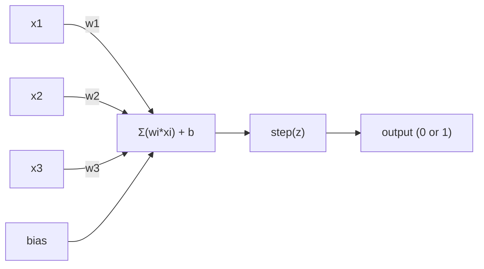
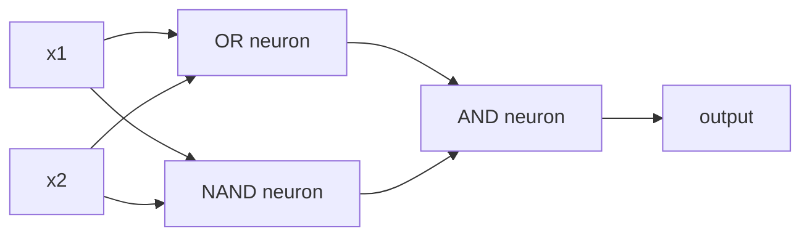

# 퍼셉트론(The Perceptron)

> 퍼셉트론은 신경망의 원자와 같습니다. 이를 쪼개어 보면 가중치, 편향, 그리고 결정이 나타납니다.

**유형:** Build (실습)
**사용 언어:** Python, Julia, Rust
**선수 레슨:** Phase 1 (Linear Algebra Intuition)
**소요 시간:** ~60분

## 학습 목표

- 가중치 업데이트 규칙과 계단 함수(step activation function)를 포함한 퍼셉트론을 Python으로 밑바닥부터 직접 구현합니다.
- 단일 퍼셉트론이 선형 분리 가능한(linearly separable) 문제만 해결할 수 있는 이유를 설명하고 XOR 실패 사례를 확인합니다.
- OR, NAND, AND 게이트를 조합하여 XOR 문제를 해결하는 다층 퍼셉트론(multi-layer perceptron)을 구성합니다.
- 시그모이드(sigmoid) 활성화 함수와 역전파(backpropagation)를 사용하는 2계층 신경망을 학습시켜 XOR 문제를 자동으로 해결합니다.

## 문제

벡터와 내적을 이미 알고 계실 것입니다. 행렬이 입력을 출력으로 변환한다는 점도 알고 있습니다. 하지만 머신은 사용할 변환을 어떻게 *학습*할까요?

퍼셉트론이 바로 이에 대한 해답을 제시합니다. 퍼셉트론은 가장 단순한 형태의 학습 머신입니다. 입력을 받아 가중치를 곱하고 편향을 더한 뒤, 이진 결정을 내립니다. 그런 다음 가중치를 조정합니다. 이것이 전부입니다. 지금까지 개발된 모든 신경망은 이 아이디어를 여러 계층으로 쌓아 올린 것입니다.

퍼셉트론을 이해한다는 것은 코드 레벨에서 '학습'이 실제로 무엇을 의미하는지 이해하는 것을 뜻합니다. 즉, 출력이 실제 정답과 일치할 때까지 숫자를 조정해 나가는 과정입니다.

## 핵심 개념

### 하나의 뉴런, 하나의 결정

퍼셉트론은 $n$개의 입력을 받아 각각 가중치를 곱하고, 모두 더한 후 편향을 더하고, 그 결과를 활성화 함수에 통과시킵니다.



계단 함수(step function)는 매우 단순합니다. 가중치 합에 편향을 더한 값이 $\ge 0$이면 1을 출력하고, 그렇지 않으면 0을 출력합니다.

```math
\text{step}(z) = \begin{cases} 1 & \text{if } z \ge 0 \\ 0 & \text{if } z < 0 \end{cases}
```

이것이 바로 선형 분류기(linear classifier)입니다. 가중치와 편향은 입력 공간을 두 영역으로 나누는 직선(고차원에서는 초평면, hyperplane)을 정의합니다.

### 결정 경계

입력이 2개일 때, 퍼셉트론은 2차원 공간에 직선을 긋습니다.

```
  x2
  ┤
  │  Class 1        /
  │    (0)          /
  │                /
  │               / w1·x1 + w2·x2 + b = 0
  │              /
  │             /     Class 2
  │            /        (1)
  ┼───────────/──────────── x1
```

직선의 한쪽에 있는 모든 데이터는 0을 출력하고, 반대쪽에 있는 모든 데이터는 1을 출력합니다. 학습이란 클래스를 정확하게 분리할 수 있을 때까지 이 직선을 이동시키는 과정입니다.

### 학습 규칙

퍼셉트론 학습 규칙은 간단합니다.

```
For each training example (x, y_true):
    y_pred = predict(x)
    error = y_true - y_pred

    For each weight:
        w_i = w_i + learning_rate * error * x_i
    bias = bias + learning_rate * error
```

예측이 맞으면($\text{error} = 0$) 아무것도 변경되지 않습니다. 0으로 예측했으나 실제 정답이 1이어야 한다면 가중치를 늘립니다. 1로 예측했으나 실제 정답이 0이어야 한다면 가중치를 줄입니다. 학습률(learning rate)은 각 조정 단계의 크기를 제어합니다.

### XOR 문제

여기서 한계가 드러납니다. 다음 논리 게이트들을 살펴보겠습니다.

```
AND gate:           OR gate:            XOR gate:
x1  x2  out         x1  x2  out         x1  x2  out
0   0   0           0   0   0           0   0   0
0   1   0           0   1   1           0   1   1
1   0   0           1   0   1           1   0   1
1   1   1           1   1   1           1   1   0
```

AND와 OR는 선형 분리가 가능합니다. 직선 하나로 0과 1을 나눌 수 있습니다. 하지만 XOR은 그렇지 않습니다. 단일 직선으로는 [0,1], [1,0]을 [0,0], [1,1]로부터 분리할 수 없습니다.

```
AND (separable):        XOR (not separable):

  x2                      x2
  1 ┤  0     1            1 ┤  1     0
    │     /                 │
  0 ┤  0 / 0              0 ┤  0     1
    ┼──/──────── x1         ┼──────────── x1
       line works!          no single line works!
```

이는 근본적인 한계입니다. 단일 퍼셉트론은 선형 분리 가능한 문제만 해결할 수 있습니다. 민스키(Minsky)와 페퍼트(Papert)가 1969년에 이를 증명하면서 신경망 연구는 거의 10년 동안 침체기를 겪었습니다.

해결책은 퍼셉트론을 여러 계층으로 쌓는 것입니다. 다층 퍼셉트론은 두 개의 선형 결정을 결합하여 비선형 결정을 만듦으로써 XOR 문제를 해결할 수 있습니다.

```figure
perceptron-boundary
```

## 직접 구현하기

### 1단계: Perceptron 클래스 구현

```python
class Perceptron:
    def __init__(self, n_inputs, learning_rate=0.1):
        self.weights = [0.0] * n_inputs
        self.bias = 0.0
        self.lr = learning_rate

    def predict(self, inputs):
        total = sum(w * x for w, x in zip(self.weights, inputs))
        total += self.bias
        return 1 if total >= 0 else 0

    def train(self, training_data, epochs=100):
        for epoch in range(epochs):
            errors = 0
            for inputs, target in training_data:
                prediction = self.predict(inputs)
                error = target - prediction
                if error != 0:
                    errors += 1
                    for i in range(len(self.weights)):
                        self.weights[i] += self.lr * error * inputs[i]
                    self.bias += self.lr * error
            if errors == 0:
                print(f"Converged at epoch {epoch + 1}")
                return
        print(f"Did not converge after {epochs} epochs")
```

### 2단계: 논리 게이트 학습

```python
and_data = [
    ([0, 0], 0),
    ([0, 1], 0),
    ([1, 0], 0),
    ([1, 1], 1),
]

or_data = [
    ([0, 0], 0),
    ([0, 1], 1),
    ([1, 0], 1),
    ([1, 1], 1),
]

not_data = [
    ([0], 1),
    ([1], 0),
]

print("=== AND Gate ===")
p_and = Perceptron(2)
p_and.train(and_data)
for inputs, _ in and_data:
    print(f"  {inputs} -> {p_and.predict(inputs)}")

print("\n=== OR Gate ===")
p_or = Perceptron(2)
p_or.train(or_data)
for inputs, _ in or_data:
    print(f"  {inputs} -> {p_or.predict(inputs)}")

print("\n=== NOT Gate ===")
p_not = Perceptron(1)
p_not.train(not_data)
for inputs, _ in not_data:
    print(f"  {inputs} -> {p_not.predict(inputs)}")
```

### 3단계: XOR 실패 확인

```python
xor_data = [
    ([0, 0], 0),
    ([0, 1], 1),
    ([1, 0], 1),
    ([1, 1], 0),
]

print("\n=== XOR Gate (single perceptron) ===")
p_xor = Perceptron(2)
p_xor.train(xor_data, epochs=1000)
for inputs, expected in xor_data:
    result = p_xor.predict(inputs)
    status = "OK" if result == expected else "WRONG"
    print(f"  {inputs} -> {result} (expected {expected}) {status}")
```

학습이 전혀 수렴하지 않습니다. 이는 단일 퍼셉트론이 XOR을 학습할 수 없음을 명확히 보여주는 증거입니다.

### 4단계: 2계층으로 XOR 문제 해결

핵심 원리는 $\text{XOR} = (x_1 \text{ OR } x_2) \text{ AND NOT } (x_1 \text{ AND } x_2)$입니다. 세 개의 퍼셉트론을 결합합니다.



```python
def xor_network(x1, x2):
    or_neuron = Perceptron(2)
    or_neuron.weights = [1.0, 1.0]
    or_neuron.bias = -0.5

    nand_neuron = Perceptron(2)
    nand_neuron.weights = [-1.0, -1.0]
    nand_neuron.bias = 1.5

    and_neuron = Perceptron(2)
    and_neuron.weights = [1.0, 1.0]
    and_neuron.bias = -1.5

    hidden1 = or_neuron.predict([x1, x2])
    hidden2 = nand_neuron.predict([x1, x2])
    output = and_neuron.predict([hidden1, hidden2])
    return output


print("\n=== XOR Gate (multi-layer network) ===")
for inputs, expected in xor_data:
    result = xor_network(inputs[0], inputs[1])
    print(f"  {inputs} -> {result} (expected {expected})")
```

네 가지 경우 모두 정확하게 맞췄습니다. 퍼셉트론을 여러 계층으로 쌓으면 단일 퍼셉트론으로는 만들 수 없는 결정 경계를 생성할 수 있습니다.

### 5단계: 2계층 신경망 학습시키기

4단계에서는 가중치를 수동으로 지정했습니다. 이 방식은 XOR에는 작동하지만, 올바른 가중치를 미리 알 수 없는 실제 문제에는 적용할 수 없습니다. 해결 방법은 계단 함수 대신 시그모이드를 사용하고, 역전파를 통해 가중치를 자동으로 학습시키는 것입니다.

```python
class TwoLayerNetwork:
    def __init__(self, learning_rate=0.5):
        import random
        random.seed(0)
        self.w_hidden = [[random.uniform(-1, 1), random.uniform(-1, 1)] for _ in range(2)]
        self.b_hidden = [random.uniform(-1, 1), random.uniform(-1, 1)]
        self.w_output = [random.uniform(-1, 1), random.uniform(-1, 1)]
        self.b_output = random.uniform(-1, 1)
        self.lr = learning_rate

    def sigmoid(self, x):
        import math
        x = max(-500, min(500, x))
        return 1.0 / (1.0 + math.exp(-x))

    def forward(self, inputs):
        self.inputs = inputs
        self.hidden_outputs = []
        for i in range(2):
            z = sum(w * x for w, x in zip(self.w_hidden[i], inputs)) + self.b_hidden[i]
            self.hidden_outputs.append(self.sigmoid(z))
        z_out = sum(w * h for w, h in zip(self.w_output, self.hidden_outputs)) + self.b_output
        self.output = self.sigmoid(z_out)
        return self.output

    def train(self, training_data, epochs=10000):
        for epoch in range(epochs):
            total_error = 0
            for inputs, target in training_data:
                output = self.forward(inputs)
                error = target - output
                total_error += error ** 2

                d_output = error * output * (1 - output)

                saved_w_output = self.w_output[:]
                hidden_deltas = []
                for i in range(2):
                    h = self.hidden_outputs[i]
                    hd = d_output * saved_w_output[i] * h * (1 - h)
                    hidden_deltas.append(hd)

                for i in range(2):
                    self.w_output[i] += self.lr * d_output * self.hidden_outputs[i]
                self.b_output += self.lr * d_output

                for i in range(2):
                    for j in range(len(inputs)):
                        self.w_hidden[i][j] += self.lr * hidden_deltas[i] * inputs[j]
                    self.b_hidden[i] += self.lr * hidden_deltas[i]
```

```python
net = TwoLayerNetwork(learning_rate=2.0)
net.train(xor_data, epochs=10000)
for inputs, expected in xor_data:
    result = net.forward(inputs)
    predicted = 1 if result >= 0.5 else 0
    print(f"  {inputs} -> {result:.4f} (rounded: {predicted}, expected {expected})")
```

4단계와의 두 가지 주요 차이점이 있습니다. 첫째, 계단 함수 대신 시그모이드 함수를 사용합니다. 시그모이드는 매끄러운 곡선이므로 기울기(gradient)가 존재합니다. 둘째, `train` 메서드가 출력 계층에서 은닉 계층으로 오차를 역방향으로 전파하여 오차에 기여한 정도에 비례해 모든 가중치를 조정합니다. 이것이 바로 20줄로 구현한 역전파입니다.

이 과정은 03강으로 이어지는 가교 역할을 합니다. `d_output`과 `hidden_deltas` 뒤에 숨은 수학적 원리는 네트워크 그래프에 적용된 연쇄 법칙(chain rule)입니다. 다음 강의에서 이를 본격적으로 유도해 보겠습니다.

## 활용하기

지금까지 밑바닥부터 직접 구현한 모든 기능은 단 한 줄의 임포트로 사용할 수 있습니다.

```python
from sklearn.linear_model import Perceptron as SkPerceptron
import numpy as np

X = np.array([[0,0],[0,1],[1,0],[1,1]])
y = np.array([0, 0, 0, 1])

clf = SkPerceptron(max_iter=100, tol=1e-3)
clf.fit(X, y)
print([clf.predict([x])[0] for x in X])
```

단 5줄입니다. 직접 작성한 30줄의 `Perceptron` 클래스도 동일한 역할을 수행합니다. sklearn 버전에는 수렴 확인, 다양한 손실 함수, 희소 입력(sparse input) 지원 등이 추가되어 있지만, 가중치 합 계산, 계단 함수 적용, 오차에 따른 가중치 업데이트라는 핵심 루프는 동일합니다.

진짜 차이는 규모가 커질 때 나타납니다. 실제 프로덕션 환경의 신경망에서는 다음과 같은 점들이 달라집니다.

- 계단 함수 대신 시그모이드, ReLU 등 매끄러운 활성화 함수를 사용합니다.
- 역전파(03강)를 통해 가중치를 자동으로 학습합니다.
- 계층이 3개, 10개, 100개 이상으로 깊어집니다.
- 하지만 동일한 원리가 유지됩니다. 각 계층은 이전 계층의 출력을 바탕으로 새로운 특성(feature)을 생성합니다.

단일 퍼셉트론은 직선만 그릴 수 있습니다. 하지만 이들을 쌓으면 어떤 형태의 경계라도 그려낼 수 있습니다.

## 과제 제출

이번 강의의 결과물:
- `outputs/skill-perceptron.md` - 단일 계층과 다층 아키텍처가 각각 언제 필요한지를 다루는 스킬

## 실습 문제

1. NAND 게이트(모든 논리 회로를 구성할 수 있는 범용 게이트)에 대해 퍼셉트론을 학습시켜 보세요. 학습된 가중치와 편향이 유효한 결정 경계를 형성하는지 확인합니다.
2. 각 에포크(epoch)마다 결정 경계($w_1 x_1 + w_2 x_2 + b = 0$)를 추적하도록 Perceptron 클래스를 수정해 보세요. AND 게이트 학습 중에 직선이 어떻게 이동하는지 출력합니다.
3. 3개의 입력 중 최소 2개가 1일 때만 1을 출력하는 3-입력 퍼셉트론(다수결 투표 함수)을 만들어 보세요. 이 문제는 선형 분리가 가능한가요? 그 이유는 무엇인가요?

## 핵심 용어

| 용어 | 일반적인 설명 | 실제 의미 |
|------|----------------|----------------------|
| 퍼셉트론(Perceptron) | "가짜 뉴런" | 선형 분류기: 입력과 가중치의 내적에 편향을 더한 후 계단 함수를 통과시키는 구조 |
| 가중치(Weight) | "입력이 얼마나 중요한지 나타내는 값" | 결정에 대한 각 입력의 기여도를 조절하는 곱셈 계수 |
| 편향(Bias) | "임계값" | 결정 경계를 이동시켜 입력이 모두 0일 때도 퍼셉트론이 활성화될 수 있게 하는 상수 |
| 활성화 함수(Activation function) | "값을 압축하는 것" | 가중치 합을 구한 후 적용되는 함수. 퍼셉트론에서는 계단 함수, 최신 신경망에서는 시그모이드/ReLU 등을 사용 |
| 선형 분리 가능(Linearly separable) | "둘 사이에 선을 그을 수 있는 상태" | 단일 초평면으로 클래스를 완벽하게 분리할 수 있는 데이터셋 |
| XOR 문제(XOR problem) | "퍼셉트론이 해결할 수 없는 문제" | 단일 계층 신경망이 선형 분리 불가능한 함수를 학습할 수 없음을 보여주는 증명 |
| 결정 경계(Decision boundary) | "분류기의 판단이 바뀌는 지점" | 입력 공간을 두 클래스로 나누는 초평면 $w \cdot x + b = 0$ |
| 다층 퍼셉트론(Multi-layer perceptron) | "진짜 신경망" | 한 계층의 출력이 다음 계층의 입력으로 전달되도록 여러 계층으로 쌓아 올린 퍼셉트론 구조 |
## 더 읽어보기

- Frank Rosenblatt, "The Perceptron: A Probabilistic Model for Information Storage and Organization in the Brain" (1958) -- 모든 것의 시작이 된 원저 논문입니다.
- Minsky & Papert, "Perceptrons" (1969) -- 단층 네트워크로는 XOR을 해결할 수 없음을 증명하여 10년 동안 퍼셉트론 연구를 침체시켰던 책입니다.
- Michael Nielsen, "Neural Networks and Deep Learning", Chapter 1 (http://neuralnetworksanddeeplearning.com/) -- 온라인에서 무료로 제공되며, 퍼셉트론이 네트워크를 구성하는 방식을 시각적으로 가장 잘 설명합니다.
