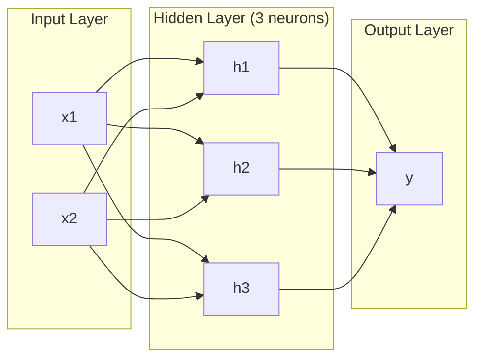
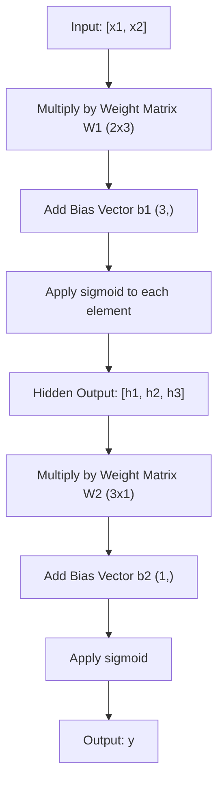
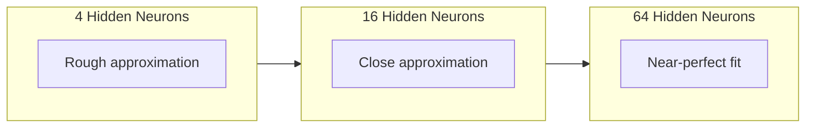

# 다층 신경망과 순방향 전파(Forward Pass)

> 뉴런 하나는 선을 긋습니다. 쌓아 올리면 무엇이든 그릴 수 있습니다.

**유형:** Build (실습)
**사용 언어:** Python
**선수 레슨:** Phase 01 (Math Foundations), Lesson 03.01 (The Perceptron)
**소요 시간:** ~90분

## 학습 목표

- 완전한 순방향 전파(forward pass)를 수행하는 Layer 및 Network 클래스를 밑바닥부터 직접 구현하여 다층 신경망(multi-layer network)을 만듭니다.
- 신경망의 각 층을 통과하는 행렬 차원을 추적하고 형태 불일치(shape mismatch)를 식별합니다.
- 비선형 활성화 함수(activation function)를 쌓아 올려 신경망이 곡선 결정 경계(decision boundary)를 학습할 수 있게 되는 원리를 설명합니다.
- 수동으로 조정한 시그모이드(sigmoid) 가중치가 있는 2-2-1 구조를 사용하여 XOR 문제를 해결합니다.

## 문제 정의

단일 뉴런은 선을 긋는 도구일 뿐입니다. 데이터 사이에 직선 하나를 그을 뿐입니다. 이미지 인식, 언어 이해, 바둑 두기와 같은 AI의 모든 실제 문제는 곡선을 필요로 합니다. 뉴런을 층으로 쌓아 올려야 곡선을 얻을 수 있습니다.

1969년, 민스키(Minsky)와 페퍼트(Papert)는 이 한계가 치명적임을 증명했습니다. 단일 층 신경망은 XOR을 학습할 수 없습니다. "학습하기 어렵다"가 아니라 수학적으로 불가능합니다. XOR 진리표는 [0, 1]과 [1, 0]을 한쪽에, [0, 0]과 [1, 1]을 다른 한쪽에 배치합니다. 단 하나의 직선으로는 이를 분리할 수 없습니다.

이로 인해 10년이 넘는 기간 동안 신경망 관련 연구 지원이 중단되었습니다. 지나고 보면 해결책은 명확했습니다. 단일 층 사용을 멈추는 것이었습니다. 뉴런을 여러 층으로 쌓아야 합니다. 첫 번째 층이 입력 공간을 새로운 특성으로 나누고, 두 번째 층이 이 특성들을 결합하여 단일 직선으로는 내릴 수 없는 결정을 내리게 하는 것입니다.

이처럼 층을 쌓아 올린 것이 다층 신경망입니다. 이는 오늘날 프로덕션 환경에서 사용되는 모든 딥러닝 모델의 기반입니다. 입력에서 은닉층을 거쳐 출력으로 데이터가 흐르는 순방향 전파(forward pass)는 다른 작업을 시작하기 전에 가장 먼저 구축해야 하는 핵심입니다.

## 핵심 개념

### 계층 구조: 입력층, 은닉층, 출력층

다층 신경망에는 세 가지 유형의 층이 있습니다.

**입력층(Input layer)** -- 엄밀히 말해 계산 층은 아닙니다. 원시 데이터를 담는 역할을 합니다. 특성(feature)이 2개이면 입력 노드도 2개입니다. 이곳에서는 어떤 연산도 수행되지 않습니다.

**은닉층(Hidden layers)** -- 실제 연산이 일어나는 곳입니다. 각 뉴런은 이전 층의 모든 출력을 받아 가중치와 편향(bias)을 적용한 다음, 그 결과를 활성화 함수에 통과시킵니다. 훈련 데이터에서 이 값들을 직접 볼 수 없기 때문에 "은닉(hidden)"이라고 부릅니다.

**출력층(Output layer)** -- 최종 결괏값을 냅니다. 이진 분류(binary classification)의 경우 시그모이드를 사용하는 뉴런 1개, 다중 클래스 분류의 경우 클래스당 뉴런 1개로 구성됩니다.



이것은 2-3-1 신경망입니다. 입력 2개, 은닉 뉴런 3개, 출력 1개로 이루어집니다. 모든 연결선에는 가중치가 부여되며, 입력 노드를 제외한 모든 뉴런에는 편향이 적용됩니다.

각 층은 은닉 상태(hidden state)라 불리는 숫자 벡터를 생성합니다. 텍스트의 경우 은닉 상태는 차원을 확장합니다. 예를 들어 의미적 맥락을 포착하기 위해 단어 하나를 768개의 숫자로 인코딩합니다. 이미지의 경우 차원을 축소하여 수백만 개의 픽셀을 다루기 쉬운 표현(representation)으로 압축합니다. 학습된 정보는 바로 이 은닉 상태에 존재합니다.

### 뉴런과 활성화 함수

각 뉴런은 세 가지 작업을 수행합니다.

1. 모든 입력에 대응하는 가중치를 곱합니다.
2. 곱한 값들을 모두 더하고 편향을 더합니다.
3. 그 합을 활성화 함수에 통과시킵니다.

여기서는 활성화 함수로 시그모이드를 사용합니다.

```math
\text{sigmoid}(z) = \frac{1}{1 + e^{-z}}
```

시그모이드는 임의의 실수를 (0, 1) 범위로 압축합니다. 큰 양수 입력은 1에 가까워지고, 큰 음수 입력은 0에 가까워집니다. 0은 0.5로 매핑됩니다. 이 매끄러운 곡선 덕분에 학습이 가능해집니다. 퍼셉트론의 계단 함수(step function)와 달리, 시그모이드는 모든 지점에서 기울기(gradient)가 존재합니다.

### 순방향 전파: 데이터가 흐르는 방식

순방향 전파는 입력 데이터를 층별로 차례대로 전달하여 출력에 도달하게 합니다. 순방향 전파 중에는 학습이 일어나지 않습니다. 곱셈, 덧셈, 활성화 함수 적용을 반복하는 순수한 연산 과정입니다.



각 층에서는 세 가지 연산이 순서대로 일어납니다.

```math
\begin{aligned}
z &= W \cdot \text{input} + b \quad \text{(linear transformation)} \\
a &= \text{sigmoid}(z) \quad \text{(activation)}
\end{aligned}
```

한 층의 출력이 다음 층의 입력이 됩니다. 이것이 순방향 전파의 전부입니다.

### 행렬 차원

차원을 추적하는 것은 딥러닝에서 가장 중요한 디버깅 기술입니다. 다음은 2-3-1 신경망의 차원 구성입니다.

| 단계 | 연산 | 차원 | 결과 형태 |
|------|-----------|------------|-------------|
| Input | $x$ | -- | (2,) |
| Hidden linear | $W_1 x + b_1$ | $W_1$: (3, 2), $b_1$: (3,) | (3,) |
| Hidden activation | $\text{sigmoid}(z_1)$ | -- | (3,) |
| Output linear | $W_2 h + b_2$ | $W_2$: (1, 3), $b_2$: (1,) | (1,) |
| Output activation | $\text{sigmoid}(z_2)$ | -- | (1,) |

규칙: $k$번째 층의 가중치 행렬 $W$는 (neurons_in_layer_k, neurons_in_layer_k_minus_1) 형태를 갖습니다. 행의 수는 현재 층의 뉴런 수와 일치하고, 열의 수는 이전 층의 뉴런 수와 일치합니다. 형태가 일치하지 않는다면 버그가 발생한 것입니다.

### 보편 근사 정리(Universal Approximation Theorem)

1989년 조지 사이벤코(George Cybenko)는 주목할 만한 사실을 증명했습니다. 뉴런 수가 충분하다면 은닉층이 하나뿐인 신경망으로도 어떤 연속 함수든 원하는 임의의 정확도로 근사할 수 있다는 것입니다.

이것이 은닉층 하나만 있는 구조가 항상 최선임을 의미하지는 않습니다. 이론상 가능하다는 의미일 뿐입니다. 실제로는 얕고 넓은 신경망보다 깊은 신경망(층이 더 많고 층당 뉴런 수가 적은 구조)이 훨씬 적은 총 파라미터 수로 동일한 함수를 학습합니다. 이것이 바로 딥러닝이 효과적으로 작동하는 이유입니다.

직관적인 원리는 이렇습니다. 은닉층의 각 뉴런은 하나의 "요철(bump)" 또는 특성을 학습합니다. 적절한 위치에 충분한 요철이 배치되면 어떤 매끄러운 곡선도 근사할 수 있습니다. 뉴런이 많을수록 더 많은 요철이 생겨 근사 정확도가 높아집니다.



### 조합성(Composability)

신경망은 조합이 가능합니다. 쌓을 수도 있고, 연결할 수도 있으며, 병렬로 실행할 수도 있습니다. Whisper 모델은 인코더 네트워크를 사용하여 오디오를 처리하고, 별도의 디코더 네트워크를 사용하여 텍스트를 생성합니다. 최신 LLM은 디코더 전용(decoder-only) 구조입니다. BERT는 인코더 전용(encoder-only)이고, T5는 인코더-디코더(encoder-decoder) 구조입니다. 아키텍처 선택이 모델이 수행할 수 있는 작업을 정의합니다.

```figure
mlp-forward
```

## 직접 구현하기

순수 Python으로 작성합니다. numpy는 사용하지 않습니다. 모든 행렬 연산을 밑바닥부터 직접 구현합니다.

### 1단계: 시그모이드 활성화 함수

```python
import math

def sigmoid(x):
    x = max(-500.0, min(500.0, x))
    return 1.0 / (1.0 + math.exp(-x))
```

[-500, 500] 범위로 제한(clamp)하는 것은 오버플로를 방지하기 위함입니다. `math.exp(500)`은 매우 크지만 유한한 값인 반면, `math.exp(1000)`은 무한대입니다.

### 2단계: Layer 클래스

딥러닝 전체에서 가장 중요한 연산은 행렬 곱셈입니다. 모든 층, 모든 어텐션 헤드(attention head), 모든 순방향 전파 과정은 근본적으로 행렬 곱셈으로 이루어져 있습니다. 선형 층(linear layer)은 입력 벡터를 받아 가중치 행렬을 곱하고 편향 벡터를 더합니다: $y = Wx + b$. 이 단 하나의 수식이 신경망 연산의 90%를 차지합니다.

층은 가중치 행렬과 편향 벡터를 갖습니다. 이 층의 forward 메서드는 입력 벡터를 받아 활성화 함수가 적용된 출력을 반환합니다.

```python
class Layer:
    def __init__(self, n_inputs, n_neurons, weights=None, biases=None):
        if weights is not None:
            self.weights = weights
        else:
            import random
            self.weights = [
                [random.uniform(-1, 1) for _ in range(n_inputs)]
                for _ in range(n_neurons)
            ]
        if biases is not None:
            self.biases = biases
        else:
            self.biases = [0.0] * n_neurons

    def forward(self, inputs):
        self.last_input = inputs
        self.last_output = []
        for neuron_idx in range(len(self.weights)):
            z = sum(
                w * x for w, x in zip(self.weights[neuron_idx], inputs)
            )
            z += self.biases[neuron_idx]
            self.last_output.append(sigmoid(z))
        return self.last_output
```

가중치 행렬의 형태는 (n_neurons, n_inputs)입니다. 각 행은 모든 입력에 대한 한 뉴런의 가중치를 나타냅니다. forward 메서드는 뉴런들을 순회하며 가중치 합과 편향을 더한 뒤, 시그모이드를 적용하여 결과를 모읍니다.

### 3단계: Network 클래스

신경망은 층들의 리스트입니다. 순방향 전파는 이 층들을 연결합니다. $k$번째 층의 출력이 $k+1$번째 층의 입력으로 들어갑니다.

```python
class Network:
    def __init__(self, layers):
        self.layers = layers

    def forward(self, inputs):
        current = inputs
        for layer in self.layers:
            current = layer.forward(current)
        return current
```

이것이 순방향 전파의 전부입니다. 단 4줄의 로직입니다. 데이터가 입력되어 모든 층을 통과하고 반대편으로 출력됩니다.
### 4단계: 직접 조정한 가중치로 XOR 해결하기

Lesson 01에서는 OR, NAND, AND 퍼셉트론을 결합하여 XOR을 해결했습니다. 이제 직접 만든 Layer 및 Network 클래스로 동일한 작업을 수행해 봅니다. 입력 2개, 은닉 뉴런 2개, 출력 1개로 구성된 2-2-1 아키텍처입니다.

```python
hidden = Layer(
    n_inputs=2,
    n_neurons=2,
    weights=[[20.0, 20.0], [-20.0, -20.0]],
    biases=[-10.0, 30.0],
)

output = Layer(
    n_inputs=2,
    n_neurons=1,
    weights=[[20.0, 20.0]],
    biases=[-30.0],
)

xor_net = Network([hidden, output])

xor_data = [
    ([0, 0], 0),
    ([0, 1], 1),
    ([1, 0], 1),
    ([1, 1], 0),
]

for inputs, expected in xor_data:
    result = xor_net.forward(inputs)
    predicted = 1 if result[0] >= 0.5 else 0
    print(f"  {inputs} -> {result[0]:.6f} (rounded: {predicted}, expected: {expected})")
```

큰 가중치(20, -20)는 sigmoid가 계단 함수(step function)처럼 동작하도록 만듭니다. 첫 번째 은닉 뉴런은 OR에 가깝게 동작합니다. 두 번째 뉴런은 NAND에 가깝게 동작합니다. 출력 뉴런은 둘을 AND로 결합하며, 이것이 곧 XOR이 됩니다.

### 5단계: 원형 데이터 분류

더 어려운 문제입니다. 원점을 중심으로 반지름이 0.5인 원의 내부 또는 외부에 위치하는 2D 좌표를 분류합니다. 이를 위해서는 곡선 형태의 결정 경계(decision boundary)가 필요한데, 단일 퍼셉트론으로는 불가능합니다.

```python
import random
import math

random.seed(42)

data = []
for _ in range(200):
    x = random.uniform(-1, 1)
    y = random.uniform(-1, 1)
    label = 1 if (x * x + y * y) < 0.25 else 0
    data.append(([x, y], label))

circle_net = Network([
    Layer(n_inputs=2, n_neurons=8),
    Layer(n_inputs=8, n_neurons=1),
])
```

무작위 가중치로는 네트워크가 제대로 분류하지 못합니다. 하지만 순전파(forward pass)는 정상적으로 실행됩니다. 바로 이것이 핵심입니다. 순전파는 단순한 계산일 뿐입니다. 올바른 가중치를 학습하는 과정은 역전파(backpropagation)이며, Lesson 03에서 다룹니다.

```python
correct = 0
for inputs, expected in data:
    result = circle_net.forward(inputs)
    predicted = 1 if result[0] >= 0.5 else 0
    if predicted == expected:
        correct += 1

print(f"Accuracy with random weights: {correct}/{len(data)} ({100*correct/len(data):.1f}%)")
```

무작위 가중치는 낮은 정확도를 보이며, 종종 다수 클래스를 찍는 것보다 결과가 나쁘기도 합니다. 학습(Lesson 03)을 거치고 나면, 은닉 뉴런 8개로 구성된 이 동일한 아키텍처가 내부와 외부를 구분하는 곡선 경계를 그려내게 됩니다.

## 적용하기

PyTorch에서는 위의 모든 과정을 단 네 줄로 처리합니다.

```python
import torch
import torch.nn as nn

model = nn.Sequential(
    nn.Linear(2, 8),
    nn.Sigmoid(),
    nn.Linear(8, 1),
    nn.Sigmoid(),
)

x = torch.tensor([[0.0, 0.0], [0.0, 1.0], [1.0, 0.0], [1.0, 1.0]])
output = model(x)
print(output)
```

`nn.Linear(2, 8)`는 직접 만든 Layer 클래스에 해당합니다. 형상이 (8, 2)인 가중치 행렬과 형상이 (8,)인 편향 벡터를 갖습니다. `nn.Sigmoid()`는 원소별로 적용되는 sigmoid 함수입니다. `nn.Sequential`는 레이어를 순서대로 연결하는 Network 클래스에 해당합니다.

차이점은 속도와 확장성입니다. PyTorch는 GPU에서 실행되고, 수백만 개의 샘플로 구성된 배치를 처리하며, 역전파를 위한 그래디언트(gradient)를 자동으로 계산합니다. 하지만 순전파 로직은 여러분이 밑바닥부터 직접 구현한 것과 완전히 동일합니다.

## 결과물

이번 강의를 통해 네트워크 아키텍처를 설계할 때 재사용할 수 있는 프롬프트를 도출할 수 있습니다.

- `outputs/prompt-network-architect.md`

주어진 문제에 대해 레이어 수, 레이어당 뉴런 수, 그리고 어떤 활성화 함수(activation function)를 사용할지 결정해야 할 때 이 프롬프트를 활용해 보세요.

## 실습 과제

1. 2-4-2-1 네트워크(은닉층 2개)를 구축하고 무작위 가중치를 사용하여 XOR 데이터에 대한 순전파를 실행해 보세요. 각 레이어에서 표현(representation)이 어떻게 변환되는지 확인하기 위해 중간 은닉층의 출력을 출력해 봅니다.

2. 원형 분류기에서 은닉층 크기를 8에서 2로, 그리고 32로 변경해 보세요. 매번 무작위 가중치로 순전파를 실행합니다. 은닉 뉴런의 수가 출력 범위나 분포를 변화시키나요? 그 이유는 무엇인가요?

3. 학습 가능한 가중치와 편향의 총 개수를 반환하는 `count_parameters` 메서드를 Network 클래스에 구현해 보세요. 784-256-128-10 네트워크(클래식 MNIST 아키텍처)에서 이를 테스트해 봅니다. 파라미터는 총 몇 개인가요?

4. 3-4-4-2 네트워크의 순전파를 구현해 보세요. RGB 색상 값(0~1로 정규화됨)을 입력하고 두 개의 출력을 관찰합니다. 이것이 바로 2개 클래스를 가진 간단한 색상 분류기의 아키텍처입니다.

5. sigmoid를 "leaky step" 함수(z < 0이면 0.01 * z를 반환하고, 그렇지 않으면 1.0을 반환)로 대체해 보세요. 4단계에서 직접 조정한 가중치를 그대로 사용하여 XOR에 대한 순전파를 실행합니다. 여전히 잘 동작하나요? 급격한 절단(cutoff)보다 매끄러운 sigmoid가 선호되는 이유는 무엇인가요?

## 핵심 용어

| 용어 | 흔히 하는 말 | 실제 의미 |
|------|----------------|----------------------|
| 순전파(Forward pass) | "모델 실행하기" | 입력을 모든 레이어에 통과시켜(가중치 곱셈, 편향 추가, 활성화 적용) 출력을 생성하는 과정 |
| 은닉층(Hidden layer) | "중간 부분" | 입력과 출력 사이에 위치하며 데이터에서 직접 관찰되지 않는 모든 레이어 |
| 다층 네트워크(Multi-layer network) | "딥 뉴럴 네트워크" | 각 레이어의 출력이 다음 레이어의 입력으로 전달되도록 순차적으로 쌓은 뉴런 레이어들 |
| 활성화 함수(Activation function) | "비선형성" | 선형 변환 후에 적용되어 결정 경계에 곡선을 도입하는 함수 |
| Sigmoid | "S자 곡선" | $\sigma(z) = 1/(1+e^{-z})$, 모든 실수를 (0, 1) 범위로 압축하며, 모든 구간에서 매끄럽고 미분 가능한 함수 |
| 가중치 행렬(Weight matrix) | "파라미터" | 학습 가능한 연결 강도를 포함하는 (current_layer_neurons, previous_layer_neurons) 형상의 행렬 $W$ |
| 편향 벡터(Bias vector) | "오프셋" | 행렬 곱셈 후에 더해져 모든 입력이 0일 때도 뉴런이 활성화될 수 있도록 하는 벡터 |
| 보편 근사 정리(Universal approximation) | "신경망은 무엇이든 학습할 수 있다" | 뉴런 수가 충분하다면 단 하나의 은닉층만으로도 모든 연속 함수를 근사할 수 있다는 이론(단, "충분하다"는 것이 수십억 개를 의미할 수도 있음) |
| 선형 변환(Linear transformation) | "행렬 곱셈 단계" | $z = W x + b$, 활성화 함수를 적용하기 전의 계산 단계로, 입력을 새로운 공간으로 매핑하는 연산 |
| 결정 경계(Decision boundary) | "분류 기준이 바뀌는 곳" | 네트워크 출력이 분류 임계값을 교차하는 입력 공간 상의 표면 |

## 더 읽을거리

- Michael Nielsen, "Neural Networks and Deep Learning", Chapter 1-2 (http://neuralnetworksanddeeplearning.com/) -- 인터랙티브 시각화와 함께 순전파와 네트워크 구조를 가장 명확하게 설명하는 무료 도서
- Cybenko, "Approximation by Superpositions of a Sigmoidal Function" (1989) -- 보편 근사 정리를 다룬 최초의 논문으로, 놀라울 정도로 읽기 쉬움
- 3Blue1Brown, "But what is a neural network?" (https://www.youtube.com/watch?v=aircAruvnKk) -- 레이어, 가중치, 순전파를 시각적으로 다루며 올바른 멘탈 모델을 세워주는 20분 분량의 영상
- Goodfellow, Bengio, Courville, "Deep Learning", Chapter 6 (https://www.deeplearningbook.org/) -- 다층 네트워크에 관한 표준 참고 자료로, 온라인에서 무료로 제공됨
