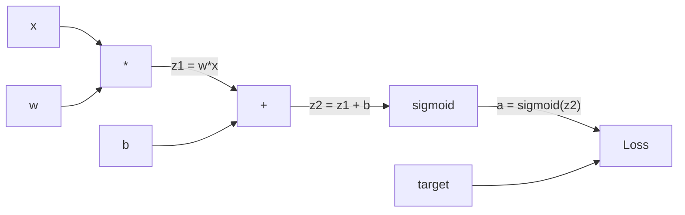
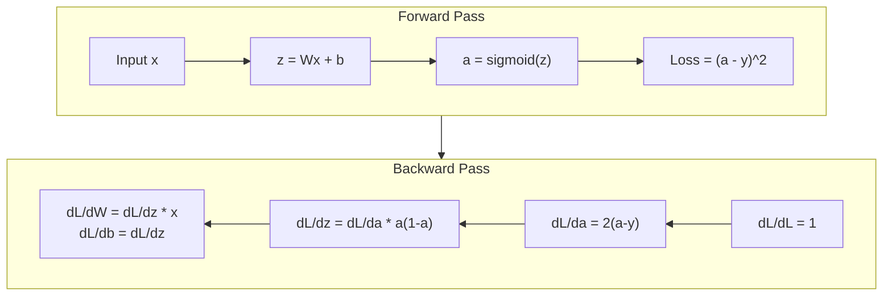
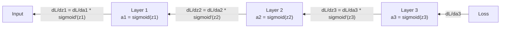

# 밑바닥부터 구현하는 역전파

> 역전파는 학습을 가능하게 만드는 알고리즘입니다. 역전파가 없다면 신경망은 값비싼 난수 생성기에 불과합니다.

**유형:** Build (실습)
**사용 언어:** Python
**선수 레슨:** Lesson 03.02 (Multi-Layer Networks)
**소요 시간:** ~120분

## 학습 목표

- 계산 그래프(computational graph)를 구축하고 위상 정렬(topological sort)을 통해 기울기(gradient)를 계산하는 Value 기반 자동 미분(autograd) 엔진 구현하기
- 연쇄 법칙(chain rule)을 사용하여 덧셈, 곱셈, sigmoid에 대한 역방향 전달(backward pass) 유도하기
- 밑바닥부터 구현한 역전파 엔진만으로 XOR 및 원형 분류 문제에서 다층 신경망을 학습시키기
- 깊은 sigmoid 네트워크에서 발생하는 기울기 소실 문제(vanishing gradient problem)를 파악하고, 기울기가 지수적으로 감소하는 이유를 설명하기

## 문제 정의

네트워크에 768개의 입력과 3072개의 출력을 가진 단일 은닉층이 있다고 가정해 보겠습니다. 가중치만 2,359,296개에 달합니다. 네트워크가 잘못된 예측을 내놓았습니다. 어떤 가중치가 오차를 유발했을까요? 각 가중치를 개별적으로 테스트하려면 230만 번의 순방향 전달(forward pass)을 거쳐야 합니다. 반면 역전파(backpropagation)는 단 한 번의 역방향 전달(backward pass)로 230만 개의 기울기 전체를 계산합니다. 이는 단순한 최적화가 아닙니다. 학습 가능 여부 자체를 가르는 차이입니다.

순진한 접근법은 이렇습니다. 가중치 하나를 골라 아주 미세하게 조정한 다음, 순방향 전달을 다시 실행하여 손실이 증가했는지 감소했는지 측정합니다. 그러면 해당 가중치에 대한 기울기를 얻을 수 있습니다. 이제 이 과정을 네트워크의 모든 가중치에 대해 반복합니다. 여기에 수천 번의 학습 단계와 수백만 개의 데이터 포인트를 곱해 보십시오. 유의미한 모델 하나를 학습시키는 데 지질학적 시간 단위가 필요할 것입니다.

역전파는 이 문제를 해결합니다. 한 번의 순방향 전달과 한 번의 역방향 전달만으로 모든 기울기를 계산해 냅니다. 핵심은 미적분학의 연쇄 법칙을 계산 그래프에 체계적으로 적용하는 것입니다. 이것이 바로 딥러닝을 실용적인 기술로 만들어 준 알고리즘입니다. 역전파가 없었다면 우리는 여전히 장난감 수준의 문제에 머물러 있었을 것입니다.

## 핵심 개념

### 네트워크에 적용되는 연쇄 법칙

Phase 01의 Lesson 05에서 연쇄 법칙을 다루었습니다. 간단히 요약하자면, $y = f(g(x))$이면 $\frac{dy}{dx} = f'(g(x)) \cdot g'(x)$입니다. 사슬(chain)을 따라 도함수를 곱해 나가는 것입니다.

신경망에서 "사슬"은 입력부터 손실에 이르는 연산의 연속입니다. 각 층은 가중치를 적용하고, 편향(bias)을 더하며, 활성화 함수를 통과시킵니다. 손실 함수는 최종 출력과 목표값을 비교합니다. 역전파는 이 사슬을 거꾸로 거슬러 올라가며 각 연산이 오차에 얼마나 기여했는지를 계산합니다.

### 계산 그래프

모든 순방향 전달은 그래프를 구축합니다. 각 노드는 연산(곱셈, 덧셈, sigmoid)입니다. 각 엣지는 값을 앞으로 전달하고 기울기를 뒤로 전달합니다.



순방향 전달: 값은 왼쪽에서 오른쪽으로 흐릅니다. $x$와(과) $w$이(가) $z_1 = w x$을(를) 생성합니다. $b$을(를) 더하여 $z_2$을(를) 얻습니다. Sigmoid를 거쳐 활성화 값 $a$이(가) 나옵니다. 손실 함수를 사용하여 $a$을(를) 목표값 $y$과(와) 비교합니다.

역방향 전달: 기울기는 오른쪽에서 왼쪽으로 흐릅니다. $\partial L/\partial a$(활성화 값의 변화에 따른 손실의 변화)부터 시작합니다. 여기에 $\partial a/\partial z_2$(sigmoid 도함수)를 곱합니다. 그러면 $\partial L/\partial z_2$이(가) 나옵니다. 이를 $\partial L/\partial b$($z_2 = z_1 + b$이므로 $\partial L/\partial z_2$과(와) 같음) 및 $\partial L/\partial z_1$으로 분기합니다. 그런 다음 $\partial L/\partial w = \partial L/\partial z_1 \cdot x$ 및 $\partial L/\partial x = \partial L/\partial z_1 \cdot w$를 계산합니다.

역방향 전달 동안 그래프의 모든 노드는 한 가지 역할만 수행합니다. 바로 상류에서 전달된 기울기를 받아 자신의 국소 도함수(local derivative)와 곱한 뒤, 이를 하류로 전달하는 것입니다.

### 순방향 vs 역방향



순방향 전달은 모든 중간값(z, a, 각 층의 입력)을 저장합니다. 역방향 전달에서 기울기를 계산하려면 이렇게 저장된 값이 필요합니다. 이것이 바로 역전파의 핵심에 자리 잡은 메모리-연산량 간의 트레이드오프(tradeoff)입니다. 메모리(활성화 값 저장)를 대가로 속도(수백만 번 대신 단 한 번의 패스)를 얻는 것입니다.

### 네트워크를 통한 기울기 흐름

3층 네트워크의 경우, 기울기는 모든 층을 거쳐 사슬처럼 연결됩니다.



각 층에서 기울기는 sigmoid 도함수와 곱해집니다. Sigmoid 도함수는 $a(1 - a)$이며, 최댓값은 0.25입니다($a = 0.5$일 때). 3개 층을 거치면 기울기는 기껏해야 $0.25^3 = 0.0156$만큼 곱해진 셈입니다. 10개 층을 거치면 $0.25^{10} = 0.000001$이 됩니다.

### 기울기 소실

이것이 바로 기울기 소실 문제(vanishing gradient problem)입니다. Sigmoid는 출력을 0과 1 사이로 압축합니다. 그 도함수는 항상 0.25 이하입니다. Sigmoid 층을 여러 개 쌓으면 기울기는 거의 0으로 줄어듭니다. 초기 층들은 거의 0에 가까운 기울기를 전달받기 때문에 학습이 거의 이루어지지 않습니다.

```
sigmoid(z):     Output range [0, 1]
sigmoid'(z):    Max value 0.25 (at z = 0)

After 5 layers:   gradient * 0.25^5 = 0.001x original
After 10 layers:  gradient * 0.25^10 = 0.000001x original
```

깊은 sigmoid 네트워크를 학습시키는 것이 거의 불가능한 이유가 바로 여기에 있습니다. 이에 대한 해결책인 ReLU와 그 변형들은 Lesson 04에서 다룹니다. 지금은 역전파 자체는 완벽하게 작동한다는 점을 이해하면 됩니다. 문제는 역전파가 거쳐 가는 함수에 있습니다.

### 2층 네트워크의 기울기 유도

입력 $x$, sigmoid 은닉층, sigmoid 출력층, MSE 손실을 갖는 네트워크의 구체적인 수학적 유도 과정입니다.

순방향 전달:

```math
\begin{aligned}
z_1 &= W_1 x + b_1 \\
a_1 &= \text{sigmoid}(z_1) \\
z_2 &= W_2 a_1 + b_2 \\
a_2 &= \text{sigmoid}(z_2) \\
L &= (a_2 - y)^2
\end{aligned}
```

역방향 전달 (연쇄 법칙을 단계별로 적용):

```math
\begin{aligned}
\frac{\partial L}{\partial a_2} &= 2(a_2 - y) \\
\frac{\partial a_2}{\partial z_2} &= a_2 (1 - a_2) \\
\frac{\partial L}{\partial z_2} &= \frac{\partial L}{\partial a_2} \cdot \frac{\partial a_2}{\partial z_2} = 2(a_2 - y) \cdot a_2 (1 - a_2) \\[6pt]
\frac{\partial L}{\partial W_2} &= \frac{\partial L}{\partial z_2} \cdot a_1 \\
\frac{\partial L}{\partial b_2} &= \frac{\partial L}{\partial z_2} \\[6pt]
\frac{\partial L}{\partial a_1} &= \frac{\partial L}{\partial z_2} \cdot W_2 \\
\frac{\partial a_1}{\partial z_1} &= a_1 (1 - a_1) \\
\frac{\partial L}{\partial z_1} &= \frac{\partial L}{\partial a_1} \cdot \frac{\partial a_1}{\partial z_1} \\[6pt]
\frac{\partial L}{\partial W_1} &= \frac{\partial L}{\partial z_1} \cdot x \\
\frac{\partial L}{\partial b_1} &= \frac{\partial L}{\partial z_1}
\end{aligned}
```

모든 기울기는 손실에서부터 거슬러 올라오며 국소 도함수들을 곱한 결과입니다. 역전파의 본질은 이것이 전부입니다.

```figure
backprop-vanishing
```

## 직접 구현하기

### 1단계: Value 노드

계산에 사용되는 모든 숫자는 Value가 됩니다. Value는 데이터 값, 기울기, 그리고 역방향으로 기울기를 계산할 수 있도록 자신이 어떻게 생성되었는지를 저장합니다.

```python
class Value:
    def __init__(self, data, children=(), op=''):
        self.data = data
        self.grad = 0.0
        self._backward = lambda: None
        self._children = set(children)
        self._op = op

    def __repr__(self):
        return f"Value(data={self.data:.4f}, grad={self.grad:.4f})"
```

아직 기울기는 없습니다(0.0). 역방향 함수도 아직 없습니다(no-op). `_children`은(는) 어떤 Value들이 이 노드를 생성했는지 추적하므로, 나중에 그래프를 위상 정렬할 수 있습니다.

### 2단계: 역방향 함수를 포함한 연산

각 연산은 새로운 Value를 생성하고, 해당 연산을 거쳐 역방향으로 기울기가 흐르는 방식을 정의합니다.

```python
def __add__(self, other):
    other = other if isinstance(other, Value) else Value(other)
    out = Value(self.data + other.data, (self, other), '+')

    def _backward():
        self.grad += out.grad
        other.grad += out.grad

    out._backward = _backward
    return out

def __mul__(self, other):
    other = other if isinstance(other, Value) else Value(other)
    out = Value(self.data * other.data, (self, other), '*')

    def _backward():
        self.grad += other.data * out.grad
        other.grad += self.data * out.grad

    out._backward = _backward
    return out
```

덧셈의 경우: $\partial(a+b)/\partial a = 1$, $\partial(a+b)/\partial b = 1$입니다. 따라서 두 입력 모두 출력의 기울기를 그대로 전달받습니다.

곱셈의 경우: $\partial(ab)/\partial a = b$, $\partial(ab)/\partial b = a$입니다. 각 입력은 상대방의 값에 출력 기울기를 곱한 값을 전달받습니다.

`+=` 연산자는 매우 중요합니다. 하나의 Value가 여러 연산에 사용될 수 있기 때문입니다. Value의 기울기는 모든 경로에서 들어오는 기울기들의 합입니다.

### 3단계: Sigmoid 및 손실 함수

```python
import math

def sigmoid(self):
    x = self.data
    x = max(-500, min(500, x))
    s = 1.0 / (1.0 + math.exp(-x))
    out = Value(s, (self,), 'sigmoid')

    def _backward():
        self.grad += (s * (1 - s)) * out.grad

    out._backward = _backward
    return out
```

Sigmoid 도함수: $\text{sigmoid}(x) \cdot (1 - \text{sigmoid}(x))$입니다. 순방향 전달 과정에서 $\text{sigmoid}(x) = s$을(를) 이미 계산했습니다. 이 값을 재사용하면 되므로 추가 연산이 필요 없습니다.

```python
def mse_loss(predicted, target):
    diff = predicted + Value(-target)
    return diff * diff
```

단일 출력에 대한 MSE: $(\text{predicted} - \text{target})^2$입니다. 뺄셈은 부호가 반전된 Value와의 덧셈으로 표현합니다.

### 4단계: 역방향 전달

위상 정렬은 올바른 순서로 노드를 처리하도록 보장합니다. 즉, 어떤 노드를 통해 기울기를 역전파하기 전에 해당 노드의 기울기가 온전히 누적되도록 합니다.

```python
def backward(self):
    topo = []
    visited = set()

    def build_topo(v):
        if v not in visited:
            visited.add(v)
            for child in v._children:
                build_topo(child)
            topo.append(v)

    build_topo(self)
    self.grad = 1.0
    for v in reversed(topo):
        v._backward()
```

손실 노드부터 시작합니다($dL/dL = 1$이므로 gradient = 1.0). 정렬된 그래프를 거꾸로 순회합니다. 각 노드의 `_backward`은(는) 자식 노드들에게 기울기를 전달합니다.

### 5단계: Layer와 Network

```python
import random

class Neuron:
    def __init__(self, n_inputs):
        scale = (2.0 / n_inputs) ** 0.5
        self.weights = [Value(random.uniform(-scale, scale)) for _ in range(n_inputs)]
        self.bias = Value(0.0)

    def __call__(self, x):
        act = sum((wi * xi for wi, xi in zip(self.weights, x)), self.bias)
        return act.sigmoid()

    def parameters(self):
        return self.weights + [self.bias]


class Layer:
    def __init__(self, n_inputs, n_outputs):
        self.neurons = [Neuron(n_inputs) for _ in range(n_outputs)]

    def __call__(self, x):
        out = [n(x) for n in self.neurons]
        return out[0] if len(out) == 1 else out

    def parameters(self):
        params = []
        for n in self.neurons:
            params.extend(n.parameters())
        return params


class Network:
    def __init__(self, sizes):
        self.layers = []
        for i in range(len(sizes) - 1):
            self.layers.append(Layer(sizes[i], sizes[i + 1]))

    def __call__(self, x):
        for layer in self.layers:
            x = layer(x)
            if not isinstance(x, list):
                x = [x]
        return x[0] if len(x) == 1 else x

    def parameters(self):
        params = []
        for layer in self.layers:
            params.extend(layer.parameters())
        return params

    def zero_grad(self):
        for p in self.parameters():
            p.grad = 0.0
```

Neuron은 입력을 받아 가중합에 편향을 더한 값을 계산하고 sigmoid를 적용합니다. 깊은 네트워크에서 sigmoid 포화(saturation)를 방지하기 위해 가중치 초기화는 $\sqrt{2/n_{\text{inputs}}}$ 비율로 스케일링됩니다. Layer는 Neuron들의 리스트입니다. Network는 Layer들의 리스트입니다. `parameters()` 메서드는 업데이트를 수행할 수 있도록 학습 가능한 모든 Value를 수집합니다.

### 6단계: XOR 데이터셋으로 학습

```python
random.seed(42)
net = Network([2, 4, 1])

xor_data = [
    ([0.0, 0.0], 0.0),
    ([0.0, 1.0], 1.0),
    ([1.0, 0.0], 1.0),
    ([1.0, 1.0], 0.0),
]

learning_rate = 1.0

for epoch in range(1000):
    total_loss = Value(0.0)
    for inputs, target in xor_data:
        x = [Value(i) for i in inputs]
        pred = net(x)
        loss = mse_loss(pred, target)
        total_loss = total_loss + loss

    net.zero_grad()
    total_loss.backward()

    for p in net.parameters():
        p.data -= learning_rate * p.grad

    if epoch % 100 == 0:
        print(f"Epoch {epoch:4d} | Loss: {total_loss.data:.6f}")

print("\nXOR Results:")
for inputs, target in xor_data:
    x = [Value(i) for i in inputs]
    pred = net(x)
    print(f"  {inputs} -> {pred.data:.4f} (expected {target})")
```

손실이 감소하는 과정을 확인해 보십시오. 무작위 예측에서 시작하여 정확한 XOR 출력을 내놓기까지, 모든 과정은 기울기를 계산하고 가중치를 올바른 방향으로 미세 조정하는 역전파만으로 이루어집니다.
### 7단계: 원형 분류

레슨 02에서는 원형 분류를 위해 가중치를 수작업으로 튜닝했습니다. 이제 네트워크가 스스로 학습하도록 만들어 봅니다.

```python
random.seed(7)

def generate_circle_data(n=100):
    data = []
    for _ in range(n):
        x1 = random.uniform(-1.5, 1.5)
        x2 = random.uniform(-1.5, 1.5)
        label = 1.0 if x1 * x1 + x2 * x2 < 1.0 else 0.0
        data.append(([x1, x2], label))
    return data

circle_data = generate_circle_data(80)

circle_net = Network([2, 8, 1])
learning_rate = 0.5

for epoch in range(2000):
    random.shuffle(circle_data)
    total_loss_val = 0.0
    for inputs, target in circle_data:
        x = [Value(i) for i in inputs]
        pred = circle_net(x)
        loss = mse_loss(pred, target)
        circle_net.zero_grad()
        loss.backward()
        for p in circle_net.parameters():
            p.data -= learning_rate * p.grad
        total_loss_val += loss.data

    if epoch % 200 == 0:
        correct = 0
        for inputs, target in circle_data:
            x = [Value(i) for i in inputs]
            pred = circle_net(x)
            predicted_class = 1.0 if pred.data > 0.5 else 0.0
            if predicted_class == target:
                correct += 1
        accuracy = correct / len(circle_data) * 100
        print(f"Epoch {epoch:4d} | Loss: {total_loss_val:.4f} | Accuracy: {accuracy:.1f}%")
```

여기서는 전체 배치를 누적하는 대신 각 샘플마다 가중치를 업데이트하는 온라인 SGD를 사용합니다. 이렇게 하면 대칭성이 더 빠르게 깨지고, 전체 손실 지형에서 시그모이드 포화(sigmoid saturation)를 피할 수 있습니다. 에포크마다 데이터를 셔플하면 네트워크가 데이터 순서를 외우는 것을 방지할 수 있습니다.

수작업 튜닝은 필요 없습니다. 네트워크가 스스로 원형 결정 경계를 찾아냅니다. 이것이 바로 역전파(backpropagation)의 강력함입니다. 아키텍처, 손실 함수, 데이터만 정의하면 알고리즘이 가중치를 알아서 찾아냅니다.

## 실제로 사용해 보기

PyTorch는 위의 모든 과정을 단 몇 줄로 처리합니다. 핵심 아이디어는 동일합니다. autograd가 순전파(forward pass) 중에 계산 그래프를 구축하고, 역방향으로 추적하여 그래디언트를 계산합니다.

```python
import torch
import torch.nn as nn

model = nn.Sequential(
    nn.Linear(2, 4),
    nn.Sigmoid(),
    nn.Linear(4, 1),
    nn.Sigmoid(),
)
optimizer = torch.optim.SGD(model.parameters(), lr=1.0)
criterion = nn.MSELoss()

X = torch.tensor([[0,0],[0,1],[1,0],[1,1]], dtype=torch.float32)
y = torch.tensor([[0],[1],[1],[0]], dtype=torch.float32)

for epoch in range(1000):
    pred = model(X)
    loss = criterion(pred, y)
    optimizer.zero_grad()
    loss.backward()
    optimizer.step()

print("PyTorch XOR Results:")
with torch.no_grad():
    for i in range(4):
        pred = model(X[i])
        print(f"  {X[i].tolist()} -> {pred.item():.4f} (expected {y[i].item()})")
```

`loss.backward()`는 여러분이 만든 `total_loss.backward()`에 해당합니다. `optimizer.step()`는 수작업으로 구현한 `p.data -= lr * p.grad`입니다. `optimizer.zero_grad()`는 `net.zero_grad()`에 해당합니다. 동일한 알고리즘을 산업용 수준으로 구현한 것입니다. PyTorch는 GPU 가속, 혼합 정밀도(mixed precision), 그래디언트 체크포인팅(gradient checkpointing), 그리고 수백 가지의 레이어 타입을 처리합니다. 하지만 역전파(backward pass)는 동일한 계산 그래프에 동일한 연쇄 법칙(chain rule)을 적용하는 것뿐입니다.

훈련(training)은 순전파를 실행하고, 역전파를 실행한 다음, 가중치를 업데이트합니다. 추론(inference)은 순전파만 실행합니다. 그래디언트도 없고, 업데이트도 없습니다. 이 차이는 매우 중요합니다. 프로덕션 환경에서 일어나는 일은 바로 추론이기 때문입니다. Claude나 GPT 같은 API를 호출할 때 여러분은 추론을 실행하고 있는 것입니다. 프롬프트가 네트워크를 통해 순방향으로 흐르고, 반대편으로 토큰이 나옵니다. 어떤 가중치도 바뀌지 않습니다. 역전파를 이해하는 것이 중요한 이유는, 그것이 해당 네트워크의 모든 가중치를 만들어 냈기 때문입니다.

## 결과물

이 레슨을 통해 다음 결과물이 생성됩니다:
- `outputs/prompt-gradient-debugger.md` -- 모든 신경망에서 그래디언트 문제(소실, 폭발, NaN)를 진단하기 위한 재사용 가능한 프롬프트

## 연습 문제

1. Value 클래스에 `__sub__` 메서드를 추가합니다 $(a - b = a + (-1 \cdot b))$. 그런 다음 `__neg__` 메서드를 구현합니다. $(a - b)^2$과 같은 간단한 식에 대해 수작업 계산과 비교하여 그래디언트가 올바른지 검증합니다.

2. Value에 `relu` 메서드를 추가합니다(출력은 $\max(0, x)$, 도함수는 $x \gt 0$이면 1, 그렇지 않으면 0). 은닉층의 sigmoid를 relu로 교체하고 XOR에 대해 다시 훈련합니다. 수렴 속도를 비교해 봅니다. 훈련 속도가 빨라진 것을 확인할 수 있을 것이며, 이는 레슨 04의 미리보기가 됩니다.

3. 정수 거듭제곱을 위한 `__pow__` 메서드를 Value에 구현합니다. 이를 사용해 `mse_loss`을 적절한 `(predicted - target) ** 2` 표현식으로 교체합니다. 그래디언트가 원래 구현과 일치하는지 검증합니다.

4. 훈련 루프에 그래디언트 클리핑(gradient clipping)을 추가합니다. `backward()`를 호출한 후 모든 그래디언트를 [-1, 1] 범위로 클리핑합니다. 더 깊은 네트워크(sigmoid를 사용하는 4개 이상의 레이어)를 훈련하고, 클리핑 유무에 따른 손실 곡선을 비교합니다. 이것이 그래디언트 폭발에 대항하는 첫 번째 방어선입니다.

5. 시각화를 구축합니다. XOR 훈련 후 네트워크의 모든 파라미터의 그래디언트를 출력합니다. 어떤 레이어의 그래디언트가 가장 작은지 파악합니다. 이는 개념 섹션에서 읽은 그래디언트 소실(vanishing gradient) 문제를 실제로 보여줍니다.

## 핵심 용어

| 용어 | 흔히 하는 말 | 실제 의미 |
|------|----------------|----------------------|
| 역전파(Backpropagation) | "네트워크가 학습한다" | 계산 그래프를 거슬러 올라가며 연쇄 법칙을 적용하여 모든 가중치에 대해 $\partial L/\partial w$를 계산하는 알고리즘 |
| 계산 그래프(Computational graph) | "네트워크 구조" | 노드는 연산이고 엣지는 값(순방향)과 그래디언트(역방향)를 전달하는 유향 비순환 그래프(DAG) |
| 연쇄 법칙(Chain rule) | "도함수를 곱한다" | $y = f(g(x))$이면 $\frac{dy}{dx} = f'(g(x)) \cdot g'(x)$ -- 역전파의 수학적 토대 |
| 그래디언트(Gradient) | "가장 가파른 상승 방향" | 파라미터에 대한 손실의 편도함수 -- 손실을 줄이기 위해 해당 파라미터를 어떻게 변경해야 하는지 알려줌 |
| 그래디언트 소실(Vanishing gradient) | "깊은 네트워크는 학습하지 못한다" | sigmoid와 같은 포화 활성화 함수를 가진 레이어를 거쳐 전파되면서 그래디언트가 기하급수적으로 줄어드는 현상 |
| 순전파(Forward pass) | "네트워크 실행" | 각 레이어의 연산을 순차적으로 적용하고 중간값을 저장하여 입력으로부터 출력을 계산하는 과정 |
| 역전파 단계(Backward pass) | "그래디언트 계산" | 계산 그래프를 역방향으로 순회하며, 연쇄 법칙을 사용해 각 노드에서 그래디언트를 누적하는 과정 |
| 학습률(Learning rate) | "얼마나 빠르게 학습하는가" | 가중치를 업데이트할 때 보폭 크기(step size)를 제어하는 스칼라 값: $w_{\text{new}} = w_{\text{old}} - \text{lr} \cdot \text{gradient}$ |
| 위상 정렬(Topological sort) | "올바른 순서" | 각 노드가 자신이 의존하는 모든 노드 뒤에 나타나도록 그래프 노드를 나열하는 것 -- 전파 전에 그래디언트가 완전히 누적되도록 보장함 |
| Autograd | "자동 미분" | 순방향 계산 중에 계산 그래프를 구축하고 그래디언트를 자동으로 계산하는 시스템 -- PyTorch 엔진의 핵심 기능 |

## 참고 자료

- Rumelhart, Hinton & Williams, "Learning representations by back-propagating errors" (1986) -- 역전파를 대중화하고 다층 네트워크 훈련의 길을 연 논문
- 3Blue1Brown, "Neural Networks" 시리즈 (https://www.youtube.com/playlist?list=PLZHQObOWTQDNU6R1_67000Dx_ZCJB-3pi) -- 역전파와 네트워크를 통한 그래디언트 흐름을 가장 훌륭하게 시각적으로 설명한 자료
