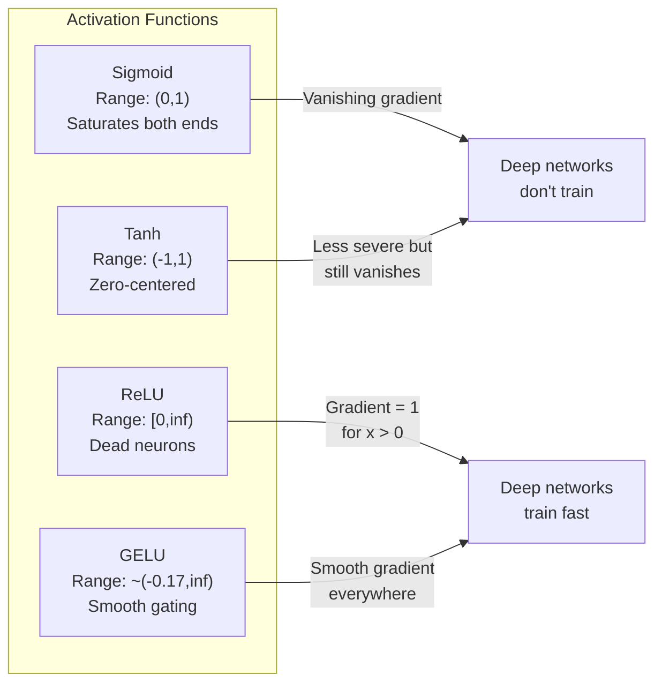
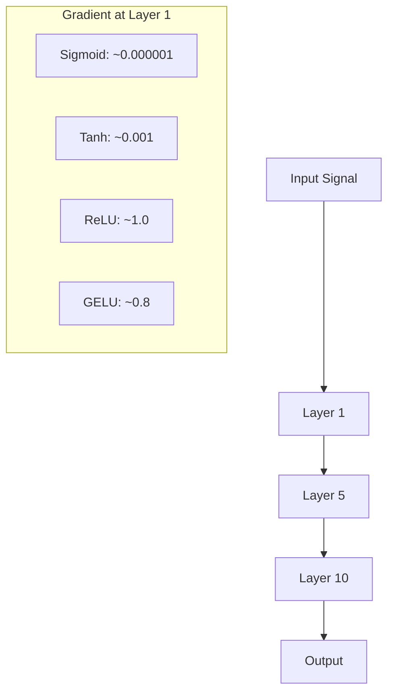
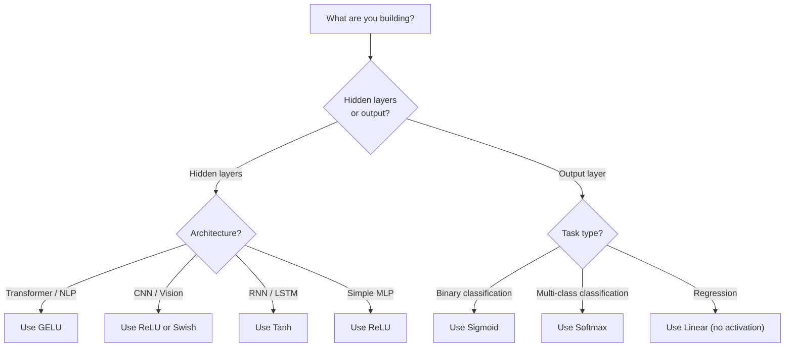

# 활성화 함수

> 비선형성이 없다면 100개 층으로 이루어진 네트워크도 그저 화려한 행렬 곱셈에 불과합니다. 활성화 함수는 신경망이 곡선으로 사고할 수 있게 해주는 관문입니다.

**유형:** Build (실습)
**사용 언어:** Python
**선수 레슨:** Lesson 03.03 (Backpropagation)
**소요 시간:** ~75분

## 학습 목표

- sigmoid, tanh, ReLU, Leaky ReLU, GELU, Swish, softmax 및 각 함수의 도함수를 밑바닥부터 직접 구현합니다.
- 서로 다른 활성화 함수를 사용하여 10개 이상의 층을 통과하는 활성화 값의 크기를 측정함으로써 기울기 소실(vanishing gradient) 문제를 진단합니다.
- ReLU 네트워크에서 죽은 뉴런(dead neuron)을 감지하고, GELU가 이러한 실패 모드를 방지하는 이유를 설명합니다.
- 주어진 아키텍처(Transformer, CNN, RNN, 출력층)에 적합한 활성화 함수를 선택합니다.

## 문제 상황

두 개의 선형 변환을 쌓아봅니다: $y = W_2(W_1 x + b_1) + b_2$. 이를 전개하면 다음과 같습니다: $y = W_2 W_1 x + W_2 b_1 + b_2$. 이는 결국 $y = Ax + c$에 불과하며, 하나의 선형 변환일 뿐입니다. 선형 층을 아무리 많이 쌓더라도 그 결과는 하나의 행렬 곱셈으로 축약됩니다. 100개의 층을 가진 네트워크도 단일 층과 동일한 표현력(representational power)을 가질 뿐입니다.

이는 단순한 이론적 호기심에 그치지 않습니다. 심층 선형 네트워크는 말 그대로 XOR을 학습할 수 없고, 나선형 데이터셋을 분류할 수 없으며, 얼굴을 인식할 수 없음을 의미합니다. 활성화 함수가 없다면 깊이는 착각에 불과합니다.

활성화 함수는 이러한 선형성을 깨뜨립니다. 각 층의 출력을 비선형 함수를 통해 왜곡함으로써, 네트워크가 결정 경계를 구부리고 임의의 함수를 근사하며 실제로 학습할 수 있는 능력을 부여합니다. 하지만 활성화 함수를 잘못 선택하면 기울기가 0으로 소실되거나(심층 네트워크에서의 sigmoid), 무한대로 폭발하거나(주의 깊은 초기화가 없는 비유계 활성화 함수), 뉴런이 영구적으로 죽어버릴 수 있습니다(큰 음수 편향을 가진 ReLU). 어떤 활성화 함수를 선택하느냐에 따라 네트워크의 학습 성패가 직접적으로 결정됩니다.

## 핵심 개념

### 비선형성이 필요한 이유

행렬 곱셈은 합성이 가능합니다. 벡터에 행렬 $A$를 곱한 다음 행렬 $B$를 곱하는 것은 $AB$를 곱하는 것과 동일합니다. 즉, 열 개의 선형 층을 쌓는 것은 수학적으로 하나의 큰 행렬을 가진 단일 선형 층과 완전히 같습니다. 그 모든 파라미터와 깊이가 낭비되는 셈입니다. 이 연쇄를 끊어낼 무언가가 필요하며, 바로 활성화 함수가 그 역할을 합니다.

증명은 다음과 같습니다. 선형 층은 $f(x) = Wx + b$를 계산합니다. 두 개를 쌓으면 다음과 같습니다:

```math
\begin{aligned}
\text{Layer 1:} \quad h &= W_1 x + b_1 \\
\text{Layer 2:} \quad y &= W_2 h + b_2
\end{aligned}
```

대입하면 다음과 같습니다:

```math
\begin{aligned}
y &= W_2 (W_1 x + b_1) + b_2 \\
y &= (W_2 W_1) x + (W_2 b_1 + b_2) \\
y &= A x + c
\end{aligned}
```

결국 단일 층입니다. 층 사이에 비선형 활성화 함수 $g()$를 삽입해 봅니다:

```math
\begin{aligned}
h &= g(W_1 x + b_1) \\
y &= W_2 h + b_2
\end{aligned}
```

이제 단순 대입으로 축약되지 않습니다. $W_2 g(W_1 x + b_1) + b_2$는 단일 선형 변환으로 환원될 수 없습니다. 네트워크는 비선형 함수를 표현할 수 있게 됩니다. 활성화 함수가 포함된 층이 추가될 때마다 표현 용량(representational capacity)이 늘어납니다.

### Sigmoid

신경망 초기에 사용된 전통적인 활성화 함수입니다.

```math
\text{sigmoid}(x) = \frac{1}{1 + e^{-x}}
```

출력 범위: (0, 1). 매끄럽고 미분 가능하며, 모든 실수를 확률과 유사한 값으로 매핑합니다.

도함수:

```math
\text{sigmoid}'(x) = \text{sigmoid}(x) \cdot (1 - \text{sigmoid}(x))
```

이 도함수의 최댓값은 0.25이며, $x = 0$에서 발생합니다. 역전파(backpropagation) 과정에서 기울기는 층을 거치며 계속 곱해집니다. sigmoid를 사용한 10개의 층에서는 기울기에 기껏해야 0.25가 열 번 곱해진다는 뜻입니다:

```math
0.25^{10} = 0.000000953674
```

원래 신호의 100만 분의 1도 되지 않습니다. 이것이 바로 기울기 소실(vanishing gradient) 문제입니다. 앞쪽 층의 기울기가 너무 작아져 가중치가 거의 업데이트되지 않습니다. 뒤쪽 층에서 손실이 감소하여 네트워크가 학습하는 것처럼 보일 수 있지만, 앞쪽 층은 동결된 상태입니다. 깊은 sigmoid 네트워크는 사실상 학습이 불가능합니다.

추가적인 문제점: sigmoid 출력은 항상 양수(0~1)이므로, 가중치에 대한 기울기가 항상 같은 부호를 갖게 됩니다. 이는 경사 하강법(gradient descent) 과정에서 지그재그 경로를 유발합니다.

### Tanh

Sigmoid의 중심을 0으로 맞춘 버전입니다.

```math
\tanh(x) = \frac{e^x - e^{-x}}{e^x + e^{-x}}
```

출력 범위: (-1, 1). 영점 중심(zero-centered)이므로 지그재그 문제를 해소합니다.

도함수:

```math
\tanh'(x) = 1 - \tanh(x)^2
```

도함수의 최댓값은 $x = 0$에서 1.0으로, sigmoid보다 4배 낫습니다. 하지만 기울기 소실 문제는 여전히 존재합니다. 입력의 양수 또는 음수 크기가 크면 도함수가 0에 가까워집니다. 10개 층을 지나면 sigmoid보다는 덜 급격하지만 여전히 기울기가 짓눌립니다.

### ReLU: 혁신적 전환점

정류 선형 유닛(Rectified Linear Unit). 2010년 Nair와 Hinton에 의해 딥러닝 분야에서 대중화되었으며(함수 자체는 1969년 Fukushima의 연구로 거슬러 올라갑니다), 모든 것을 바꾸어 놓았습니다.

```math
\text{relu}(x) = \max(0, x)
```

출력 범위: $[0, \infty)$. 도함수는 매우 단순합니다:

```math
\text{relu}'(x) = \begin{cases} 1 & \text{if } x > 0 \\ 0 & \text{if } x \le 0 \end{cases}
```

양수 입력에 대해서는 기울기 소실이 발생하지 않습니다. 기울기가 정확히 1이 되어 그대로 전달됩니다. 심층 네트워크의 학습이 가능해진 이유가 바로 여기에 있습니다. ReLU는 여러 층에 걸쳐 기울기의 크기를 보존합니다.

하지만 한 가지 실패 모드가 존재합니다. 바로 죽은 뉴런(dead neuron) 문제입니다. 뉴런의 가중치 합 입력이 (큰 음수 편향이나 불운한 가중치 초기화로 인해) 항상 음수가 되면, 출력은 항상 0이 되고 기울기도 항상 0이 되어 가중치가 전혀 업데이트되지 않습니다. 영구적으로 죽어버리는 것입니다. 실제로 ReLU 네트워크에서는 학습 도중 10~40%의 뉴런이 죽을 수 있습니다.

### Leaky ReLU

죽은 뉴런 문제를 해결하는 가장 단순한 방법입니다.

```math
\text{leaky\_relu}(x) = \begin{cases} x & \text{if } x > 0 \\ \alpha x & \text{if } x \le 0 \end{cases}
```

여기서 $\alpha$은 작은 상수이며, 일반적으로 0.01을 사용합니다. 음수 영역의 기울기가 0 대신 작은 값을 가지므로, 죽은 뉴런도 여전히 기울기 신호를 받아 회생할 수 있습니다.

### GELU: 현대의 표준

가우스 오차 선형 유닛(Gaussian Error Linear Unit). 2016년 Hendrycks와 Gimpel이 제안했습니다. BERT, GPT 및 대부분의 최신 Transformer에서 기본 활성화 함수로 사용됩니다.

```math
\text{gelu}(x) = x \cdot \Phi(x)
```

여기서 $\Phi(x)$는 표준정규분포의 누적분포함수(CDF)입니다. 실제 구현에서 사용되는 근사식은 다음과 같습니다:

```math
\text{gelu}(x) \approx 0.5 \cdot x \cdot \left(1 + \tanh\left(\sqrt{2/\pi} \cdot (x + 0.044715 \cdot x^3)\right)\right)
```

GELU는 모든 구간에서 매끄럽고, (0으로 강제 절단하는 ReLU와 달리) 작은 음수 값을 허용하며, 확률론적 해석을 갖습니다. 즉, 정규분포 하에서 입력이 양수일 확률에 따라 각 입력을 가중합니다. 이러한 매끄러운 게이팅(gating)은 더 나은 기울기 흐름을 제공하고 죽은 뉴런 문제를 완전히 방지하기 때문에 Transformer 아키텍처에서 ReLU보다 우수한 성능을 발휘합니다.

### Swish / SiLU

2017년 Ramachandran 등이 자동 탐색(automated search)을 통해 발견한 자기 게이트형(self-gated) 활성화 함수입니다.

```math
\text{swish}(x) = x \cdot \text{sigmoid}(x)
```

Swish는 공식적으로 $x \cdot \text{sigmoid}(x)$로 정의됩니다. Google은 활성화 함수 공간에 대한 자동 탐색을 통해 이를 발견했습니다. 신경망이 신경망의 일부를 직접 설계한 셈입니다.

GELU와 마찬가지로 매끄럽고 비단조적(non-monotonic)이며 작은 음수 값을 허용합니다. 차이는 미세합니다. Swish는 게이팅에 sigmoid를 사용하는 반면, GELU는 가우스 누적분포함수를 사용합니다. 실제 성능은 거의 동일합니다. Swish는 EfficientNet 및 일부 비전 모델에서 사용되며, 언어 모델에서는 GELU가 지배적입니다.

### Softmax: 출력층 활성화 함수

은닉층에서는 사용되지 않습니다. Softmax는 가공되지 않은 점수(로짓, logits) 벡터를 확률 분포로 변환합니다.

```math
\text{softmax}(x_i) = \frac{e^{x_i}}{\sum_j e^{x_j}}
```

모든 출력은 0과 1 사이입니다. 모든 출력의 합은 1이 됩니다. 따라서 다중 클래스 분류의 표준적인 최종 활성화 함수로 쓰입니다. 가장 큰 로짓이 가장 높은 확률을 갖게 되지만, argmax와 달리 softmax는 미분 가능하며 상대적인 확신도에 대한 정보를 보존합니다.

### 형태 비교



### 기울기 흐름 비교



### 상황별 활성화 함수 선택



```figure
softmax-temperature
```

## 직접 구현하기

### 1단계: 모든 활성화 함수와 도함수 구현하기

각 함수는 단일 float 값을 입력받아 float 값을 반환합니다. 각 도함수 함수는 동일한 입력을 받아 기울기(gradient)를 반환합니다.

```python
import math

def sigmoid(x):
    x = max(-500, min(500, x))
    return 1.0 / (1.0 + math.exp(-x))

def sigmoid_derivative(x):
    s = sigmoid(x)
    return s * (1 - s)

def tanh_act(x):
    return math.tanh(x)

def tanh_derivative(x):
    t = math.tanh(x)
    return 1 - t * t

def relu(x):
    return max(0.0, x)

def relu_derivative(x):
    return 1.0 if x > 0 else 0.0

def leaky_relu(x, alpha=0.01):
    return x if x > 0 else alpha * x

def leaky_relu_derivative(x, alpha=0.01):
    return 1.0 if x > 0 else alpha

def gelu(x):
    return 0.5 * x * (1 + math.tanh(math.sqrt(2 / math.pi) * (x + 0.044715 * x ** 3)))

def gelu_derivative(x):
    phi = 0.5 * (1 + math.erf(x / math.sqrt(2)))
    pdf = math.exp(-0.5 * x * x) / math.sqrt(2 * math.pi)
    return phi + x * pdf

def swish(x):
    return x * sigmoid(x)

def swish_derivative(x):
    s = sigmoid(x)
    return s + x * s * (1 - s)

def softmax(xs):
    max_x = max(xs)
    exps = [math.exp(x - max_x) for x in xs]
    total = sum(exps)
    return [e / total for e in exps]
```
### 2단계: 기울기가 소실되는 지점 시각화하기

-5부터 5까지 균등하게 배치된 100개 지점에서 기울기를 계산합니다. 각 활성화 함수의 기울기가 0에 가까워지는 영역을 보여주는 텍스트 히스토그램을 출력합니다.

```python
def gradient_scan(name, derivative_fn, start=-5, end=5, n=100):
    step = (end - start) / n
    near_zero = 0
    healthy = 0
    for i in range(n):
        x = start + i * step
        g = derivative_fn(x)
        if abs(g) < 0.01:
            near_zero += 1
        else:
            healthy += 1
    pct_dead = near_zero / n * 100
    print(f"{name:15s}: {healthy:3d} healthy, {near_zero:3d} near-zero ({pct_dead:.0f}% dead zone)")

gradient_scan("Sigmoid", sigmoid_derivative)
gradient_scan("Tanh", tanh_derivative)
gradient_scan("ReLU", relu_derivative)
gradient_scan("Leaky ReLU", leaky_relu_derivative)
gradient_scan("GELU", gelu_derivative)
gradient_scan("Swish", swish_derivative)
```

### 3단계: 기울기 소실 실험

신호를 sigmoid와 ReLU를 사용하여 N개 층을 거쳐 순전파(forward pass)시킵니다. 활성화 크기가 어떻게 변하는지 측정합니다.

```python
import random

def vanishing_gradient_experiment(activation_fn, name, n_layers=10, n_inputs=5):
    random.seed(42)
    values = [random.gauss(0, 1) for _ in range(n_inputs)]

    print(f"\n{name} through {n_layers} layers:")
    for layer in range(n_layers):
        weights = [random.gauss(0, 1) for _ in range(n_inputs)]
        z = sum(w * v for w, v in zip(weights, values))
        activated = activation_fn(z)
        magnitude = abs(activated)
        bar = "#" * int(magnitude * 20)
        print(f"  Layer {layer+1:2d}: magnitude = {magnitude:.6f} {bar}")
        values = [activated] * n_inputs

vanishing_gradient_experiment(sigmoid, "Sigmoid")
vanishing_gradient_experiment(relu, "ReLU")
vanishing_gradient_experiment(gelu, "GELU")
```

### 4단계: 죽은 뉴런 감지기

ReLU 네트워크를 만들고, 무작위 입력을 통과시켜, 전혀 활성화되지 않는 뉴런이 몇 개인지 셉니다.

```python
def dead_neuron_detector(n_inputs=5, hidden_size=20, n_samples=1000):
    random.seed(0)
    weights = [[random.gauss(0, 1) for _ in range(n_inputs)] for _ in range(hidden_size)]
    biases = [random.gauss(0, 1) for _ in range(hidden_size)]

    fire_counts = [0] * hidden_size

    for _ in range(n_samples):
        inputs = [random.gauss(0, 1) for _ in range(n_inputs)]
        for neuron_idx in range(hidden_size):
            z = sum(w * x for w, x in zip(weights[neuron_idx], inputs)) + biases[neuron_idx]
            if relu(z) > 0:
                fire_counts[neuron_idx] += 1

    dead = sum(1 for c in fire_counts if c == 0)
    rarely_fire = sum(1 for c in fire_counts if 0 < c < n_samples * 0.05)
    healthy = hidden_size - dead - rarely_fire

    print(f"\nDead Neuron Report ({hidden_size} neurons, {n_samples} samples):")
    print(f"  Dead (never fired):     {dead}")
    print(f"  Barely alive (<5%):     {rarely_fire}")
    print(f"  Healthy:                {healthy}")
    print(f"  Dead neuron rate:       {dead/hidden_size*100:.1f}%")

    for i, c in enumerate(fire_counts):
        status = "DEAD" if c == 0 else "WEAK" if c < n_samples * 0.05 else "OK"
        bar = "#" * (c * 40 // n_samples)
        print(f"  Neuron {i:2d}: {c:4d}/{n_samples} fires [{status:4s}] {bar}")

dead_neuron_detector()
```

### 5단계: 학습 비교 -- Sigmoid vs ReLU vs GELU

동일한 2층 네트워크를 원형 데이터셋(원 내부의 점 = 클래스 1, 외부 = 클래스 0)에 대해 세 가지 다른 활성화 함수로 학습시킵니다. 수렴 속도를 비교합니다.

```python
def make_circle_data(n=200, seed=42):
    random.seed(seed)
    data = []
    for _ in range(n):
        x = random.uniform(-2, 2)
        y = random.uniform(-2, 2)
        label = 1.0 if x * x + y * y < 1.5 else 0.0
        data.append(([x, y], label))
    return data


class ActivationNetwork:
    def __init__(self, activation_fn, activation_deriv, hidden_size=8, lr=0.1):
        random.seed(0)
        self.act = activation_fn
        self.act_d = activation_deriv
        self.lr = lr
        self.hidden_size = hidden_size

        self.w1 = [[random.gauss(0, 0.5) for _ in range(2)] for _ in range(hidden_size)]
        self.b1 = [0.0] * hidden_size
        self.w2 = [random.gauss(0, 0.5) for _ in range(hidden_size)]
        self.b2 = 0.0

    def forward(self, x):
        self.x = x
        self.z1 = []
        self.h = []
        for i in range(self.hidden_size):
            z = self.w1[i][0] * x[0] + self.w1[i][1] * x[1] + self.b1[i]
            self.z1.append(z)
            self.h.append(self.act(z))

        self.z2 = sum(self.w2[i] * self.h[i] for i in range(self.hidden_size)) + self.b2
        self.out = sigmoid(self.z2)
        return self.out

    def backward(self, target):
        error = self.out - target
        d_out = error * self.out * (1 - self.out)

        for i in range(self.hidden_size):
            d_h = d_out * self.w2[i] * self.act_d(self.z1[i])
            self.w2[i] -= self.lr * d_out * self.h[i]
            for j in range(2):
                self.w1[i][j] -= self.lr * d_h * self.x[j]
            self.b1[i] -= self.lr * d_h
        self.b2 -= self.lr * d_out

    def train(self, data, epochs=200):
        losses = []
        for epoch in range(epochs):
            total_loss = 0
            correct = 0
            for x, y in data:
                pred = self.forward(x)
                self.backward(y)
                total_loss += (pred - y) ** 2
                if (pred >= 0.5) == (y >= 0.5):
                    correct += 1
            avg_loss = total_loss / len(data)
            accuracy = correct / len(data) * 100
            losses.append(avg_loss)
            if epoch % 50 == 0 or epoch == epochs - 1:
                print(f"    Epoch {epoch:3d}: loss={avg_loss:.4f}, accuracy={accuracy:.1f}%")
        return losses


data = make_circle_data()

configs = [
    ("Sigmoid", sigmoid, sigmoid_derivative),
    ("ReLU", relu, relu_derivative),
    ("GELU", gelu, gelu_derivative),
]

results = {}
for name, act_fn, act_d_fn in configs:
    print(f"\n=== Training with {name} ===")
    net = ActivationNetwork(act_fn, act_d_fn, hidden_size=8, lr=0.1)
    losses = net.train(data, epochs=200)
    results[name] = losses

print("\n=== Final Loss Comparison ===")
for name, losses in results.items():
    print(f"  {name:10s}: start={losses[0]:.4f} -> end={losses[-1]:.4f} (improvement: {(1 - losses[-1]/losses[0])*100:.1f}%)")
```

## 직접 사용해 보기

PyTorch는 이 모든 함수를 함수형(functional)과 모듈(module) 형태 둘 다 제공합니다:

```python
import torch
import torch.nn as nn
import torch.nn.functional as F

x = torch.randn(4, 10)

relu_out = F.relu(x)
gelu_out = F.gelu(x)
sigmoid_out = torch.sigmoid(x)
swish_out = F.silu(x)

logits = torch.randn(4, 5)
probs = F.softmax(logits, dim=1)

model = nn.Sequential(
    nn.Linear(10, 64),
    nn.GELU(),
    nn.Linear(64, 32),
    nn.GELU(),
    nn.Linear(32, 5),
)
```

Transformer의 은닉층: GELU. CNN의 은닉층: ReLU. 분류 작업의 출력층: softmax. 회귀 작업의 출력층: 없음 (선형). 확률값 출력층: sigmoid. 이것이 전부입니다. 이 기본값들로 시작하세요. 확실한 근거가 있을 때만 바꾸시기 바랍니다.

RNN과 LSTM은 은닉 상태에 tanh를, 게이트에 sigmoid를 사용하지만, 오늘날 처음부터 새로 구축한다면 아마도 RNN을 사용할 일은 없을 것입니다. ReLU 네트워크에서 뉴런이 죽어간다면 GELU로 전환하세요. 특별한 이유가 없다면 Leaky ReLU를 굳이 찾지 마세요 -- GELU가 죽은 뉴런 문제를 해결하고 더 나은 기울기 흐름을 제공합니다.

## 결과물

이 레슨을 통해 다음이 완성됩니다:
- `outputs/prompt-activation-selector.md` -- 어떤 아키텍처에서든 올바른 활성화 함수를 선택하도록 돕는 재사용 가능한 프롬프트

## 연습 문제

1. 음수 기울기 $\alpha$가 학습 가능한 매개변수인 PReLU(Parametric ReLU)를 구현하세요. 원형 데이터셋에서 학습시키고 고정된 Leaky ReLU와 비교하세요.

2. 기울기 소실 실험을 10개 층 대신 50개 층으로 실행하세요. sigmoid, tanh, ReLU, GELU에 대해 각 층에서의 크기를 그래프로 그리세요. 각 활성화 함수의 신호가 실질적으로 0에 도달하는 층은 어디인가요?

3. ELU(Exponential Linear Unit)를 구현하세요: $x \gt 0$이면 $\text{elu}(x) = x$, $x \le 0$이면 $\alpha (e^x - 1)$. 동일한 네트워크에서 ReLU와 비교하여 죽은 뉴런 비율을 측정하세요.

4. 학습 중에 실행되는 "기울기 상태 모니터(gradient health monitor)"를 구축하세요: 매 에포크마다 각 층의 평균 기울기 크기를 계산합니다. 어느 층의 기울기가 0.001 미만으로 떨어지거나 100을 초과하면 경고를 출력합니다.

5. 원형 데이터셋 대신 레슨 01의 XOR 데이터셋을 사용하도록 학습 비교 코드를 수정하세요. XOR에서 어떤 활성화 함수가 가장 빠르게 수렴하나요? 원형 데이터셋의 결과와 다른 이유는 무엇인가요?

## 주요 용어

| 용어 | 흔히 하는 말 | 실제 의미 |
|------|----------------|----------------------|
| 활성화 함수 (Activation function) | "비선형적인 부분" | 각 뉴런의 출력에 적용되어 선형성을 깨뜨림으로써 네트워크가 비선형 매핑을 학습할 수 있게 해주는 함수 |
| 기울기 소실 (Vanishing gradient) | "심층 네트워크에서 기울기가 사라짐" | 활성화 함수의 도함수가 1 미만일 때 층을 거치며 기울기가 기하급수적으로 줄어들어, 초기 층의 학습이 불가능해지는 현상 |
| 기울기 폭주 (Exploding gradient) | "기울기가 폭발함" | 유효 승수가 1을 초과할 때 층을 거치며 기울기가 기하급수적으로 커져, 학습이 불안정해지는 현상 |
| 죽은 뉴런 (Dead neuron) | "학습을 멈춘 뉴런" | 입력값이 영구적으로 음수가 되어 출력이 0이고 기울기도 0을 생성하는 ReLU 뉴런 |
| Sigmoid | "값을 0에서 1 사이로 압축함" | 로지스틱 함수 $1/(1+e^{-x})$로, 역사적으로 중요하지만 심층 네트워크에서 기울기 소실을 유발함 |
| ReLU | "음수를 0으로 잘라냄" | $\max(0, x)$ -- 기울기 크기를 보존함으로써 딥러닝을 실용화한 활성화 함수 |
| GELU | "Transformer용 활성화 함수" | Gaussian Error Linear Unit의 약자로, 입력이 양수일 확률에 따라 입력값에 가중치를 부여하는 매끄러운 활성화 함수 |
| Swish/SiLU | "자가 게이트 ReLU" | $x \cdot \text{sigmoid}(x)$로, 자동화된 탐색을 통해 발견되었으며 EfficientNet에서 사용됨 |
| Softmax | "점수를 확률로 변환함" | 로짓 벡터를 정규화하여 모든 값이 (0, 1) 범위에 있고 합이 1이 되는 확률 분포로 만드는 함수 |
| Leaky ReLU | "죽지 않는 ReLU" | $\alpha$가 작은 값(0.01)인 $\max(\alpha x, x)$로, 작은 음수 기울기를 허용하여 죽은 뉴런을 방지함 |
| 포화 (Saturation) | "sigmoid의 평평한 부분" | 활성화 함수의 도함수가 0에 가까워져 기울기 흐름을 차단하는 영역 |
| 로짓 (Logit) | "softmax 전의 원시 점수" | softmax나 sigmoid를 적용하기 전 최종 층의 정규화되지 않은 출력 |

## 참고 자료

- Nair & Hinton, "Rectified Linear Units Improve Restricted Boltzmann Machines" (2010) -- ReLU를 도입하고 심층 네트워크 학습을 가능하게 한 논문
- Hendrycks & Gimpel, "Gaussian Error Linear Units (GELUs)" (2016) -- Transformer의 기본값이 된 활성화 함수를 도입한 논문
- Ramachandran et al., "Searching for Activation Functions" (2017) -- 자동화된 탐색을 통해 Swish를 발견하고, 활성화 함수 설계를 자동화할 수 있음을 보여준 논문
- Glorot & Bengio, "Understanding the difficulty of training deep feedforward neural networks" (2010) -- 기울기 소실/폭주를 진단하고 Xavier 초기화를 제안한 논문
- Goodfellow, Bengio, Courville, "Deep Learning" Chapter 6.3 (https://www.deeplearningbook.org/) -- 은닉 유닛과 활성화 함수에 대한 엄밀한 설명
