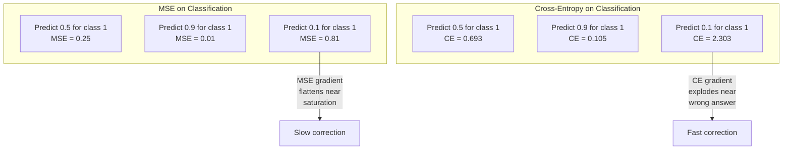
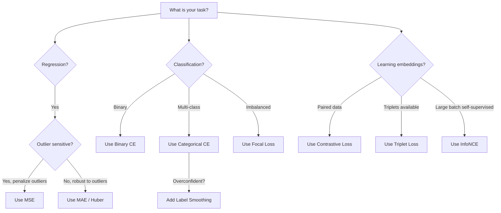
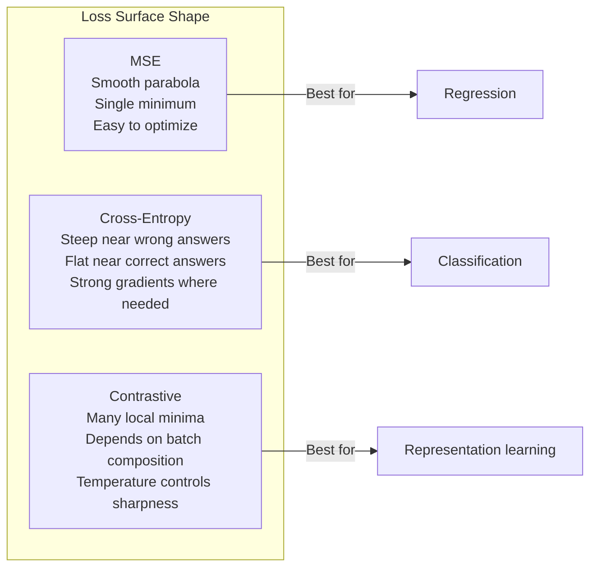

# 손실 함수(Loss Functions)

> 네트워크가 예측을 수행합니다. 실제 정답(ground truth)은 다른 값을 가리킵니다. 모델은 얼마나 틀렸을까요? 그 정도를 나타내는 숫자가 바로 손실(loss)입니다. 손실 함수를 잘못 선택하면 모델은 완전히 엉뚱한 방향으로 최적화됩니다.

**유형:** Build (실습)
**사용 언어:** Python
**선수 레슨:** Lesson 03.04 (Activation Functions)
**소요 시간:** ~75분

## 학습 목표

- MSE, 이진 크로스 엔트로피(binary cross-entropy), 범주형 크로스 엔트로피(categorical cross-entropy), 대조 손실(contrastive loss, InfoNCE)을 기울기(gradient)와 함께 바닥부터 직접 구현합니다.
- "모든 것에 0.5를 예측하는" 실패 모드를 시연하여 분류 작업에서 MSE가 실패하는 이유를 설명합니다.
- 크로스 엔트로피에 레이블 스무딩(label smoothing)을 적용하고, 이것이 과도한 확신을 가진 예측(overconfident prediction)을 방지하는 방식을 설명합니다.
- 회귀(regression), 이진 분류(binary classification), 다중 클래스 분류(multi-class classification), 임베딩(embedding) 학습 작업에 적합한 손실 함수를 선택합니다.

## 문제 정의

분류 문제에서 MSE를 최소화하는 모델은 모든 입력에 대해 자신 있게 0.5를 예측하게 됩니다. 손실은 최소화하고 있지만, 전혀 쓸모없는 모델입니다.

손실 함수는 모델이 실제로 최적화하는 유일한 대상입니다. 정확도(accuracy)도, F1 점수(F1 score)도, 관리자에게 보고하는 지표도 아닙니다. 옵티마이저(optimizer)는 손실 함수의 기울기를 계산하고 그 값을 줄이기 위해 가중치(weights)를 조정합니다. 손실 함수가 여러분이 중요하게 여기는 목표를 온전히 담아내지 못하면, 모델은 이를 만족하는 수학적으로 가장 손쉬운 방법을 찾아낼 것이며, 그 방법은 여러분이 원했던 결과와 거의 항상 거리가 멉니다.

구체적인 예를 들어보겠습니다. 클래스가 50 대 50으로 나뉜 이진 분류 작업이 있습니다. 손실 함수로 MSE를 사용합니다. 모델은 모든 입력에 대해 0.5를 예측합니다. 이때 평균 MSE는 0.25로, 실제로 아무것도 학습하지 않고 달성할 수 있는 최소치입니다. 모델의 판별 능력은 전무하지만, 엄연히 손실 함수를 최소화했습니다. 이를 크로스 엔트로피로 바꾸면 동일한 모델이라도 예측값을 0 또는 1 쪽으로 밀어붙여야만 합니다. -log(0.5) = 0.693은 형편없는 손실 값인 반면, -log(0.99) = 0.01은 확신을 가진 올바른 예측에 큰 보상을 주기 때문입니다. 손실 함수의 선택이 제대로 학습하는 모델과 지표를 편법으로 달성하는 모델을 가르는 차이입니다.

자기지도 학습(self-supervised learning)에서는 상황이 더 심각합니다. 레이블조차 존재하지 않기 때문입니다. 이때는 대조 손실이 학습 신호의 전부를 정의합니다. 즉, 무엇이 유사하고 무엇이 다른지, 그리고 모델이 서로 다른 항목을 얼마나 강하게 밀어내야 하는지를 결정합니다. 대조 손실을 잘못 설정하면 임베딩이 단일 지점으로 붕괴(collapse)하여 모든 입력이 동일한 벡터로 매핑됩니다. 이론상 손실은 0이지만 완전히 무가치한 결과입니다.

## 핵심 개념

### 평균 제곱 오차(Mean Squared Error, MSE)

회귀 작업의 기본 손실 함수입니다. 예측값과 타깃 사이의 차이를 제곱하여 계산한 뒤, 모든 샘플에 대해 평균을 구합니다.

```math
\text{MSE} = \frac{1}{n} \sum (y_{\text{pred}} - y_{\text{true}})^2
```

제곱이 중요한 이유: 큰 오차에 이차 함수적으로(quadratically) 페널티를 부여하기 때문입니다. 오차가 2이면 오차가 1일 때보다 4배의 비용이 발생하고, 오차가 10이면 100배의 비용이 듭니다. 이로 인해 MSE는 이상치(outlier)에 민감해집니다. 터무니없이 틀린 단 하나의 예측이 전체 손실을 지배할 수 있습니다.

실제 수치로 살펴보겠습니다. 주택 가격을 예측하는 모델이 대부분의 주택에 대해서는 $10,000 정도의 오차를 보이지만 대저택 한 채에서 $200,000의 오차를 낸다면, MSE는 그 대저택 하나의 오차를 바로잡기 위해 지나치게 반응하여 나머지 99채 주택에 대한 성능을 떨어뜨릴 위험이 있습니다.

예측값에 대한 MSE의 기울기는 다음과 같습니다.

```math
\frac{\partial \text{MSE}}{\partial y_{\text{pred}}} = \frac{2}{n} (y_{\text{pred}} - y_{\text{true}})
```

오차에 선형적으로 비례합니다. 오차가 클수록 더 큰 기울기를 얻습니다. 이는 회귀에서는 장점(큰 오차에는 큰 교정이 필요함)이지만, 분류에서는 단점입니다(틀린 답에 강한 확신을 보일 때는 선형적이 아니라 기하급수적으로 페널티를 주어야 하기 때문입니다).

### 크로스 엔트로피 손실(Cross-Entropy Loss)

분류를 위한 손실 함수입니다. 정보 이론(information theory)에 기반을 두며, 예측된 확률 분포와 실제 분포 사이의 발산(divergence)을 측정합니다.

**이진 크로스 엔트로피(Binary Cross-Entropy, BCE):**

```math
\text{BCE} = -\left(y \log(p) + (1 - y) \log(1 - p)\right)
```

여기서 $y$는 실제 레이블(0 또는 1)이고, $p$는 예측 확률입니다.

$-\log(p)$가 효과적인 이유: 실제 레이블이 1일 때 $p = 0.99$을 예측하면 손실은 $-\log(0.99) = 0.01$입니다. 반면 $p = 0.01$을 예측하면 손실은 $-\log(0.01) = 4.6$가 됩니다. 이 460배의 차이가 바로 크로스 엔트로피가 효과적인 이유입니다. 정답에 확신을 가진 예측에는 거의 페널티를 주지 않으면서, 오답에 확신을 가진 예측에는 가혹한 페널티를 부과합니다.

기울기를 살펴보아도 마찬가지입니다.

```math
\frac{\partial \text{BCE}}{\partial p} = -\frac{y}{p} + \frac{1-y}{1-p}
```

$y = 1$이고 $p$가 0에 가까울 때, 기울기는 음의 무한대에 수렴하는 $-1/p$가 됩니다. 모델은 실수를 바로잡기 위한 막대한 신호를 받게 됩니다. $p$가 1에 가까우면 기울기는 매우 작아집니다. 이미 정답이므로 수정할 것이 없습니다.

**범주형 크로스 엔트로피(Categorical Cross-Entropy):**

원-핫 인코딩(one-hot encoded)된 타깃을 사용하는 다중 클래스 분류를 위한 손실 함수입니다.

```math
\text{CCE} = -\sum_i y_i \log(p_i)
```

실제 정답 클래스만이 손실에 기여합니다(다른 모든 $y_i$가 0이기 때문입니다). 클래스가 10개이고 정답 클래스에 0.1의 확률(무작위 추측)이 할당되면 손실은 $-\log(0.1) = 2.3$입니다. 정답 클래스에 0.9의 확률이 할당되면 손실은 $-\log(0.9) = 0.105$가 됩니다. 모델은 올바른 정답에 확률 질량을 집중시키는 법을 학습합니다.

### 분류 작업에서 MSE가 실패하는 이유



MSE의 기울기는 시그모이드(sigmoid) 포화로 인해 예측값이 0 또는 1에 가까워질 때 평탄해집니다. 크로스 엔트로피의 기울기는 이를 상쇄합니다. 즉, $-\log$ 항이 시그모이드의 평탄한 영역을 상쇄하여 가장 필요한 지점에 강력한 기울기를 전달합니다.

### 레이블 스무딩(Label Smoothing)

표준 원-핫 레이블은 "이것은 100% 클래스 3이며, 나머지는 0%이다"라고 선언합니다. 이는 너무 단정적인 주장입니다. 레이블 스무딩은 이를 완화합니다.

```math
\text{smooth\_label} = (1 - \alpha) \cdot \text{one\_hot} + \frac{\alpha}{\text{num\_classes}}
```

$\alpha = 0.1$이고 클래스가 10개인 경우, [0, 0, 1, 0, ...] 대신 타깃이 [0.01, 0.01, 0.91, 0.01, ...]가 됩니다. 모델은 1.0 대신 0.91을 목표로 삼습니다.

효과가 있는 이유: 소프트맥스(softmax)를 통해 정확히 1.0을 출력하려는 모델은 로짓(logit)을 무한대까지 밀어붙여야 합니다. 이는 과도한 확신(overconfidence)을 낳고, 일반화 능력을 해치며, 모델을 분포 변화(distribution shift)에 취약하게 만듭니다. 레이블 스무딩은 타깃의 상한을($\alpha = 0.1$일 때) 0.9로 제한하여 로짓을 합리적인 범위 내로 유지합니다. GPT를 비롯한 대부분의 현대 모델이 레이블 스무딩 또는 이에 상응하는 기법을 사용합니다.

### 대조 손실(Contrastive Loss)

레이블도 없고 클래스도 없습니다. 입력 쌍과 "이 둘은 유사한가, 다른가?"라는 질문만 존재합니다.

**SimCLR 스타일 대조 손실(NT-Xent / InfoNCE):**

하나의 이미지를 가져옵니다. 이를 증강(augmentation)하여 두 가지 변형(자르기, 회전, 색상 왜곡)을 만듭니다. 이 둘이 바로 "양성 쌍(positive pair)"이며 유사한 임베딩을 가져야 합니다. 배치의 다른 모든 이미지는 "음성 쌍(negative pair)"을 형성하며 서로 다른 임베딩을 가져야 합니다.

```math
L = -\log \frac{\exp(\text{sim}(z_i, z_j) / \tau)}{\sum_k \exp(\text{sim}(z_i, z_k) / \tau)}
```

여기서 $\text{sim}()$는 코사인 유사도(cosine similarity)이고, $z_i$와 $z_j$는 양성 쌍이며, 합계는 모든 음성 샘플에 대한 것입니다. $\tau$(온도, temperature)는 분포가 얼마나 날카로운지 제어합니다. 온도가 낮을수록 = 더 어려운 음성 샘플(hard negatives)을 다루게 되며 = 더 강력한 분리가 일어납니다.

실제 수치로 보면 다음과 같습니다. 배치 크기가 256이라는 것은 양성 쌍 하나당 255개의 음성 샘플이 있음을 의미합니다. 온도 $\tau = 0.07$(SimCLR 기본값)에서 이 손실은 유사도에 대한 소프트맥스처럼 동작하며, 256개의 선택지 중 양성 쌍의 유사도가 가장 높아지도록 유도합니다.

**트리플렛 손실(Triplet Loss):**

기준 샘플(anchor), 양성 샘플(positive, 동일 클래스), 음성 샘플(negative, 다른 클래스)의 세 입력을 받습니다.

```math
L = \max\left(0, d(\text{anchor}, \text{positive}) - d(\text{anchor}, \text{negative}) + \text{margin}\right)
```

마진(margin, 일반적으로 0.2~1.0)은 양성 샘플 간의 거리와 음성 샘플 간의 거리 사이에 최소한의 격차를 강제합니다. 음성 샘플이 이미 충분히 멀리 떨어져 있다면 손실은 0이 되며, 기울기도 없고 업데이트도 발생하지 않습니다. 이를 통해 학습을 효율적으로 진행할 수 있지만, 신중한 트리플렛 마이닝(triplet mining, 기준 샘플에 가까운 어려운 음성 샘플 선별)이 필요합니다.
### Focal Loss

불균형 데이터셋(imbalanced datasets)을 위한 손실 함수입니다. 표준 교차 엔트로피(cross-entropy)는 올바르게 분류된 모든 예제를 동일하게 취급합니다. Focal loss는 쉬운 예제의 가중치를 낮춥니다(down-weight).

```math
\text{FL} = -\alpha (1 - p_t)^\gamma \log(p_t)
```

여기서 $p_t$는 실제 클래스의 예측 확률이며, $\gamma$는 집중도(focusing)를 조절합니다. $\gamma = 0$이면 표준 교차 엔트로피와 동일합니다. 기본값인 $\gamma = 2$인 경우:

- 쉬운 예제($p_t = 0.9$): 가중치 $= (0.1)^2 = 0.01$. 사실상 무시됩니다.
- 어려운 예제($p_t = 0.1$): 가중치 $= (0.9)^2 = 0.81$. 온전한 그래디언트 신호가 전달됩니다.

Focal loss는 후보 영역의 99%가 배경(쉬운 음성 예제)인 객체 탐지(object detection)를 위해 Lin 등에 의해 도입되었습니다. Focal loss가 없으면 모델은 쉬운 배경 예제에 압도되어 객체 탐지를 제대로 학습하지 못합니다. Focal loss를 사용하면 모델은 중요한, 어렵고 모호한 사례에 용량을 집중할 수 있습니다.

### 손실 함수 결정 트리



### 손실 곡면



```figure
cross-entropy-loss
```

## 직접 만들어 보기

### 1단계: MSE와 그 그래디언트

```python
def mse(predictions, targets):
    n = len(predictions)
    total = 0.0
    for p, t in zip(predictions, targets):
        total += (p - t) ** 2
    return total / n

def mse_gradient(predictions, targets):
    n = len(predictions)
    grads = []
    for p, t in zip(predictions, targets):
        grads.append(2.0 * (p - t) / n)
    return grads
```

### 2단계: 이진 교차 엔트로피

log(0) 문제는 실제로 발생합니다. 모델이 양성 예제에 대해 정확히 0을 예측하면 $\log(0) = -\infty$가 됩니다. 클리핑(clipping)을 통해 이를 방지할 수 있습니다.

```python
import math

def binary_cross_entropy(predictions, targets, eps=1e-15):
    n = len(predictions)
    total = 0.0
    for p, t in zip(predictions, targets):
        p_clipped = max(eps, min(1 - eps, p))
        total += -(t * math.log(p_clipped) + (1 - t) * math.log(1 - p_clipped))
    return total / n

def bce_gradient(predictions, targets, eps=1e-15):
    grads = []
    for p, t in zip(predictions, targets):
        p_clipped = max(eps, min(1 - eps, p))
        grads.append(-(t / p_clipped) + (1 - t) / (1 - p_clipped))
    return grads
```

### 3단계: Softmax를 사용한 다중 클래스 교차 엔트로피

Softmax는 원시 로짓(logit)을 확률로 변환합니다. 그런 다음 원-핫(one-hot) 타깃에 대해 교차 엔트로피를 계산합니다.

```python
def softmax(logits):
    max_val = max(logits)
    exps = [math.exp(x - max_val) for x in logits]
    total = sum(exps)
    return [e / total for e in exps]

def categorical_cross_entropy(logits, target_index, eps=1e-15):
    probs = softmax(logits)
    p = max(eps, probs[target_index])
    return -math.log(p)

def cce_gradient(logits, target_index):
    probs = softmax(logits)
    grads = list(probs)
    grads[target_index] -= 1.0
    return grads
```

Softmax + 교차 엔트로피의 그래디언트는 매우 깔끔하게 단순화됩니다. 실제 클래스에 대해서는 (예측 확률 - 1)이고, 다른 모든 클래스에 대해서는 단순히 (예측 확률)이 됩니다. 이 우아한 단순화는 우연이 아닙니다. 이것이 바로 softmax와 교차 엔트로피가 짝을 이루는 이유입니다.

### 4단계: 레이블 스무딩

```python
def label_smoothed_cce(logits, target_index, num_classes, alpha=0.1, eps=1e-15):
    probs = softmax(logits)
    loss = 0.0
    for i in range(num_classes):
        if i == target_index:
            smooth_target = 1.0 - alpha + alpha / num_classes
        else:
            smooth_target = alpha / num_classes
        p = max(eps, probs[i])
        loss += -smooth_target * math.log(p)
    return loss
```

### 5단계: 대조 손실 (단순화된 InfoNCE)

```python
def cosine_similarity(a, b):
    dot = sum(x * y for x, y in zip(a, b))
    norm_a = math.sqrt(sum(x * x for x in a))
    norm_b = math.sqrt(sum(x * x for x in b))
    if norm_a < 1e-10 or norm_b < 1e-10:
        return 0.0
    return dot / (norm_a * norm_b)

def contrastive_loss(anchor, positive, negatives, temperature=0.07):
    sim_pos = cosine_similarity(anchor, positive) / temperature
    sim_negs = [cosine_similarity(anchor, neg) / temperature for neg in negatives]

    max_sim = max(sim_pos, max(sim_negs)) if sim_negs else sim_pos
    exp_pos = math.exp(sim_pos - max_sim)
    exp_negs = [math.exp(s - max_sim) for s in sim_negs]
    total_exp = exp_pos + sum(exp_negs)

    return -math.log(max(1e-15, exp_pos / total_exp))
```

### 6단계: 분류 문제에서 MSE vs 교차 엔트로피

레슨 04의 동일한 네트워크(원형 데이터셋)를 두 손실 함수로 각각 훈련합니다. 교차 엔트로피가 더 빠르게 수렴하는 것을 확인해 보세요.

```python
import random

def sigmoid(x):
    x = max(-500, min(500, x))
    return 1.0 / (1.0 + math.exp(-x))

def make_circle_data(n=200, seed=42):
    random.seed(seed)
    data = []
    for _ in range(n):
        x = random.uniform(-2, 2)
        y = random.uniform(-2, 2)
        label = 1.0 if x * x + y * y < 1.5 else 0.0
        data.append(([x, y], label))
    return data


class LossComparisonNetwork:
    def __init__(self, loss_type="bce", hidden_size=8, lr=0.1):
        random.seed(0)
        self.loss_type = loss_type
        self.lr = lr
        self.hidden_size = hidden_size

        self.w1 = [[random.gauss(0, 0.5) for _ in range(2)] for _ in range(hidden_size)]
        self.b1 = [0.0] * hidden_size
        self.w2 = [random.gauss(0, 0.5) for _ in range(hidden_size)]
        self.b2 = 0.0

    def forward(self, x):
        self.x = x
        self.z1 = []
        self.h = []
        for i in range(self.hidden_size):
            z = self.w1[i][0] * x[0] + self.w1[i][1] * x[1] + self.b1[i]
            self.z1.append(z)
            self.h.append(max(0.0, z))

        self.z2 = sum(self.w2[i] * self.h[i] for i in range(self.hidden_size)) + self.b2
        self.out = sigmoid(self.z2)
        return self.out

    def backward(self, target):
        if self.loss_type == "mse":
            d_loss = 2.0 * (self.out - target)
        else:
            eps = 1e-15
            p = max(eps, min(1 - eps, self.out))
            d_loss = -(target / p) + (1 - target) / (1 - p)

        d_sigmoid = self.out * (1 - self.out)
        d_out = d_loss * d_sigmoid

        for i in range(self.hidden_size):
            d_relu = 1.0 if self.z1[i] > 0 else 0.0
            d_h = d_out * self.w2[i] * d_relu
            self.w2[i] -= self.lr * d_out * self.h[i]
            for j in range(2):
                self.w1[i][j] -= self.lr * d_h * self.x[j]
            self.b1[i] -= self.lr * d_h
        self.b2 -= self.lr * d_out

    def compute_loss(self, pred, target):
        if self.loss_type == "mse":
            return (pred - target) ** 2
        else:
            eps = 1e-15
            p = max(eps, min(1 - eps, pred))
            return -(target * math.log(p) + (1 - target) * math.log(1 - p))

    def train(self, data, epochs=200):
        losses = []
        for epoch in range(epochs):
            total_loss = 0.0
            correct = 0
            for x, y in data:
                pred = self.forward(x)
                self.backward(y)
                total_loss += self.compute_loss(pred, y)
                if (pred >= 0.5) == (y >= 0.5):
                    correct += 1
            avg_loss = total_loss / len(data)
            accuracy = correct / len(data) * 100
            losses.append((avg_loss, accuracy))
            if epoch % 50 == 0 or epoch == epochs - 1:
                print(f"    Epoch {epoch:3d}: loss={avg_loss:.4f}, accuracy={accuracy:.1f}%")
        return losses
```

## 실전 적용

PyTorch는 수치적 안정성이 내장된 모든 표준 손실 함수를 제공합니다.

```python
import torch
import torch.nn as nn
import torch.nn.functional as F

predictions = torch.tensor([0.9, 0.1, 0.7], requires_grad=True)
targets = torch.tensor([1.0, 0.0, 1.0])

mse_loss = F.mse_loss(predictions, targets)
bce_loss = F.binary_cross_entropy(predictions, targets)

logits = torch.randn(4, 10)
labels = torch.tensor([3, 7, 1, 9])
ce_loss = F.cross_entropy(logits, labels)
ce_smooth = F.cross_entropy(logits, labels, label_smoothing=0.1)
```

`F.cross_entropy`를 사용하세요(`F.nll_loss`에 수동 softmax를 결합하는 방식 대신). 이는 log-softmax와 음의 로그 우도(negative log-likelihood)를 수치적으로 안정한 단일 연산으로 결합합니다. Softmax를 별도로 적용한 다음 로그를 취하는 것은 안정성이 떨어집니다. 큰 지수 연산의 뺄셈 과정에서 정밀도 손실이 발생하기 때문입니다.

대조 학습(contrastive learning)의 경우, 대부분의 팀은 커스텀 구현이나 `lightly` 또는 `pytorch-metric-learning` 같은 라이브러리를 사용합니다. 핵심 루프는 항상 동일합니다. 쌍별 유사도를 계산하고, 양성과 음성 쌍에 대해 softmax를 취한 뒤, 역전파(backpropagation)를 수행합니다.

## 결과물

이 레슨을 통해 다음 항목을 얻을 수 있습니다.
- `outputs/prompt-loss-function-selector.md` -- 올바른 손실 함수를 선택하기 위한 재사용 가능한 프롬프트
- `outputs/prompt-loss-debugger.md` -- 손실 곡선이 비정상적일 때를 위한 진단 프롬프트

## 연습 문제

1. 작은 오차에는 MSE를, 큰 오차에는 MAE를 적용하는 Huber 손실(smooth L1 loss)을 구현해 보세요. 훈련 타깃의 5%에 무작위 노이즈가 추가된(이상치) 상황에서 $y = \sin(x)$를 예측하는 회귀 네트워크를 MSE와 Huber 손실로 각각 훈련해 보세요. 최종 테스트 오차를 비교해 봅니다.

2. 이진 분류 훈련 루프에 focal loss를 추가해 보세요. 불균형 데이터셋(클래스 0 90%, 클래스 1 10%)을 생성합니다. 200 에포크 후 소수 클래스 재현율(recall)에 대해 표준 BCE와 focal loss($\gamma = 2$)를 비교해 보세요.

3. 준어려운 음성 마이닝(semi-hard negative mining)을 적용한 triplet loss를 구현해 보세요. 5개 클래스에 대한 2D 임베딩 데이터를 생성합니다. 각 앵커(anchor)에 대해 양성 예제보다 멀리 있지만 가장 가까운 음성 예제(semi-hard)를 찾습니다. 무작위 삼중항(triplet) 선택과 수렴 속도를 비교해 보세요.

4. MSE vs 교차 엔트로피 비교를 실행하되, 훈련 중에 각 레이어의 그래디언트 크기를 추적해 보세요. 에포크당 평균 그래디언트 노름(norm)을 시각화합니다. 모델이 가장 불확실한 초기 에포크에서 교차 엔트로피가 더 큰 그래디언트를 생성하는지 확인해 보세요.

5. KL 발산(KL divergence) 손실을 구현하고, 실제 분포가 원-핫 형태일 때 $\mathrm{KL}(\text{true} \Vert \text{predicted})$를 최소화하는 것이 교차 엔트로피와 동일한 그래디언트를 산출하는지 확인해 보세요. 그런 다음 "실제" 분포가 교사 모델의 softmax 출력에서 나오는 소프트 타깃(soft target, 지식 증류(knowledge distillation) 방식)을 적용해 보세요.

## 핵심 용어

| 용어 | 일반적인 설명 | 실제 기술적 의미 |
|------|----------------|----------------------|
| Loss function (손실 함수) | "모델이 얼마나 틀렸는지" | 옵티마이저가 최소화하도록 예측값과 타깃을 스칼라로 매핑하는 미분 가능한 함수 |
| MSE | "평균 제곱 오차" | 예측값과 타깃 간의 제곱 차이의 평균; 큰 오차에 2차 함수적으로 페널티를 부여함 |
| Cross-entropy (교차 엔트로피) | "분류용 손실" | $-\log(p)$를 사용하여 예측된 확률 분포와 실제 분포 사이의 발산을 측정함 |
| Binary cross-entropy (이진 교차 엔트로피) | "BCE" | 두 클래스에 대한 교차 엔트로피: $-(y \log(p) + (1-y) \log(1-p))$ |
| Label smoothing (레이블 스무딩) | "타깃을 부드럽게 만들기" | 과도한 확신(overconfidence)을 방지하고 일반화 성능을 향상하기 위해 원-핫(0/1) 타깃을 부드러운 값(예: 0.1/0.9)으로 대체하는 기법 |
| Contrastive loss (대조 손실) | "유사한 것은 당기고, 다른 것은 밀어내기" | 임베딩 공간에서 유사한 쌍은 가깝게, 상이한 쌍은 멀어지게 하여 표현을 학습하는 손실 함수 |
| InfoNCE | "CLIP/SimCLR 손실" | 유사도 점수에 대한 정규화된 온도 조절 교차 엔트로피; 대조 학습을 분류 문제로 취급함 |
| Focal loss | "불균형 데이터 해결책" | 쉬운 예제의 가중치를 낮추고 어려운 예제에 집중하기 위해 $(1-p_t)^\gamma$로 가중치를 부여한 교차 엔트로피 |
| Triplet loss | "앵커-양성-음성" | 임베딩 공간에서 앵커가 음성 예제보다 양성 예제에 최소 마진 이상 더 가깝도록 밀어내는 손실 함수 |
| Temperature (온도) | "선명도 조절 손잡이" | 로짓/유사도를 나누는 스칼라 값으로, 결과 분포가 얼마나 뾰족한지 제어함; 낮을수록 더 뾰족해짐 |

## 더 읽을거리

- Lin et al., "Focal Loss for Dense Object Detection" (2017) -- 객체 탐지(RetinaNet)에서 극심한 클래스 불균형을 다루기 위해 focal loss를 소개함
- Chen et al., "A Simple Framework for Contrastive Learning of Visual Representations" (SimCLR, 2020) -- NT-Xent 손실을 통해 현대적인 대조 학습 파이프라인을 정의함
- Szegedy et al., "Rethinking the Inception Architecture" (2016) -- 정규화(regularization) 기법으로 레이블 스무딩을 도입함; 현재 대부분의 대형 모델에서 표준으로 사용됨
- Hinton et al., "Distilling the Knowledge in a Neural Network" (2015) -- 소프트 타깃과 KL 발산을 사용한 지식 증류를 다룸; 모델 압축의 기초가 됨
