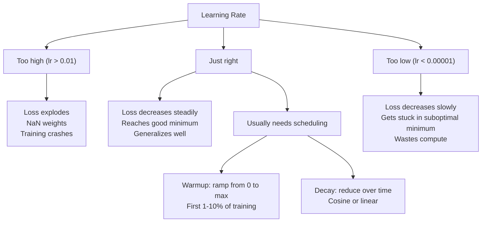
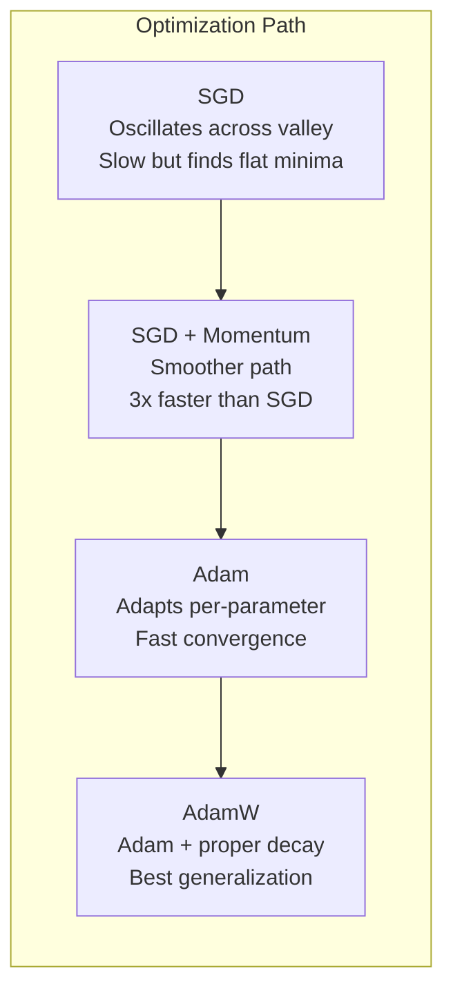
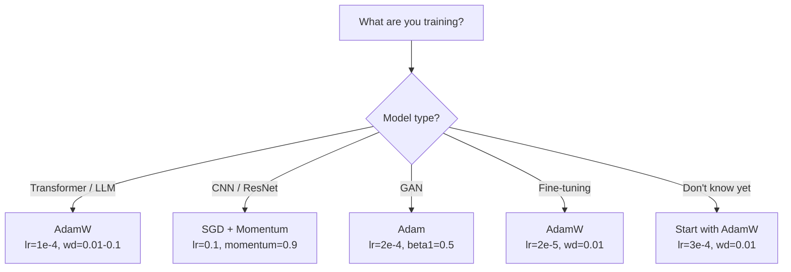

# 옵티마이저

> 경사 하강법(gradient descent)은 어느 방향으로 이동해야 하는지 알려줍니다. 하지만 얼마나 멀리, 얼마나 빠르게 이동해야 하는지는 전혀 알려주지 않습니다. SGD가 나침반이라면, Adam은 교통 정보가 반영된 GPS입니다.

**유형:** Build (실습)
**사용 언어:** Python
**선수 레슨:** Lesson 03.05 (Loss Functions)
**소요 시간:** ~75분

## 학습 목표

- Python으로 SGD, 모멘텀을 적용한 SGD, Adam, AdamW 옵티마이저를 밑바닥부터 직접 구현합니다.
- Adam의 편향 수정(bias correction)이 학습 초기 단계에서 0으로 초기화된 모멘트 추정치를 어떻게 보정하는지 설명합니다.
- 동일한 작업에서 AdamW가 L2 정규화(regularization)를 적용한 Adam보다 더 우수한 일반화 성능을 보이는 이유를 증명합니다.
- Transformer, CNN, GAN 및 미세 조정(fine-tuning)에 적합한 옵티마이저와 기본 하이퍼파라미터를 선택합니다.

## 문제 정의

기울기(gradient)를 계산했습니다. 손실(loss)을 줄이려면 4,721번째 가중치를 0.003만큼 줄여야 한다는 것도 알고 있습니다. 하지만 0.003은 어떤 단위일까요? 무엇에 의해 스케일링되어야 할까요? 그리고 1단계(step 1)와 1,000단계(step 1,000)에서 같은 크기만큼 이동해야 할까요?

기본적인 경사 하강법(Vanilla gradient descent)은 매 단계마다 모든 파라미터에 동일한 학습률(learning rate)을 적용합니다: $w = w - \text{lr} \cdot \text{gradient}$. 이는 신경망 학습을 실무에서 매우 까다롭게 만드는 세 가지 문제를 유발합니다.

첫째, 진동(oscillation)입니다. 손실 지형(loss landscape)은 매끄러운 그릇 모양인 경우가 거의 없습니다. 오히려 길고 좁은 계곡에 가깝습니다. 기울기는 계곡을 따라가는 방향(완만한 방향)이 아니라 계곡을 가로지르는 방향(가파른 방향)을 가리킵니다. 경사 하강법은 좁은 차원을 따라 앞뒤로 튕겨 다니며 유용한 방향으로는 거의 나아가지 못합니다. 손실이 빠르게 감소하다가 정체되는 현상을 본 적이 있을 것입니다. 이는 모델이 수렴해서가 아니라 진동하고 있기 때문입니다.

둘째, 모든 파라미터에 단 하나의 학습률을 적용하는 것은 잘못된 접근입니다. 어떤 가중치는 큰 업데이트가 필요한 반면(초기 과소적합 단계인 경우), 다른 가중치는 아주 작은 업데이트만 필요합니다(최적값에 가까운 경우). 전자에게 적합한 학습률은 후자를 망가뜨리고, 그 반대도 마찬가지입니다.

셋째, 안장점(saddle point)입니다. 고차원 공간에서 손실 지형에는 기울기가 거의 0에 가까운 광대한 평탄한 영역이 존재합니다. 기본 SGD는 사실상 0에 가까운 기울기 속도로 이곳을 기어가듯 통과합니다. 모델이 멈춘 것처럼 보이지만, 실제로 멈춘 것이 아니라 반대편에 유용한 내리막이 있는 평탄한 영역에 머물러 있는 것입니다. 그러나 SGD에는 이를 밀고 나갈 메커니즘이 없습니다.

Adam은 이 세 가지 문제를 모두 해결합니다. Adam은 파라미터별로 두 개의 이동 평균(running average)을 유지합니다. 바로 기울기의 평균(모멘텀, 진동 처리)과 기울기 제곱의 평균(적응형 학습률, 서로 다른 스케일 처리)입니다. 여기에 초기 몇 단계를 위한 편향 수정까지 결합되어, 기본 하이퍼파라미터만으로도 문제의 80%에서 잘 작동하는 단일 옵티마이저가 완성됩니다. 이번 강의에서는 Adam을 밑바닥부터 직접 구현하여, 나머지 20%의 상황에서는 언제, 왜 실패하는지 정확히 이해하도록 합니다.

## 개념

### 확률적 경사 하강법(Stochastic Gradient Descent, SGD)

가장 단순한 옵티마이저입니다. 미니배치(mini-batch)에서 기울기를 계산하고 그 반대 방향으로 한 걸음 나아갑니다.

```math
w = w - \text{lr} \cdot \text{gradient}
```

여기서 "확률적(stochastic)"이라는 말은 전체 데이터셋 대신 무작위로 추출한 데이터의 부분 집합(미니배치)을 사용하여 기울기를 추정한다는 뜻입니다. 이 노이즈는 실제로 유용한데, 가파른 국소 최솟값(sharp local minima)에서 벗어나는 데 도움을 줍니다. 하지만 동시에 진동을 유발하기도 합니다.

학습률이 유일한 조절 손잡이(knob)입니다. 너무 높으면 손실이 발산하고, 너무 낮으면 학습에 오랜 시간이 걸립니다. 최적의 값은 아키텍처, 데이터, 배치 크기, 현재 학습 단계에 따라 달라집니다. 최신 신경망에서 기본 SGD를 사용할 때 일반적인 값의 범위는 0.01에서 0.1 사이입니다. 하지만 단 한 번의 학습 과정 내에서도 이상적인 학습률은 계속해서 변합니다.

### 모멘텀(Momentum)

언덕을 굴러 내려가는 공의 비유는 너무 흔하게 쓰이지만 정확한 설명입니다. 기울기만으로 이동하는 대신, 과거의 기울기를 누적하는 속도(velocity)를 유지합니다.

```math
\begin{aligned}
m_t &= \beta \, m_{t-1} + \text{gradient} \\
w &= w - \text{lr} \cdot m_t
\end{aligned}
```

베타(beta, 일반적으로 0.9)는 과거 이력을 얼마나 유지할지 제어합니다. $\beta = 0.9$일 때, 모멘텀은 대략 최근 10개 기울기의 평균이 됩니다($1 / (1 - 0.9) = 10$).

이것이 진동을 해결하는 이유: 같은 방향을 가리키는 기울기는 누적됩니다. 반대 방향을 가리키는 기울기는 상쇄됩니다. 그 좁은 계곡에서 계곡을 "가로지르는" 성분은 매 단계마다 부호가 바뀌며 감쇠됩니다. 계곡을 "따라가는" 성분은 일정하게 유지되며 증폭됩니다. 그 결과 유용한 방향으로 부드럽게 가속하게 됩니다.

실제 수치로 비교해보면, 조건이 좋지 않은 손실 지형에서 SGD 단독으로는 10,000단계가 걸릴 수 있습니다. 모멘텀을 적용한 SGD($\beta = 0.9$)는 동일한 문제에서 일반적으로 3,000~5,000단계가 걸립니다. 이러한 가속은 결코 미미한 수준이 아닙니다.

### RMSProp

실제로 잘 작동했던 최초의 파라미터별 적응형 학습률(adaptive learning rate) 방식입니다. Hinton이 Coursera 강의에서 제안했습니다(공식 논문으로 출판된 적은 없습니다).

```math
\begin{aligned}
s_t &= \beta \, s_{t-1} + (1 - \beta) \cdot \text{gradient}^2 \\
w &= w - \text{lr} \cdot \frac{\text{gradient}}{\sqrt{s_t} + \epsilon}
\end{aligned}
```

$s_t$는 기울기 제곱의 이동 평균을 추적합니다. 지속적으로 큰 기울기를 갖는 파라미터는 큰 수로 나누어집니다(유효 학습률이 작아짐). 작은 기울기를 갖는 파라미터는 작은 수로 나누어집니다(유효 학습률이 커짐).

이는 "모든 파라미터에 단 하나의 학습률을 적용하는" 문제를 해결합니다. 이미 큰 폭으로 업데이트되어 온 가중치는 목표치에 가까울 가능성이 높으므로 속도를 늦춥니다. 아주 작은 업데이트만 받아온 가중치는 덜 학습되었을 수 있으므로 속도를 높입니다.

입실론(epsilon, 일반적으로 1e-8)은 파라미터가 업데이트되지 않았을 때 0으로 나누어지는 오류를 방지합니다.

### Adam: 모멘텀 + RMSProp

Adam은 두 아이디어를 결합합니다. 파라미터마다 두 개의 지수 이동 평균(exponential moving average)을 유지합니다:

```math
\begin{aligned}
m_t &= \beta_1 m_{t-1} + (1 - \beta_1) \cdot \text{gradient} && \text{(first moment: mean)} \\
v_t &= \beta_2 v_{t-1} + (1 - \beta_2) \cdot \text{gradient}^2 && \text{(second moment: variance)}
\end{aligned}
```

**편향 수정(Bias correction)**은 대부분의 설명에서 간과하는 핵심적인 세부 사항입니다. 1단계에서 $m_1 = (1 - \beta_1) \cdot \text{gradient}$입니다. $\beta_1 = 0.9$라면 이는 $0.1 \cdot \text{gradient}$가 되며, 이는 실제보다 10배나 작은 값입니다. 이동 평균이 아직 예열(warm up)되지 않은 것입니다. 편향 수정은 이를 다음과 같이 보정합니다:

```math
\begin{aligned}
\hat{m} &= \frac{m_t}{1 - \beta_1^t} \\
\hat{v} &= \frac{v_t}{1 - \beta_2^t}
\end{aligned}
```

$\beta_1 = 0.9$일 때 1단계에서는 $\hat{m} = m_1 / (1 - 0.9) = m_1 / 0.1 =$ 실제 기울기가 됩니다. 100단계에서는 $(1 - 0.9^{100})$이 약 1.0이 되므로 보정 효과가 사라집니다. 편향 수정은 초기 약 10단계 동안 중요하며, 약 50단계 이후에는 거의 영향을 미치지 않습니다.

업데이트 식은 다음과 같습니다:

```math
w = w - \text{lr} \cdot \frac{\hat{m}}{\sqrt{\hat{v}} + \epsilon}
```

Adam의 기본값: $\text{lr} = 0.001$, $\beta_1 = 0.9$, $\beta_2 = 0.999$, $\epsilon = 10^{-8}$. 이 기본값은 문제의 80%에서 잘 작동합니다. 잘 작동하지 않는다면 먼저 lr을 변경하십시오. 그다음 $\beta_2$을 변경합니다. $\beta_1$나 $\epsilon$는 거의 변경하지 않습니다.

### AdamW: 올바른 방식의 가중치 감쇠

L2 정규화는 손실에 $\lambda w^2$을 더합니다. 기본 SGD에서는 이것이 가중치 감쇠(weight decay, 매 단계 가중치에서 $\lambda w$을 빼는 것)와 동일합니다. 하지만 Adam에서는 이 동등성이 깨집니다.

Loshchilov와 Hutter의 통찰: 손실에 L2를 더한 후 Adam이 기울기를 처리하면, 적응형 학습률이 정규화 항까지 스케일링해 버립니다. 기울기 분산이 큰 파라미터는 정규화를 적게 받고, 분산이 작은 파라미터는 정규화를 더 많이 받게 됩니다. 이는 우리가 원하는 방식이 아닙니다. 기울기 통계와 무관하게 균등한 정규화를 적용해야 합니다.

AdamW는 Adam 업데이트 이후 가중치에 직접 가중치 감쇠를 적용하여 이 문제를 해결합니다:

```math
w = w - \text{lr} \cdot \frac{\hat{m}}{\sqrt{\hat{v}} + \epsilon} - \text{lr} \cdot \lambda w
```

가중치 감쇠 항($\text{lr} \cdot \lambda w$)은 Adam의 적응형 계수에 의해 스케일링되지 않습니다. 모든 파라미터가 동일한 비율로 감소합니다.

사소한 세부 사항처럼 보일 수 있지만 그렇지 않습니다. 거의 모든 작업에서 AdamW는 Adam + L2 정규화보다 더 나은 해로 수렴합니다. PyTorch에서 Transformer, 확산 모델(diffusion model) 및 대부분의 최신 아키텍처를 학습시킬 때 기본으로 사용되는 옵티마이저입니다. BERT, GPT, LLaMA, Stable Diffusion 모두 AdamW로 학습되었습니다.
### 학습률: 가장 중요한 하이퍼파라미터



단 하나의 하이퍼파라미터만 튜닝해야 한다면, 학습률(learning rate)을 튜닝하십시오. 학습률의 10배 변화는 여러분이 내릴 어떤 아키텍처적 결정보다 중요합니다. 일반적인 기본값은 다음과 같습니다.

- SGD: lr = 0.01 ~ 0.1
- Adam/AdamW: lr = 1e-4 ~ 3e-4
- 사전 학습된 모델 미세 조정(fine-tuning): lr = 1e-5 ~ 5e-5
- 학습률 웜업(learning rate warmup): 처음 1~10% 스텝에 걸친 선형 증가

### 옵티마이저 비교



### 각 옵티마이저가 유리한 경우



```figure
optimizer-trajectory
```

## 직접 구현해 보기

### 1단계: 바닐라 SGD

```python
class SGD:
    def __init__(self, lr=0.01):
        self.lr = lr

    def step(self, params, grads):
        for i in range(len(params)):
            params[i] -= self.lr * grads[i]
```

### 2단계: 모멘텀을 적용한 SGD

```python
class SGDMomentum:
    def __init__(self, lr=0.01, beta=0.9):
        self.lr = lr
        self.beta = beta
        self.velocities = None

    def step(self, params, grads):
        if self.velocities is None:
            self.velocities = [0.0] * len(params)
        for i in range(len(params)):
            self.velocities[i] = self.beta * self.velocities[i] + grads[i]
            params[i] -= self.lr * self.velocities[i]
```

### 3단계: Adam

```python
import math

class Adam:
    def __init__(self, lr=0.001, beta1=0.9, beta2=0.999, epsilon=1e-8):
        self.lr = lr
        self.beta1 = beta1
        self.beta2 = beta2
        self.epsilon = epsilon
        self.m = None
        self.v = None
        self.t = 0

    def step(self, params, grads):
        if self.m is None:
            self.m = [0.0] * len(params)
            self.v = [0.0] * len(params)

        self.t += 1

        for i in range(len(params)):
            self.m[i] = self.beta1 * self.m[i] + (1 - self.beta1) * grads[i]
            self.v[i] = self.beta2 * self.v[i] + (1 - self.beta2) * grads[i] ** 2

            m_hat = self.m[i] / (1 - self.beta1 ** self.t)
            v_hat = self.v[i] / (1 - self.beta2 ** self.t)

            params[i] -= self.lr * m_hat / (math.sqrt(v_hat) + self.epsilon)
```

### 4단계: AdamW

```python
class AdamW:
    def __init__(self, lr=0.001, beta1=0.9, beta2=0.999, epsilon=1e-8, weight_decay=0.01):
        self.lr = lr
        self.beta1 = beta1
        self.beta2 = beta2
        self.epsilon = epsilon
        self.weight_decay = weight_decay
        self.m = None
        self.v = None
        self.t = 0

    def step(self, params, grads):
        if self.m is None:
            self.m = [0.0] * len(params)
            self.v = [0.0] * len(params)

        self.t += 1

        for i in range(len(params)):
            self.m[i] = self.beta1 * self.m[i] + (1 - self.beta1) * grads[i]
            self.v[i] = self.beta2 * self.v[i] + (1 - self.beta2) * grads[i] ** 2

            m_hat = self.m[i] / (1 - self.beta1 ** self.t)
            v_hat = self.v[i] / (1 - self.beta2 ** self.t)

            params[i] -= self.lr * m_hat / (math.sqrt(v_hat) + self.epsilon)
            params[i] -= self.lr * self.weight_decay * params[i]
```

### 5단계: 학습 비교

레슨 05의 원형(circle) 데이터셋에 대해 네 가지 옵티마이저 모두로 동일한 2계층 네트워크를 학습시킵니다. 수렴 속도를 비교합니다.

```python
import random

def sigmoid(x):
    x = max(-500, min(500, x))
    return 1.0 / (1.0 + math.exp(-x))

def make_circle_data(n=200, seed=42):
    random.seed(seed)
    data = []
    for _ in range(n):
        x = random.uniform(-2, 2)
        y = random.uniform(-2, 2)
        label = 1.0 if x * x + y * y < 1.5 else 0.0
        data.append(([x, y], label))
    return data


class OptimizerTestNetwork:
    def __init__(self, optimizer, hidden_size=8):
        random.seed(0)
        self.hidden_size = hidden_size
        self.optimizer = optimizer

        self.w1 = [[random.gauss(0, 0.5) for _ in range(2)] for _ in range(hidden_size)]
        self.b1 = [0.0] * hidden_size
        self.w2 = [random.gauss(0, 0.5) for _ in range(hidden_size)]
        self.b2 = 0.0

    def get_params(self):
        params = []
        for row in self.w1:
            params.extend(row)
        params.extend(self.b1)
        params.extend(self.w2)
        params.append(self.b2)
        return params

    def set_params(self, params):
        idx = 0
        for i in range(self.hidden_size):
            for j in range(2):
                self.w1[i][j] = params[idx]
                idx += 1
        for i in range(self.hidden_size):
            self.b1[i] = params[idx]
            idx += 1
        for i in range(self.hidden_size):
            self.w2[i] = params[idx]
            idx += 1
        self.b2 = params[idx]

    def forward(self, x):
        self.x = x
        self.z1 = []
        self.h = []
        for i in range(self.hidden_size):
            z = self.w1[i][0] * x[0] + self.w1[i][1] * x[1] + self.b1[i]
            self.z1.append(z)
            self.h.append(max(0.0, z))

        self.z2 = sum(self.w2[i] * self.h[i] for i in range(self.hidden_size)) + self.b2
        self.out = sigmoid(self.z2)
        return self.out

    def compute_grads(self, target):
        eps = 1e-15
        p = max(eps, min(1 - eps, self.out))
        d_loss = -(target / p) + (1 - target) / (1 - p)
        d_sigmoid = self.out * (1 - self.out)
        d_out = d_loss * d_sigmoid

        grads = [0.0] * (self.hidden_size * 2 + self.hidden_size + self.hidden_size + 1)
        idx = 0
        for i in range(self.hidden_size):
            d_relu = 1.0 if self.z1[i] > 0 else 0.0
            d_h = d_out * self.w2[i] * d_relu
            grads[idx] = d_h * self.x[0]
            grads[idx + 1] = d_h * self.x[1]
            idx += 2

        for i in range(self.hidden_size):
            d_relu = 1.0 if self.z1[i] > 0 else 0.0
            grads[idx] = d_out * self.w2[i] * d_relu
            idx += 1

        for i in range(self.hidden_size):
            grads[idx] = d_out * self.h[i]
            idx += 1

        grads[idx] = d_out
        return grads

    def train(self, data, epochs=300):
        losses = []
        for epoch in range(epochs):
            total_loss = 0.0
            correct = 0
            for x, y in data:
                pred = self.forward(x)
                grads = self.compute_grads(y)
                params = self.get_params()
                self.optimizer.step(params, grads)
                self.set_params(params)

                eps = 1e-15
                p = max(eps, min(1 - eps, pred))
                total_loss += -(y * math.log(p) + (1 - y) * math.log(1 - p))
                if (pred >= 0.5) == (y >= 0.5):
                    correct += 1
            avg_loss = total_loss / len(data)
            accuracy = correct / len(data) * 100
            losses.append((avg_loss, accuracy))
            if epoch % 75 == 0 or epoch == epochs - 1:
                print(f"    Epoch {epoch:3d}: loss={avg_loss:.4f}, accuracy={accuracy:.1f}%")
        return losses
```

## 사용해 보기

PyTorch 옵티마이저는 파라미터 그룹, 그래디언트 클리핑(gradient clipping), 학습률 스케줄링을 처리합니다.

```python
import torch
import torch.optim as optim

model = torch.nn.Sequential(
    torch.nn.Linear(784, 256),
    torch.nn.ReLU(),
    torch.nn.Linear(256, 10),
)

optimizer = optim.AdamW(model.parameters(), lr=3e-4, weight_decay=0.01)

scheduler = optim.lr_scheduler.CosineAnnealingLR(optimizer, T_max=100)

for epoch in range(100):
    optimizer.zero_grad()
    output = model(torch.randn(32, 784))
    loss = torch.nn.functional.cross_entropy(output, torch.randint(0, 10, (32,)))
    loss.backward()
    torch.nn.utils.clip_grad_norm_(model.parameters(), max_norm=1.0)
    optimizer.step()
    scheduler.step()
```

패턴은 언제나 다음과 같습니다: zero_grad, forward, loss, backward, (clip), step, (schedule). 이 순서를 외워 두십시오. 순서를 잘못 지정하는 것(예: optimizer.step() 전에 scheduler.step() 호출)은 미묘한 버그가 발생하는 흔한 원인입니다.

CNN의 경우, 많은 실무자가 스텝 또는 코사인 스케줄과 함께 SGD + 모멘텀(lr=0.1, momentum=0.9, weight_decay=1e-4)을 여전히 선호합니다. SGD는 더 평탄한 최솟값(flatter minima)을 찾는 경향이 있어 종종 일반화가 더 잘됩니다. Transformer와 LLM의 경우, 웜업 + 코사인 감쇠를 적용한 AdamW가 보편적인 기본값입니다. 측정된 명확한 근거 없이 이러한 합의를 거스르지 마십시오.

## 배포하기

이번 레슨에서 생성하는 결과물은 다음과 같습니다.
- `outputs/prompt-optimizer-selector.md` -- 모든 아키텍처에 적합한 옵티마이저와 학습률을 선택하기 위한 결정 프롬프트

## 연습 문제

1. 현재 위치 대신 "미리 보기(lookahead)" 위치($w - \text{lr} \cdot \beta v$)에서 그래디언트를 계산하는 네스테로프 모멘텀(Nesterov momentum)을 구현하십시오. 원형 데이터셋에서 표준 모멘텀과의 수렴 속도를 비교해 보십시오.

2. 학습률 웜업 스케줄을 구현하십시오: 학습 스텝의 첫 10% 동안 0에서 max_lr까지 선형 증가시킨 다음, 0까지 코사인 감쇠시킵니다. Adam + 웜업과 웜업 없는 Adam으로 학습해 보십시오. 원형 데이터셋에서 90% 정확도에 도달하는 데 몇 에포크가 걸리는지 측정하십시오.

3. Adam 학습 중에 각 파라미터의 유효 학습률(effective learning rate)을 추적하십시오. 유효 학습률은 $\text{lr} \cdot \hat{m} / (\sqrt{\hat{v}} + \epsilon)$입니다. 10, 50, 200 스텝 후의 유효 학습률 분포를 시각화하십시오. 모든 파라미터가 동일한 속도로 업데이트되고 있습니까?

4. 그래디언트 클리핑(글로벌 노름 기준 클리핑)을 구현하십시오. 최대 그래디언트 노름을 1.0으로 설정합니다. 높은 학습률(Adam의 경우 lr=0.01)을 사용하여 클리핑을 적용했을 때와 적용하지 않았을 때 각각 학습해 보십시오. 10개의 랜덤 시드에 걸쳐 클리핑 유무에 따라 발산(손실이 NaN이 됨)하는 실행 횟수를 세어 보십시오.

5. 가중치가 큰 네트워크에서 Adam과 AdamW를 비교하십시오. 모든 가중치를 [-5, 5] 범위의 무작위 값(일반적인 경우보다 훨씬 큼)으로 초기화합니다. weight_decay=0.1로 200 에포크 동안 학습하십시오. 두 옵티마이저에 대해 학습 진행에 따른 가중치의 L2 노름을 시각화하십시오. AdamW에서 더 빠른 가중치 축소(shrinkage)가 나타나야 합니다.

## 핵심 용어

| 용어 | 사람들이 말하는 의미 | 실제 의미 |
|------|----------------|----------------------|
| 학습률(Learning rate) | "스텝 크기" | 그래디언트 업데이트에 적용되는 스칼라 승수; 학습에서 가장 영향력이 큰 단일 하이퍼파라미터 |
| SGD | "기본 경사 하강법" | 확률적 경사 하강법(Stochastic gradient descent): 미니배치에서 계산된 $\text{lr} \cdot \text{gradient}$를 빼서 가중치를 업데이트함 |
| 모멘텀(Momentum) | "굴러가는 공 비유" | 과거 그래디언트의 지수 이동 평균; 진동을 감쇠시키고 일관된 방향으로의 진행을 가속함 |
| RMSProp | "적응형 학습률" | 각 파라미터의 그래디언트를 최근 그래디언트의 이동 RMS로 나눔; 학습률을 균등화함 |
| Adam | "기본 옵티마이저" | 모멘텀(1차 모멘트)과 RMSProp(2차 모멘트)을 결합하고 초기 스텝에 대한 편향 보정을 적용함 |
| AdamW | "올바르게 구현된 Adam" | 분리된 가중치 감쇠(decoupled weight decay)가 적용된 Adam; 그래디언트를 통하지 않고 가중치에 직접 규제를 적용함 |
| 편향 보정(Bias correction) | "이동 평균을 위한 웜업" | Adam의 모멘트 추정치가 0으로 초기화되는 점을 보상하기 위해 $(1 - \beta^t)$로 나누는 것 |
| 가중치 감쇠(Weight decay) | "가중치 축소" | 매 스텝마다 가중치 값의 일부를 빼는 것; 큰 가중치에 페널티를 부여하는 규제 기법 |
| 학습률 스케줄(Learning rate schedule) | "시간에 따른 lr 변경" | 학습 중에 학습률을 조정하는 함수; 웜업 + 코사인 감쇠가 현대적인 기본값임 |
| 그래디언트 클리핑(Gradient clipping) | "그래디언트 노름 제한" | 그래디언트 벡터의 노름이 임계값을 초과할 때 스케일을 줄이는 것; 폭발적인 그래디언트 업데이트를 방지함 |

## 더 읽어보기

- Kingma & Ba, "Adam: A Method for Stochastic Optimization" (2014) -- 수렴 분석과 편향 보정 유도가 포함된 오리지널 Adam 논문
- Loshchilov & Hutter, "Decoupled Weight Decay Regularization" (2017) -- Adam에서 L2 규제와 가중치 감쇠가 동일하지 않음을 증명하고 AdamW를 제안한 논문
- Smith, "Cyclical Learning Rates for Training Neural Networks" (2017) -- 고정 학습률을 튜닝할 필요를 없애 주는 LR 범위 테스트와 순환 스케줄을 도입한 논문
- Ruder, "An Overview of Gradient Descent Optimization Algorithms" (2016) -- 명확한 비교와 직관을 제공하는 모든 옵티마이저 변형에 대한 최고의 단일 서베이 논문
