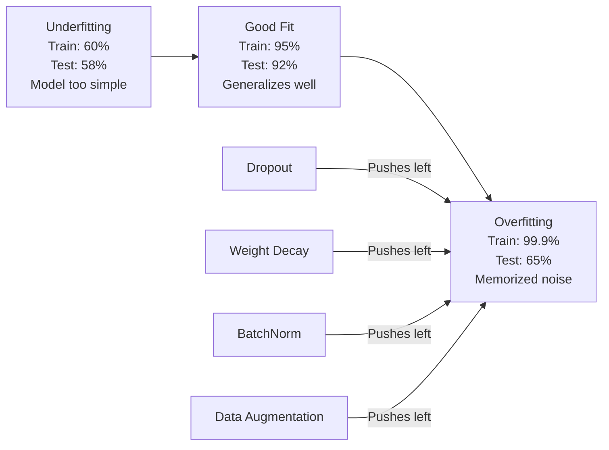
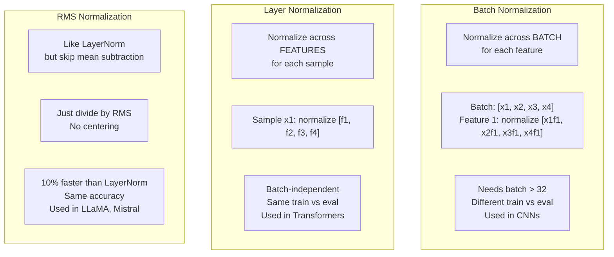
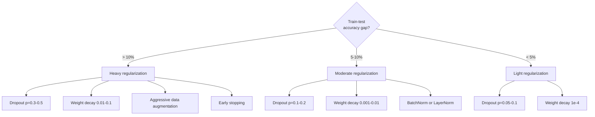

# 정규화 (Regularization)

> 모델이 훈련 데이터에서는 99%를 기록하지만 테스트 데이터에서는 60%에 그칩니다. 모델이 학습한 것이 아니라 암기한 것입니다. 정규화는 일반화(generalization)를 강제하기 위해 모델의 복잡도에 부과하는 세금과 같습니다.

**유형:** Build (실습)
**사용 언어:** Python
**선수 레슨:** Lesson 03.06 (Optimizers)
**소요 시간:** ~75분

## 학습 목표

- 역스케일링(inverted scaling)이 적용된 드롭아웃(dropout), L2 가중치 감쇠(weight decay), 배치 정규화(batch normalization), 레이어 정규화(layer normalization), RMSNorm을 밑바닥부터 구현합니다.
- 훈련-테스트 정확도 격차를 측정하고 정규화 실험을 통해 과적합(overfitting)을 진단합니다.
- 트랜스포머(Transformer)가 BatchNorm 대신 LayerNorm을 사용하는 이유와 최신 LLM이 RMSNorm을 선호하는 이유를 설명합니다.
- 과적합의 심각도에 따라 적절한 정규화 기법의 조합을 적용합니다.

## 문제 정의

충분한 매개변수를 가진 신경망은 어떤 데이터셋이든 암기할 수 있습니다. 이는 가설이 아닙니다. Zhang et al. (2017)은 무작위 레이블이 지정된 ImageNet 데이터셋으로 표준 신경망을 훈련하여 이를 증명했습니다. 신경망은 완전히 무작위로 할당된 레이블에 대해 0에 가까운 훈련 손실을 달성했습니다. 학습할 패턴이 전혀 없는 백만 개의 무작위 입출력 쌍을 그대로 암기해 버린 것입니다. 훈련 손실은 완벽했지만 테스트 정확도는 0이었습니다.

이것이 바로 과적합 문제이며, 모델이 커질수록 더욱 심각해집니다. GPT-3는 1,750억 개의 매개변수를 가집니다. 훈련 세트는 약 5,000억 개의 토큰으로 구성됩니다. 이렇게 많은 매개변수가 있으면 모델은 훈련 데이터의 상당 부분을 그대로 암기할 수 있는 충분한 용량을 갖추게 됩니다. 정규화가 없다면 모델은 일반화 가능한 패턴을 학습하는 대신 훈련 예시를 그대로 읊어대기만 할 것입니다.

훈련 성능과 테스트 성능 사이의 격차를 과적합 격차(overfitting gap)라고 합니다. 이번 레슨의 모든 기법은 서로 다른 각도에서 이 격차를 줄이고자 합니다. 드롭아웃은 신경망이 특정 단일 뉴런에 의존하지 않도록 강제합니다. 가중치 감쇠는 개별 가중치가 지나치게 커지는 것을 방지합니다. 배치 정규화는 손실 지형(loss landscape)을 매끄럽게 만들어 옵티마이저가 더 평평하고 일반화하기 쉬운 최솟값(minima)을 찾도록 돕습니다. 레이어 정규화는 동일한 작업을 수행하면서도 배치 정규화가 실패하는 환경(작은 배치 크기, 가변 길이 시퀀스)에서도 잘 동작합니다. RMSNorm은 평균 계산을 생략하여 이를 10% 더 빠르게 수행합니다. 각각의 기법은 단순합니다. 하지만 이들이 결합되면 단순 암기 모델과 일반화 모델을 가르는 결정적인 차이를 만들어 냅니다.

## 핵심 개념

### 과적합 스펙트럼

모든 모델은 과소적합(underfitting, 패턴을 포착하기에 너무 단순함)부터 과적합(노이즈까지 포착할 정도로 너무 복잡함)에 이르는 스펙트럼 어딘가에 위치합니다. 가장 이상적인 지점은 그 중간이며, 정규화는 과적합된 모델을 이 중간 지점으로 밀어 넣는 역할을 합니다.



### 드롭아웃 (Dropout)

가장 단순하면서도 가장 우아한 해석을 가진 정규화 기법입니다. 훈련 중에 확률 $p$로 각 뉴런의 출력을 무작위로 0으로 설정합니다.

```math
\text{output} = \text{activation}(z) \cdot \text{mask} \quad \text{where }\text{mask}[i] \sim \text{Bernoulli}(1 - p)
```

$p = 0.5$일 때, 매 순전파(forward pass)마다 뉴런의 절반이 0으로 바뀝니다. 신경망은 어떤 뉴런을 사용할 수 있을지 예측할 수 없으므로 중복된 표현(redundant representation)을 학습해야만 합니다. 이는 동시 적응(co-adaptation), 즉 뉴런들이 서로 특정 뉴런의 존재에 의존하도록 학습되는 현상을 방지합니다.

앙상블 관점에서의 해석: $N$개의 뉴런을 가진 신경망에 드롭아웃을 적용하면 $2^N$개의 가능한 서브네트워크(각 뉴런의 활성화/비활성화 조합)가 생성됩니다. 드롭아웃을 적용한 훈련은 서로 다른 미니배치에서 이 $2^N$개의 서브네트워크를 사실상 동시에 훈련하는 것과 같습니다. 테스트 시에는 모든 뉴런을 사용하고(드롭아웃 미적용), 훈련 중의 기댓값과 일치하도록 출력을 $(1 - p)$로 스케일링합니다. 이는 $2^N$개 서브네트워크의 예측을 평균 내는 것과 같으며, 단일 모델로부터 거대한 앙상블 효과를 얻는 셈입니다.

실제로는 테스트 대신 훈련 중에 스케일링을 적용합니다(역드롭아웃, inverted dropout):

```math
\begin{aligned}
\text{During training:} \quad & \text{output} = \text{activation}(z) \cdot \text{mask} / (1 - p) \\
\text{During testing:} \quad & \text{output} = \text{activation}(z) \quad \text{(no change needed)}
\end{aligned}
```

이렇게 하면 테스트 코드가 드롭아웃의 존재를 전혀 알 필요가 없으므로 구현이 훨씬 깔끔해집니다.

기본 드롭아웃 비율: 트랜스포머는 p = 0.1, MLP는 p = 0.5, CNN은 p = 0.2~0.3을 주로 사용합니다. 드롭아웃 비율이 높을수록 정규화가 강해지며, 과소적합의 위험도 커집니다.

### 가중치 감쇠 (L2 Regularization)

모든 가중치의 제곱 크기를 손실 함수에 더합니다:

```math
\text{total\_loss} = \text{task\_loss} + \frac{\lambda}{2} \sum_i w_i^2
```

정규화 항의 그래디언트는 $\lambda w$입니다. 이는 매 스텝마다 각 가중치가 자신의 크기에 비례하는 비율만큼 0을 향해 줄어든다는 것을 의미합니다. 가중치가 클수록 더 큰 페널티를 받습니다. 결과적으로 모델은 특정 가중치 하나가 지배적이지 않은 해(solution)를 찾도록 유도됩니다.

이것이 일반화에 도움이 되는 이유: 과적합된 모델은 훈련 데이터의 노이즈를 증폭시키는 큰 가중치를 갖는 경향이 있습니다. 가중치 감쇠는 가중치를 작게 유지하여 모델의 유효 용량을 제한하고, 암기된 특이점보다는 견고하고 일반화 가능한 특징에 의존하도록 강제합니다.

$\lambda$ 하이퍼파라미터는 정규화 강도를 제어합니다. 일반적인 값은 다음과 같습니다:

- 트랜스포머의 AdamW: 0.01
- CNN의 SGD: 1e-4
- 심하게 과적합된 모델: 0.1

레슨 06에서 다루었듯이, 가중치 감쇠와 L2 정규화는 SGD에서는 동일하지만 Adam에서는 다릅니다. Adam으로 훈련할 때는 항상 AdamW(분리된 가중치 감쇠, decoupled weight decay)를 사용하세요.

### 배치 정규화 (Batch Normalization)

각 레이어의 출력을 다음 레이어로 전달하기 전에 미니배치 전체에 대해 정규화합니다.

특정 레이어의 미니배치 활성화 값에 대해:

```math
\begin{aligned}
\mu &= \frac{1}{B} \sum_i x_i && \text{(batch mean)} \\
\sigma^2 &= \frac{1}{B} \sum_i (x_i - \mu)^2 && \text{(batch variance)} \\
\hat{x} &= \frac{x_i - \mu}{\sqrt{\sigma^2 + \epsilon}} && \text{(normalize)} \\
y &= \gamma \hat{x} + \beta && \text{(scale and shift)}
\end{aligned}
```

감마(gamma)와 베타(beta)는 정규화를 되돌리는 것이 최적일 경우 신경망이 이를 복원할 수 있도록 하는 학습 가능한 매개변수입니다. 이 매개변수들이 없다면 모든 레이어의 출력이 강제로 평균 0, 분산 1이 되는데, 이는 신경망이 원하는 방향이 아닐 수 있습니다.

**훈련과 추론(inference)의 차이:** 훈련 중에는 $\mu$와 $\sigma$가 현재 미니배치로부터 계산됩니다. 추론 중에는 훈련 중에 누적된 이동 평균(momentum = 0.1인 지수 이동 평균, 즉 기존 90% + 신규 10%)을 사용합니다.

BatchNorm이 효과적인 이유는 여전히 논쟁거리입니다. 원 논문에서는 "내부 공변량 변화(internal covariate shift)"(이전 레이어가 업데이트됨에 따라 레이어 입력의 분포가 변하는 현상)를 줄여준다고 주장했습니다. 그러나 Santurkar et al. (2018)은 이 설명이 틀렸음을 입증했습니다. 실제 이유는 BatchNorm이 손실 지형을 더 매끄럽게 만들기 때문입니다. 그래디언트의 예측 가능성이 높아지고 립시츠 상수(Lipschitz constant)가 작아져 옵티마이저가 더 큰 보폭을 안전하게 취할 수 있게 됩니다. 이것이 바로 BatchNorm을 사용하면 더 높은 학습률을 적용하여 빠르게 수렴할 수 있는 이유입니다.

BatchNorm에는 근본적인 한계가 있습니다. 바로 배치 통계량에 의존한다는 점입니다. 배치 크기가 1이면 평균과 분산은 아무런 의미를 갖지 못합니다. 작은 배치 크기(< 32)에서는 통계량에 노이즈가 심해져 성능이 저하됩니다. 이는 메모리 제약으로 배치 크기가 제한되는 객체 탐지(object detection)나 시퀀스 길이가 가변적인 언어 모델링(language modeling)과 같은 작업에서 심각한 문제가 됩니다.

### 레이어 정규화 (Layer Normalization)

배치 전체가 아닌 특성(feature) 차원을 따라 정규화합니다. 단일 샘플에 대해 다음과 같이 계산합니다:

```math
\begin{aligned}
\mu &= \frac{1}{D} \sum_j x_j && \text{(feature mean)} \\
\sigma^2 &= \frac{1}{D} \sum_j (x_j - \mu)^2 && \text{(feature variance)} \\
\hat{x} &= \frac{x_j - \mu}{\sqrt{\sigma^2 + \epsilon}} \\
y &= \gamma \hat{x} + \beta
\end{aligned}
```

$D$는 특성 차원의 크기입니다. 각 샘플은 배치 크기에 구애받지 않고 독립적으로 정규화됩니다. 트랜스포머가 BatchNorm 대신 LayerNorm을 사용하는 이유가 바로 여기에 있습니다. 시퀀스는 길이가 가변적이고 배치 크기가 작은 경우가 많으며(생성 시점에는 1), 훈련과 추론 시의 계산 방식이 완전히 동일하기 때문입니다.

트랜스포머에서 LayerNorm은 각 셀프 어텐션(self-attention) 블록과 피드포워드(feed-forward) 블록 뒤에 적용되거나(Post-LN), 블록 앞에 적용됩니다(Pre-LN, 훈련 안정성이 더 우수함).
### RMSNorm

평균 감산(mean subtraction)을 생략한 LayerNorm입니다. Zhang & Sennrich(2019)가 제안했습니다.

```math
\begin{aligned}
\text{rms} &= \sqrt{\frac{1}{D} \sum_j x_j^2} \\
y &= \gamma \cdot \frac{x}{\text{rms}}
\end{aligned}
```

이것이 전부입니다. 평균 계산도 없고, beta 파라미터도 없습니다. LayerNorm의 재중심화(평균 감산)가 모델 성능에 거의 기여하지 않으면서도 계산 비용을 소모한다는 관찰에 기반합니다. 이를 제거하면 약 10%의 오버헤드를 줄이면서 동일한 정확도를 얻을 수 있습니다.

LLaMA, LLaMA 2, LLaMA 3, Mistral을 비롯한 대부분의 최신 LLM은 LayerNorm 대신 RMSNorm을 사용합니다. 수십억 개의 파라미터와 수조 개의 토큰 규모에서는 이 10%의 절감이 상당한 차이를 만듭니다.

### Normalization Comparison



### 정규화로서의 데이터 증강

모델을 수정하는 것이 아니라 데이터를 수정하는 방식입니다. 레이블을 유지하면서 훈련 입력을 변환합니다.

- 이미지: 무작위 자르기(random crop), 뒤집기(flip), 회전(rotation), 색상 왜곡(color jitter), 컷아웃(cutout)
- 텍스트: 유의어 대체(synonym replacement), 역번역(back-translation), 무작위 삭제(random deletion)
- 오디오: 시간 왜곡(time stretch), 피치 변경(pitch shift), 노이즈 추가(noise addition)

그 효과는 정규화와 동일합니다. 훈련 세트의 유효 크기를 늘려 모델이 특정 예시를 단순 암기하기 어렵게 만듭니다. 각 이미지를 원본 형태로 단 한 번만 보는 모델은 이를 암기할 수 있습니다. 반면 각 이미지의 증강된 버전을 50개씩 보는 모델은 불변하는 구조(invariant structure)를 학습해야만 합니다.

### 조기 종료(Early Stopping)

가장 단순한 정규화 기법입니다. 검증 손실(validation loss)이 증가하기 시작할 때 훈련을 중단합니다. 그 시점에서는 모델이 아직 과적합되지 않은 상태입니다. 실제로는 매 에포크마다 검증 손실을 추적하고, 가장 성능이 좋은 모델을 저장하며, "인내(patience)" 구간(일반적으로 5~20 에포크) 동안 훈련을 계속합니다. 인내 구간 내에 검증 손실이 개선되지 않으면 훈련을 멈추고 저장된 최선의 모델을 불러옵니다.

### 적용 가이드



```figure
l2-regularization
```

## 직접 구현하기

### 1단계: Dropout (훈련 및 평가 모드)

```python
import random
import math


class Dropout:
    def __init__(self, p=0.5):
        self.p = p
        self.training = True
        self.mask = None

    def forward(self, x):
        if not self.training:
            return list(x)
        self.mask = []
        output = []
        for val in x:
            if random.random() < self.p:
                self.mask.append(0)
                output.append(0.0)
            else:
                self.mask.append(1)
                output.append(val / (1 - self.p))
        return output

    def backward(self, grad_output):
        grads = []
        for g, m in zip(grad_output, self.mask):
            if m == 0:
                grads.append(0.0)
            else:
                grads.append(g / (1 - self.p))
        return grads
```

### 2단계: L2 가중치 감쇠

```python
def l2_regularization(weights, lambda_reg):
    penalty = 0.0
    for w in weights:
        penalty += w * w
    return lambda_reg * 0.5 * penalty

def l2_gradient(weights, lambda_reg):
    return [lambda_reg * w for w in weights]
```

### 3단계: 배치 정규화

```python
class BatchNorm:
    def __init__(self, num_features, momentum=0.1, eps=1e-5):
        self.gamma = [1.0] * num_features
        self.beta = [0.0] * num_features
        self.eps = eps
        self.momentum = momentum
        self.running_mean = [0.0] * num_features
        self.running_var = [1.0] * num_features
        self.training = True
        self.num_features = num_features

    def forward(self, batch):
        batch_size = len(batch)
        if self.training:
            mean = [0.0] * self.num_features
            for sample in batch:
                for j in range(self.num_features):
                    mean[j] += sample[j]
            mean = [m / batch_size for m in mean]

            var = [0.0] * self.num_features
            for sample in batch:
                for j in range(self.num_features):
                    var[j] += (sample[j] - mean[j]) ** 2
            var = [v / batch_size for v in var]

            for j in range(self.num_features):
                self.running_mean[j] = (1 - self.momentum) * self.running_mean[j] + self.momentum * mean[j]
                self.running_var[j] = (1 - self.momentum) * self.running_var[j] + self.momentum * var[j]
        else:
            mean = list(self.running_mean)
            var = list(self.running_var)

        self.x_hat = []
        output = []
        for sample in batch:
            normalized = []
            out_sample = []
            for j in range(self.num_features):
                x_h = (sample[j] - mean[j]) / math.sqrt(var[j] + self.eps)
                normalized.append(x_h)
                out_sample.append(self.gamma[j] * x_h + self.beta[j])
            self.x_hat.append(normalized)
            output.append(out_sample)
        return output
```

### 4단계: 레이어 정규화

```python
class LayerNorm:
    def __init__(self, num_features, eps=1e-5):
        self.gamma = [1.0] * num_features
        self.beta = [0.0] * num_features
        self.eps = eps
        self.num_features = num_features

    def forward(self, x):
        mean = sum(x) / len(x)
        var = sum((xi - mean) ** 2 for xi in x) / len(x)

        self.x_hat = []
        output = []
        for j in range(self.num_features):
            x_h = (x[j] - mean) / math.sqrt(var + self.eps)
            self.x_hat.append(x_h)
            output.append(self.gamma[j] * x_h + self.beta[j])
        return output
```

### 5단계: RMSNorm

```python
class RMSNorm:
    def __init__(self, num_features, eps=1e-6):
        self.gamma = [1.0] * num_features
        self.eps = eps
        self.num_features = num_features

    def forward(self, x):
        rms = math.sqrt(sum(xi * xi for xi in x) / len(x) + self.eps)
        output = []
        for j in range(self.num_features):
            output.append(self.gamma[j] * x[j] / rms)
        return output
```

### 6단계: 정규화 적용 여부에 따른 훈련 비교

```python
def sigmoid(x):
    x = max(-500, min(500, x))
    return 1.0 / (1.0 + math.exp(-x))


def make_circle_data(n=200, seed=42):
    random.seed(seed)
    data = []
    for _ in range(n):
        x = random.uniform(-2, 2)
        y = random.uniform(-2, 2)
        label = 1.0 if x * x + y * y < 1.5 else 0.0
        data.append(([x, y], label))
    return data


class RegularizedNetwork:
    def __init__(self, hidden_size=16, lr=0.05, dropout_p=0.0, weight_decay=0.0):
        random.seed(0)
        self.hidden_size = hidden_size
        self.lr = lr
        self.dropout_p = dropout_p
        self.weight_decay = weight_decay
        self.dropout = Dropout(p=dropout_p) if dropout_p > 0 else None

        self.w1 = [[random.gauss(0, 0.5) for _ in range(2)] for _ in range(hidden_size)]
        self.b1 = [0.0] * hidden_size
        self.w2 = [random.gauss(0, 0.5) for _ in range(hidden_size)]
        self.b2 = 0.0

    def forward(self, x, training=True):
        self.x = x
        self.z1 = []
        self.h = []
        for i in range(self.hidden_size):
            z = self.w1[i][0] * x[0] + self.w1[i][1] * x[1] + self.b1[i]
            self.z1.append(z)
            self.h.append(max(0.0, z))

        if self.dropout and training:
            self.dropout.training = True
            self.h = self.dropout.forward(self.h)
        elif self.dropout:
            self.dropout.training = False
            self.h = self.dropout.forward(self.h)

        self.z2 = sum(self.w2[i] * self.h[i] for i in range(self.hidden_size)) + self.b2
        self.out = sigmoid(self.z2)
        return self.out

    def backward(self, target):
        eps = 1e-15
        p = max(eps, min(1 - eps, self.out))
        d_loss = -(target / p) + (1 - target) / (1 - p)
        d_sigmoid = self.out * (1 - self.out)
        d_out = d_loss * d_sigmoid

        for i in range(self.hidden_size):
            d_relu = 1.0 if self.z1[i] > 0 else 0.0
            d_h = d_out * self.w2[i] * d_relu
            self.w2[i] -= self.lr * (d_out * self.h[i] + self.weight_decay * self.w2[i])
            for j in range(2):
                self.w1[i][j] -= self.lr * (d_h * self.x[j] + self.weight_decay * self.w1[i][j])
            self.b1[i] -= self.lr * d_h
        self.b2 -= self.lr * d_out

    def evaluate(self, data):
        correct = 0
        total_loss = 0.0
        for x, y in data:
            pred = self.forward(x, training=False)
            eps = 1e-15
            p = max(eps, min(1 - eps, pred))
            total_loss += -(y * math.log(p) + (1 - y) * math.log(1 - p))
            if (pred >= 0.5) == (y >= 0.5):
                correct += 1
        return total_loss / len(data), correct / len(data) * 100

    def train_model(self, train_data, test_data, epochs=300):
        history = []
        for epoch in range(epochs):
            total_loss = 0.0
            correct = 0
            for x, y in train_data:
                pred = self.forward(x, training=True)
                self.backward(y)
                eps = 1e-15
                p = max(eps, min(1 - eps, pred))
                total_loss += -(y * math.log(p) + (1 - y) * math.log(1 - p))
                if (pred >= 0.5) == (y >= 0.5):
                    correct += 1
            train_loss = total_loss / len(train_data)
            train_acc = correct / len(train_data) * 100
            test_loss, test_acc = self.evaluate(test_data)
            history.append((train_loss, train_acc, test_loss, test_acc))
            if epoch % 75 == 0 or epoch == epochs - 1:
                gap = train_acc - test_acc
                print(f"    Epoch {epoch:3d}: train_acc={train_acc:.1f}%, test_acc={test_acc:.1f}%, gap={gap:.1f}%")
        return history
```

## 사용하기

PyTorch는 모든 정규화 기법을 모듈 형태로 제공합니다.

```python
import torch
import torch.nn as nn

model = nn.Sequential(
    nn.Linear(784, 256),
    nn.BatchNorm1d(256),
    nn.ReLU(),
    nn.Dropout(0.3),
    nn.Linear(256, 128),
    nn.BatchNorm1d(128),
    nn.ReLU(),
    nn.Dropout(0.3),
    nn.Linear(128, 10),
)

model.train()
out_train = model(torch.randn(32, 784))

model.eval()
out_test = model(torch.randn(1, 784))
```

`model.train()` / `model.eval()` 전환은 매우 중요합니다. 이 설정은 dropout을 켜고 끄며, BatchNorm에 배치 통계량을 사용할지 이동 평균(running statistics)을 사용할지 지시합니다. 추론(inference) 전에 `model.eval()` 설정을 잊는 것은 딥러닝에서 가장 흔한 버그 중 하나입니다. dropout이 여전히 활성화되어 있고 BatchNorm이 미니배치 통계량을 사용하기 때문에 테스트 정확도가 무작위로 요동치게 됩니다.

Transformer의 경우 패턴이 다릅니다.

```python
class TransformerBlock(nn.Module):
    def __init__(self, d_model=512, nhead=8, dropout=0.1):
        super().__init__()
        self.attention = nn.MultiheadAttention(d_model, nhead, dropout=dropout)
        self.norm1 = nn.LayerNorm(d_model)
        self.ff = nn.Sequential(
            nn.Linear(d_model, d_model * 4),
            nn.GELU(),
            nn.Linear(d_model * 4, d_model),
            nn.Dropout(dropout),
        )
        self.norm2 = nn.LayerNorm(d_model)
        self.dropout = nn.Dropout(dropout)

    def forward(self, x):
        attended, _ = self.attention(x, x, x)
        x = self.norm1(x + self.dropout(attended))
        x = self.norm2(x + self.ff(x))
        return x
```

BatchNorm 대신 LayerNorm을 사용합니다. Dropout은 p=0.5가 아닌 p=0.1을 사용합니다. 이것이 Transformer의 기본값입니다.

## 배포하기

이 레슨의 결과물:
- `outputs/prompt-regularization-advisor.md` -- 과적합을 진단하고 적절한 정규화 전략을 추천하는 프롬프트

## 연습 문제

1. 2D 데이터용 spatial dropout을 구현하세요. 개별 뉴런을 드롭하는 대신 전체 피처 채널을 드롭합니다. 연속된 피처 그룹을 채널로 간주하고 전체 그룹을 드롭하여 이를 시뮬레이션하세요. hidden_size=32인 circle 데이터셋에서 표준 dropout과 훈련-테스트 격차를 비교하세요.

2. 레슨 05의 레이블 스무딩(label smoothing)과 이번 레슨의 dropout을 결합하여 구현하세요. 둘 다 적용 안 함, dropout만 적용, 레이블 스무딩만 적용, 둘 다 적용의 네 가지 구성으로 훈련하세요. 각 구성의 최종 훈련-테스트 정확도 격차를 측정하세요. 어떤 조합이 가장 작은 격차를 만듭니까?

3. circle 데이터셋 네트워크의 은닉층과 활성화 함수 사이에 BatchNorm 레이어를 추가하세요. 학습률 0.01, 0.05, 0.1에서 BatchNorm 적용 여부에 따라 각각 훈련하세요. 일반 네트워크가 발산하는 높은 학습률에서도 BatchNorm을 적용하면 안정적인 훈련이 가능함을 확인하세요.

4. 조기 종료를 구현하세요. 매 에포크마다 테스트 손실을 추적하고, 가장 우수한 가중치를 저장하며, 테스트 손실이 20 에포크 동안 개선되지 않으면 중단합니다. 정규화된 네트워크를 1000 에포크 동안 실행하세요. 어느 에포크에서 최고의 테스트 정확도를 얻었는지, 몇 에포크 분량의 계산을 절약했는지 기록하세요.

5. 2개 층이 아닌 4개 층 네트워크에서 LayerNorm과 RMSNorm을 비교하세요. 두 모델을 동일한 가중치로 초기화합니다. 200 에포크 동안 훈련하고 최종 정확도, 훈련 속도(에포크당 시간), 첫 번째 레이어의 그래디언트 크기를 비교하세요. RMSNorm이 동일한 정확도를 유지하면서 더 빠른지 검증하세요.

## 핵심 용어

| 용어 | 일반적인 표현 | 실제 의미 |
|------|----------------|----------------------|
| 과적합(Overfitting) | "모델이 데이터를 암기했다" | 모델의 훈련 성능이 테스트 성능을 크게 앞서는 상태로, 신호(signal)가 아닌 노이즈(noise)를 학습했음을 의미 |
| 정규화(Regularization) | "과적합 방지" | 일반화(generalization) 성능을 높이기 위해 모델 복잡도를 제한하는 모든 기법: dropout, 가중치 감쇠, 정규화(normalization), 데이터 증강 |
| 드롭아웃(Dropout) | "무작위 뉴런 삭제" | 훈련 중 확률 $p$로 뉴런을 무작위로 0으로 만들어 중복 표현(redundant representation) 학습을 유도하는 기법으로, 앙상블을 훈련하는 것과 동등함 |
| 가중치 감쇠(Weight decay) | "L2 페널티" | 매 스텝마다 $\lambda w$을 빼서 모든 가중치를 0 쪽으로 축소하는 기법으로, 가중치 크기를 통해 복잡도에 페널티를 부여함 |
| 배치 정규화(Batch normalization) | "배치 단위 정규화" | 훈련 중에는 배치 통계량을 사용하고 추론 중에는 이동 평균을 사용하여 배치 차원을 따라 레이어 출력을 정규화하는 기법 |
| 레이어 정규화(Layer normalization) | "샘플 단위 정규화" | 각 샘플 내의 피처 전체에 대해 정규화하는 기법으로, 배치 크기에 독립적이며 배치 크기가 가변적인 Transformer에서 사용됨 |
| RMSNorm | "평균 없는 LayerNorm" | 제곱평균제곱근(Root Mean Square) 정규화 기법으로, LayerNorm에서 평균 감산을 생략하여 동일한 정확도로 10%의 속도 향상을 얻음 |
| 조기 종료(Early stopping) | "과적합되기 전에 중단" | 검증 손실이 더 이상 개선되지 않을 때 훈련을 중단하는 기법으로, 가장 단순한 정규화 방식이며 흔히 다른 기법과 함께 사용됨 |
| 데이터 증강(Data augmentation) | "적은 데이터로 많은 데이터를 만듦" | 훈련 입력을 변환(뒤집기, 자르기, 노이즈)하여 유효 데이터셋 크기를 늘리고 불변성 학습을 유도하는 기법 |
| 일반화 격차(Generalization gap) | "훈련-테스트 차이" | 훈련 성능과 테스트 성능 사이의 차이로, 정규화는 이 격차를 최소화하는 것을 목표로 함 |

## 더 읽을거리

- Srivastava et al., "Dropout: A Simple Way to Prevent Neural Networks from Overfitting" (2014) -- 앙상블 관점의 해석과 광범위한 실험을 담은 원본 dropout 논문
- Ioffe & Szegedy, "Batch Normalization: Accelerating Deep Network Training by Reducing Internal Covariate Shift" (2015) -- BatchNorm과 그 훈련 절차를 소개한, 가장 많이 인용되는 딥러닝 논문 중 하나
- Zhang & Sennrich, "Root Mean Square Layer Normalization" (2019) -- RMSNorm이 계산량을 줄이면서도 LayerNorm 수준의 정확도를 낸다는 것을 보인 논문으로, LLaMA 및 Mistral에 채택됨
- Zhang et al., "Understanding Deep Learning Requires Rethinking Generalization" (2017) -- 신경망이 무작위 레이블도 암기할 수 있음을 보여주며 일반화에 대한 기존 관점에 의문을 제기한 기념비적 논문
