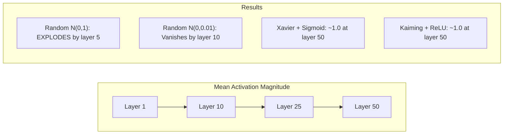
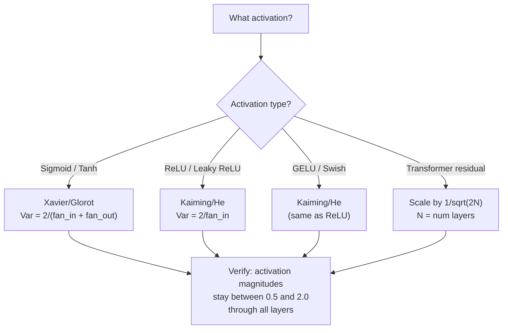

# 가중치 초기화와 학습 안정성

> 잘못 초기화하면 학습이 아예 시작되지 않습니다. 올바르게 초기화하면 50개 층도 3개 층처럼 매끄럽게 학습됩니다.

**유형:** Build (실습)
**사용 언어:** Python
**선수 레슨:** Lesson 03.04 (Activation Functions), Lesson 03.07 (Regularization)
**소요 시간:** ~90분

## 학습 목표

- 제로(zero), 무작위(random), Xavier/Glorot, Kaiming/He 초기화 전략을 구현하고, 50개 층에 걸친 활성화 크기(activation magnitude)에 미치는 영향을 측정합니다.
- Xavier 초기화가 Var(w) = 2/(fan_in + fan_out)을 사용하고 Kaiming 초기화가 Var(w) = 2/fan_in을 사용하는 이유를 유도합니다.
- 제로 초기화에서 발생하는 대칭성 문제(symmetry problem)를 시연하고, 무작위 스케일만으로는 충분하지 않은 이유를 설명합니다.
- 활성화 함수에 맞는 올바른 초기화 전략을 연결합니다: sigmoid/tanh에는 Xavier, ReLU/GELU에는 Kaiming.

## 문제 정의

모든 가중치를 0으로 초기화해 보십시오. 아무것도 학습되지 않습니다. 모든 뉴런이 동일한 함수를 계산하고, 동일한 그래디언트(gradient)를 전달받으며, 동일하게 업데이트됩니다. 10,000 에포크(epoch)가 지난 후에도 512개 뉴런으로 구성된 은닉층(hidden layer)은 여전히 똑같은 뉴런 512개의 복사본일 뿐입니다. 512개 파라미터의 비용을 지불하고 고작 1개를 얻은 셈입니다.

가중치를 너무 크게 초기화해 보십시오. 활성화 값이 네트워크를 통과하며 폭발(explode)합니다. 10번째 층에 이르면 값이 1e15에 도달하고, 20번째 층에서는 무한대(infinity)로 오버플로됩니다. 역방향으로 흐르는 그래디언트 역시 동일한 궤적을 따릅니다.

표준정규분포에서 무작위로 추출하여 초기화해 보십시오. 3개 층에서는 잘 작동합니다. 하지만 50개 층에 이르면 무작위 스케일이 아주 조금 작거나 큰 것에 따라 신호가 0으로 붕괴하거나 무한대로 폭발합니다. "정상 작동"과 "망가짐"의 경계는 종이 한 장 차이입니다.

가중치 초기화는 딥러닝에서 가장 과소평가된 결정입니다. 아키텍처는 논문으로 다뤄지고, 옵티마이저(optimizer)는 블로그 글로 소개되지만, 초기화는 각주 정도로만 취급됩니다. 그러나 초기화가 잘못되면 다른 것은 아무런 의미가 없습니다. 학습이 시작되기도 전에 네트워크가 죽어버리기 때문입니다.

## 핵심 개념

### 대칭성 문제

한 층에 있는 모든 뉴런은 동일한 구조를 가집니다. 입력을 가중치와 곱하고, 편향(bias)을 더한 뒤, 활성화 함수를 적용합니다. 모든 가중치가 동일한 값(0이 극단적인 예입니다)으로 시작하면, 모든 뉴런이 동일한 출력을 계산합니다. 역전파(backpropagation) 과정에서 모든 뉴런은 동일한 그래디언트를 받게 되며, 업데이트 단계에서도 모든 뉴런이 동일한 크기만큼 변경됩니다.

진퇴양난에 빠지게 됩니다. 네트워크에 수백 개의 파라미터가 있지만 모두가 완전히 동일하게 움직입니다. 이를 대칭성(symmetry) 문제라고 하며, 무작위 초기화는 이를 깨뜨리기 위한 가장 직관적인 해결책입니다. 각 뉴런이 가중치 공간의 서로 다른 지점에서 출발하므로 각자 다른 특징(feature)을 학습할 수 있게 됩니다.

그러나 단순히 "무작위"인 것만으로는 충분하지 않습니다. 무작위성의 *스케일(scale)*이 네트워크의 학습 성패를 결정합니다.

### 층을 통과하는 분산의 전파

fan_in개의 입력을 가진 단일 층을 생각해 보겠습니다:

```math
z = w_1 x_1 + w_2 x_2 + \cdots + w_n x_n
```

각 가중치 $w_i$가 분산 $\mathrm{Var}(w)$을 갖는 분포에서 추출되고 각 입력 $x_i$가 분산 $\mathrm{Var}(x)$를 갖는다면, 출력의 분산은 다음과 같습니다:

```math
\mathrm{Var}(z) = \text{fan}_{\text{in}} \cdot \mathrm{Var}(w) \cdot \mathrm{Var}(x)
```

만약 $\mathrm{Var}(w) = 1$이고 $\text{fan}_{\text{in}} = 512$라면, 출력 분산은 입력 분산의 512배가 됩니다. 10개 층을 통과하면 $512^{10} = 1.2 \times 10^{27}$가 됩니다. 신호가 폭발해 버린 것입니다.

만약 $\mathrm{Var}(w) = 0.001$라면, 출력 분산은 층마다 $0.001 \cdot 512 = 0.512$씩 줄어듭니다. 10개 층을 통과하면 $0.512^{10} = 0.00013$가 됩니다. 신호가 소멸한 것입니다.

목표는 $\mathrm{Var}(z) = \mathrm{Var}(x)$이 되도록 $\mathrm{Var}(w)$를 선택하는 것입니다. 이렇게 하면 신호의 크기가 여러 층을 거쳐도 일정하게 유지됩니다.

### Xavier/Glorot 초기화

Glorot과 Bengio(2010)는 sigmoid 및 tanh 활성화 함수를 위한 해법을 유도했습니다. 순전파(forward pass)와 역전파(backward pass) 모두에서 분산을 일정하게 유지하려면 다음과 같아야 합니다:

```math
\mathrm{Var}(w) = \frac{2}{\text{fan}_{\text{in}} + \text{fan}_{\text{out}}}
```

실제로는 가중치를 다음 분포에서 추출합니다:

```math
w \sim \text{Uniform}(-\text{limit}, \text{limit}) \quad \text{where } \text{limit} = \sqrt{\frac{6}{\text{fan}_{\text{in}} + \text{fan}_{\text{out}}}}
```

또는:

```math
w \sim \text{Normal}\left(0, \sqrt{\frac{2}{\text{fan}_{\text{in}} + \text{fan}_{\text{out}}}}\right)
```

이것이 잘 작동하는 이유는 올바르게 초기화된 활성화 값이 위치하는 0 근처에서 sigmoid와 tanh가 거의 선형(linear)에 가깝기 때문입니다. 덕분에 수십 개의 층을 거쳐도 분산이 안정적으로 유지됩니다.

### Kaiming/He 초기화

ReLU는 출력의 절반을 제거합니다(모든 음수 값이 0이 됩니다). 평균적으로 절반의 입력이 0이 되므로 유효 fan_in이 절반으로 줄어듭니다. Xavier 초기화는 이를 고려하지 않으므로 필요한 분산을 과소평가하게 됩니다.

He 등(2015)은 수식을 다음과 같이 조정했습니다:

```math
\mathrm{Var}(w) = \frac{2}{\text{fan}_{\text{in}}}
```

가중치는 다음 분포에서 추출합니다:

```math
w \sim \text{Normal}\left(0, \sqrt{\frac{2}{\text{fan}_{\text{in}}}}\right)
```

계수 2는 ReLU가 활성화 값의 절반을 0으로 만드는 점을 보상합니다. 이 계수가 없으면 신호는 층마다 약 0.5배씩 줄어듭니다. 50개 층을 지나면 $0.5^{50} = 8.8 \times 10^{-16}$가 됩니다. Kaiming 초기화는 이를 방지합니다.

### Transformer 초기화

GPT-2는 다른 방식을 도입했습니다. 잔차 연결(residual connection)은 각 하위 층의 출력을 입력에 더합니다:

```math
x = x + \text{sublayer}(x)
```

덧셈이 일어날 때마다 분산이 증가합니다. $N$개의 잔차 층이 있다면 분산은 $N$에 비례하여 증가합니다. GPT-2는 잔차 층의 가중치를 $1/\sqrt{2N}$로 스케일링하며, 여기서 $N$은 층의 수입니다. 이를 통해 누적된 신호 크기를 안정적으로 유지합니다.

Llama 3(4,050억 개 파라미터, 126개 층)도 유사한 방식을 사용합니다. 이러한 스케일링이 없다면 126개 층의 어텐션(attention) 및 피드포워드(feedforward) 블록을 거치면서 잔차 스트림(residual stream)이 한계 없이 커지게 됩니다.

```mermaid
flowchart TD
    subgraph "Zero Init"
        Z1["Layer 1<br/>All weights = 0"] --> Z2["Layer 2<br/>All neurons identical"]
        Z2 --> Z3["Layer 3<br/>Still identical"]
        Z3 --> ZR["Result: 1 effective neuron<br/>regardless of width"]
    end

    subgraph "Xavier Init"
        X1["Layer 1<br/>Var = 2/(fan_in+fan_out)"] --> X2["Layer 2<br/>Signal stable"]
        X2 --> X3["Layer 50<br/>Signal stable"]
        X3 --> XR["Result: Trains with<br/>sigmoid/tanh"]
    end

    subgraph "Kaiming Init"
        K1["Layer 1<br/>Var = 2/fan_in"] --> K2["Layer 2<br/>Signal stable"]
        K2 --> K3["Layer 50<br/>Signal stable"]
        K3 --> KR["Result: Trains with<br/>ReLU/GELU"]
    end
```



### 50개 층을 통과하는 활성화 크기



### 적절한 초기화 방법 선택하기



```figure
weight-init-variance
```

## 직접 구현해 보기

### 1단계: 초기화 전략

가중치 행렬을 초기화하는 네 가지 방법입니다. 각각 fan_in 열과 fan_out 행을 갖는 이중 리스트(2D 행렬)를 반환합니다.

```python
import math
import random


def zero_init(fan_in, fan_out):
    return [[0.0 for _ in range(fan_in)] for _ in range(fan_out)]


def random_init(fan_in, fan_out, scale=1.0):
    return [[random.gauss(0, scale) for _ in range(fan_in)] for _ in range(fan_out)]


def xavier_init(fan_in, fan_out):
    std = math.sqrt(2.0 / (fan_in + fan_out))
    return [[random.gauss(0, std) for _ in range(fan_in)] for _ in range(fan_out)]


def kaiming_init(fan_in, fan_out):
    std = math.sqrt(2.0 / fan_in)
    return [[random.gauss(0, std) for _ in range(fan_in)] for _ in range(fan_out)]
```

### 2단계: 활성화 함수

각 초기화 전략을 그에 맞는 활성화 함수와 함께 테스트하기 위해 sigmoid, tanh, ReLU가 필요합니다.

```python
def sigmoid(x):
    x = max(-500, min(500, x))
    return 1.0 / (1.0 + math.exp(-x))


def tanh_act(x):
    return math.tanh(x)


def relu(x):
    return max(0.0, x)
```

### 3단계: 50개 층 순전파

무작위 데이터를 깊은 네트워크에 통과시키고 각 층에서의 평균 활성화 크기를 측정합니다.

```python
def forward_deep(init_fn, activation_fn, n_layers=50, width=64, n_samples=100):
    random.seed(42)
    layer_magnitudes = []

    inputs = [[random.gauss(0, 1) for _ in range(width)] for _ in range(n_samples)]

    for layer_idx in range(n_layers):
        weights = init_fn(width, width)
        biases = [0.0] * width

        new_inputs = []
        for sample in inputs:
            output = []
            for neuron_idx in range(width):
                z = sum(weights[neuron_idx][j] * sample[j] for j in range(width)) + biases[neuron_idx]
                output.append(activation_fn(z))
            new_inputs.append(output)
        inputs = new_inputs

        magnitudes = []
        for sample in inputs:
            magnitudes.append(sum(abs(v) for v in sample) / width)
        mean_mag = sum(magnitudes) / len(magnitudes)
        layer_magnitudes.append(mean_mag)

    return layer_magnitudes
```

### 4단계: 실험 실행

모든 조합을 실행합니다: 제로 초기화, 무작위 N(0,1), 무작위 N(0,0.01), Xavier + sigmoid, Xavier + tanh, Kaiming + ReLU. 주요 층에서의 크기를 출력합니다.

```python
def run_experiment():
    configs = [
        ("Zero init + Sigmoid", lambda fi, fo: zero_init(fi, fo), sigmoid),
        ("Random N(0,1) + ReLU", lambda fi, fo: random_init(fi, fo, 1.0), relu),
        ("Random N(0,0.01) + ReLU", lambda fi, fo: random_init(fi, fo, 0.01), relu),
        ("Xavier + Sigmoid", xavier_init, sigmoid),
        ("Xavier + Tanh", xavier_init, tanh_act),
        ("Kaiming + ReLU", kaiming_init, relu),
    ]

    print(f"{'Strategy':<30} {'L1':>10} {'L5':>10} {'L10':>10} {'L25':>10} {'L50':>10}")
    print("-" * 80)

    for name, init_fn, act_fn in configs:
        mags = forward_deep(init_fn, act_fn)
        row = f"{name:<30}"
        for idx in [0, 4, 9, 24, 49]:
            val = mags[idx]
            if val > 1e6:
                row += f" {'EXPLODED':>10}"
            elif val < 1e-6:
                row += f" {'VANISHED':>10}"
            else:
                row += f" {val:>10.4f}"
        print(row)
```

### 5단계: 대칭성 시연

제로 초기화가 동일한 뉴런들을 만들어냄을 보여줍니다.

```python
def symmetry_demo():
    random.seed(42)
    weights = zero_init(2, 4)
    biases = [0.0] * 4

    inputs = [0.5, -0.3]
    outputs = []
    for neuron_idx in range(4):
        z = sum(weights[neuron_idx][j] * inputs[j] for j in range(2)) + biases[neuron_idx]
        outputs.append(sigmoid(z))

    print("\nSymmetry Demo (4 neurons, zero init):")
    for i, out in enumerate(outputs):
        print(f"  Neuron {i}: output = {out:.6f}")
    all_same = all(abs(outputs[i] - outputs[0]) < 1e-10 for i in range(len(outputs)))
    print(f"  All identical: {all_same}")
    print(f"  Effective parameters: 1 (not {len(weights) * len(weights[0])})")
```

### 6단계: 층별 크기 리포트

50개 층에 걸친 활성화 크기를 시각적인 막대 차트로 출력합니다.

```python
def magnitude_report(name, magnitudes):
    print(f"\n{name}:")
    for i, mag in enumerate(magnitudes):
        if i % 5 == 0 or i == len(magnitudes) - 1:
            if mag > 1e6:
                bar = "X" * 50 + " EXPLODED"
            elif mag < 1e-6:
                bar = "." + " VANISHED"
            else:
                bar_len = min(50, max(1, int(mag * 10)))
                bar = "#" * bar_len
            print(f"  Layer {i+1:3d}: {bar} ({mag:.6f})")
```

## 실무 활용

PyTorch는 이를 내장 함수로 제공합니다:

```python
import torch
import torch.nn as nn

layer = nn.Linear(512, 256)

nn.init.xavier_uniform_(layer.weight)
nn.init.xavier_normal_(layer.weight)

nn.init.kaiming_uniform_(layer.weight, nonlinearity='relu')
nn.init.kaiming_normal_(layer.weight, nonlinearity='relu')

nn.init.zeros_(layer.bias)
```

`nn.Linear(512, 256)`를 호출할 때 PyTorch는 기본적으로 Kaiming 균등(uniform) 초기화를 사용합니다. 대부분의 단순한 네트워크가 "별문제 없이 작동"하는 이유가 바로 여기에 있습니다. PyTorch가 이미 올바른 선택을 해두었기 때문입니다. 하지만 커스텀 아키텍처를 구축하거나 20개 이상의 층으로 깊어질 때는 어떤 일이 일어나는지 이해하고 기본값을 직접 변경해야 할 수도 있습니다.

Transformer 모델의 경우, HuggingFace 모델들은 일반적으로 `_init_weights` 메서드에서 초기화를 처리합니다. GPT-2 구현체는 잔차 투영(residual projection)을 $1/\sqrt{N}$로 스케일링합니다. Transformer를 밑바닥부터 직접 구현한다면 이 로직을 직접 추가해야 합니다.

## 결과물 정리

이 레슨에서 제작한 결과물은 다음과 같습니다:
- `outputs/prompt-init-strategy.md` -- 가중치 초기화 문제를 진단하고 올바른 전략을 추천하는 프롬프트
## 연습 문제

1. LeCun 초기화($\mathrm{Var} = 1/\text{fan}_{\text{in}}$, SELU 활성화 함수용으로 설계됨)를 추가합니다. LeCun 초기화 + tanh 조합으로 50개 층(layer) 실험을 실행하고 Xavier + tanh와 비교해 봅니다.

2. GPT-2의 잔차 스케일링(residual scaling)을 구현합니다. 잔차 스트림(residual stream)에 더하기 전에 각 층의 출력에 $1/\sqrt{2N}$을 곱합니다. 스케일링을 적용했을 때와 적용하지 않았을 때 각각 50개 층을 실행하고, 잔차의 크기(magnitude)가 얼마나 빠르게 증가하는지 측정해 봅니다.

3. 네트워크의 층 차원과 활성화 함수 종류를 입력받아 적절한 초기화를 추천하고, 현재 초기화 방식이 문제를 일으킬 가능성이 있다면 경고를 출력하는 "초기화 상태 점검(init health check)" 함수를 작성합니다.

4. $\text{fan} _{\text{in}} = 16$ 대 $\text{fan} _{\text{in}} = 1024$로 실험을 실행합니다. Xavier와 Kaiming은 fan_in에 적응하지만 무작위 초기화는 그렇지 않습니다. 층의 크기가 커질수록 "정상 작동"과 "작동 불능" 사이의 격차가 어떻게 벌어지는지 보여줍니다.

5. 직교 초기화(orthogonal initialization)를 구현합니다(무작위 행렬을 생성하고, 특잇값 분해(SVD)를 계산한 뒤, 직교 행렬 U를 사용). 50개 층을 갖는 ReLU 네트워크에서 Kaiming 초기화와 비교해 봅니다.

## 핵심 용어

| 용어 | 통칭하는 표현 | 실제 의미 |
|------|----------------|----------------------|
| 가중치 초기화(Weight initialization) | "시작 가중치를 무작위로 설정하기" | 네트워크의 학습 가능 여부 자체를 결정짓는 초기 가중치 값 선정 전략 |
| 대칭성 깨기(Symmetry breaking) | "뉴런들을 서로 다르게 만들기" | 뉴런들이 동일한 함수를 계산하는 대신 서로 구별되는 특징을 학습하도록 보장하기 위해 무작위 초기화를 사용하는 것 |
| Fan-in | "뉴런으로 들어오는 입력의 수" | 가중합(weighted sum)에서 입력 분산이 어떻게 누적되는지를 결정하는 유입 연결의 수 |
| Fan-out | "뉴런에서 나가는 출력의 수" | 역전파(backpropagation) 과정에서 기울기(gradient) 분산을 유지하는 데 관여하는 유출 연결의 수 |
| Xavier/Glorot 초기화 | "시그모이드용 초기화" | 시그모이드(sigmoid) 및 tanh 활성화 함수를 통과할 때 분산을 보존하도록 설계된 $\mathrm{Var}(w) = 2/(\text{fan} _{\text{in}} + \text{fan} _{\text{out}})$ |
| Kaiming/He 초기화 | "ReLU용 초기화" | ReLU가 활성화 값의 절반을 0으로 만드는 점을 고려한 $\mathrm{Var}(w) = 2/\text{fan}_{\text{in}}$ |
| 분산 전파(Variance propagation) | "층을 거치며 신호가 커지거나 작아지는 방식" | 가중치 스케일에 따라 활성화 분산이 층별로 어떻게 변하는지에 대한 수학적 분석 |
| 잔차 스케일링(Residual scaling) | "GPT-2의 초기화 트릭" | $N$개의 Transformer 층을 거치며 분산이 증가하는 것을 방지하기 위해 잔차 연결 가중치를 $1/\sqrt{2N}$배로 스케일링하는 기법 |
| 죽은 네트워크(Dead network) | "아무것도 학습되지 않음" | 부적절한 초기화로 인해 모든 기울기가 0이 되거나 모든 활성화 값이 포화(saturate)되어버린 네트워크 |
| 활성화 폭주(Exploding activations) | "값이 무한대로 발산함" | 가중치 분산이 너무 높아 층을 거칠수록 활성화 크기가 지수적으로 증가하는 현상 |

## 추가 참고 자료

- Glorot & Bengio, "Understanding the difficulty of training deep feedforward neural networks" (2010) -- 분산 분석이 포함된 오리지널 Xavier 초기화 논문
- He et al., "Delving Deep into Rectifiers" (2015) -- ReLU 네트워크를 위한 Kaiming 초기화를 소개한 논문
- Radford et al., "Language Models are Unsupervised Multitask Learners" (2019) -- 잔차 스케일링 초기화를 다룬 GPT-2 논문
- Mishkin & Matas, "All You Need is a Good Init" (2016) -- 해석적 공식의 경험적 대안인 층 단위 순차적 단위 분산(layer-sequential unit-variance) 초기화를 제안한 논문
