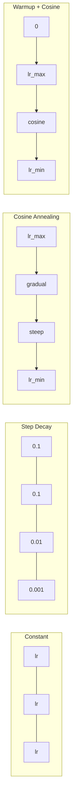
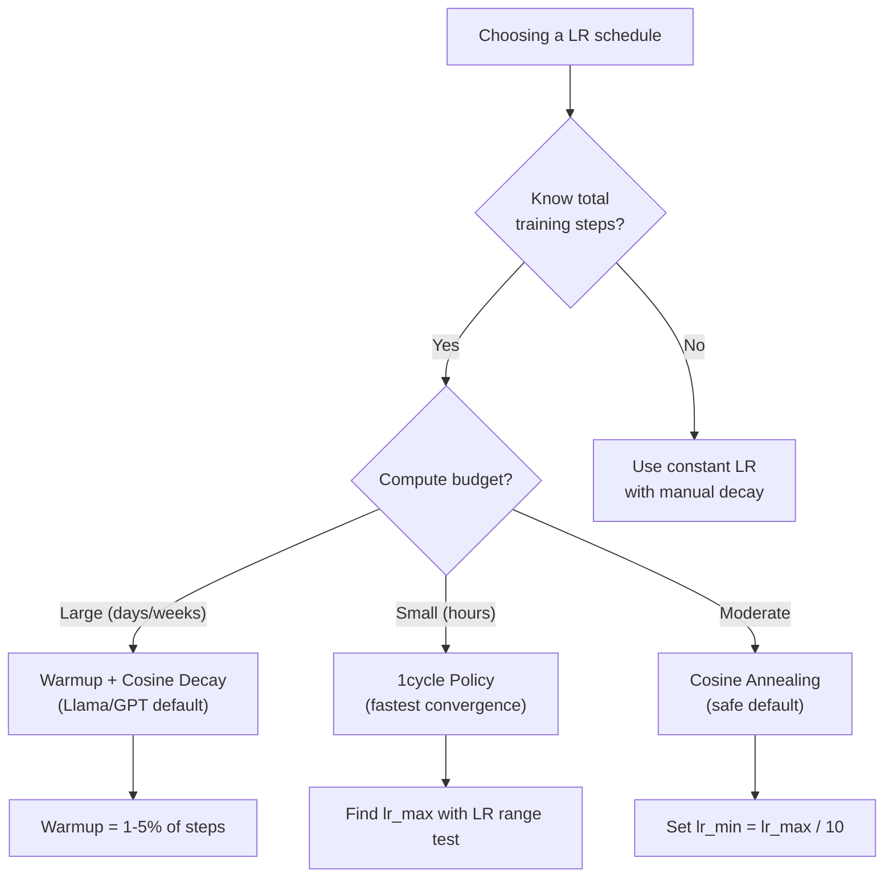
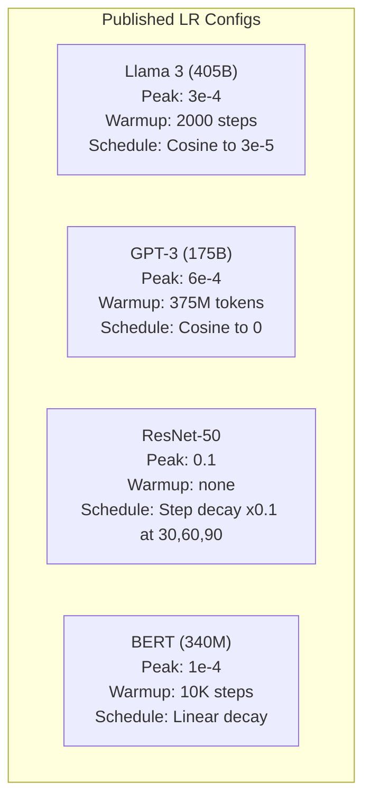

# 학습률 스케줄과 웜업

> 학습률(learning rate)은 단연 가장 중요한 하이퍼파라미터입니다. 아키텍처도, 데이터셋 크기도, 활성화 함수도 아닙니다. 바로 학습률입니다. 다른 것은 아무것도 튜닝하지 않더라도, 이것만큼은 튜닝해야 합니다.

**유형:** Build (실습)
**사용 언어:** Python
**선수 레슨:** Lesson 03.06 (Optimizers), Lesson 03.08 (Weight Initialization)
**소요 시간:** ~90분

## 학습 목표

- 상수(constant), 스텝 감쇠(step decay), 코사인 어닐링(cosine annealing), 웜업 + 코사인(warmup + cosine), 1cycle 학습률 스케줄을 밑바닥부터 직접 구현합니다.
- 학습률 선택 시 발생하는 세 가지 실패 양상인 발산(너무 높음), 정체(너무 낮음), 진동(감쇠 없음)을 살펴봅니다.
- Adam 기반 옵티마이저(optimizer)에 웜업이 필요한 이유와 웜업이 초기 학습을 안정화하는 방식을 설명합니다.
- 동일한 작업에서 5가지 스케줄의 수렴 속도를 비교하고, 주어진 학습 예산에 적합한 스케줄을 선택합니다.

## 문제 상황

학습률을 0.1로 설정하면 학습이 발산하여 손실(loss)이 3스텝 만에 무한대로 치솟습니다. 0.0001로 설정하면 학습 속도가 기어가듯 느려져서 100 에포크(epoch)가 지나도 모델이 무작위 초기 상태에서 거의 벗어나지 못합니다. 0.01로 설정하면 50 에포크 동안은 잘 학습되다가, 보폭이 너무 커서 결코 도달할 수 없는 최솟값 주위를 맴돌며 손실이 진동합니다.

최적의 학습률은 상수가 아닙니다. 학습이 진행됨에 따라 달라집니다. 학습 초기에는 영역을 빠르게 탐색하기 위해 큰 보폭을 원하지만, 학습 후반부에는 날카로운 최솟값에 안정적으로 안착하기 위해 아주 작은 보폭을 원합니다. 정확도 90% 모델과 95% 모델의 차이는 단지 스케줄 하나 때문인 경우가 많습니다.

최근 3년 동안 발표된 모든 주요 모델은 학습률 스케줄을 사용합니다. Llama 3는 2000 웜업 스텝과 함께 최대 학습률(peak lr)=3e-4를 사용하고 코사인 감쇠를 통해 3e-5까지 줄였습니다. GPT-3는 3억 7,500만 토큰에 걸친 웜업과 함께 lr=6e-4를 사용했습니다. 이는 임의로 내린 결정이 아닙니다. 수백만 달러를 투입한 대규모 하이퍼파라미터 탐색의 결과입니다.

기본 설정값으로는 여러분의 문제를 해결할 수 없기 때문에 스케줄을 이해해야 합니다. 사전 훈련된 모델을 미세 조정(fine-tuning)할 때 적합한 스케줄은 밑바닥부터 훈련할 때와 다릅니다. 배치 크기(batch size)를 늘리면 웜업 기간도 변경되어야 합니다. 10,000번째 스텝에서 학습이 무너졌을 때, 이것이 스케줄 문제인지 아니면 다른 원인인지 파악할 수 있어야 합니다.

## 개념

### 상수 학습률(Constant Learning Rate)

가장 단순한 접근 방식입니다. 하나의 숫자를 정해 모든 스텝에서 동일하게 사용합니다.

```math
\text{lr}(t) = \text{lr}_0
```

최적인 경우는 거의 없습니다. 학습 후반부에는 너무 높아서 최솟값 주위를 진동하거나, 학습 초반부에는 너무 낮아서 미세한 보폭으로 연산 자원을 낭비하게 됩니다. 소형 모델이나 디버깅에는 괜찮지만, 1시간 이상 학습해야 하는 작업에는 최악의 선택입니다.

### 스텝 감쇠(Step Decay)

ResNet 시절부터 쓰이던 전통적인 방식입니다. 정해진 에포크마다 학습률을 특정 비율(주로 10배)만큼 감소시킵니다.

```math
\text{lr}(t) = \text{lr}_0 \cdot \gamma^{\lfloor \text{epoch} / \text{step\_size} \rfloor}
```

여기서 $\gamma = 0.1$이고 step_size = 30이라면 매 30 에포크마다 학습률이 10배씩 감소한다는 뜻입니다. ResNet-50이 이 방식을 사용했습니다(lr=0.1, 에포크 30, 60, 90에서 10배씩 감소).

문제는 최적의 감쇠 시점이 데이터셋과 아키텍처에 따라 달라진다는 점입니다. 다른 문제로 넘어가면 학습률을 낮출 시점을 다시 튜닝해야 합니다. 또한 변화가 급격하여 학습률이 갑자기 바뀔 때 손실이 일시적으로 급증할 수 있습니다.

### 코사인 어닐링(Cosine Annealing)

코사인 곡선을 따라 최댓값에서 최솟값까지 매끄럽게 감소합니다.

```math
\text{lr}(t) = \text{lr}_{\min} + 0.5 \cdot (\text{lr}_{\max} - \text{lr}_{\min}) \cdot \left(1 + \cos\left(\frac{\pi t}{T}\right)\right)
```

여기서 $t$는 현재 스텝이고 $T$는 총 스텝 수입니다.

$t=0$일 때 코사인 항은 1이 되므로 $\text{lr} = \text{lr} _{\max}$가 됩니다. $t=T$일 때는 코사인 항이 -1이 되므로 $\text{lr} = \text{lr} _{\min}$가 됩니다. 감쇠는 처음에 완만하다가 중간에 가속되며, 끝부분에 가까워지면 다시 완만해집니다.

현대 딥러닝 훈련의 대부분에서 기본으로 채택되는 방식입니다. $\text{lr} _{\max}$와 $\text{lr} _{\min}$ 외에는 튜닝할 하이퍼파라미터가 없습니다. 코사인 형태는 대부분의 학습이 훈련 중간 단계에서 일어난다는 경험적 관찰과 잘 맞아떨어집니다. 이 중요한 구간 동안 적절한 보폭을 유지할 수 있기 때문입니다.

### 웜업: 작게 시작해야 하는 이유

Adam을 비롯한 적응형 옵티마이저(adaptive optimizer)는 그래디언트의 평균과 분산에 대한 이동 추정치(running estimates)를 유지합니다. 스텝 0에서는 이 추정치들이 0으로 초기화됩니다. 처음 몇 번의 그래디언트 업데이트는 불안정한 쓰레기 통계치를 바탕으로 이루어집니다. 이 시기에 학습률이 높으면 모델은 방향도 제대로 잡지 못한 채 지나치게 큰 보폭으로 이동하게 됩니다.

웜업은 이 문제를 해결합니다. 매우 작은 학습률(보통 lr_max / warmup_steps 또는 0)로 시작하여 초기 $N$ 스텝에 걸쳐 $\text{lr}_{\max}$까지 선형적으로 증가시킵니다. 전체 학습률에 도달할 때쯤이면 Adam의 통계치는 이미 안정화되어 있습니다.

```math
\text{lr}(t) = \text{lr}_{\max} \cdot \frac{t}{\text{warmup\_steps}} \quad \text{for } t < \text{warmup\_steps}
```

일반적인 웜업: 총 학습 스텝의 1~5%. Llama 3는 약 1조 8,000억 개의 토큰을 학습하면서 2,000 스텝 동안 웜업을 진행했습니다. GPT-3는 3억 7,500만 토큰에 걸쳐 웜업했습니다.

### 선형 웜업 + 코사인 감쇠(Linear Warmup + Cosine Decay)

현대 딥러닝의 기본 표준입니다. 선형으로 증가한 다음 코사인 곡선으로 감쇠합니다.

```
if t < warmup_steps:
    lr(t) = lr_max * (t / warmup_steps)
else:
    progress = (t - warmup_steps) / (total_steps - warmup_steps)
    lr(t) = lr_min + 0.5 * (lr_max - lr_min) * (1 + cos(pi * progress))
```

Llama, GPT, PaLM 및 대부분의 최신 Transformer가 이 방식을 사용합니다. 웜업을 통해 초기 불안정성을 방지하고, 코사인 감쇠를 통해 모델을 우수한 최솟값에 안착시킵니다.

### 1cycle 정책(1cycle Policy)

Leslie Smith가 발견한 방식(2018년): 훈련 전반부에는 학습률을 낮은 값에서 높은 값으로 올리고, 후반부에는 다시 낮춥니다. 학습 중간에 학습률을 *높인다*는 것은 직관에 반하는 것처럼 보입니다.

그 이면의 이론은 다음과 같습니다. 높은 학습률은 최적화 경로에 노이즈를 더해 정규화(regularization) 역할을 합니다. 모델은 학습률 상승 단계에서 손실 지형(loss landscape)을 더 넓게 탐색하여 더 나은 분지(basin)를 찾습니다. 이후 하강 단계에서 찾아낸 최적의 분지 내부를 정밀하게 조정합니다.

```
Phase 1 (0 to T/2):    lr ramps from lr_max/25 to lr_max
Phase 2 (T/2 to T):    lr ramps from lr_max to lr_max/10000
```

주어진 연산 예산 내에서 1cycle은 코사인 어닐링보다 더 빠르게 학습되는 경우가 많습니다. 다만 총 스텝 수를 미리 알고 있어야 한다는 트레이드오프가 있습니다.

### 스케줄 형태



### 의사결정 플로우차트



### 공개된 모델의 실제 수치



```figure
lr-schedule
```

## 직접 만들어보기

### 1단계: 스케줄 함수

각 함수는 현재 스텝을 입력받아 해당 스텝의 학습률을 반환합니다.

```python
import math


def constant_schedule(step, lr=0.01, **kwargs):
    return lr


def step_decay_schedule(step, lr=0.1, step_size=100, gamma=0.1, **kwargs):
    return lr * (gamma ** (step // step_size))


def cosine_schedule(step, lr=0.01, total_steps=1000, lr_min=1e-5, **kwargs):
    if step >= total_steps:
        return lr_min
    return lr_min + 0.5 * (lr - lr_min) * (1 + math.cos(math.pi * step / total_steps))


def warmup_cosine_schedule(step, lr=0.01, total_steps=1000, warmup_steps=100, lr_min=1e-5, **kwargs):
    if total_steps <= warmup_steps:
        return lr * (step / max(warmup_steps, 1))
    if step < warmup_steps:
        return lr * step / warmup_steps
    progress = (step - warmup_steps) / (total_steps - warmup_steps)
    return lr_min + 0.5 * (lr - lr_min) * (1 + math.cos(math.pi * progress))


def one_cycle_schedule(step, lr=0.01, total_steps=1000, **kwargs):
    mid = max(total_steps // 2, 1)
    if step < mid:
        return (lr / 25) + (lr - lr / 25) * step / mid
    else:
        progress = (step - mid) / max(total_steps - mid, 1)
        return lr * (1 - progress) + (lr / 10000) * progress
```

### 2단계: 모든 스케줄 시각화

학습 진행에 따라 각 스케줄이 어떻게 변화하는지 텍스트 기반 플롯으로 출력합니다.

```python
def visualize_schedule(name, schedule_fn, total_steps=500, **kwargs):
    steps = list(range(0, total_steps, total_steps // 20))
    if total_steps - 1 not in steps:
        steps.append(total_steps - 1)

    lrs = [schedule_fn(s, total_steps=total_steps, **kwargs) for s in steps]
    max_lr = max(lrs) if max(lrs) > 0 else 1.0

    print(f"\n{name}:")
    for s, lr_val in zip(steps, lrs):
        bar_len = int(lr_val / max_lr * 40)
        bar = "#" * bar_len
        print(f"  Step {s:4d}: lr={lr_val:.6f} {bar}")
```

### 3단계: 훈련 네트워크

이전 강의와 동일하게 circle 데이터셋을 다루는 간단한 2계층 네트워크이지만, 이번에는 스케줄을 변경해 봅니다.

```python
import random


def sigmoid(x):
    x = max(-500, min(500, x))
    return 1.0 / (1.0 + math.exp(-x))


def relu(x):
    return max(0.0, x)


def relu_deriv(x):
    return 1.0 if x > 0 else 0.0


def make_circle_data(n=200, seed=42):
    random.seed(seed)
    data = []
    for _ in range(n):
        x = random.uniform(-2, 2)
        y = random.uniform(-2, 2)
        label = 1.0 if x * x + y * y < 1.5 else 0.0
        data.append(([x, y], label))
    return data


def train_with_schedule(schedule_fn, schedule_name, data, epochs=300, base_lr=0.05, **kwargs):
    random.seed(0)
    hidden_size = 8
    total_steps = epochs * len(data)

    std = math.sqrt(2.0 / 2)
    w1 = [[random.gauss(0, std) for _ in range(2)] for _ in range(hidden_size)]
    b1 = [0.0] * hidden_size
    w2 = [random.gauss(0, std) for _ in range(hidden_size)]
    b2 = 0.0

    step = 0
    epoch_losses = []

    for epoch in range(epochs):
        total_loss = 0
        correct = 0

        for x, target in data:
            lr = schedule_fn(step, lr=base_lr, total_steps=total_steps, **kwargs)

            z1 = []
            h = []
            for i in range(hidden_size):
                z = w1[i][0] * x[0] + w1[i][1] * x[1] + b1[i]
                z1.append(z)
                h.append(relu(z))

            z2 = sum(w2[i] * h[i] for i in range(hidden_size)) + b2
            out = sigmoid(z2)

            error = out - target
            d_out = error * out * (1 - out)

            for i in range(hidden_size):
                d_h = d_out * w2[i] * relu_deriv(z1[i])
                w2[i] -= lr * d_out * h[i]
                for j in range(2):
                    w1[i][j] -= lr * d_h * x[j]
                b1[i] -= lr * d_h
            b2 -= lr * d_out

            total_loss += (out - target) ** 2
            if (out >= 0.5) == (target >= 0.5):
                correct += 1
            step += 1

        avg_loss = total_loss / len(data)
        accuracy = correct / len(data) * 100
        epoch_losses.append(avg_loss)

    return epoch_losses
```

### 4단계: 모든 스케줄 비교

동일한 네트워크를 각 스케줄로 훈련하고 최종 손실 및 수렴 양상을 비교합니다.

```python
def compare_schedules(data):
    configs = [
        ("Constant", constant_schedule, {}),
        ("Step Decay", step_decay_schedule, {"step_size": 15000, "gamma": 0.1}),
        ("Cosine", cosine_schedule, {"lr_min": 1e-5}),
        ("Warmup+Cosine", warmup_cosine_schedule, {"warmup_steps": 3000, "lr_min": 1e-5}),
        ("1cycle", one_cycle_schedule, {}),
    ]

    print(f"\n{'Schedule':<20} {'Start Loss':>12} {'Mid Loss':>12} {'End Loss':>12} {'Best Loss':>12}")
    print("-" * 70)

    for name, schedule_fn, extra_kwargs in configs:
        losses = train_with_schedule(schedule_fn, name, data, epochs=300, base_lr=0.05, **extra_kwargs)
        mid_idx = len(losses) // 2
        best = min(losses)
        print(f"{name:<20} {losses[0]:>12.6f} {losses[mid_idx]:>12.6f} {losses[-1]:>12.6f} {best:>12.6f}")
```

### 5단계: 너무 높은 학습률 vs 너무 낮은 학습률

너무 높음(발산), 너무 낮음(기어감), 적절함이라는 세 가지 양상을 확인합니다.

```python
def lr_sensitivity(data):
    learning_rates = [1.0, 0.1, 0.01, 0.001, 0.0001]

    print("\nLR Sensitivity (constant schedule, 100 epochs):")
    print(f"  {'LR':>10} {'Start Loss':>12} {'End Loss':>12} {'Status':>15}")
    print("  " + "-" * 52)

    for lr in learning_rates:
        losses = train_with_schedule(constant_schedule, f"lr={lr}", data, epochs=100, base_lr=lr)
        start = losses[0]
        end = losses[-1]

        if end > start or math.isnan(end) or end > 1.0:
            status = "DIVERGED"
        elif end > start * 0.9:
            status = "BARELY MOVED"
        elif end < 0.15:
            status = "CONVERGED"
        else:
            status = "LEARNING"

        end_str = f"{end:.6f}" if not math.isnan(end) else "NaN"
        print(f"  {lr:>10.4f} {start:>12.6f} {end_str:>12} {status:>15}")
```

## 활용하기

PyTorch는 `torch.optim.lr_scheduler`에서 스케줄러를 제공합니다.

```python
import torch
import torch.optim as optim
from torch.optim.lr_scheduler import CosineAnnealingLR, OneCycleLR, StepLR

model = nn.Sequential(nn.Linear(10, 64), nn.ReLU(), nn.Linear(64, 1))
optimizer = optim.Adam(model.parameters(), lr=3e-4)

scheduler = CosineAnnealingLR(optimizer, T_max=1000, eta_min=1e-5)

for step in range(1000):
    loss = train_step(model, optimizer)
    scheduler.step()
```

웜업 + 코사인의 경우 LambdaLR 스케줄러를 사용하거나 HuggingFace의 `get_cosine_schedule_with_warmup`을 사용할 수 있습니다.

```python
from transformers import get_cosine_schedule_with_warmup

scheduler = get_cosine_schedule_with_warmup(
    optimizer,
    num_warmup_steps=2000,
    num_training_steps=100000,
)
```

이 HuggingFace 함수는 대부분의 Llama 및 GPT 미세 조정 스크립트에서 사용하는 방식입니다. 무엇을 쓸지 확신이 서지 않는다면 전체 스텝의 3~5%를 웜업으로 설정한 웜업 + 코사인을 사용하십시오. 거의 모든 문제에 잘 동작합니다.

## 배포하기

이번 강의에서 제작하는 결과물은 다음과 같습니다.
- `outputs/prompt-lr-schedule-advisor.md` -- 여러분의 훈련 설정에 적합한 학습률 스케줄과 하이퍼파라미터를 추천하는 프롬프트
## 연습 문제

1. 지수 감쇠(exponential decay)를 구현해 보세요: $\text{lr}(t) = \text{lr}_0 \cdot \gamma^t$ (단, $\gamma = 0.999$). circle 데이터셋에서 코사인 어닐링(cosine annealing)과 비교합니다.

2. 학습률 범위 테스트(learning rate range test, Leslie Smith)를 구현해 보세요: LR을 1e-7에서 1까지 지수적으로 증가시키면서 수백 스텝 동안 훈련합니다. 손실 대 LR 그래프를 그려보세요. 최적의 최대 LR은 손실이 증가하기 시작하기 직전의 지점입니다.

3. 웜업(warmup) + 코사인 스케줄로 훈련하되, 웜업 길이를 전체 스텝의 0%, 1%, 5%, 10%, 20%로 변경해 보세요. 훈련이 가장 안정적인 최적의 지점을 찾아보세요.

4. 웜 리스타트를 적용한 코사인 어닐링(cosine annealing with warm restarts, SGDR)을 구현해 보세요: 매 $T$ 스텝마다 학습률을 $\text{lr}_{\max}$값으로 재설정하고 다시 감쇠시킵니다. 더 긴 훈련 실행에서 표준 코사인과 비교해 보세요.

5. 훈련 손실을 모니터링하여 손실이 안정화되면 웜업에서 코사인으로 자동 전환하고, 손실이 너무 오랫동안 정체(plateau)되면 LR을 줄여주는 "스케줄 서전(schedule surgeon)"을 구축해 보세요.

## 핵심 용어

| 용어 | 통칭 | 실제 의미 |
|------|----------------|----------------------|
| 학습률(Learning rate) | "모델이 얼마나 빨리 학습하는지" | 그래디언트에 곱해져 파라미터 업데이트 크기를 결정하는 스칼라값 |
| 스케줄(Schedule) | "시간에 따라 LR 변경하기" | 수렴을 최적화하도록 설계된, 훈련 스텝을 학습률로 매핑하는 함수 |
| 웜업(Warmup) | "작은 LR로 시작하기" | 옵티마이저 통계량을 안정화하기 위해 초기 $N$ 스텝에 걸쳐 LR을 0에 가까운 값에서 목표값까지 선형적으로 증가시키는 기법 |
| 코사인 어닐링(Cosine annealing) | "부드러운 LR 감쇠" | 훈련 과정 동안 코사인 곡선을 따라 LR을 $\text{lr} _{\max}$에서 $\text{lr} _{\min}$까지 점진적으로 감소시키는 기법 |
| 스텝 감쇠(Step decay) | "특정 시점마다 LR 떨어뜨리기" | 고정된 에포크 간격마다 LR에 특정 비율(보통 0.1)을 곱해 줄이는 방식 |
| 1cycle 정책(1cycle policy) | "올렸다가 내리기" | 더 빠른 수렴을 위해 단일 사이클 동안 LR을 올렸다가 내리는 Leslie Smith의 방식 |
| LR 범위 테스트(LR range test) | "최적의 학습률 찾기" | 손실이 발산하기 시작하는 지점을 찾기 위해 LR을 점진적으로 증가시키며 짧게 훈련하는 테스트 |
| 웜 리스타트를 적용한 코사인(Cosine with warm restarts) | "재설정 후 반복" | 주기적으로 LR을 $\text{lr} _{\max}$값으로 재설정한 뒤 다시 감쇠시키는 기법 (SGDR) |
| Eta min | "LR의 하한선" | 스케줄을 통해 감쇠할 수 있는 최저 학습률 |
| 피크 학습률(Peak learning rate) | "최대 LR" | 주로 웜업 이후에 도달하는, 훈련 과정 중 가장 높은 LR |

## 추가 자료

- Loshchilov & Hutter, "SGDR: Stochastic Gradient Descent with Warm Restarts" (2017) -- 코사인 어닐링과 웜 리스타트를 처음 도입한 논문
- Smith, "Super-Convergence: Very Fast Training of Neural Networks Using Large Learning Rates" (2018) -- 1cycle 정책을 소개한 논문
- Touvron et al., "Llama 2: Open Foundation and Fine-Tuned Chat Models" (2023) -- 대규모 모델 훈련에 사용된 웜업 + 코사인 스케줄을 기록한 논문
- Goyal et al., "Accurate, Large Minibatch SGD: Training ImageNet in 1 Hour" (2017) -- 대규모 배치 훈련을 위한 선형 스케일링 규칙과 웜업을 제안한 논문
