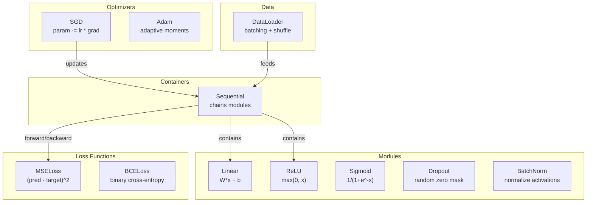
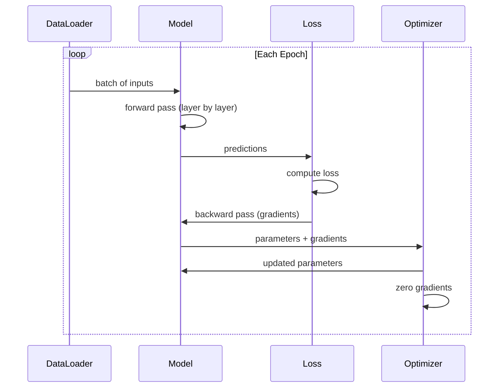
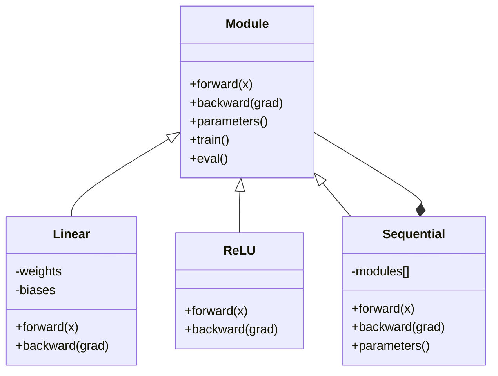

# 나만의 미니 프레임워크 만들기

> 뉴런, 레이어, 네트워크, 역전파, 활성화 함수, 손실 함수, 옵티마이저, 규제, 가중치 초기화, 학습률 스케줄까지 모두 만들어 보았습니다. 각각 독립된 조각들이었죠. 이제 이것들을 하나의 프레임워크로 엮을 차례입니다. PyTorch도, TensorFlow도 아닌 여러분만의 프레임워크입니다.

**유형:** Build (실습)
**사용 언어:** Python
**선수 레슨:** All of Phase 03 (Lessons 01-09)
**소요 시간:** ~120분

## 학습 목표

- Module, Linear, ReLU, Sigmoid, Dropout, BatchNorm, Sequential, 손실 함수, 옵티마이저, DataLoader를 포함하는 완전한 딥러닝 프레임워크(~500줄)를 직접 구현합니다.
- Module 추상화(forward, backward, parameters)와 train/eval 모드 전환이 필요한 이유를 설명합니다.
- 모든 컴포넌트를 작동하는 학습 루프에 연결하여 원형 분류(circle classification) 데이터셋에서 4개 레이어 네트워크를 학습시킵니다.
- 프레임워크의 각 컴포넌트를 해당하는 PyTorch 컴포넌트(nn.Module, nn.Sequential, optim.Adam, DataLoader)에 매핑합니다.

## 문제 상황

열 개 레슨에 걸쳐 만든 빌딩 블록들이 여러 파일에 흩어져 있습니다. `Value` 클래스는 여기에, 학습 루프는 저기에, 가중치 초기화는 또 다른 파일에, 학습률 스케줄은 또 다른 곳에 있죠. 네트워크를 하나 학습시키려면 다섯 개 레슨에서 코드를 복사해 붙여넣고 일일이 수작업으로 연결해야 합니다.

프레임워크가 해결해 주는 문제가 바로 이것입니다. PyTorch는 `nn.Module`, `nn.Sequential`, `optim.Adam`, `DataLoader`를 제공하고, 이들을 하나로 묶어주는 학습 루프 패턴을 제공합니다. TensorFlow는 `keras.Layer`, `keras.Sequential`, `keras.optimizers.Adam`를 제공하죠. 이들은 마법이 아닙니다. 매번 밑바닥부터 배관을 다시 깔지 않고도 네트워크를 정의하고, 학습하고, 평가할 수 있게 해주는 구조화 패턴일 뿐입니다.

여러분은 약 500줄의 Python 코드로 같은 것을 직접 만들게 됩니다. numpy도 없고, 외부 의존성도 없습니다. 어떤 피드포워드(feedforward) 네트워크든 정의할 수 있고, SGD나 Adam으로 학습시킬 수 있으며, 데이터를 배치로 묶고, 드롭아웃(dropout)과 배치 정규화(batch normalization)를 적용하고, 어떤 활성화 함수든 사용하며, 학습률을 스케줄링할 수 있는 프레임워크입니다.

이 과정을 마치고 나면, PyTorch에서 `model = nn.Sequential(...)`를 작성할 때 실제로 무슨 일이 일어나는지 정확하게 이해하게 됩니다. 왜 `model.train()`와 `model.eval()`가 존재하는지 이해하게 됩니다. 왜 `optimizer.zero_grad()`가 별도의 호출인지 이해하게 됩니다. 모든 것을 직접 만들었기 때문에, 모든 것을 이해하게 됩니다.

## 개념

### Module 추상화

PyTorch의 모든 레이어는 `nn.Module`를 상속받습니다. Module에는 세 가지 책임이 있습니다:

1. **forward()** -- 입력이 주어졌을 때 출력을 계산
2. **parameters()** -- 학습 가능한 모든 가중치를 반환
3. **backward()** -- 그래디언트를 계산(PyTorch에서는 autograd가 처리하지만, 우리 프레임워크에서는 명시적으로 구현)

Linear 레이어도 Module입니다. ReLU 활성화 함수도 Module입니다. 드롭아웃 레이어도 Module입니다. 배치 정규화 레이어도 Module입니다. 모두 동일한 인터페이스를 가집니다.

### Sequential 컨테이너

`nn.Sequential`은 여러 Module을 사슬처럼 연결합니다. 순전파(forward pass): 데이터를 Module 1, Module 2, Module 3으로 차례로 통과시킵니다. 역전파(backward pass): 이 사슬을 역순으로 통과시킵니다. 컨테이너 자체도 하나의 Module로서 forward(), parameters(), backward()를 가집니다. 이것이 바로 컴포지트 패턴(composite pattern)입니다. Module들의 연속 자체가 하나의 Module이 됩니다.

### 학습 모드 vs 평가 모드

드롭아웃은 학습 중에 무작위로 뉴런을 0으로 만들지만, 평가 중에는 모든 것을 그대로 통과시킵니다. 배치 정규화는 학습 중에 배치 통계량을 사용하지만, 평가 중에는 이동 평균(running average)을 사용합니다. `train()`와 `eval()` 메서드가 이 동작을 전환합니다. 모든 Module은 `training` 플래그를 가집니다.

### 옵티마이저

옵티마이저는 그래디언트를 사용해 파라미터를 업데이트합니다. SGD: `param -= lr * grad`. Adam: 모멘텀과 분산 추정치를 유지한 다음 업데이트합니다. 옵티마이저는 네트워크 구조를 알지 못하며, 파라미터와 그 그래디언트로 이루어진 평탄한 리스트만 볼 뿐입니다.

### DataLoader

배치 처리는 두 가지 이유로 중요합니다. 첫째, 대규모 문제에서는 전체 데이터셋을 메모리에 한 번에 올릴 수 없습니다. 둘째, 미니배치 경사 하강법(mini-batch gradient descent)은 지역 최솟값(local minima)에서 벗어나는 데 도움이 되는 노이즈를 제공합니다. DataLoader는 데이터를 여러 배치로 나누고, 에포크 사이에 선택적으로 셔플(shuffle)을 수행합니다.

### 프레임워크 아키텍처



### 학습 루프



### Module 계층 구조



```figure
gradient-clipping
```

## 직접 구현하기

### 1단계: Module 베이스 클래스

모든 레이어가 구현하는 추상 인터페이스입니다.

```python
class Module:
    def __init__(self):
        self.training = True

    def forward(self, x):
        raise NotImplementedError

    def backward(self, grad):
        raise NotImplementedError

    def parameters(self):
        return []

    def train(self):
        self.training = True

    def eval(self):
        self.training = False
```

### 2단계: Linear 레이어

가장 기본적인 빌딩 블록입니다. 가중치와 편향을 저장하고, 순전파에서 Wx + b를 계산하며, 역전파에서 가중치와 입력의 그래디언트를 계산합니다.

```python
import math
import random


class Linear(Module):
    def __init__(self, fan_in, fan_out):
        super().__init__()
        std = math.sqrt(2.0 / fan_in)
        self.weights = [[random.gauss(0, std) for _ in range(fan_in)] for _ in range(fan_out)]
        self.biases = [0.0] * fan_out
        self.weight_grads = [[0.0] * fan_in for _ in range(fan_out)]
        self.bias_grads = [0.0] * fan_out
        self.fan_in = fan_in
        self.fan_out = fan_out
        self.input = None

    def forward(self, x):
        self.input = x
        output = []
        for i in range(self.fan_out):
            val = self.biases[i]
            for j in range(self.fan_in):
                val += self.weights[i][j] * x[j]
            output.append(val)
        return output

    def backward(self, grad):
        input_grad = [0.0] * self.fan_in
        for i in range(self.fan_out):
            self.bias_grads[i] += grad[i]
            for j in range(self.fan_in):
                self.weight_grads[i][j] += grad[i] * self.input[j]
                input_grad[j] += grad[i] * self.weights[i][j]
        return input_grad

    def parameters(self):
        params = []
        for i in range(self.fan_out):
            for j in range(self.fan_in):
                params.append((self.weights, i, j, self.weight_grads))
            params.append((self.biases, i, None, self.bias_grads))
        return params
```

### 3단계: 활성화 함수 Module

Module 형태의 ReLU, Sigmoid, Tanh입니다. 각각 역전파에 필요한 값을 캐싱합니다.

```python
class ReLU(Module):
    def __init__(self):
        super().__init__()
        self.mask = None

    def forward(self, x):
        self.mask = [1.0 if v > 0 else 0.0 for v in x]
        return [max(0.0, v) for v in x]

    def backward(self, grad):
        return [g * m for g, m in zip(grad, self.mask)]


class Sigmoid(Module):
    def __init__(self):
        super().__init__()
        self.output = None

    def forward(self, x):
        self.output = []
        for v in x:
            v = max(-500, min(500, v))
            self.output.append(1.0 / (1.0 + math.exp(-v)))
        return self.output

    def backward(self, grad):
        return [g * o * (1 - o) for g, o in zip(grad, self.output)]


class Tanh(Module):
    def __init__(self):
        super().__init__()
        self.output = None

    def forward(self, x):
        self.output = [math.tanh(v) for v in x]
        return self.output

    def backward(self, grad):
        return [g * (1 - o * o) for g, o in zip(grad, self.output)]
```

### 4단계: Dropout Module

학습 중에 무작위로 요소를 0으로 만듭니다. 기댓값이 유지되도록 나머지 요소를 1/(1-p)로 스케일링합니다. 평가 중에는 아무 작업도 하지 않습니다.

```python
class Dropout(Module):
    def __init__(self, p=0.5):
        super().__init__()
        self.p = p
        self.mask = None

    def forward(self, x):
        if not self.training:
            return x
        self.mask = [0.0 if random.random() < self.p else 1.0 / (1 - self.p) for _ in x]
        return [v * m for v, m in zip(x, self.mask)]

    def backward(self, grad):
        if self.mask is None:
            return grad
        return [g * m for g, m in zip(grad, self.mask)]
```

### 5단계: BatchNorm Module

배치 전체에 걸쳐 피처별로 활성화를 평균 0, 분산 1로 정규화합니다. 평가 모드를 위한 이동 통계량을 유지합니다.

```python
class BatchNorm(Module):
    def __init__(self, size, momentum=0.1, eps=1e-5):
        super().__init__()
        self.size = size
        self.gamma = [1.0] * size
        self.beta = [0.0] * size
        self.gamma_grads = [0.0] * size
        self.beta_grads = [0.0] * size
        self.running_mean = [0.0] * size
        self.running_var = [1.0] * size
        self.momentum = momentum
        self.eps = eps
        self.x_norm = None
        self.std_inv = None
        self.batch_input = None

    def forward_batch(self, batch):
        batch_size = len(batch)
        output_batch = []

        if self.training:
            mean = [0.0] * self.size
            for sample in batch:
                for j in range(self.size):
                    mean[j] += sample[j]
            mean = [m / batch_size for m in mean]

            var = [0.0] * self.size
            for sample in batch:
                for j in range(self.size):
                    var[j] += (sample[j] - mean[j]) ** 2
            var = [v / batch_size for v in var]

            self.std_inv = [1.0 / math.sqrt(v + self.eps) for v in var]

            self.x_norm = []
            self.batch_input = batch
            for sample in batch:
                normed = [(sample[j] - mean[j]) * self.std_inv[j] for j in range(self.size)]
                self.x_norm.append(normed)
                output = [self.gamma[j] * normed[j] + self.beta[j] for j in range(self.size)]
                output_batch.append(output)

            for j in range(self.size):
                self.running_mean[j] = (1 - self.momentum) * self.running_mean[j] + self.momentum * mean[j]
                self.running_var[j] = (1 - self.momentum) * self.running_var[j] + self.momentum * var[j]
        else:
            std_inv = [1.0 / math.sqrt(v + self.eps) for v in self.running_var]
            for sample in batch:
                normed = [(sample[j] - self.running_mean[j]) * std_inv[j] for j in range(self.size)]
                output = [self.gamma[j] * normed[j] + self.beta[j] for j in range(self.size)]
                output_batch.append(output)

        return output_batch

    def forward(self, x):
        result = self.forward_batch([x])
        return result[0]

    def backward(self, grad):
        if self.x_norm is None:
            return grad
        for j in range(self.size):
            self.gamma_grads[j] += self.x_norm[0][j] * grad[j]
            self.beta_grads[j] += grad[j]
        return [grad[j] * self.gamma[j] * self.std_inv[j] for j in range(self.size)]

    def parameters(self):
        params = []
        for j in range(self.size):
            params.append((self.gamma, j, None, self.gamma_grads))
            params.append((self.beta, j, None, self.beta_grads))
        return params
```

### 6단계: Sequential 컨테이너

여러 모듈을 연결합니다. 순전파는 왼쪽에서 오른쪽으로, 역전파는 오른쪽에서 왼쪽으로 진행합니다.

```python
class Sequential(Module):
    def __init__(self, *modules):
        super().__init__()
        self.modules = list(modules)

    def forward(self, x):
        for module in self.modules:
            x = module.forward(x)
        return x

    def backward(self, grad):
        for module in reversed(self.modules):
            grad = module.backward(grad)
        return grad

    def parameters(self):
        params = []
        for module in self.modules:
            params.extend(module.parameters())
        return params

    def train(self):
        self.training = True
        for module in self.modules:
            module.train()

    def eval(self):
        self.training = False
        for module in self.modules:
            module.eval()
```

### 7단계: 손실 함수

MSE와 이진 크로스 엔트로피(Binary Cross-Entropy)입니다. 각각 손실 값을 반환하고, 그래디언트를 반환하는 backward()를 제공합니다.

```python
class MSELoss:
    def __call__(self, predicted, target):
        self.predicted = predicted
        self.target = target
        n = len(predicted)
        self.loss = sum((p - t) ** 2 for p, t in zip(predicted, target)) / n
        return self.loss

    def backward(self):
        n = len(self.predicted)
        return [2 * (p - t) / n for p, t in zip(self.predicted, self.target)]


class BCELoss:
    def __call__(self, predicted, target):
        self.predicted = predicted
        self.target = target
        eps = 1e-7
        n = len(predicted)
        self.loss = 0
        for p, t in zip(predicted, target):
            p = max(eps, min(1 - eps, p))
            self.loss += -(t * math.log(p) + (1 - t) * math.log(1 - p))
        self.loss /= n
        return self.loss

    def backward(self):
        eps = 1e-7
        n = len(self.predicted)
        grads = []
        for p, t in zip(self.predicted, self.target):
            p = max(eps, min(1 - eps, p))
            grads.append((-t / p + (1 - t) / (1 - p)) / n)
        return grads
```

### 8단계: SGD 및 Adam 옵티마이저

두 옵티마이저 모두 파라미터 리스트를 받아 그래디언트를 사용해 가중치를 업데이트합니다.

```python
class SGD:
    def __init__(self, parameters, lr=0.01):
        self.params = parameters
        self.lr = lr

    def step(self):
        for container, i, j, grad_container in self.params:
            if j is not None:
                container[i][j] -= self.lr * grad_container[i][j]
            else:
                container[i] -= self.lr * grad_container[i]

    def zero_grad(self):
        for container, i, j, grad_container in self.params:
            if j is not None:
                grad_container[i][j] = 0.0
            else:
                grad_container[i] = 0.0


class Adam:
    def __init__(self, parameters, lr=0.001, beta1=0.9, beta2=0.999, eps=1e-8):
        self.params = parameters
        self.lr = lr
        self.beta1 = beta1
        self.beta2 = beta2
        self.eps = eps
        self.t = 0
        self.m = [0.0] * len(parameters)
        self.v = [0.0] * len(parameters)

    def step(self):
        self.t += 1
        for idx, (container, i, j, grad_container) in enumerate(self.params):
            if j is not None:
                g = grad_container[i][j]
            else:
                g = grad_container[i]

            self.m[idx] = self.beta1 * self.m[idx] + (1 - self.beta1) * g
            self.v[idx] = self.beta2 * self.v[idx] + (1 - self.beta2) * g * g

            m_hat = self.m[idx] / (1 - self.beta1 ** self.t)
            v_hat = self.v[idx] / (1 - self.beta2 ** self.t)

            update = self.lr * m_hat / (math.sqrt(v_hat) + self.eps)

            if j is not None:
                container[i][j] -= update
            else:
                container[i] -= update

    def zero_grad(self):
        for container, i, j, grad_container in self.params:
            if j is not None:
                grad_container[i][j] = 0.0
            else:
                grad_container[i] = 0.0
```

### 9단계: DataLoader

데이터를 여러 배치로 나누고, 매 에포크마다 선택적으로 셔플합니다.

```python
class DataLoader:
    def __init__(self, data, batch_size=32, shuffle=True):
        self.data = data
        self.batch_size = batch_size
        self.shuffle = shuffle

    def __iter__(self):
        indices = list(range(len(self.data)))
        if self.shuffle:
            random.shuffle(indices)
        for start in range(0, len(indices), self.batch_size):
            batch_indices = indices[start:start + self.batch_size]
            batch = [self.data[i] for i in batch_indices]
            inputs = [item[0] for item in batch]
            targets = [item[1] for item in batch]
            yield inputs, targets

    def __len__(self):
        return (len(self.data) + self.batch_size - 1) // self.batch_size
```

### 10단계: 원형 분류 데이터셋에서 4개 레이어 네트워크 학습

모든 컴포넌트를 연결합니다. 모델을 정의하고, 손실 함수를 고르고, 옵티마이저를 선택한 뒤, 학습 루프를 실행합니다.

```python
def make_circle_data(n=500, seed=42):
    random.seed(seed)
    data = []
    for _ in range(n):
        x = random.uniform(-2, 2)
        y = random.uniform(-2, 2)
        label = 1.0 if x * x + y * y < 1.5 else 0.0
        data.append(([x, y], [label]))
    return data


def train():
    random.seed(42)

    model = Sequential(
        Linear(2, 16),
        ReLU(),
        Linear(16, 16),
        ReLU(),
        Linear(16, 8),
        ReLU(),
        Linear(8, 1),
        Sigmoid(),
    )

    criterion = BCELoss()
    optimizer = Adam(model.parameters(), lr=0.01)

    data = make_circle_data(500)
    split = int(len(data) * 0.8)
    train_data = data[:split]
    test_data = data[split:]

    loader = DataLoader(train_data, batch_size=16, shuffle=True)

    model.train()

    for epoch in range(100):
        total_loss = 0
        total_correct = 0
        total_samples = 0

        for batch_inputs, batch_targets in loader:
            batch_loss = 0
            for x, t in zip(batch_inputs, batch_targets):
                pred = model.forward(x)
                loss = criterion(pred, t)
                batch_loss += loss

                optimizer.zero_grad()
                grad = criterion.backward()
                model.backward(grad)
                optimizer.step()

                predicted_class = 1.0 if pred[0] >= 0.5 else 0.0
                if predicted_class == t[0]:
                    total_correct += 1
                total_samples += 1

            total_loss += batch_loss

        avg_loss = total_loss / total_samples
        accuracy = total_correct / total_samples * 100

        if epoch % 10 == 0 or epoch == 99:
            print(f"Epoch {epoch:3d} | Loss: {avg_loss:.6f} | Train Accuracy: {accuracy:.1f}%")

    model.eval()
    correct = 0
    for x, t in test_data:
        pred = model.forward(x)
        predicted_class = 1.0 if pred[0] >= 0.5 else 0.0
        if predicted_class == t[0]:
            correct += 1
    test_accuracy = correct / len(test_data) * 100
    print(f"\nTest Accuracy: {test_accuracy:.1f}% ({correct}/{len(test_data)})")

    return model, test_accuracy
```

## 사용하기

방금 만든 것의 PyTorch 버전입니다:

```python
import torch
import torch.nn as nn
from torch.utils.data import DataLoader, TensorDataset

model = nn.Sequential(
    nn.Linear(2, 16),
    nn.ReLU(),
    nn.Linear(16, 16),
    nn.ReLU(),
    nn.Linear(16, 8),
    nn.ReLU(),
    nn.Linear(8, 1),
    nn.Sigmoid(),
)

criterion = nn.BCELoss()
optimizer = torch.optim.Adam(model.parameters(), lr=0.01)

for epoch in range(100):
    model.train()
    for inputs, targets in dataloader:
        optimizer.zero_grad()
        predictions = model(inputs)
        loss = criterion(predictions, targets)
        loss.backward()
        optimizer.step()

    model.eval()
    with torch.no_grad():
        test_predictions = model(test_inputs)
```

구조가 동일합니다. `Sequential`, `Linear`, `ReLU`, `Sigmoid`, `BCELoss`, `Adam`, `zero_grad`, `backward`, `step`, `train`, `eval`. 모든 개념이 일대일로 매핑됩니다. 차이점이라면 PyTorch는 autograd를 자동으로 처리하고(각 모듈마다 backward()를 구현할 필요가 없음), GPU에서 실행되며, 수년간 최적화되었다는 점뿐입니다. 하지만 뼈대는 똑같습니다.

이제 PyTorch 코드를 볼 때, 모든 줄에서 정확히 무슨 일이 일어나고 있는지 알 수 있습니다. 그 이해를 얻는 것이 바로 이번 학습의 핵심입니다.

## 배포하기

이 레슨의 결과물은 다음과 같습니다:
- `outputs/prompt-framework-architect.md` -- 프레임워크 추상화를 사용해 신경망 아키텍처를 설계하기 위한 프롬프트

## 연습 문제

1. 다중 클래스 분류를 위한 `SoftmaxCrossEntropyLoss` 클래스를 추가하세요. 예측값에 소프트맥스(softmax)를 적용하고, 크로스 엔트로피 손실을 계산하며, 결합된 역전파 패스를 처리합니다. 3개 클래스 나선형(spiral) 데이터셋에서 테스트해 보세요.

2. 옵티마이저에 학습률 스케줄링을 구현하세요. `set_lr()` 메서드를 추가하고 레슨 09의 코사인 스케줄을 연결합니다. 웜업(warmup) + 코사인 스케줄로 원형 분류기를 학습시키고 고정 학습률과 비교해 보세요.

3. Sequential에 모든 가중치를 JSON 파일로 직렬화하고 다시 불러오는 `save()` 및 `load()` 메서드를 추가하세요. 불러온 모델이 원래 모델과 동일한 예측을 생성하는지 검증합니다.

4. Adam 옵티마이저에 가중치 감쇠(weight decay, L2 규제)를 구현하세요. 매 스텝마다 가중치를 0 쪽으로 축소하는 `weight_decay` 파라미터를 추가합니다. decay=0일 때와 decay=0.01일 때의 학습을 비교해 보세요.

5. 샘플별 학습 루프를 적절한 미니배치 그래디언트 누적(mini-batch gradient accumulation)으로 교체하세요. 배치의 모든 샘플에 걸쳐 그래디언트를 누적한 다음, 배치 크기로 나누고 옵티마이저 스텝을 한 번 수행합니다. 이것이 수렴 속도를 변화시키는지 측정해 보세요.
## 핵심 용어

| 용어 | 흔히 하는 표현 | 실제 의미 |
|------|----------------|----------------------|
| Module | "레이어" | 프레임워크의 기본 추상화 -- forward(), backward(), parameters()를 갖는 모든 대상 |
| Sequential | "레이어를 순서대로 쌓기" | 모듈을 연결하여 순전파(forward) 시에는 순차적으로, 역전파(backward) 시에는 역순으로 적용하는 컨테이너 |
| Forward pass | "네트워크 실행" | 입력을 각 모듈에 순서대로 통과시켜 출력을 계산하는 과정 |
| Backward pass | "그래디언트 계산" | 손실 그래디언트를 각 모듈을 통해 역방향으로 전파하여 파라미터 그래디언트를 계산하는 과정 |
| Parameters | "학습 가능한 가중치" | 옵티마이저가 업데이트할 수 있는 네트워크 내의 모든 값 -- 가중치와 편향 |
| Optimizer | "가중치를 업데이트하는 것" | 그래디언트를 사용하여 파라미터를 업데이트하며, SGD, Adam 또는 기타 규칙을 구현하는 알고리즘 |
| DataLoader | "데이터를 공급하는 것" | 데이터셋을 배치로 분할하고, 선택적으로 에포크 간에 셔플을 수행하는 이터레이터 |
| Training mode | "model.train()" | 드롭아웃(dropout)이나 배치 통계량을 사용하는 배치 정규화(batch normalization)와 같은 확률적 동작을 활성화하는 플래그 |
| Evaluation mode | "model.eval()" | 드롭아웃을 비활성화하고 배치 정규화에 이동 통계량(running statistics)을 사용하도록 하는 플래그 |
| Zero grad | "그래디언트 초기화" | 다음 배치의 그래디언트를 계산하기 전에 모든 파라미터 그래디언트를 0으로 재설정하는 작업 |

## 더 읽을거리

- Paszke et al., "PyTorch: An Imperative Style, High-Performance Deep Learning Library" (2019) -- PyTorch의 설계 결정을 다룬 논문
- Chollet, "Deep Learning with Python, Second Edition" (2021) -- 3장에서 동일한 모듈/레이어 추상화를 바탕으로 Keras의 내부 구조를 설명합니다.
- Johnson, "Tiny-DNN" (https://github.com/tiny-dnn/tiny-dnn) -- 프레임워크 내부 구조를 이해하는 데 도움이 되는 헤더 전용(header-only) C++ 딥러닝 프레임워크
