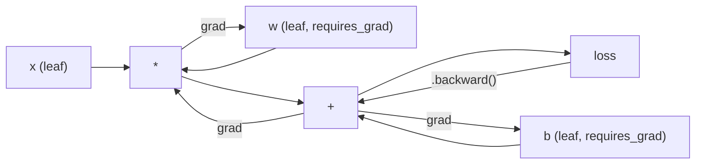
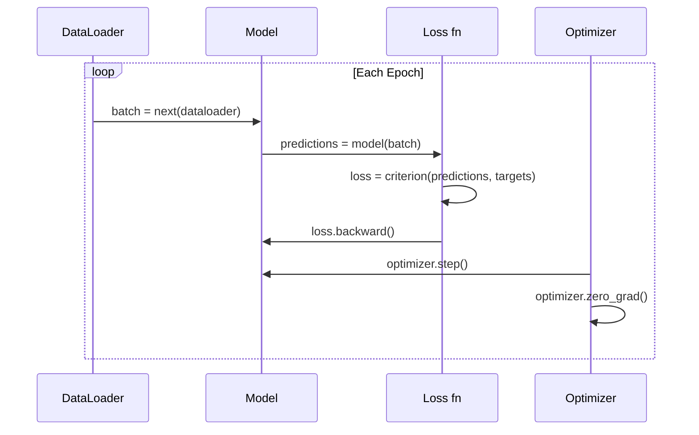

# PyTorch 소개

> 피스톤과 크랭크샤프트로 엔진을 직접 만들어 보았습니다. 이제 모든 사람이 실제로 운전하는 엔진을 배울 차례입니다.

**유형:** Build (실습)
**사용 언어:** Python
**선수 레슨:** Lesson 03.10 (Build Your Own Mini Framework)
**소요 시간:** ~75분

## 학습 목표

- PyTorch의 nn.Module, nn.Sequential, autograd를 사용하여 신경망을 구축하고 학습합니다.
- PyTorch 텐서(tensor), GPU 가속, 표준 학습 루프(zero_grad, forward, loss, backward, step)를 사용합니다.
- 밑바닥부터 구현했던 미니 프레임워크의 컴포넌트들을 이에 상응하는 PyTorch 기능으로 변환합니다.
- 동일한 작업에서 순수 Python 프레임워크와 PyTorch 간의 학습 속도를 프로파일링하고 비교합니다.

## 문제 정의

여러분에게는 이미 동작하는 미니 프레임워크가 있습니다. Linear 계층, ReLU, dropout, batch norm, Adam, DataLoader, 그리고 학습 루프까지 갖추어져 있습니다. 순수 Python만으로 원형 분류(circle classification) 문제에 대해 4계층 네트워크를 학습할 수 있습니다.

하지만 동일한 문제에서 PyTorch보다 500배 느립니다.

여러분의 미니 프레임워크는 중첩된 Python 루프를 통해 한 번에 하나의 샘플을 처리합니다. 반면 PyTorch는 동일한 연산을 GPU에서 실행되는 최적화된 C++/CUDA 커널로 전달합니다. 단일 NVIDIA A100에서 PyTorch는 ImageNet(128만 장의 이미지)으로 ResNet-50(2,560만 개의 파라미터)을 약 6시간 만에 학습합니다. 여러분의 프레임워크로 동일한 작업을 수행한다면 메모리가 먼저 부족해지지 않는다는 가정하에 대략 3,000시간이 걸릴 것입니다.

속도만이 유일한 격차는 아닙니다. 여러분의 프레임워크에는 GPU 지원이 없습니다. 자동 미분(automatic differentiation)도 지원되지 않아 모든 모듈의 backward()를 직접 작성해야 했습니다. 직렬화(serialization)도 없고, 분산 학습도 없으며, 혼합 정밀도(mixed precision)도 지원하지 않습니다. print 문 없이는 그래디언트의 흐름을 디버깅할 방법도 없습니다.

PyTorch는 이러한 모든 공백을 채워줍니다. 그러면서도 여러분이 이미 구축해 둔 멘탈 모델인 Module, forward(), parameters(), backward(), optimizer.step()을 그대로 유지합니다. 개념들이 1:1로 매핑됩니다. 문법도 거의 동일합니다. 차이점은 여러분이 밑바닥부터 설계했던 바로 그 인터페이스 뒤편에 PyTorch가 10년에 걸친 시스템 엔지니어링 기술을 집약해 두었다는 것뿐입니다.

## 핵심 개념

### PyTorch가 승리한 이유

2015년 당시의 TensorFlow는 어떤 코드든 실행하기 전에 정적 계산 그래프(static computation graph)를 정의하도록 요구했습니다. 그래프를 만들고, 컴파일한 다음, 데이터를 흘려보내는 방식이었습니다. 디버깅을 하려면 그래프 시각화 화면을 멍하니 바라보아야 했습니다. 아키텍처를 변경하려면 그래프를 처음부터 다시 작성해야 했습니다.

PyTorch는 2017년에 즉시 실행(eager execution)이라는 다른 철학을 내세우며 출시되었습니다. Python 코드를 작성하면 즉시 실행됩니다. `y = model(x)`는 "나중에 y를 계산할 노드를 그래프에 추가"하는 것이 아니라 실제로 지금 당장 y를 계산합니다. 이는 표준 Python 디버깅 도구가 그대로 동작함을 의미했습니다. print()도 동작했고, pdb도 동작했으며, forward 패스 안에서 if/else를 사용하는 것도 가능했습니다.

2020년에 이르러 시장의 판도가 결정되었습니다. ML 연구 논문에서 PyTorch의 점유율은 7%(2017년)에서 75% 이상(2022년)으로 치솟았습니다. Meta, Google DeepMind, OpenAI, Anthropic, Hugging Face 모두 PyTorch를 기본 프레임워크로 사용합니다. TensorFlow 2.x는 이에 대응하여 즉시 실행을 도입했는데, 이는 PyTorch의 설계가 옳았음을 암묵적으로 인정한 셈이었습니다.

여기서 얻을 수 있는 교훈은 개발자 경험(developer experience)이 복리로 작용한다는 점입니다. 속도가 10% 느리더라도 디버깅 속도가 50% 빠른 프레임워크가 언제나 승리합니다.

### 텐서

텐서(tensor)는 shape, dtype, device라는 세 가지 핵심 속성을 지닌 다차원 배열입니다.

```python
import torch

x = torch.zeros(3, 4)           # shape: (3, 4), dtype: float32, device: cpu
x = torch.randn(2, 3, 224, 224) # batch of 2 RGB images, 224x224
x = torch.tensor([1, 2, 3])     # from a Python list
```

**Shape**는 차원의 형태입니다. 스칼라의 shape는 (), 벡터는 (n,), 행렬은 (m, n), 이미지 배치는 (batch, channels, height, width)입니다.

**Dtype**은 정밀도와 메모리를 제어합니다.

| dtype | 비트 수 | 범위 | 사용 사례 |
|-------|------|-------|----------|
| float32 | 32 | ~7자리 십진수 | 기본 학습 |
| float16 | 16 | ~3.3자리 십진수 | 혼합 정밀도 |
| bfloat16 | 16 | float32와 동일한 범위, 더 낮은 정밀도 | LLM 학습 |
| int8 | 8 | -128 ~ 127 | 양자화(quantized) 추론 |

**Device**는 연산이 일어나는 위치를 결정합니다.

```python
device = torch.device("cuda" if torch.cuda.is_available() else "cpu")
x = torch.randn(3, 4, device=device)
x = x.to("cuda")
x = x.cpu()
```

모든 연산은 관련된 모든 텐서가 동일한 디바이스에 있어야만 수행될 수 있습니다. 이것이 초보자가 가장 흔히 겪는 PyTorch 오류 1위입니다: `RuntimeError: Expected all tensors to be on the same device`. 연산 전에 모든 요소를 동일한 디바이스로 이동하여 해결할 수 있습니다.

**형태 변경(Reshaping)**은 상수 시간(constant-time)이 걸립니다. 데이터 자체가 아니라 메타데이터만 변경하기 때문입니다.

```python
x = torch.randn(2, 3, 4)
x.view(2, 12)      # reshape to (2, 12) -- must be contiguous
x.reshape(6, 4)    # reshape to (6, 4) -- works always
x.permute(2, 0, 1) # reorder dimensions
x.unsqueeze(0)     # add dimension: (1, 2, 3, 4)
x.squeeze()        # remove size-1 dimensions
```

### Autograd

여러분의 미니 프레임워크에서는 모든 모듈마다 backward()를 직접 구현해야 했습니다. PyTorch는 그럴 필요가 없습니다. 텐서에 적용되는 모든 연산을 방향성 비순환 그래프(DAG, 계산 그래프)에 기록한 다음, 해당 그래프를 역방향으로 순회하면서 그래디언트를 자동으로 계산합니다.



여러분의 프레임워크와 다른 핵심 차이점은 PyTorch가 테이프 기반 자동 미분(tape-based autodiff)을 사용한다는 점입니다. 모든 연산은 forward 패스 중에 "테이프"에 추가됩니다. `.backward()`를 호출하면 이 테이프를 역방향으로 재생합니다.

```python
x = torch.randn(3, requires_grad=True)
y = x ** 2 + 3 * x
z = y.sum()
z.backward()
print(x.grad)  # dz/dx = 2x + 3
```

autograd의 세 가지 규칙:

1. `requires_grad=True`인 리프(leaf) 텐서에만 그래디언트가 누적됩니다.
2. 그래디언트는 기본적으로 누적(accumulate)되므로, 각 backward 패스 전에 `optimizer.zero_grad()`를 호출해야 합니다.
3. `torch.no_grad()`는 그래디언트 추적을 비활성화합니다(평가 시 사용).

### nn.Module

`nn.Module`은 PyTorch의 모든 신경망 컴포넌트를 위한 기본 클래스입니다. 여러분은 이미 레슨 10에서 이 추상화를 직접 구축해 보았습니다. PyTorch 버전에는 자동 파라미터 등록, 재귀적 모듈 탐색, 디바이스 관리, state dict 직렬화 기능이 추가되어 있습니다.

```python
import torch.nn as nn

class MLP(nn.Module):
    def __init__(self, input_dim, hidden_dim, output_dim):
        super().__init__()
        self.layer1 = nn.Linear(input_dim, hidden_dim)
        self.relu = nn.ReLU()
        self.layer2 = nn.Linear(hidden_dim, output_dim)

    def forward(self, x):
        x = self.layer1(x)
        x = self.relu(x)
        x = self.layer2(x)
        return x
```

`__init__` 내부에서 `nn.Module`이나 `nn.Parameter`을 속성으로 할당하면, PyTorch가 이를 자동으로 등록합니다. `model.parameters()`는 등록된 모든 파라미터를 재귀적으로 수집합니다. 이것이 바로 미니 프레임워크에서처럼 가중치를 수동으로 모을 필요가 없는 이유입니다.

주요 빌딩 블록:

| 모듈 | 역할 | 파라미터 수 |
|--------|-------------|------------|
| nn.Linear(in, out) | $Wx + b$ | in*out + out |
| nn.Conv2d(in_ch, out_ch, k) | 2D 합성곱(convolution) | in_ch*out_ch*k*k + out_ch |
| nn.BatchNorm1d(features) | 활성화 정규화 | 2 * features |
| nn.Dropout(p) | 무작위 비활성화(zeroing) | 0 |
| nn.ReLU() | $\max(0, x)$ | 0 |
| nn.GELU() | 가우시안 오차 선형 유닛(Gaussian error linear) | 0 |
| nn.Embedding(vocab, dim) | 룩업 테이블(lookup table) | vocab * dim |
| nn.LayerNorm(dim) | 샘플별 정규화 | 2 * dim |

### 손실 함수와 옵티마이저

PyTorch는 여러분이 구축한 모든 구성 요소의 프로덕션 수준 버전을 제공합니다.

**손실 함수**(loss functions, `torch.nn` 제공):

| 손실 | 작업 | 입력 |
|------|------|-------|
| nn.MSELoss() | 회귀(Regression) | 임의의 shape |
| nn.CrossEntropyLoss() | 다중 클래스 분류 | 로짓(Logits, softmax 아님) |
| nn.BCEWithLogitsLoss() | 이진 분류 | 로짓(Logits, sigmoid 아님) |
| nn.L1Loss() | 회귀(로버스트) | 임의의 shape |
| nn.CTCLoss() | 시퀀스 정렬 | 로그 확률(Log probabilities) |

참고: `CrossEntropyLoss`는 내부적으로 `LogSoftmax` + `NLLLoss`를 결합하여 처리합니다. softmax 출력이 아닌 원시 로짓(raw logits)을 전달해야 합니다. 이는 잘못된 그래디언트를 조용히 유발하는 흔한 실수 중 하나입니다.

**옵티마이저**(optimizers, `torch.optim` 제공):

| 옵티마이저 | 사용 시점 | 일반적인 학습률(LR) |
|-----------|-------------|-----------|
| SGD(params, lr, momentum) | CNN, 정밀하게 튜닝된 파이프라인 | 0.01--0.1 |
| Adam(params, lr) | 기본 시작 지점 | 1e-3 |
| AdamW(params, lr, weight_decay) | Transformer, 미세 조정(fine-tuning) | 1e-4--1e-3 |
| LBFGS(params) | 소규모, 2차 최적화 | 1.0 |
### 학습 루프 (The Training Loop)

모든 PyTorch 학습 루프는 동일한 5단계 패턴을 따릅니다. 이는 이미 레슨 10에서 학습했습니다.



표준 패턴은 다음과 같습니다.

```python
for epoch in range(num_epochs):
    model.train()
    for inputs, targets in train_loader:
        inputs, targets = inputs.to(device), targets.to(device)
        optimizer.zero_grad()
        outputs = model(inputs)
        loss = criterion(outputs, targets)
        loss.backward()
        optimizer.step()
```

배치 루프 내부의 단 5줄입니다. GPT-4, Stable Diffusion, LLaMA를 학습시킨 바로 그 5줄입니다. 아키텍처는 바뀌고 데이터도 바뀌지만, 이 5줄은 바뀌지 않습니다.

### Dataset과 DataLoader

PyTorch의 `Dataset`은 `__len__`와 `__getitem__`라는 두 가지 메서드를 가진 추상 클래스입니다. `DataLoader`는 이를 감싸서 배치 처리, 셔플링, 멀티프로세스 데이터 로딩 기능을 제공합니다.

```python
from torch.utils.data import Dataset, DataLoader

class MNISTDataset(Dataset):
    def __init__(self, images, labels):
        self.images = images
        self.labels = labels

    def __len__(self):
        return len(self.labels)

    def __getitem__(self, idx):
        return self.images[idx], self.labels[idx]

loader = DataLoader(dataset, batch_size=64, shuffle=True, num_workers=4)
```

`num_workers=4`은 GPU가 현재 배치를 학습하는 동안 4개의 프로세스를 생성하여 데이터를 병렬로 로드합니다. 디스크 바운드 워크로드(대용량 이미지, 오디오)에서는 이것만으로도 학습 속도를 2배 높일 수 있습니다.

### GPU 학습

모델을 GPU로 이동하기:

```python
device = torch.device("cuda" if torch.cuda.is_available() else "cpu")
model = model.to(device)
```

이렇게 하면 모든 파라미터와 버퍼가 재귀적으로 GPU로 이동합니다. 그런 다음 학습 중에 각 배치를 이동합니다.

```python
inputs, targets = inputs.to(device), targets.to(device)
```

**혼합 정밀도(Mixed precision)**는 마스터 가중치를 float32로 유지하면서 순전파/역전파를 float16으로 실행하여, 최신 GPU(A100, H100, RTX 4090)에서 메모리 사용량을 절반으로 줄이고 처리량을 2배로 늘립니다.

```python
from torch.amp import autocast, GradScaler

scaler = GradScaler()
for inputs, targets in loader:
    with autocast(device_type="cuda"):
        outputs = model(inputs)
        loss = criterion(outputs, targets)
    scaler.scale(loss).backward()
    scaler.step(optimizer)
    scaler.update()
    optimizer.zero_grad()
```

### 비교: 미니 프레임워크 vs PyTorch vs JAX

| 기능 | 미니 프레임워크 (L10) | PyTorch | JAX |
|---------|---------------------|---------|-----|
| 자동 미분 | 수동 backward() | 테이프 기반 autograd | 함수형 변환 |
| 실행 방식 | 즉시 실행 (Python 루프) | 즉시 실행 (C++ 커널) | 추적(Traced) + JIT 컴파일 |
| GPU 지원 | 미지원 | 지원 (CUDA, ROCm, MPS) | 지원 (CUDA, TPU) |
| 속도 (MNIST MLP) | ~300초/에포크 | ~0.5초/에포크 | ~0.3초/에포크 |
| 모듈 시스템 | 커스텀 Module 클래스 | nn.Module | 상태 없는 함수 (Flax/Equinox) |
| 디버깅 | print() | print(), pdb, breakpoint() | 더 어려움 (JIT 추적이 print를 중단시킴) |
| 생태계 | 없음 | Hugging Face, Lightning, timm | Flax, Optax, Orbax |
| 학습 곡선 | 직접 구축함 | 보통 | 가파름 (함수형 패러다임) |
| 프로덕션 활용 | 토이 프로젝트 | Meta, OpenAI, Anthropic, HF | Google DeepMind, Midjourney |

```figure
dropout-mask
```

## 직접 만들어보기

오직 PyTorch 기본 요소(primitives)만을 사용하여 MNIST 데이터셋으로 학습하는 3계층 MLP를 구현합니다. 고수준 래퍼는 사용하지 않습니다. `torchvision.datasets`도 사용하지 않습니다. 원시 데이터를 직접 다운로드하고 파싱합니다.

### 1단계: 원시 파일에서 MNIST 로드하기

MNIST는 4개의 gzip 압축 파일로 제공됩니다: 학습 이미지(60,000 x 28 x 28), 학습 레이블, 테스트 이미지(10,000 x 28 x 28), 테스트 레이블. 이 파일들을 다운로드하고 바이너리 형식을 파싱합니다.

```python
import torch
import torch.nn as nn
import struct
import gzip
import urllib.request
import os

def download_mnist(path="./mnist_data"):
    base_url = "https://storage.googleapis.com/cvdf-datasets/mnist/"
    files = [
        "train-images-idx3-ubyte.gz",
        "train-labels-idx1-ubyte.gz",
        "t10k-images-idx3-ubyte.gz",
        "t10k-labels-idx1-ubyte.gz",
    ]
    os.makedirs(path, exist_ok=True)
    for f in files:
        filepath = os.path.join(path, f)
        if not os.path.exists(filepath):
            urllib.request.urlretrieve(base_url + f, filepath)

def load_images(filepath):
    with gzip.open(filepath, "rb") as f:
        magic, num, rows, cols = struct.unpack(">IIII", f.read(16))
        data = f.read()
        images = torch.frombuffer(bytearray(data), dtype=torch.uint8)
        images = images.reshape(num, rows * cols).float() / 255.0
    return images

def load_labels(filepath):
    with gzip.open(filepath, "rb") as f:
        magic, num = struct.unpack(">II", f.read(8))
        data = f.read()
        labels = torch.frombuffer(bytearray(data), dtype=torch.uint8).long()
    return labels
```

### 2단계: 모델 정의하기

3계층 MLP: 784 -> 256 -> 128 -> 10. ReLU 활성화 함수. 정규화를 위한 Dropout. 단순함을 유지하기 위해 배치 정규화(batch norm)는 사용하지 않습니다.

```python
class MNISTModel(nn.Module):
    def __init__(self):
        super().__init__()
        self.net = nn.Sequential(
            nn.Linear(784, 256),
            nn.ReLU(),
            nn.Dropout(0.2),
            nn.Linear(256, 128),
            nn.ReLU(),
            nn.Dropout(0.2),
            nn.Linear(128, 10),
        )

    def forward(self, x):
        return self.net(x)
```

출력 계층은 10개의 원시 로짓(숫자당 하나)을 생성합니다. softmax는 필요하지 않습니다 -- `CrossEntropyLoss`가 내부적으로 처리합니다.

파라미터 수: $784 \cdot 256 + 256 + 256 \cdot 128 + 128 + 128 \cdot 10 + 10 = 235{,}146$. 현대적인 기준에서는 매우 작습니다. GPT-2 small은 1억 2,400만 개를 가지고 있습니다. 이 모델은 몇 초 만에 학습됩니다.

### 3단계: 학습 루프

표준 순전파-손실-역전파-스텝(forward-loss-backward-step) 패턴입니다.

```python
def train_one_epoch(model, loader, criterion, optimizer, device):
    model.train()
    total_loss = 0
    correct = 0
    total = 0
    for images, labels in loader:
        images, labels = images.to(device), labels.to(device)
        optimizer.zero_grad()
        outputs = model(images)
        loss = criterion(outputs, labels)
        loss.backward()
        optimizer.step()
        total_loss += loss.item() * images.size(0)
        _, predicted = outputs.max(1)
        correct += predicted.eq(labels).sum().item()
        total += labels.size(0)
    return total_loss / total, correct / total


def evaluate(model, loader, criterion, device):
    model.eval()
    total_loss = 0
    correct = 0
    total = 0
    with torch.no_grad():
        for images, labels in loader:
            images, labels = images.to(device), labels.to(device)
            outputs = model(images)
            loss = criterion(outputs, labels)
            total_loss += loss.item() * images.size(0)
            _, predicted = outputs.max(1)
            correct += predicted.eq(labels).sum().item()
            total += labels.size(0)
    return total_loss / total, correct / total
```

평가 중에 `torch.no_grad()`가 사용된 점에 주목하세요. 이는 autograd를 비활성화하여 메모리 사용량을 줄이고 추론(inference) 속도를 높입니다. 이것이 없으면 PyTorch는 사용하지도 않을 연산 그래프를 구축합니다.

### 4단계: 모든 요소 연결하기

```python
def main():
    device = torch.device("cuda" if torch.cuda.is_available() else "cpu")

    download_mnist()
    train_images = load_images("./mnist_data/train-images-idx3-ubyte.gz")
    train_labels = load_labels("./mnist_data/train-labels-idx1-ubyte.gz")
    test_images = load_images("./mnist_data/t10k-images-idx3-ubyte.gz")
    test_labels = load_labels("./mnist_data/t10k-labels-idx1-ubyte.gz")

    train_dataset = torch.utils.data.TensorDataset(train_images, train_labels)
    test_dataset = torch.utils.data.TensorDataset(test_images, test_labels)
    train_loader = torch.utils.data.DataLoader(
        train_dataset, batch_size=64, shuffle=True
    )
    test_loader = torch.utils.data.DataLoader(
        test_dataset, batch_size=256, shuffle=False
    )

    model = MNISTModel().to(device)
    criterion = nn.CrossEntropyLoss()
    optimizer = torch.optim.Adam(model.parameters(), lr=1e-3)

    num_params = sum(p.numel() for p in model.parameters())
    print(f"Device: {device}")
    print(f"Parameters: {num_params:,}")
    print(f"Train samples: {len(train_dataset):,}")
    print(f"Test samples: {len(test_dataset):,}")
    print()

    for epoch in range(10):
        train_loss, train_acc = train_one_epoch(
            model, train_loader, criterion, optimizer, device
        )
        test_loss, test_acc = evaluate(
            model, test_loader, criterion, device
        )
        print(
            f"Epoch {epoch+1:2d} | "
            f"Train Loss: {train_loss:.4f} | Train Acc: {train_acc:.4f} | "
            f"Test Loss: {test_loss:.4f} | Test Acc: {test_acc:.4f}"
        )

    torch.save(model.state_dict(), "mnist_mlp.pt")
    print(f"\nModel saved to mnist_mlp.pt")
    print(f"Final test accuracy: {test_acc:.4f}")
```

10 에포크 후 예상 결과: 테스트 정확도 약 97.8%. CPU 학습 시간: 약 30초. GPU: 약 5초. 동일한 아키텍처를 가진 미니 프레임워크: 약 45분.

## 활용하기

### 빠른 비교: 미니 프레임워크 vs PyTorch

| 미니 프레임워크 (레슨 10) | PyTorch |
|---------------------------|---------|
| `model = Sequential(Linear(784, 256), ReLU(), ...)` | `model = nn.Sequential(nn.Linear(784, 256), nn.ReLU(), ...)` |
| `pred = model.forward(x)` | `pred = model(x)` |
| `optimizer.zero_grad()` | `optimizer.zero_grad()` |
| `grad = criterion.backward()` 후 `model.backward(grad)` | `loss.backward()` |
| `optimizer.step()` | `optimizer.step()` |
| GPU 미지원 | `model.to("cuda")` |
| 모든 모듈에 대한 수동 backward | Autograd가 모든 것을 처리 |

인터페이스는 거의 동일합니다. 차이점은 내부 구현에 있습니다.

### 모델 저장 및 로드하기

```python
torch.save(model.state_dict(), "model.pt")

model = MNISTModel()
model.load_state_dict(torch.load("model.pt", weights_only=True))
model.eval()
```

모델 객체가 아니라 항상 `state_dict()`(파라미터 딕셔너리)를 저장해야 합니다. 모델 객체를 저장하면 pickle을 사용하게 되는데, 이는 코드를 리팩터링할 때 오류를 발생시킵니다. State dict는 이식성이 뛰어납니다.

### 학습률 스케줄링

```python
scheduler = torch.optim.lr_scheduler.CosineAnnealingLR(
    optimizer, T_max=10
)
for epoch in range(10):
    train_one_epoch(model, train_loader, criterion, optimizer, device)
    scheduler.step()
```

PyTorch는 15개 이상의 스케줄러를 제공합니다: StepLR, ExponentialLR, CosineAnnealingLR, OneCycleLR, ReduceLROnPlateau. 모두 동일한 옵티마이저 인터페이스에 연결할 수 있습니다.

## 배포하기

이 레슨에서는 두 가지 결과물을 생성합니다:

- `outputs/prompt-pytorch-debugger.md` -- 흔히 발생하는 PyTorch 학습 실패를 진단하기 위한 프롬프트
- `outputs/skill-pytorch-patterns.md` -- PyTorch 학습 패턴을 위한 스킬 참조 문서

## 연습 문제

1. **배치 정규화(batch normalization) 추가하기.** 각 선형 계층 뒤(활성화 함수 앞)에 `nn.BatchNorm1d`을 삽입합니다. 드롭아웃만 적용한 버전과 테스트 정확도 및 학습 속도를 비교합니다. 배치 정규화를 적용하면 더 적은 에포크 만에 98% 이상에 도달해야 합니다.

2. **학습률 탐색기(learning rate finder) 구현하기.** 지수적으로 증가하는 학습률(1e-7부터 1.0까지)로 1 에포크 동안 학습합니다. 손실 대 학습률 그래프를 그립니다. 최적의 학습률은 손실이 증가하기 시작하기 직전의 값입니다. 이를 활용하여 MNIST 모델에 더 적합한 학습률을 선택하세요.

3. **혼합 정밀도를 사용하여 GPU로 포팅하기.** 학습 루프에 `torch.amp.autocast`과 `GradScaler`를 추가합니다. GPU에서 혼합 정밀도를 적용했을 때와 적용하지 않았을 때의 처리량(초당 샘플 수)을 측정합니다. A100에서는 약 2배의 속도 향상을 기대할 수 있습니다.

4. **커스텀 Dataset 구축하기.** Fashion-MNIST(MNIST와 동일한 형식이지만 의류 품목으로 구성됨)를 다운로드합니다. `__getitem__`과 `__len__`를 포함하는 `FashionMNISTDataset(Dataset)` 클래스를 구현합니다. 동일한 MLP를 학습시키고 정확도를 비교합니다. Fashion-MNIST가 더 어려우므로 약 98% 대신 약 88%의 정확도가 예상됩니다.

5. **Adam을 모멘텀이 포함된 SGD로 대체하기.** `SGD(params, lr=0.01, momentum=0.9)`로 학습합니다. 수렴 곡선을 비교합니다. 그런 다음 `CosineAnnealingLR` 스케줄러를 추가하고 10 에포크 시점에 SGD가 Adam을 따라잡는지 확인합니다.

## 핵심 용어

| 용어 | 일반적인 설명 | 실제 의미 |
|------|----------------|----------------------|
| Tensor | "다차원 배열" | 모든 연산에 자동 미분(automatic differentiation) 지원이 내장되어 있고, 데이터 타입과 디바이스를 인식하는 배열 |
| Autograd | "자동 역전파" | 순전파 중에 연산을 기록한 다음, 이를 역순으로 재생하여 정확한 그래디언트를 계산하는 테이프 기반 시스템 |
| nn.Module | "하나의 레이어" | 미분 가능한 모든 연산 블록의 기본 클래스 -- 파라미터를 등록하고, 중첩을 지원하며, 학습/평가 모드를 처리함 |
| state_dict | "모델 가중치" | 파라미터 이름을 텐서에 매핑하는 OrderedDict -- 학습된 모델의 이식 가능하고 직렬화 가능한 표현 형태 |
| .backward() | "그래디언트 계산" | 연산 그래프를 역방향으로 순회하며, requires_grad=True인 모든 리프 텐서(leaf tensor)에 대해 그래디언트를 계산하고 누적함 |
| .to(device) | "GPU로 이동" | 모든 파라미터와 버퍼를 지정된 디바이스(CPU, CUDA, MPS)로 재귀적으로 전송함 |
| DataLoader | "데이터 파이프라인" | Dataset으로부터 데이터를 배치 처리하고, 셔플링하며, 선택적으로 병렬 처리하여 로드하는 이터레이터 |
| Mixed precision | "float16 사용" | 수치적 안정성을 위해 float32 마스터 가중치를 유지하면서 속도를 위해 float16 순전파/역전파로 학습하는 기법 |
| Eager execution | "즉시 실행" | 호출 시 연산이 지연된 컴파일 단계로 미뤄지지 않고 즉시 실행되는 방식 -- PyTorch를 TF 1.x와 차별화하는 핵심 설계 결정 |
| zero_grad | "그래디언트 초기화" | PyTorch는 기본적으로 그래디언트를 누적하므로, 다음 역전파 패스 전에 모든 파라미터 그래디언트를 0으로 설정함 |
## 추가 참고 자료

- Paszke et al., "PyTorch: An Imperative Style, High-Performance Deep Learning Library" (2019) -- PyTorch의 설계 트레이드오프를 설명한 원본 논문입니다.
- PyTorch 튜토리얼: "Learning PyTorch with Examples" (https://pytorch.org/tutorials/beginner/pytorch_with_examples.html) -- 텐서에서 nn.Module로 이어지는 공식 학습 경로입니다.
- PyTorch Performance Tuning Guide (https://pytorch.org/tutorials/recipes/recipes/tuning_guide.html) -- 혼합 정밀도(mixed precision), DataLoader 워커, 고정 메모리(pinned memory) 및 기타 프로덕션 최적화 기법을 다룹니다.
- Horace He, "Making Deep Learning Go Brrrr" (https://horace.io/brrr_intro.html) -- GPU 훈련이 빠른 이유와 PyTorch 특화 최적화 전략을 설명합니다.
