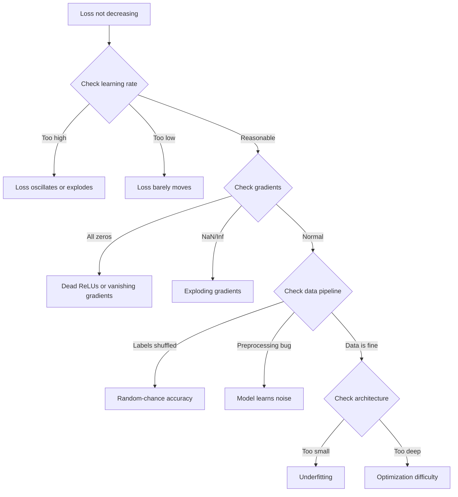
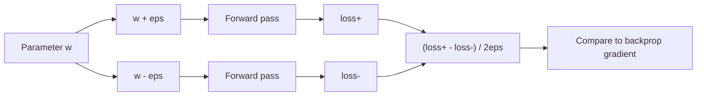
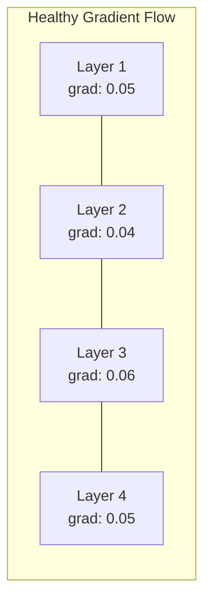
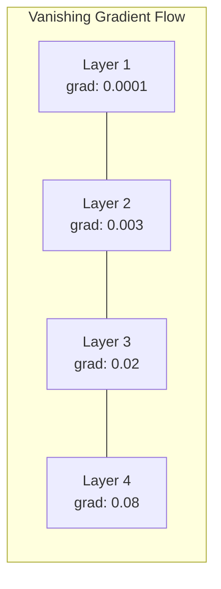
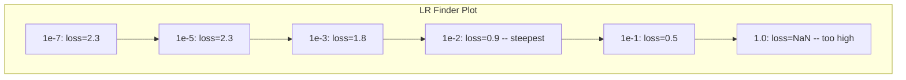

# 신경망 디버깅

> 네트워크가 컴파일되었습니다. 정상적으로 실행되었습니다. 어떤 숫자가 출력되었습니다. 하지만 그 숫자는 잘못되었고, 아무런 에러도 발생하지 않았습니다. 에러 메시지가 전혀 없는, 가장 까다로운 유형의 디버깅에 오신 것을 환영합니다.

**유형:** Build (실습)
**사용 언어:** Python, PyTorch
**선수 레슨:** Phase 03 Lessons 01-10 (especially backpropagation, loss functions, optimizers)
**소요 시간:** ~90분

## 학습 목표

- 체계적인 디버깅 전략을 사용하여 일반적인 신경망 실패 증상(NaN 손실, 평탄한 손실 곡선, 과적합, 진동)을 진단합니다.
- "단일 배치 과적합(overfit one batch)" 기법을 적용하여 모델 아키텍처와 학습 루프가 올바른지 검증합니다.
- 그래디언트 크기, 활성화 분포, 가중치 노름(norm)을 점검하여 기울기 소실(vanishing gradient) 및 폭주(exploding gradient) 문제를 식별합니다.
- 데이터 파이프라인, 모델 아키텍처, 손실 함수, 옵티마이저, 학습률 문제를 포괄하는 디버깅 체크리스트를 구축합니다.

## 문제 정의

전통적인 소프트웨어는 고장이 나면 충돌이 발생합니다. 널 포인터(null pointer)는 예외를 던집니다. 타입 불일치는 컴파일 시점에 실패합니다. 오프바이원(off-by-one) 오류는 명백히 잘못된 출력을 냅니다.

신경망은 그런 편의를 제공하지 않습니다.

망가진 신경망도 끝까지 실행되고, 손실(loss) 값을 출력하며, 예측을 내놓습니다. 손실이 줄어들 수도 있습니다. 예측값이 그럴듯해 보일 수도 있습니다. 하지만 모델은 조용히 망가져 있습니다. 지름길(shortcut)을 학습하거나, 노이즈를 암기하거나, 쓸모없는 로컬 미니멈(local minimum)으로 수렴하는 식입니다. Google 연구진은 ML 디버깅 시간의 60~70%가 에러를 발생시키지 않으면서 모델 품질을 떨어뜨리는 "무음(silent)" 버그에 소요된다고 추정했습니다.

제대로 작동하는 모델과 망가진 모델의 차이는 단 한 줄의 실수에서 비롯되는 경우가 많습니다. 누락된 `zero_grad()`, 전치된 차원, 10배 잘못 설정된 학습률 등이 그렇습니다. 신경망 분야의 고전적인 글인 "신경망 학습 레시피(A Recipe for Training Neural Networks)"(2019)는 다음과 같은 문장으로 시작합니다. "신경망에서 가장 흔한 실수는 충돌을 일으키지 않는 버그다."

이 강의에서는 이러한 버그를 찾아내는 방법을 배웁니다.

## 핵심 개념

### 디버깅 마인드셋

무작정 출력문을 찍고 기도하는(print-and-pray) 디버깅은 잊으십시오. 신경망 디버깅에는 체계적인 접근 방식이 필요합니다. 피드백 루프가 느리고(학습 실행당 수분에서 수시간 소요), 증상이 모호하기 때문입니다(손실이 줄지 않는 원인은 20가지도 넘을 수 있습니다).

황금률은 다음과 같습니다. **단순하게 시작하고, 한 번에 하나씩 복잡성을 추가하며, 각 요소를 독립적으로 검증하십시오.**



### 증상 1: 손실이 감소하지 않음

가장 흔하게 겪는 문제입니다. 학습 루프는 돌고, 에폭(epoch)은 넘어가는데, 손실이 제자리걸음을 하거나 격렬하게 진동합니다.

**잘못된 학습률.** 학습률이 너무 높으면 손실이 진동하거나 NaN으로 튑니다. 너무 낮으면 손실이 너무 느리게 감소하여 평탄해 보입니다. Adam의 경우 1e-3부터 시작하십시오. SGD의 경우 1e-1 또는 1e-2부터 시작하십시오. 다른 문제라고 단정 짓기 전에 항상 10배 간격의 세 가지 학습률(예: 1e-2, 1e-3, 1e-4)을 먼저 시도해 보십시오.

**죽은 ReLU(Dead ReLUs).** ReLU 뉴런이 큰 음수 입력을 받으면 출력이 0이 되고 그래디언트도 0이 됩니다. 그러면 다시는 활성화되지 않습니다. 죽은 뉴런이 충분히 많아지면 네트워크는 학습할 수 없게 됩니다. 점검 방법: 각 ReLU 계층 이후 출력이 정확히 0인 활성화의 비율을 출력해 봅니다. 50%를 초과하여 죽어 있다면 LeakyReLU로 전환하거나 학습률을 낮추십시오.

**기울기 소실(Vanishing gradients).** sigmoid나 tanh 활성화 함수를 사용하는 깊은 네트워크에서는 역전파(backpropagation)가 진행될수록 그래디언트가 지수적으로 줄어듭니다. 첫 번째 계층에 도달할 때쯤에는 거의 0에 가까워집니다. 초기 계층들이 학습을 멈추게 됩니다. 해결책: ReLU/GELU 사용, 잔차 연결(residual connection) 추가, 배치 정규화(batch normalization) 사용.

**기울기 폭주(Exploding gradients).** 반대 문제입니다. 그래디언트가 지수적으로 증가합니다. RNN과 매우 깊은 네트워크에서 흔히 발생합니다. 손실이 갑자기 NaN으로 튑니다. 해결책: 그래디언트 클리핑(`torch.nn.utils.clip_grad_norm_`), 학습률 낮추기, 정규화 추가.

### 증상 2: 손실은 감소하지만 모델 성능이 나쁨

손실은 감소합니다. 훈련 정확도는 99%에 도달합니다. 하지만 테스트 정확도는 55%에 불과합니다. 혹은 모델이 실제 데이터에서 터무니없는 출력을 생성합니다.

**과적합(Overfitting).** 모델이 패턴을 학습하는 대신 훈련 데이터를 단순히 암기합니다. 훈련 손실과 검증 손실 사이의 격차가 시간이 지남에 따라 커집니다. 해결책: 데이터 추가 확보, 드롭아웃(dropout), 가중치 감쇠(weight decay), 조기 종료(early stopping), 데이터 증강(data augmentation).

**데이터 누수(Data leakage).** 테스트 데이터가 훈련 과정에 유출되었습니다. 정확도가 의심스러울 정도로 높게 나옵니다. 흔한 원인: 데이터 분할(split) 전 셔플링, 전체 데이터셋의 통계량을 사용한 전처리, 분할 간 중복 샘플 존재. 해결책: 먼저 분할한 후 전처리 수행, 중복 샘플 점검.

**라벨 오류(Label errors).** 대부분의 실제 데이터셋에서 라벨의 5~10%는 잘못되어 있습니다(Northcutt et al., 2021 -- "Pervasive Label Errors in Test Sets"). 모델이 이러한 노이즈를 학습합니다. 해결책: 신뢰 학습(confident learning)을 사용하여 잘못 라벨링된 샘플을 찾아서 수정하거나, 손실 절단(loss truncation)을 사용하여 손실이 큰 샘플을 무시합니다.

### 증상 3: 손실에 NaN 또는 Inf 발생

손실 값이 `nan` 또는 `inf`가 됩니다. 학습이 완전히 중단된 상태입니다.

**과도하게 높은 학습률.** 그래디언트 업데이트가 지나치게 크게 일어나 가중치가 폭주합니다. 해결책: 10배 줄입니다.

**log(0) 또는 log(음수).** 크로스 엔트로피(cross-entropy) 손실은 `log(p)`을 계산합니다. 모델이 정확히 0 또는 음수 확률을 출력하면 로그 값이 폭발합니다. 해결책: `eps=1e-7` 조건에서 예측값을 `[eps, 1-eps]` 범위로 클램핑(clamp)합니다.

**0으로 나누기.** 배치 정규화는 표준편차로 나눕니다. 모든 값이 일정한 배치는 표준편차가 0이 됩니다. 해결책: 분모에 입실론(epsilon)을 더합니다(PyTorch는 기본적으로 이를 수행하지만, 직접 구현한 코드에서는 빠져 있을 수 있습니다).

**수치적 오버플로(Numerical overflow).** 큰 활성화 값이 `exp()`에 입력되면 Inf가 발생합니다. 특히 softmax가 이에 취약합니다. 해결책: 지수 함수를 취하기 전에 최댓값을 뺍니다(log-sum-exp 트릭).

### 기법 1: 그래디언트 검사 (Gradient Checking)

해석적 그래디언트(역전파로 계산)를 수치적 그래디언트(유한 차분으로 계산)와 비교합니다. 둘이 일치하지 않는다면 역전파 패스(backward pass)에 버그가 있는 것입니다.

파라미터 `w`에 대한 수치적 그래디언트:

```math
\text{grad\_numerical} = \frac{\text{loss}(w + \text{eps}) - \text{loss}(w - \text{eps})}{2 \cdot \text{eps}}
```

일치도 측정 지표(상대 오차):

```math
\text{rel\_diff} = \frac{\lvert \text{grad\_analytical} - \text{grad\_numerical} \rvert}{\max(\lvert \text{grad\_analytical} \rvert, \lvert \text{grad\_numerical} \rvert, 10^{-8})}
```

`rel_diff < 1e-5`인 경우: 올바름. `rel_diff > 1e-3`인 경우: 거의 확실히 버그임.



### 기법 2: 활성화 통계량 (Activation Statistics)

학습 도중 각 계층 이후의 활성화 평균과 표준편차를 모니터링합니다. 정상적인 네트워크는 (정규화 후) 평균이 0에 가깝고 표준편차가 1에 가깝거나, 최소한 유계(bounded)인 활성화 상태를 유지합니다.

| 상태 지표 | 평균 | 표준편차 | 진단 |
|-----------------|------|-----|-----------|
| 정상 (Healthy) | ~0 | ~1 | 네트워크가 정상적으로 학습 중 |
| 포화 (Saturated) | >>0 또는 <<0 | ~0 | 활성화 값이 극단값에 갇힘 |
| 비활성화 (Dead) | 0 | 0 | 뉴런이 죽음 (전부 0) |
| 폭주 (Exploding) | >>10 | >>10 | 활성화 값이 한계 없이 증가함 |

### 기법 3: 그래디언트 흐름 시각화 (Gradient Flow Visualization)

각 계층의 평균 그래디언트 크기를 시각화합니다. 정상적인 네트워크라면 계층 전반에 걸쳐 그래디언트 크기가 대체로 비슷해야 합니다. 초기 계층의 그래디언트가 후속 계층보다 1000배 이상 작다면 기울기 소실이 발생한 것입니다.




### 기법 4: 단일 배치 과적합 테스트 (The Overfit-One-Batch Test)

딥러닝에서 가장 중요한 단 하나의 디버깅 기법입니다.

작은 배치 하나(8~32개 샘플)를 가져옵니다. 이 배치를 100회 이상 반복 훈련(iteration)합니다. 손실은 거의 0에 수렴해야 하고 훈련 정확도는 100%에 도달해야 합니다. 그렇지 않다면 모델이나 훈련 루프에 근본적인 버그가 있는 것이므로, 전체 훈련으로 넘어가지 마십시오.

이 테스트는 다음 문제를 잡아냅니다.
- 망가진 손실 함수
- 잘못 구현된 역전파(backward pass)
- 데이터를 표현하기에 너무 작은 아키텍처
- 모델 파라미터에 연결되지 않은 옵티마이저(optimizer)
- 데이터와 라벨의 불일치

이 테스트는 실행하는 데 30초밖에 걸리지 않지만, 전체 훈련을 디버깅하느라 낭비될 수시간을 절약해 줍니다.

### 기법 5: 학습률 탐색기 (Learning Rate Finder)

Leslie Smith(2017)는 한 에포크 동안 학습률을 매우 작은 값(1e-7)에서 매우 큰 값(10)까지 스위핑하면서 손실을 기록하는 방법을 제안했습니다. 학습률에 따른 손실 그래프를 그려보십시오. 최적의 학습률은 대략 손실이 가장 빠르게 감소하기 시작하는 지점의 학습률보다 10배 정도 작은 값입니다.



이 예시에서의 최적 LR: 약 1e-3(가장 가파른 지점보다 10배 작은 값).

### 흔한 PyTorch 버그

PyTorch 커뮤니티에서 가장 많은 시간을 낭비하게 만드는 버그들입니다.

| 버그 | 증상 | 해결 방법 |
|-----|---------|-----|
| `optimizer.zero_grad()` 누락 | 배치 간 그래디언트가 누적되어 손실이 요동침 | `loss.backward()` 전에 `optimizer.zero_grad()` 추가 |
| 테스트 시 `model.eval()` 누락 | Dropout과 배치 정규화(batch norm)가 다르게 동작하여 실행마다 테스트 정확도가 달라짐 | `model.eval()` 및 `torch.no_grad()` 추가 |
| 잘못된 텐서 형태 | 조용한 브로드캐스팅(broadcasting)으로 오류 없이 잘못된 결과 생성 | 디버깅 시 모든 연산 후에 텐서 형태(shape) 출력 |
| CPU/GPU 불일치 | `RuntimeError: expected CUDA tensor` | 모델과 데이터 **모두**에 `.to(device)` 사용 |
| 텐서를 분리(detach)하지 않음 | 연산 그래프가 계속 커져 OOM 발생 | `.detach()` 또는 `with torch.no_grad()` 사용 |
| autograd를 깨뜨리는 인플레이스(in-place) 연산 | `RuntimeError: modified by in-place operation` | `x += 1`을 `x = x + 1`로 교체 |
| 정규화되지 않은 데이터 | 손실이 무작위 추측(random-chance) 수준에 정체됨 | 입력을 평균=0, 표준편차=1로 정규화 |
| 잘못된 데이터 타입의 라벨 | Cross-entropy는 `Long`을 기대하지만 `Float`이 전달됨 | 라벨의 데이터 타입 변환: `labels.long()` |

### 마스터 디버깅 테이블

| 증상 | 유력한 원인 | 가장 먼저 시도할 조치 |
|---------|-------------|-------------------|
| 손실이 -log(1/num_classes)에 정체됨 | 모델이 균등 분포를 예측함 | 데이터 파이프라인 확인, 라벨과 입력의 일치 여부 검증 |
| 몇 스텝 후 손실이 NaN이 됨 | 학습률이 너무 높음 | LR을 10배 감소 |
| 손실이 즉시 NaN이 됨 | log(0) 또는 0으로 나누기 | 로그/나눗셈 연산에 엡실론(epsilon) 추가 |
| 손실이 심하게 요동침 | LR이 너무 높거나 배치 크기가 너무 작음 | LR 감소, 배치 크기 증가 |
| 손실이 감소하다가 정체됨 | 미세 조정(fine-tuning) 단계에 비해 LR이 너무 높음 | LR 스케줄러(cosine 또는 step decay) 추가 |
| 훈련 정확도는 높으나 테스트 정확도는 낮음 | 과적합(Overfitting) | dropout, weight decay 추가, 데이터 증강 |
| 훈련 정확도 = 테스트 정확도 = 무작위 추측 수준 | 모델이 아무것도 학습하지 못함 | 단일 배치 과적합 테스트 실행 |
| 훈련 정확도 = 테스트 정확도이지만 둘 다 낮음 | 과소적합(Underfitting) | 더 큰 모델, 더 많은 레이어, 더 많은 특성(feature) 사용 |
| 그래디언트가 모두 0임 | 죽은 ReLU(Dead ReLU) 또는 분리된 연산 그래프 | LeakyReLU로 교체, `.requires_grad` 확인 |
| 훈련 도중 메모리 부족(OOM) | 배치가 너무 크거나 그래프가 해제되지 않음 | 배치 크기 감소, 평가(eval) 시 `torch.no_grad()` 사용 |

```figure
learning-curves
```

## 직접 만들어보기

활성화(activation), 그래디언트, 손실 곡선을 모니터링하는 진단 툴킷입니다. 신경망을 의도적으로 망가뜨린 다음, 이 툴킷을 사용하여 각 문제를 진단해 봅니다.

### 1단계: NetworkDebugger 클래스

PyTorch 모델에 훅(hook)을 걸어 레이어별 활성화 및 그래디언트 통계를 기록합니다.

```python
import torch
import torch.nn as nn
import math


class NetworkDebugger:
    def __init__(self, model):
        self.model = model
        self.activation_stats = {}
        self.gradient_stats = {}
        self.loss_history = []
        self.lr_losses = []
        self.hooks = []
        self._register_hooks()

    def _register_hooks(self):
        for name, module in self.model.named_modules():
            if isinstance(module, (nn.Linear, nn.Conv2d, nn.ReLU, nn.LeakyReLU)):
                hook = module.register_forward_hook(self._make_activation_hook(name))
                self.hooks.append(hook)
                hook = module.register_full_backward_hook(self._make_gradient_hook(name))
                self.hooks.append(hook)

    def _make_activation_hook(self, name):
        def hook(module, input, output):
            with torch.no_grad():
                out = output.detach().float()
                self.activation_stats[name] = {
                    "mean": out.mean().item(),
                    "std": out.std().item(),
                    "fraction_zero": (out == 0).float().mean().item(),
                    "min": out.min().item(),
                    "max": out.max().item(),
                }
        return hook

    def _make_gradient_hook(self, name):
        def hook(module, grad_input, grad_output):
            if grad_output[0] is not None:
                with torch.no_grad():
                    grad = grad_output[0].detach().float()
                    self.gradient_stats[name] = {
                        "mean": grad.mean().item(),
                        "std": grad.std().item(),
                        "abs_mean": grad.abs().mean().item(),
                        "max": grad.abs().max().item(),
                    }
        return hook

    def record_loss(self, loss_value):
        self.loss_history.append(loss_value)

    def check_loss_health(self):
        if len(self.loss_history) < 2:
            return "NOT_ENOUGH_DATA"
        recent = self.loss_history[-10:]
        if any(math.isnan(v) or math.isinf(v) for v in recent):
            return "NAN_OR_INF"
        if len(self.loss_history) >= 20:
            first_half = sum(self.loss_history[:10]) / 10
            second_half = sum(self.loss_history[-10:]) / 10
            if second_half >= first_half * 0.99:
                return "NOT_DECREASING"
        if len(recent) >= 5:
            diffs = [recent[i+1] - recent[i] for i in range(len(recent)-1)]
            if max(diffs) - min(diffs) > 2 * abs(sum(diffs) / len(diffs)):
                return "OSCILLATING"
        return "HEALTHY"

    def check_activations(self):
        issues = []
        for name, stats in self.activation_stats.items():
            if stats["fraction_zero"] > 0.5:
                issues.append(f"DEAD_NEURONS: {name} has {stats['fraction_zero']:.0%} zero activations")
            if abs(stats["mean"]) > 10:
                issues.append(f"EXPLODING_ACTIVATIONS: {name} mean={stats['mean']:.2f}")
            if stats["std"] < 1e-6:
                issues.append(f"COLLAPSED_ACTIVATIONS: {name} std={stats['std']:.2e}")
        return issues if issues else ["HEALTHY"]

    def check_gradients(self):
        issues = []
        grad_magnitudes = []
        for name, stats in self.gradient_stats.items():
            grad_magnitudes.append((name, stats["abs_mean"]))
            if stats["abs_mean"] < 1e-7:
                issues.append(f"VANISHING_GRADIENT: {name} abs_mean={stats['abs_mean']:.2e}")
            if stats["abs_mean"] > 100:
                issues.append(f"EXPLODING_GRADIENT: {name} abs_mean={stats['abs_mean']:.2e}")
        if len(grad_magnitudes) >= 2:
            first_mag = grad_magnitudes[0][1]
            last_mag = grad_magnitudes[-1][1]
            if last_mag > 0 and first_mag / last_mag > 100:
                issues.append(f"GRADIENT_RATIO: first/last = {first_mag/last_mag:.0f}x (vanishing)")
        return issues if issues else ["HEALTHY"]

    def print_report(self):
        print("\n=== NETWORK DEBUGGER REPORT ===")
        print(f"\nLoss health: {self.check_loss_health()}")
        if self.loss_history:
            print(f"  Last 5 losses: {[f'{v:.4f}' for v in self.loss_history[-5:]]}")
        print("\nActivation diagnostics:")
        for item in self.check_activations():
            print(f"  {item}")
        print("\nGradient diagnostics:")
        for item in self.check_gradients():
            print(f"  {item}")
        print("\nPer-layer activation stats:")
        for name, stats in self.activation_stats.items():
            print(f"  {name}: mean={stats['mean']:.4f} std={stats['std']:.4f} zero={stats['fraction_zero']:.1%}")
        print("\nPer-layer gradient stats:")
        for name, stats in self.gradient_stats.items():
            print(f"  {name}: abs_mean={stats['abs_mean']:.2e} max={stats['max']:.2e}")

    def remove_hooks(self):
        for hook in self.hooks:
            hook.remove()
        self.hooks.clear()
```

### 2단계: 단일 배치 과적합 테스트

```python
def overfit_one_batch(model, x_batch, y_batch, criterion, lr=0.01, steps=200):
    optimizer = torch.optim.Adam(model.parameters(), lr=lr)
    model.train()
    print("\n=== OVERFIT ONE BATCH TEST ===")
    print(f"Batch size: {x_batch.shape[0]}, Steps: {steps}")

    for step in range(steps):
        optimizer.zero_grad()
        output = model(x_batch)
        loss = criterion(output, y_batch)
        loss.backward()
        optimizer.step()

        if step % 50 == 0 or step == steps - 1:
            with torch.no_grad():
                preds = (output > 0).float() if output.shape[-1] == 1 else output.argmax(dim=1)
                targets = y_batch if y_batch.dim() == 1 else y_batch.squeeze()
                acc = (preds.squeeze() == targets).float().mean().item()
            print(f"  Step {step:3d} | Loss: {loss.item():.6f} | Accuracy: {acc:.1%}")

    final_loss = loss.item()
    if final_loss > 0.1:
        print(f"\n  FAIL: Loss did not converge ({final_loss:.4f}). Model or training loop is broken.")
        return False
    print(f"\n  PASS: Loss converged to {final_loss:.6f}")
    return True
```

### 3단계: 학습률 탐색기

```python
def find_learning_rate(model, x_data, y_data, criterion, start_lr=1e-7, end_lr=10, steps=100):
    import copy
    original_state = copy.deepcopy(model.state_dict())
    optimizer = torch.optim.SGD(model.parameters(), lr=start_lr)
    lr_mult = (end_lr / start_lr) ** (1 / steps)

    model.train()
    results = []
    best_loss = float("inf")
    current_lr = start_lr

    print("\n=== LEARNING RATE FINDER ===")

    for step in range(steps):
        optimizer.zero_grad()
        output = model(x_data)
        loss = criterion(output, y_data)

        if math.isnan(loss.item()) or loss.item() > best_loss * 10:
            break

        best_loss = min(best_loss, loss.item())
        results.append((current_lr, loss.item()))

        loss.backward()
        optimizer.step()

        current_lr *= lr_mult
        for param_group in optimizer.param_groups:
            param_group["lr"] = current_lr

    model.load_state_dict(original_state)

    if len(results) < 10:
        print("  Could not complete LR sweep -- loss diverged too quickly")
        return results

    min_loss_idx = min(range(len(results)), key=lambda i: results[i][1])
    suggested_lr = results[max(0, min_loss_idx - 10)][0]

    print(f"  Swept {len(results)} steps from {start_lr:.0e} to {results[-1][0]:.0e}")
    print(f"  Minimum loss {results[min_loss_idx][1]:.4f} at lr={results[min_loss_idx][0]:.2e}")
    print(f"  Suggested learning rate: {suggested_lr:.2e}")

    return results
```

### 4단계: 그래디언트 체커

```python
def _flat_to_multi_index(flat_idx, shape):
    multi_idx = []
    remaining = flat_idx
    for dim in reversed(shape):
        multi_idx.insert(0, remaining % dim)
        remaining //= dim
    return tuple(multi_idx)


def gradient_check(model, x, y, criterion, eps=1e-4):
    model.train()
    x_double = x.double()
    y_double = y.double()
    model_double = model.double()

    print("\n=== GRADIENT CHECK ===")
    overall_max_diff = 0
    checked = 0

    for name, param in model_double.named_parameters():
        if not param.requires_grad:
            continue

        layer_max_diff = 0

        model_double.zero_grad()
        output = model_double(x_double)
        loss = criterion(output, y_double)
        loss.backward()
        analytical_grad = param.grad.clone()

        num_checks = min(5, param.numel())
        for i in range(num_checks):
            idx = _flat_to_multi_index(i, param.shape)
            original = param.data[idx].item()

            param.data[idx] = original + eps
            with torch.no_grad():
                loss_plus = criterion(model_double(x_double), y_double).item()

            param.data[idx] = original - eps
            with torch.no_grad():
                loss_minus = criterion(model_double(x_double), y_double).item()

            param.data[idx] = original

            numerical = (loss_plus - loss_minus) / (2 * eps)
            analytical = analytical_grad[idx].item()

            denom = max(abs(numerical), abs(analytical), 1e-8)
            rel_diff = abs(numerical - analytical) / denom

            layer_max_diff = max(layer_max_diff, rel_diff)
            checked += 1

        overall_max_diff = max(overall_max_diff, layer_max_diff)
        status = "OK" if layer_max_diff < 1e-5 else "MISMATCH"
        print(f"  {name}: max_rel_diff={layer_max_diff:.2e} [{status}]")

    model.float()

    print(f"\n  Checked {checked} parameters")
    if overall_max_diff < 1e-5:
        print("  PASS: Gradients match (rel_diff < 1e-5)")
    elif overall_max_diff < 1e-3:
        print("  WARN: Small differences (1e-5 < rel_diff < 1e-3)")
    else:
        print("  FAIL: Gradient mismatch detected (rel_diff > 1e-3)")
    return overall_max_diff
```

### 5단계: 의도적으로 망가뜨린 신경망

이제 망가진 신경망들에 툴킷을 적용하고 각각의 문제를 진단합니다.

```python
def demo_broken_networks():
    torch.manual_seed(42)
    x = torch.randn(64, 10)
    y = (x[:, 0] > 0).long()

    print("\n" + "=" * 60)
    print("BUG 1: Learning rate too high (lr=10)")
    print("=" * 60)
    model1 = nn.Sequential(nn.Linear(10, 32), nn.ReLU(), nn.Linear(32, 2))
    debugger1 = NetworkDebugger(model1)
    optimizer1 = torch.optim.SGD(model1.parameters(), lr=10.0)
    criterion = nn.CrossEntropyLoss()
    for step in range(20):
        optimizer1.zero_grad()
        out = model1(x)
        loss = criterion(out, y)
        debugger1.record_loss(loss.item())
        loss.backward()
        optimizer1.step()
    debugger1.print_report()
    debugger1.remove_hooks()

    print("\n" + "=" * 60)
    print("BUG 2: Dead ReLUs from bad initialization")
    print("=" * 60)
    model2 = nn.Sequential(nn.Linear(10, 32), nn.ReLU(), nn.Linear(32, 32), nn.ReLU(), nn.Linear(32, 2))
    with torch.no_grad():
        for m in model2.modules():
            if isinstance(m, nn.Linear):
                m.weight.fill_(-1.0)
                m.bias.fill_(-5.0)
    debugger2 = NetworkDebugger(model2)
    optimizer2 = torch.optim.Adam(model2.parameters(), lr=1e-3)
    for step in range(50):
        optimizer2.zero_grad()
        out = model2(x)
        loss = criterion(out, y)
        debugger2.record_loss(loss.item())
        loss.backward()
        optimizer2.step()
    debugger2.print_report()
    debugger2.remove_hooks()

    print("\n" + "=" * 60)
    print("BUG 3: Missing zero_grad (gradients accumulate)")
    print("=" * 60)
    model3 = nn.Sequential(nn.Linear(10, 32), nn.ReLU(), nn.Linear(32, 2))
    debugger3 = NetworkDebugger(model3)
    optimizer3 = torch.optim.SGD(model3.parameters(), lr=0.01)
    for step in range(50):
        out = model3(x)
        loss = criterion(out, y)
        debugger3.record_loss(loss.item())
        loss.backward()
        optimizer3.step()
    debugger3.print_report()
    debugger3.remove_hooks()

    print("\n" + "=" * 60)
    print("HEALTHY NETWORK: Correct setup for comparison")
    print("=" * 60)
    model_good = nn.Sequential(nn.Linear(10, 32), nn.ReLU(), nn.Linear(32, 2))
    debugger_good = NetworkDebugger(model_good)
    optimizer_good = torch.optim.Adam(model_good.parameters(), lr=1e-3)
    for step in range(50):
        optimizer_good.zero_grad()
        out = model_good(x)
        loss = criterion(out, y)
        debugger_good.record_loss(loss.item())
        loss.backward()
        optimizer_good.step()
    debugger_good.print_report()
    debugger_good.remove_hooks()

    print("\n" + "=" * 60)
    print("OVERFIT-ONE-BATCH TEST (healthy model)")
    print("=" * 60)
    model_test = nn.Sequential(nn.Linear(10, 32), nn.ReLU(), nn.Linear(32, 2))
    overfit_one_batch(model_test, x[:8], y[:8], criterion)

    print("\n" + "=" * 60)
    print("LEARNING RATE FINDER")
    print("=" * 60)
    model_lr = nn.Sequential(nn.Linear(10, 32), nn.ReLU(), nn.Linear(32, 2))
    find_learning_rate(model_lr, x, y, criterion)

    print("\n" + "=" * 60)
    print("GRADIENT CHECK")
    print("=" * 60)
    model_grad = nn.Sequential(nn.Linear(10, 8), nn.ReLU(), nn.Linear(8, 2))
    gradient_check(model_grad, x[:4], y[:4], criterion)
```

## 활용하기

### PyTorch 내장 도구

```python
import torch
import torch.nn as nn

model = nn.Sequential(
    nn.Linear(768, 256),
    nn.ReLU(),
    nn.Linear(256, 10),
)

with torch.autograd.detect_anomaly():
    output = model(input_tensor)
    loss = criterion(output, target)
    loss.backward()

for name, param in model.named_parameters():
    if param.grad is not None:
        print(f"{name}: grad_mean={param.grad.abs().mean():.2e}")
```

### Weights & Biases 연동

```python
import wandb

wandb.init(project="debug-training")

for epoch in range(100):
    loss = train_one_epoch()
    wandb.log({
        "loss": loss,
        "lr": optimizer.param_groups[0]["lr"],
        "grad_norm": torch.nn.utils.clip_grad_norm_(model.parameters(), float("inf")),
    })

    for name, param in model.named_parameters():
        if param.grad is not None:
            wandb.log({f"grad/{name}": wandb.Histogram(param.grad.cpu().numpy())})
```

### TensorBoard

```python
from torch.utils.tensorboard import SummaryWriter

writer = SummaryWriter("runs/debug_experiment")

for epoch in range(100):
    loss = train_one_epoch()
    writer.add_scalar("Loss/train", loss, epoch)

    for name, param in model.named_parameters():
        writer.add_histogram(f"weights/{name}", param, epoch)
        if param.grad is not None:
            writer.add_histogram(f"gradients/{name}", param.grad, epoch)
```

### 디버그 체크리스트 (전체 훈련 전)

1. 단일 배치 과적합 테스트를 실행합니다. 실패하면 중단하십시오.
2. 모델 요약 정보를 출력하여 파라미터 수가 적절한지 검증합니다.
3. 무작위 데이터로 단일 순전파(forward pass)를 실행하여 출력 형태(shape)를 확인합니다.
4. 5 에포크 동안 훈련하여 손실이 감소하는지 확인합니다.
5. 활성화 통계를 확인하여 비활성화된 레이어나 폭발하는 값이 없는지 검증합니다.
6. 그래디언트 흐름을 점검하여 기울기 소실(vanishing)이나 폭발(exploding)이 없는지 확인합니다.
7. 데이터 파이프라인을 검증하기 위해 무작위 샘플 5개와 라벨을 출력합니다.

## 배포하기

이 레슨에서 생성되는 결과물:
- `outputs/prompt-nn-debugger.md` -- 신경망 훈련 실패 진단을 위한 프롬프트
- `outputs/skill-debug-checklist.md` -- 훈련 문제 디버깅을 위한 의사결정 트리 체크리스트

디버깅을 위한 주요 프로덕션 배포 패턴:
- 프로덕션 훈련 스크립트에 모니터링 훅 추가
- 매 N 스텝마다 활성화 및 그래디언트 통계를 W&B 또는 TensorBoard에 기록
- NaN 손실, 비활성화된 뉴런(80% 이상이 0), 또는 그래디언트 폭발에 대한 자동 알림 구현
- 아키텍처나 데이터 파이프라인을 변경할 때는 항상 단일 배치 과적합 테스트 실행

## 연습 문제

1. **그래디언트 폭발 감지기 추가.** 그래디언트가 임계값을 초과할 때 이를 감지하고 적절한 그래디언트 클리핑(gradient clipping) 값을 자동으로 제안하도록 `NetworkDebugger`를 수정하십시오. 정규화가 적용되지 않은 20개 레이어 신경망에서 테스트하십시오.

2. **죽은 뉴런 소생기(dead neuron resurrector) 구축.** 항상 0을 출력하는 죽은 ReLU 뉴런을 식별하고, 해당 뉴런으로 들어오는 가중치를 Kaiming 초기화로 재초기화하는 함수를 작성하십시오. 이를 통해 70% 이상의 뉴런이 죽은 신경망이 복구됨을 증명하십시오.

3. **시각화 기능이 포함된 학습률 탐색기 구현.** 결과를 CSV로 저장하도록 `find_learning_rate`를 확장하고, CSV를 읽어 matplotlib으로 LR 대 손실 곡선을 표시하는 별도의 스크립트를 작성하십시오. CIFAR-10 데이터셋의 ResNet-18에 대한 최적 LR을 찾아내십시오.

4. **데이터 파이프라인 검증기 제작.** 훈련/테스트 분할 간 중복 샘플, 라벨 분포 불균형(10:1 초과 비율), 입력 정규화(평균 0 근처, 표준편차 1 근처), 데이터 내 NaN/Inf 값을 검사하는 함수를 작성하십시오. 의도적으로 손상시킨 데이터셋을 대상으로 실행해 보십시오.

5. **실제 결함 디버깅.** 레슨 10의 미니 프레임워크를 가져와 미묘한 버그(예: 역전파 시 가중치 행렬 전치 오류)를 도입한 다음, 그래디언트 검사(gradient checking)를 사용하여 어느 파라미터에 잘못된 그래디언트가 있는지 정확히 찾아내십시오. 디버깅 과정을 문서로 정리하십시오.
## 주요 용어

| 용어 | 흔히 하는 말 | 실제 의미 |
|------|----------------|----------------------|
| 조용한 버그(Silent bug) | "실행은 되는데 결과가 나쁩니다" | 에러는 발생하지 않지만 모델 품질을 저하시키는 버그 -- 머신러닝의 주요 실패 모드 |
| 죽은 ReLU(Dead ReLU) | "뉴런이 죽었습니다" | 입력이 항상 음수여서 출력이 0이 되고, 기울기(gradient)를 영구적으로 0만 전달받는 ReLU 뉴런 |
| 기울기 소실(Vanishing gradients) | "앞단 레이어가 학습을 멈춥니다" | 레이어를 거치면서 기울기가 지수적으로 감소하여, 앞단 레이어의 가중치가 사실상 동결되는 현상 |
| 기울기 폭주(Exploding gradients) | "손실(loss)이 NaN이 되었습니다" | 레이어를 거치면서 기울기가 지수적으로 증가하여, 가중치 업데이트가 너무 커져 오버플로가 발생하는 현상 |
| 기울기 검증(Gradient checking) | "역전파(backprop)가 맞는지 확인합니다" | 역전파를 통한 해석적(analytical) 기울기와 유한 차분(finite differences)을 통한 수치적 기울기를 비교하는 작업 |
| 단일 배치 과적합(Overfit-one-batch) | "가장 중요한 디버깅 테스트입니다" | 모델이 실제로 학습'할 수 있는지' 검증하기 위해 하나의 작은 배치로 학습하는 테스트 -- 여기서 실패하면 근본적인 문제가 있는 것입니다 |
| LR 탐색기(LR finder) | "적절한 학습률을 찾기 위해 스윕합니다" | 한 에포크 동안 학습률을 지수적으로 증가시키면서 손실이 발산하기 직전의 학습률을 선택하는 기법 |
| 데이터 누출(Data leakage) | "테스트 데이터가 훈련에 유출되었습니다" | 테스트 세트의 정보가 훈련 데이터를 오염시켜 인위적으로 높은 정확도를 만들어내는 현상 |
| 활성화 통계(Activation statistics) | "레이어의 상태를 모니터링합니다" | 죽거나 포화되었거나 폭주하는 뉴런을 감지하기 위해 각 레이어 출력의 평균, 표준편차, 0의 비율을 추적하는 작업 |
| 기울기 클리핑(Gradient clipping) | "기울기 크기를 제한합니다" | 기울기의 노름(norm)이 임계값을 초과할 때 기울기를 축소하여 기울기 폭주로 인한 가중치 업데이트를 방지하는 기법 |

## 추가 자료

- Smith, "Cyclical Learning Rates for Training Neural Networks" (2017) -- 학습률 범위 테스트(LR finder)를 도입한 논문
- Northcutt et al., "Pervasive Label Errors in Test Sets Destabilize Machine Learning Benchmarks" (2021) -- ImageNet, CIFAR-10 및 기타 주요 벤치마크에서 라벨의 3~6%가 잘못되었음을 보여주는 논문
- Zhang et al., "Understanding Deep Learning Requires Rethinking Generalization" (2017) -- 신경망이 무작위 라벨도 완벽히 암기할 수 있음을 입증하여, 단일 배치 과적합 테스트가 유효한 이유를 제시하는 논문
- 내장된 NaN/Inf 감지 기능을 위한 `torch.autograd.detect_anomaly` 및 `torch.autograd.set_detect_anomaly` 관련 PyTorch 공식 문서
