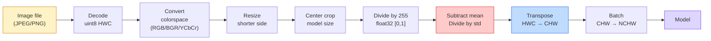
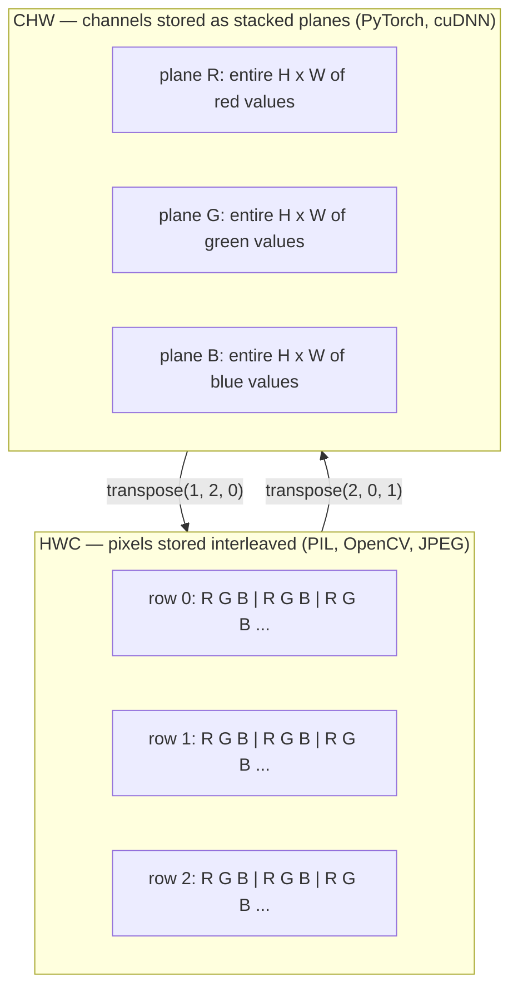

# 이미지 기초 — 픽셀, 채널, 색 공간

> 이미지는 빛 샘플의 텐서(tensor)입니다. 여러분이 사용하게 될 모든 비전 모델은 바로 이 하나의 사실에서 출발합니다.

**유형:** Build (실습)
**사용 언어:** Python
**선수 레슨:** Phase 1 Lesson 12 (Tensor Operations), Phase 3 Lesson 11 (Intro to PyTorch)
**소요 시간:** ~45분

## 학습 목표

- 연속적인 장면이 어떻게 픽셀로 이산화(discretize)되는지 설명하고, 샘플링/양자화(quantization) 결정이 모든 다운스트림 모델의 성능 상한을 어떻게 결정하는지 설명합니다.
- 이미지를 NumPy 배열로 읽고, 슬라이싱하고, 검사하며, HWC와 CHW 레이아웃 간을 유연하게 전환합니다.
- RGB, 그레이스케일, HSV, YCbCr 간을 상호 변환하고, 각 색 공간(color space)이 존재하는 이유를 설명합니다.
- 사전 학습된 PyTorch 비전 모델이 기대하는 방식 그대로 픽셀 수준의 전처리(정규화, 표준화, 크기 조정, 채널 우선 배치)를 적용합니다.

## 문제 정의

앞으로 읽게 될 모든 논문, 다운로드할 모든 사전 학습 가중치, 호출할 모든 비전 API는 입력에 대해 특정한 인코딩 방식을 가정합니다. 모델이 `float32`을 필요로 하는 곳에 `uint8` 이미지를 전달해도 코드는 여전히 실행되며, 아무런 에러 메시지 없이 조용히 엉터리 결과를 내놓습니다. RGB로 학습된 네트워크에 BGR을 공급하면 정확도가 10%포인트나 급락합니다. 채널 우선(channels-first)을 기대하는 모델에 채널 마지막(channels-last) 입력을 넘겨주면 첫 번째 합성곱(convolution) 레이어가 높이를 특성 채널로 취급해 버립니다. 이 중 어느 것도 에러를 발생시키지 않습니다. 그저 평가 지표를 망가뜨릴 뿐이며, 여러분은 파일을 불러오는 방식에 숨어 있던 버그를 찾느라 일주일을 허비하게 됩니다.

합성곱은 무엇 위를 슬라이딩하는지만 알면 복잡하지 않습니다. 어려운 부분은 카메라, JPEG 디코더, PIL, OpenCV, torchvision, 그리고 CUDA 커널에서 "이미지"가 각각 서로 다른 의미를 갖는다는 점입니다. 각 스택마다 고유한 축 순서(axis order), 바이트 범위(byte range), 채널 규칙이 있습니다. 이를 명확하게 구분하지 못하는 비전 엔지니어는 고장 난 파이프라인을 배포하게 됩니다.

이번 강의에서는 이 단계의 나머지 학습이 탄탄하게 이루어질 수 있도록 기초를 다집니다. 강의를 마칠 때쯤이면 픽셀이란 무엇인지, 왜 픽셀당 하나의 숫자가 아니라 세 개의 숫자가 존재하는지, "ImageNet 통계로 정규화(normalize)한다"는 것이 실제로 무엇을 의미하는지, 그리고 이번 페이즈의 다른 모든 강의에서 기본으로 가정할 두세 가지 레이아웃 간을 어떻게 오갈 수 있는지 알게 될 것입니다.

## 개념

### 전체 전처리 파이프라인 한눈에 보기

프로덕션 환경의 모든 비전 시스템은 가역적(reversible) 변환의 동일한 시퀀스로 이루어집니다. 한 단계라도 잘못되면 모델은 학습할 때와 전혀 다른 입력을 보게 됩니다.



빨간색과 파란색 상자 두 곳은 소리 없는 오류(silent failure)의 80%가 발생하는 지점입니다. 바로 표준화 누락과 잘못된 레이아웃입니다.

### 픽셀은 정사각형이 아니라 샘플입니다

카메라 센서는 아주 작은 검출기 그리드에 도달한 광자(photon)의 수를 셉니다. 각 검출기는 아주 짧은 시간 동안 빛을 적분하여 도달한 광자 수에 비례하는 전압을 출력합니다. 그런 다음 센서는 해당 전압을 정수로 이산화합니다. 검출기 하나가 픽셀 하나가 됩니다.

```
Continuous scene                 Sensor grid                     Digital image
(infinite detail)                (H x W detectors)               (H x W integers)

    ~~~~~                        +--+--+--+--+--+                 210 198 180 155 120
   ~   ~   ~                     |  |  |  |  |  |                 205 195 178 152 118
  ~ light ~      ---->           +--+--+--+--+--+     ---->       200 190 175 150 115
   ~~~~~                         |  |  |  |  |  |                 195 185 170 148 112
                                 +--+--+--+--+--+                 188 180 165 145 108
```

이 단계에서 두 가지 선택이 이루어지며, 이는 이후의 모든 다운스트림 성능의 상한을 결정합니다.

- **공간 샘플링(Spatial sampling)**은 장면의 각도 단위당 검출기를 몇 개 배치할지 결정합니다. 너무 적으면 가장자리가 톱니 모양으로 변하고(에일리어싱, aliasing), 너무 많으면 저장 공간과 연산량이 폭발적으로 증가합니다.
- **강도 양자화(Intensity quantization)**는 전압을 얼마나 세밀한 구간으로 나눌지 결정합니다. 8비트는 256단계를 제공하며 디스플레이의 표준입니다. 10비트, 12비트, 16비트는 더 부드러운 그래디언트를 제공하며 의료 영상, HDR, raw 센서 파이프라인에서 중요합니다.

픽셀은 면적을 가진 색칠된 정사각형이 아닙니다. 하나의 측정값일 뿐입니다. 이미지의 크기를 조정하거나 회전할 때는 이 측정 그리드를 리샘플링(resampling)하는 것입니다.

### 채널이 세 개인 이유

검출기 하나가 가시광선 스펙트럼 전체에 걸친 광자 수를 세는 것이 그레이스케일(grayscale)입니다. 색상을 얻기 위해 센서는 그리드를 빨강(Red), 초록(Green), 파랑(Blue) 필터의 모자이크로 덮습니다. 디모자이킹(demosaicing)을 거치고 나면 모든 공간 위치마다 세 개의 정수가 생깁니다. 즉 근처에 있는 빨간색 필터 검출기, 초록색 필터 검출기, 파란색 필터 검출기의 반응값입니다. 이 세 정수가 픽셀의 RGB 트리플릿(triplet)입니다.

```
One pixel in memory:

    (R, G, B) = (210, 140, 30)   <- reddish-orange

An H x W RGB image:

    shape (H, W, 3)     stored as   H rows of W pixels of 3 values
                                    each in [0, 255] for uint8
```

3이라는 숫자에 특별한 마법이 있는 것은 아닙니다. 뎁스(depth) 카메라는 Z 채널을 추가합니다. 인공위성은 적외선과 자외선 대역을 추가합니다. 의료 스캔은 대개 하나의 채널(X-ray, CT)을 갖거나 여러 개(초분광, hyperspectral)를 갖습니다. 채널 수는 마지막 축이며, 합성곱 레이어는 이 축을 가로질러 특성을 혼합(mix)하도록 학습합니다.

### 두 가지 레이아웃 규칙: HWC와 CHW

동일한 텐서이지만 순서가 다릅니다. 라이브러리마다 둘 중 하나를 선택합니다.

```
HWC (height, width, channels)           CHW (channels, height, width)

   W ->                                    H ->
  +-----+-----+-----+                     +-----+-----+
H |R G B|R G B|R G B|                   C |R R R R R R|
| +-----+-----+-----+                   | +-----+-----+
v |R G B|R G B|R G B|                   v |G G G G G G|
  +-----+-----+-----+                     +-----+-----+
                                          |B B B B B B|
                                          +-----+-----+

   PIL, OpenCV, matplotlib,              PyTorch, most deep learning
   almost every image file on disk       frameworks, cuDNN kernels
```

CHW가 존재하는 이유는 합성곱 커널이 H와 W 방향으로 슬라이딩하기 때문입니다. 채널 축을 맨 앞에 두면 각 커널이 채널별로 연속된 2D 평면을 보게 되므로 벡터화(vectorization)가 깔끔하게 이루어집니다. 반면 디스크 형식은 HWC를 유지하는데, 이것이 센서에서 스캔라인(scanline)이 출력되는 방식과 일치하기 때문입니다.

수천 번은 작성하게 될 한 줄짜리 변환 코드:

```
img_chw = img_hwc.transpose(2, 0, 1)      # NumPy
img_chw = img_hwc.permute(2, 0, 1)        # PyTorch tensor
```

메모리 레이아웃 시각화:



### 바이트 범위와 dtype

주로 세 가지 규칙이 사용됩니다.

| 규칙 | dtype | 범위 | 주로 쓰이는 곳 |
|------------|-------|-------|------------------|
| Raw | `uint8` | [0, 255] | 디스크의 파일, PIL, OpenCV 출력 |
| 정규화(Normalized) | `float32` | [0.0, 1.0] | `img.astype('float32') / 255` 이후 |
| 표준화(Standardized) | `float32` | 대략 [-2, +2] | 평균을 빼고 표준편차로 나눈 후 |

합성곱 신경망은 표준화된 입력으로 학습되었습니다. ImageNet 통계인 `mean=[0.485, 0.456, 0.406]`, `std=[0.229, 0.224, 0.225]`는 [0, 1]로 정규화된 픽셀을 기준으로 전체 ImageNet 학습 세트에 대해 계산한 세 채널의 산술 평균과 표준편차입니다. 표준화된 부동소수점(float)을 기대하는 모델에 raw `uint8`을 그대로 입력하는 것은 응용 컴퓨터 비전에서 가장 흔히 발생하는 소리 없는 오류입니다.

### 색 공간과 그 존재 이유

RGB는 캡처 형식일 뿐, 모델에게 항상 가장 유용한 표현인 것은 아닙니다.

```
 RGB               HSV                       YCbCr / YUV

 R red             H hue (angle 0-360)       Y luminance (brightness)
 G green           S saturation (0-1)        Cb chroma blue-yellow
 B blue            V value/brightness (0-1)  Cr chroma red-green

 Linear to         Separates color from      Separates brightness from
 sensor output     brightness. Useful for    color. JPEG and most video
                   color thresholding, UI    codecs compress the chroma
                   sliders, simple filters   channels harder because the
                                             human eye is less sensitive
                                             to chroma detail than to Y.
```

대부분의 현대 CNN에는 RGB를 입력합니다. 하지만 다음과 같은 상황에서는 다른 색 공간을 접하게 됩니다.

- **HSV** — 고전 컴퓨터 비전 코드, 색상 기반 분할(segmentation), 화이트 밸런싱.
- **YCbCr** — JPEG 내부 구조 읽기, 비디오 파이프라인, Y 채널에서만 동작하는 초해상화(super-resolution) 모델.
- **그레이스케일(Grayscale)** — OCR, 문서 모델, 색상이 신호가 아닌 불필요한 변수(nuisance variable)인 모든 경우.

인간의 눈은 빨강이나 파랑보다 초록에 더 민감하기 때문에, RGB에서 그레이스케일로의 변환은 단순 평균이 아닌 가중합(weighted sum)으로 이루어집니다.

```math
Y = 0.299 R + 0.587 G + 0.114 B \qquad \text{(ITU-R BT.601, the classic weights)}
```

### 종횡비, 크기 조정, 보간법

모든 모델은 고정된 입력 크기를 갖습니다(대부분의 ImageNet 분류 모델은 224x224, 최신 객체 검출 모델은 384x384 또는 512x512). 입력할 이미지가 이 크기와 일치하는 경우는 거의 없습니다. 주로 사용되는 세 가지 크기 조정(resize) 방식은 다음과 같습니다.

- **더 짧은 변의 크기를 조정한 후 중앙 자르기(center crop)** — 표준 ImageNet 레시피입니다. 종횡비(aspect ratio)를 보존하지만 가장자리 픽셀 일부를 잘라냅니다.
- **크기 조정 및 패딩(Resize and pad)** — 종횡비와 모든 픽셀을 보존하지만 검은색 여백(레터박스)이 추가됩니다. 객체 검출(detection) 및 OCR의 표준 방식입니다.
- **목표 크기로 직접 조정(Resize directly to target)** — 이미지를 늘리거나 줄입니다. 비용이 적게 들지만 기하학적 형태가 왜곡되며, 많은 분류 작업에서는 괜찮게 작동합니다.

보간(interpolation) 방법은 새로운 그리드가 기존 그리드와 정확히 일치하지 않을 때 중간 픽셀 값을 어떻게 계산할지 결정합니다.

```
Nearest neighbour     fastest, blocky, only choice for masks/labels
Bilinear              fast, smooth, default for most image resizing
Bicubic               slower, sharper on upscaling
Lanczos               slowest, best quality, used for final display
```

경험 법칙: 모델 학습에는 bilinear, 사람이 직접 볼 결과물에는 bicubic 또는 lanczos, 정수 클래스 ID가 포함된 모든 대상(예: 세그멘테이션 마스크)에는 nearest를 사용합니다.

```figure
conv-output-size
```

## 직접 만들어보기
### 단계 1: 이미지 텐서 생성 및 형태 확인

첫 번째 실습을 NumPy만으로 오프라인에서 실행할 수 있도록 결정론적인(deterministic) 합성 이미지로 시작합니다. 파일 디코딩은 별도의 경계입니다. JPEG 또는 PNG 디코더가 RGB 바이트를 반환하고 나면, 아래의 모든 텐서 연산은 동일합니다.

```python
import numpy as np

def synthetic_rgb(h=128, w=192, seed=0):
    rng = np.random.default_rng(seed)
    yy, xx = np.meshgrid(np.linspace(0, 1, h), np.linspace(0, 1, w), indexing="ij")
    r = (np.sin(xx * 6) * 0.5 + 0.5) * 255
    g = yy * 255
    b = (1 - yy) * xx * 255
    rgb = np.stack([r, g, b], axis=-1) + rng.normal(0, 6, (h, w, 3))
    return np.clip(rgb, 0, 255).astype(np.uint8)

arr = synthetic_rgb()

print(f"type:   {type(arr).__name__}")
print(f"dtype:  {arr.dtype}")
print(f"shape:  {arr.shape}     # (H, W, C)")
print(f"min:    {arr.min()}")
print(f"max:    {arr.max()}")
print(f"pixel at (0, 0): {arr[0, 0]}")
```

예상 출력: `shape: (H, W, 3)`, `dtype: uint8`, 범위 `[0, 255]`. 이것이 바이트가 카메라, 이미지 디코더, 또는 이 합성 생성기 중 어디에서 왔든 관계없이 표준적인(canonical) 디코딩 표현입니다.

### 단계 2: 채널 분할 및 레이아웃 재정렬

R, G, B를 개별적으로 추출한 다음, PyTorch를 위해 HWC에서 CHW로 변환합니다.

```python
R = arr[:, :, 0]
G = arr[:, :, 1]
B = arr[:, :, 2]
print(f"R shape: {R.shape}, mean: {R.mean():.1f}")
print(f"G shape: {G.shape}, mean: {G.mean():.1f}")
print(f"B shape: {B.shape}, mean: {B.mean():.1f}")

arr_chw = arr.transpose(2, 0, 1)
print(f"\nHWC shape: {arr.shape}")
print(f"CHW shape: {arr_chw.shape}")
```

채널당 하나씩, 세 개의 그레이스케일 평면이 생성됩니다. CHW는 축의 순서만 바꿀 뿐입니다. 메모리 레이아웃이 허용하는 한 데이터 복사는 엄격히 요구되지 않습니다.

### 단계 3: 그레이스케일 및 HSV 변환

가중합 그레이스케일 변환을 수행한 다음, 수동으로 RGB를 HSV로 변환합니다.

```python
def rgb_to_grayscale(rgb):
    weights = np.array([0.299, 0.587, 0.114], dtype=np.float32)
    return (rgb.astype(np.float32) @ weights).astype(np.uint8)

def rgb_to_hsv(rgb):
    rgb_f = rgb.astype(np.float32) / 255.0
    r, g, b = rgb_f[..., 0], rgb_f[..., 1], rgb_f[..., 2]
    cmax = np.max(rgb_f, axis=-1)
    cmin = np.min(rgb_f, axis=-1)
    delta = cmax - cmin

    h = np.zeros_like(cmax)
    mask = delta > 0
    argmax = np.argmax(rgb_f, axis=-1)
    rmax = mask & (argmax == 0)
    gmax = mask & (argmax == 1)
    bmax = mask & (argmax == 2)
    h[rmax] = ((g[rmax] - b[rmax]) / delta[rmax]) % 6
    h[gmax] = ((b[gmax] - r[gmax]) / delta[gmax]) + 2
    h[bmax] = ((r[bmax] - g[bmax]) / delta[bmax]) + 4
    h = h * 60.0

    s = np.divide(delta, cmax, out=np.zeros_like(delta), where=cmax > 0)
    v = cmax
    return np.stack([h, s, v], axis=-1)

gray = rgb_to_grayscale(arr)
hsv = rgb_to_hsv(arr)
print(f"gray shape: {gray.shape}, range: [{gray.min()}, {gray.max()}]")
print(f"hsv   shape: {hsv.shape}")
print(f"hue range: [{hsv[..., 0].min():.1f}, {hsv[..., 0].max():.1f}] degrees")
print(f"sat range: [{hsv[..., 1].min():.2f}, {hsv[..., 1].max():.2f}]")
print(f"val range: [{hsv[..., 2].min():.2f}, {hsv[..., 2].max():.2f}]")
```

색상(Hue)은 각도(degree) 단위로, 채도(Saturation)와 명도(Value)는 [0, 1] 범위로 산출됩니다. 이는 OpenCV의 `hsv_full` 규칙과 일치합니다.

### 단계 4: 정규화, 표준화 및 역변환

원시 바이트에서 사전 학습된 ImageNet 모델이 기대하는 정확한 텐서로 변환한 다음, 다시 역변환합니다.

```python
mean = np.array([0.485, 0.456, 0.406], dtype=np.float32)
std = np.array([0.229, 0.224, 0.225], dtype=np.float32)

def preprocess_imagenet(rgb_uint8):
    x = rgb_uint8.astype(np.float32) / 255.0
    x = (x - mean) / std
    x = x.transpose(2, 0, 1)
    return x

def deprocess_imagenet(chw_float32):
    x = chw_float32.transpose(1, 2, 0)
    x = x * std + mean
    x = np.clip(x * 255.0, 0, 255).astype(np.uint8)
    return x

x = preprocess_imagenet(arr)
print(f"preprocessed shape: {x.shape}     # (C, H, W)")
print(f"preprocessed dtype: {x.dtype}")
print(f"preprocessed mean per channel:  {x.mean(axis=(1, 2)).round(3)}")
print(f"preprocessed std  per channel:  {x.std(axis=(1, 2)).round(3)}")

roundtrip = deprocess_imagenet(x)
max_diff = np.abs(roundtrip.astype(int) - arr.astype(int)).max()
print(f"roundtrip max pixel diff: {max_diff}    # should be 0 or 1")
```

채널별 평균은 0에 가깝고, 표준편차는 1에 가까워야 합니다. 이 전처리/역전처리 쌍은 내부적으로 모든 torchvision `transforms.Normalize` 호출이 수행하는 작업과 정확히 일치합니다.

### 단계 5: 밑바닥부터 구현하는 리사이즈

최근접 이웃(Nearest neighbor)은 각 출력 좌표를 하나의 원본 픽셀로 반올림합니다. 쌍선형 보간법(Bilinear interpolation)은 주변 4개 픽셀을 찾아 거리에 따라 혼합합니다. 아래의 두 구현 모두 첫 번째와 마지막 원본 픽셀이 고정되도록 엔드포인트 정렬 좌표를 사용합니다.

```python
def resize_coordinates(source_length, target_length):
    if target_length == 1:
        return np.zeros(1, dtype=np.float32)
    return np.linspace(0, source_length - 1, target_length, dtype=np.float32)

def nearest_resize(image, target_height, target_width):
    y = np.rint(resize_coordinates(image.shape[0], target_height)).astype(int)
    x = np.rint(resize_coordinates(image.shape[1], target_width)).astype(int)
    return image[y[:, None], x[None, :]]

def bilinear_resize(image, target_height, target_width):
    y = resize_coordinates(image.shape[0], target_height)
    x = resize_coordinates(image.shape[1], target_width)
    y0 = np.floor(y).astype(int)
    x0 = np.floor(x).astype(int)
    y1 = np.minimum(y0 + 1, image.shape[0] - 1)
    x1 = np.minimum(x0 + 1, image.shape[1] - 1)
    wy = (y - y0)[:, None, None]
    wx = (x - x0)[None, :, None]

    source = image.astype(np.float32)
    top = source[y0[:, None], x0[None, :]] * (1 - wx)
    top += source[y0[:, None], x1[None, :]] * wx
    bottom = source[y1[:, None], x0[None, :]] * (1 - wx)
    bottom += source[y1[:, None], x1[None, :]] * wx
    result = top * (1 - wy) + bottom * wy
    return np.clip(np.rint(result), 0, 255).astype(image.dtype)

target_height = arr.shape[0] * 3
target_width = arr.shape[1] * 3
nearest = nearest_resize(arr, target_height, target_width)
bilinear = bilinear_resize(arr, target_height, target_width)

def local_roughness(x):
    gy = np.diff(x.astype(float), axis=0)
    gx = np.diff(x.astype(float), axis=1)
    return float(np.abs(gy).mean() + np.abs(gx).mean())

for name, out in [("nearest", nearest), ("bilinear", bilinear)]:
    print(f"{name:>8}  shape={out.shape}  roughness={local_roughness(out):6.2f}")
```

최근접 이웃은 강한 가장자리를 유지하므로 거칠기(roughness) 점수가 가장 높습니다. 쌍선형 보간법은 각 축에서 두 위치를 혼합하여 새 픽셀을 만들기 때문에 더 매끄럽습니다. 실행 가능한 동반 코드는 동일한 분리 가능한(separable) 아이디어를 Catmull-Rom 3차 커널을 사용하여 축당 4개의 이웃으로 확장한 후, 이미지 라이브러리 없이 세 가지 결과를 모두 출력합니다.

## 사용해 보기

PyTorch는 배치 처리 및 디바이스를 인식하는 텐서에서 동일한 연산을 수행합니다. 아래 코드는 짧은 변의 크기를 조정하고, 중앙을 자르고(center crop), 각 채널을 표준화하여 사전 학습된 모델이 기대하는 NCHW 텐서를 생성합니다.

```python
import torch
import torch.nn.functional as F

image_hwc = torch.from_numpy(synthetic_rgb(256, 320))
batch = image_hwc.permute(2, 0, 1).unsqueeze(0).float() / 255.0

height, width = batch.shape[-2:]
scale = 256 / min(height, width)
resized_height = round(height * scale)
resized_width = round(width * scale)
batch = F.interpolate(
    batch,
    size=(resized_height, resized_width),
    mode="bilinear",
    align_corners=False,
    antialias=True,
)

top = (resized_height - 224) // 2
left = (resized_width - 224) // 2
batch = batch[:, :, top:top + 224, left:left + 224]

mean = torch.tensor([0.485, 0.456, 0.406]).view(1, 3, 1, 1)
std = torch.tensor([0.229, 0.224, 0.225]).view(1, 3, 1, 1)
batch = (batch - mean) / std

print(f"tensor dtype: {batch.dtype}")
print(f"batched shape: {tuple(batch.shape)}")
print(f"per-channel mean: {batch.mean(dim=(0, 2, 3)).tolist()}")
print(f"per-channel std:  {batch.std(dim=(0, 2, 3)).tolist()}")
```

정확히 이 순서대로 네 단계를 거칩니다. 바이트를 float로 변환하고 HWC를 NCHW로 맞바꾸며, 짧은 변의 크기를 256으로 조정한 뒤, 224x224 중앙 크롭을 취하고, ImageNet 평균을 빼고 표준편차로 나눕니다. 이 순서를 바꾸면 모델에 전달되는 내용이 은밀하게 달라집니다.

## 배포하기

이 레슨의 결과물은 다음과 같습니다.

- `outputs/prompt-vision-preprocessing-audit.md` — 모델 카드나 데이터셋 카드를 팀이 준수해야 하는 정확한 전처리 불변조건(invariants) 체크리스트로 변환하는 프롬프트입니다.
- `outputs/skill-image-tensor-inspector.md` — 이미지 형태의 텐서나 배열이 주어졌을 때 dtype, 레이아웃, 범위, 그리고 이것이 원시, 정규화, 표준화 상태 중 무엇으로 보이는지 보고하는 스킬입니다.

## 연습문제

1. **(초급)** 서로 다른 네 가지 색상을 가진 2x2 RGB `uint8` 배열을 만듭니다. HWC를 CHW로 변환했다가 다시 되돌리고, 두 형태를 출력하여 왕복 변환(round trip)에서 모든 값이 보존됨을 증명하세요.
2. **(중급)** 임의의 uint8 이미지에서 `roundtrip_max_diff <= 1` 테스트를 통과하는 `standardize(img, mean, std)` 및 그 역함수를 작성하세요. 작성한 함수는 동일한 호출로 HWC 형태의 단일 이미지와 NCHW 형태의 배치 모두에서 작동해야 합니다.
3. **(고급)** ImageNet 표준화가 적용된 3채널 텐서를 취해, RGB를 단일 그레이스케일 채널로 가중 혼합하도록 학습하는 1x1 합성곱(conv)을 통과시킵니다. 가중치를 `[0.299, 0.587, 0.114]`로 초기화하고 고정한 뒤, 출력이 부동소수점 오차 범위 내에서 직접 작성한 `rgb_to_grayscale`와 일치하는지 확인하세요. 1x1 합성곱으로 작성할 수 있는 다른 고전적인 색 공간(color-space) 변환에는 무엇이 있을까요?

## 핵심 용어

| 용어 | 일반적인 표현 | 실제 의미 |
|------|----------------|----------------------|
| 픽셀 (Pixel) | "색칠된 사각형" | 한 격자 위치에서의 빛 강도 표본 하나 — 컬러의 경우 세 개의 숫자, 그레이스케일의 경우 하나의 숫자 |
| 채널 (Channel) | "색상" | 이미지 텐서에 쌓이는 병렬 공간 격자 중 하나. HWC에서는 마지막 축, CHW에서는 첫 번째 축 |
| HWC / CHW | "형태" | 이미지 텐서의 축 순서. 디스크와 PIL은 HWC를 사용하고, PyTorch와 cuDNN은 CHW를 사용 |
| 정규화 (Normalize) | "이미지 스케일링" | 픽셀이 [0, 1] 범위에 위치하도록 255로 나누는 작업 — 필요하지만 충분하지는 않음 |
| 표준화 (Standardize) | "영점 맞추기(Zero-center)" | 입력 분포가 모델이 학습된 분포와 일치하도록 채널별 평균을 빼고 표준편차로 나누는 작업 |
| 그레이스케일 변환 | "채널 평균 내기" | 인간의 휘도 인지에 일치하는 0.299/0.587/0.114 계수를 사용한 가중합 |
| 보간법 (Interpolation) | "리사이즈 시 픽셀을 고르는 방법" | 새 격자가 기존 격자와 정렬되지 않을 때 출력값을 결정하는 규칙 — 라벨에는 최근접 이웃, 학습에는 쌍선형, 표시용에는 쌍3차(bicubic) |
| 종횡비 (Aspect ratio) | "가로 세로 비율" | "크기 조정 후 패딩(resize and pad)"과 "크기 조정 후 늘이기(resize and stretch)"를 구별하는 비율 |

## 더 읽어보기

- [Charles Poynton — A Guided Tour of Color Space](https://web.archive.org/web/20251220000525/https://poynton.ca/PDFs/Guided_tour.pdf) — 색 공간이 왜 그렇게 많고 각각이 언제 중요한지에 대한 가장 명쾌한 기술적 설명서
- [PyTorch Vision Transforms Docs](https://pytorch.org/vision/stable/transforms.html) — 프로덕션에서 실제로 구성하게 될 전체 변환 파이프라인
- [How JPEG Works (Colt McAnlis)](https://www.youtube.com/watch?v=F1kYBnY6mwg) — 색차 서브샘플링(chroma subsampling), DCT, 그리고 JPEG가 RGB 대신 YCbCr을 인코딩하는 이유를 명쾌하게 보여주는 시각 자료
- [ImageNet Preprocessing Conventions (torchvision models)](https://pytorch.org/vision/stable/models.html) — `mean=[0.485, 0.456, 0.406]`의 단일 진실 공급원(source of truth)이자 모델 동물원(model zoo)의 모든 모델이 이를 기대하는 이유
