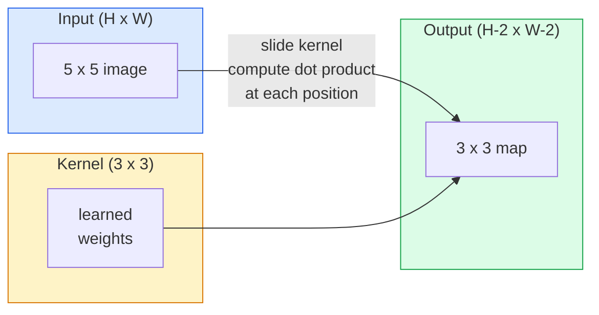
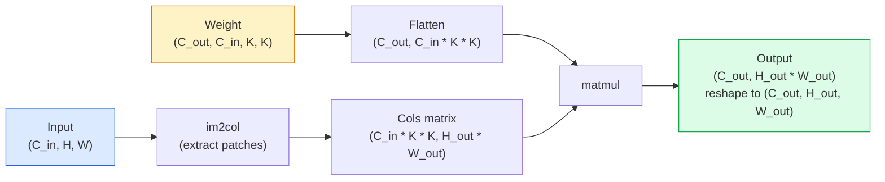

# 밑바닥부터 구현하는 합성곱(Convolution)

> 합성곱은 이미지 위를 슬라이딩하며 모든 위치에서 동일한 가중치를 공유하는 아주 작은 밀집 계층(dense layer)입니다.

**유형:** Build (실습)
**사용 언어:** Python
**선수 레슨:** Phase 3 (Deep Learning Core), Phase 4 Lesson 01 (Image Fundamentals)
**소요 시간:** ~75분

## 학습 목표

- NumPy만을 사용하여 중첩 루프 버전과 벡터화된 `im2col` 버전을 포함한 2D 합성곱을 밑바닥부터 구현합니다.
- 입력 크기, 커널 크기, 패딩, 스트라이드의 임의의 조합에 대한 출력 공간 크기를 계산하고, `(H - K + 2P) / S + 1` 공식을 논리적으로 설명합니다.
- 커널(에지, 블러, 샤픈, Sobel)을 직접 설계하고 각각이 왜 그러한 활성화 패턴을 생성하는지 설명합니다.
- 합성곱을 쌓아 특성 추출기(feature extractor)를 구성하고, 스택의 깊이와 수용 영역(receptive field) 크기 간의 관계를 연결 짓습니다.

## 문제 상황

224x224 RGB 이미지에 완전 연결 계층(fully connected layer)을 적용하면 뉴런당 224 * 224 * 3 = 150,528개의 입력 가중치가 필요합니다. 1,000개의 유닛을 가진 단 하나의 은닉층만으로도 이미 1억 5천만 개의 파라미터가 발생하며, 이는 유용한 것을 전혀 학습하기도 전의 상태입니다. 더 심각한 문제는 해당 계층이 좌측 상단의 개와 우측 하단의 개가 동일한 패턴이라는 개념을 전혀 알지 못한다는 점입니다. 이는 모든 픽셀 위치를 독립적으로 취급하는데, 이는 이미지에 완전히 부적합한 방식입니다. 고양이를 3픽셀 이동시켰다고 해서 네트워크가 그 개념을 다시 학습해야 해서는 안 됩니다.

이미지 모델에 필요한 두 가지 특성은 **평행이동 동변성(translation equivariance)**(입력이 이동하면 출력도 이동함)과 **파라미터 공유(parameter sharing)**(동일한 특성 감지기가 모든 곳에서 실행됨)입니다. 밀집 계층은 둘 중 어느 것도 제공하지 못합니다. 합성곱은 이 둘을 기본적으로 제공합니다.

합성곱은 딥러닝을 위해 발명된 것이 아닙니다. JPEG 압축, Photoshop의 가우시안 블러, 산업용 비전의 에지 검출, 출시된 모든 오디오 필터에 사용되는 것과 동일한 연산입니다. CNN이 2012년부터 2020년까지 ImageNet을 지배했던 이유는, 합성곱이 인접한 값들이 서로 관련되어 있고 동일한 패턴이 어디에나 나타날 수 있는 데이터에 적합한 올바른 사전 지식(prior)이기 때문입니다.

## 핵심 개념

### 단일 커널의 슬라이딩

2D 합성곱은 커널(또는 필터)이라고 불리는 작은 가중치 행렬을 입력 위에서 슬라이딩하며, 각 위치에서 요소별 곱(element-wise product)의 합을 계산합니다. 그 합이 하나의 출력 픽셀이 됩니다.



5x5 입력에 대한 구체적인 3x3 예시(패딩 없음, 스트라이드 1):

```
Input X (5 x 5):                Kernel W (3 x 3):

  1  2  0  1  2                   1  0 -1
  0  1  3  1  0                   2  0 -2
  2  1  0  2  1                   1  0 -1
  1  0  2  1  3
  2  1  1  0  1

The kernel slides across every valid 3 x 3 window. Output Y is 3 x 3:

 Y[0,0] = sum( W * X[0:3, 0:3] )
 Y[0,1] = sum( W * X[0:3, 1:4] )
 Y[0,2] = sum( W * X[0:3, 2:5] )
 Y[1,0] = sum( W * X[1:4, 0:3] )
 ... and so on
```

**공유 가중치, 국소성(locality), 슬라이딩 윈도우**라는 이 하나의 공식이 개념의 전부입니다. 그 외의 모든 것은 단순한 세부 절차에 불과합니다.

### 출력 크기 공식

입력 공간 크기 `H`, 커널 크기 `K`, 패딩 `P`, 스트라이드 `S`가 주어졌을 때:

```math
H_{\text{out}} = \left\lfloor \frac{H - K + 2P}{S} \right\rfloor + 1
```

이 공식을 반드시 암기해 두십시오. 아키텍처당 수십 번씩 계산하게 될 것입니다.

| 시나리오 | H | K | P | S | H_out |
|---|---|---|---|---|---|
| Valid 합성곱, 패딩 없음 | 32 | 3 | 0 | 1 | 30 |
| Same 합성곱 (크기 보존) | 32 | 3 | 1 | 1 | 32 |
| 2배 다운샘플링 | 32 | 3 | 1 | 2 | 16 |
| 2x2 풀링 | 32 | 2 | 0 | 2 | 16 |
| 큰 수용 영역 | 32 | 7 | 3 | 2 | 16 |

"Same 패딩"은 $S = 1$일 때 $H_{\text{out}} = H$가 되도록 $P$을 선택하는 것을 의미합니다. 홀수 $K$에 대해서는 $P = (K - 1) / 2$가 됩니다. 이것이 3x3 커널이 널리 사용되는 이유입니다. 중심점이 존재하는 가장 작은 홀수 커널이기 때문입니다.

### 패딩

패딩이 없으면 모든 합성곱마다 특성 맵(feature map)이 줄어듭니다. 이를 20개 쌓으면 224x224 이미지가 184x184가 되어 경계 부분의 연산이 낭비되고, 형태가 일치해야 하는 잔차 연결(residual connection)이 복잡해집니다.

```
Zero padding (P = 1) on a 5 x 5 input:

  0  0  0  0  0  0  0
  0  1  2  0  1  2  0
  0  0  1  3  1  0  0
  0  2  1  0  2  1  0       Now the kernel can centre on pixel
  0  1  0  2  1  3  0       (0, 0) and still have three rows and
  0  2  1  1  0  1  0       three columns of values to multiply.
  0  0  0  0  0  0  0
```

실무에서 접하는 모드: `zero`(가장 일반적임), `reflect`(가장자리를 거울처럼 반사하며, 생성 모델에서 뚜렷한 경계선을 피함), `replicate`(가장자리를 복사함), `circular`(둘러싸기 방식, 원환체(toroidal) 문제에 사용됨).

### 스트라이드

스트라이드는 슬라이딩의 보폭(step size)입니다. `stride=1`이 기본값입니다. `stride=2`는 공간 차원을 절반으로 줄이며, 별도의 풀링 계층 없이 CNN 내부에서 다운샘플링하는 고전적인 방법입니다. 모든 현대 아키텍처(ResNet, ConvNeXt, MobileNet)는 어딘가에서 맥스 풀링 대신 스트라이드 합성곱을 사용합니다.

```
Stride 1 on a 5 x 5 input, 3 x 3 kernel:

  starts: (0,0) (0,1) (0,2)        -> output row 0
          (1,0) (1,1) (1,2)        -> output row 1
          (2,0) (2,1) (2,2)        -> output row 2

  Output: 3 x 3

Stride 2 on the same input:

  starts: (0,0) (0,2)              -> output row 0
          (2,0) (2,2)              -> output row 1

  Output: 2 x 2
```

### 다중 입력 채널

실제 이미지는 3개의 채널을 가집니다. RGB 입력에 대한 3x3 합성곱은 실제로는 3x3x3 볼륨입니다. 즉, 입력 채널당 하나의 3x3 슬라이스를 갖습니다. 각 공간 위치에서 3개의 슬라이스 전체에 걸쳐 곱하고 합산한 뒤 편향(bias)을 더합니다.

```
Input:   (C_in,  H,  W)        3 x 5 x 5
Kernel:  (C_in,  K,  K)        3 x 3 x 3 (one kernel)
Output:  (1,     H', W')       2D map

For a layer that produces C_out output channels, you stack C_out kernels:

Weight:  (C_out, C_in, K, K)   e.g. 64 x 3 x 3 x 3
Output:  (C_out, H', W')       64 x 3 x 3

Parameter count: C_out * C_in * K * K + C_out   (the + C_out is biases)
```

마지막 줄은 모델을 설계할 때 직접 계산하게 될 수식입니다. 3채널 입력에 대한 64채널 3x3 합성곱은 `64 * 3 * 3 * 3 + 64 = 1,792`개의 파라미터를 가집니다. 매우 적은 양입니다.

### im2col 트릭

중첩 루프는 읽기 쉽지만 느립니다. GPU는 대규모 행렬 곱셈을 선호합니다. 비결은 다음과 같습니다. 입력의 모든 수용 영역 윈도우를 큰 행렬의 한 열로 펼치고(flatten), 커널을 한 행으로 펼치면 전체 합성곱이 단일 행렬 곱셈(matmul)으로 바뀝니다.



모든 상용 합성곱 구현체는 이 방식에 캐시 타일링 트릭(직접 합성곱, Winograd, 대형 커널을 위한 FFT 합성곱)을 더한 변형입니다. im2col을 이해하면 핵심을 이해한 것입니다.

### 수용 영역(Receptive field)

단일 3x3 합성곱은 9개의 입력 픽셀을 봅니다. 두 개의 3x3 합성곱을 쌓으면 두 번째 계층의 뉴런은 5x5 입력 픽셀을 봅니다. 세 개의 3x3 합성곱은 7x7을 봅니다. 일반적으로 다음과 같습니다:

```
RF after L stacked K x K convs (stride 1) = 1 + L * (K - 1)

With strides:   RF grows multiplicatively with stride along each layer.
```

"끝까지 3x3만 사용하는 구조"(VGG, ResNet, ConvNeXt)가 효과적인 전체적인 이유는, 두 개의 3x3 합성곱이 하나의 5x5 합성곱과 동일한 입력 영역을 보면서도 파라미터 수는 더 적고 그사이에 비선형성을 하나 더 추가할 수 있기 때문입니다.

```figure
convolution-kernel
```

## 직접 구현하기

### 1단계: 배열 패딩

가장 작은 프리미티브부터 시작합니다. H x W 배열의 주변을 0으로 패딩하는 함수입니다.

```python
import numpy as np

def pad2d(x, p):
    if p == 0:
        return x
    h, w = x.shape[-2:]
    out = np.zeros(x.shape[:-2] + (h + 2 * p, w + 2 * p), dtype=x.dtype)
    out[..., p:p + h, p:p + w] = x
    return out

x = np.arange(9).reshape(3, 3)
print(x)
print()
print(pad2d(x, 1))
```

후행 축(trailing-axes) 트릭인 `x.shape[:-2]`를 사용하면 수정 없이도 동일한 함수가 `(H, W)`, `(C, H, W)`, `(N, C, H, W)`에 모두 작동합니다.

### 2단계: 중첩 루프를 사용한 2D 합성곱

기준이 되는 참조 구현입니다. 느리지만 명확합니다. 이는 원리적으로 `torch.nn.functional.conv2d`이 수행하는 작업과 같습니다.

```python
def conv2d_naive(x, w, b=None, stride=1, padding=0):
    c_in, h, w_in = x.shape
    c_out, c_in_w, kh, kw = w.shape
    assert c_in == c_in_w

    x_pad = pad2d(x, padding)
    h_out = (h + 2 * padding - kh) // stride + 1
    w_out = (w_in + 2 * padding - kw) // stride + 1

    out = np.zeros((c_out, h_out, w_out), dtype=np.float32)
    for oc in range(c_out):
        for i in range(h_out):
            for j in range(w_out):
                hs = i * stride
                ws = j * stride
                patch = x_pad[:, hs:hs + kh, ws:ws + kw]
                out[oc, i, j] = np.sum(patch * w[oc])
        if b is not None:
            out[oc] += b[oc]
    return out
```

4개의 중첩 루프(출력 채널, 행, 열, 그리고 C_in, kh, kw에 대한 암시적 합산)로 구성됩니다. 이것이 향후 더 빠른 모든 구현을 검증할 기준 진실(ground truth)이 됩니다.

### 3단계: 직접 설계한 커널로 검증

수직 Sobel 커널을 만들고, 인공적인 계단형 이미지에 적용하여 수직 에지가 활성화되는 것을 관찰합니다.

```python
def synthetic_step_image():
    img = np.zeros((1, 16, 16), dtype=np.float32)
    img[:, :, 8:] = 1.0
    return img

sobel_x = np.array([
    [[-1, 0, 1],
     [-2, 0, 2],
     [-1, 0, 1]]
], dtype=np.float32)[None]

x = synthetic_step_image()
y = conv2d_naive(x, sobel_x, padding=1)
print(y[0].round(1))
```

7번째 열(좌측에서 우측으로 밝기가 증가하는 지점)에서 큰 양수 값이 나타나고 다른 모든 곳에서는 0이 나타날 것으로 예상됩니다. 이 한 번의 출력이 수학적 계산이 올바른지 확인하는 건전성 검사(sanity check)가 됩니다.

### 4단계: im2col

입력의 모든 커널 크기 윈도우를 행렬의 한 열로 변환합니다. `C_in=3, K=3`의 경우 각 열은 27개의 숫자가 됩니다.

```python
def im2col(x, kh, kw, stride=1, padding=0):
    c_in, h, w = x.shape
    x_pad = pad2d(x, padding)
    h_out = (h + 2 * padding - kh) // stride + 1
    w_out = (w + 2 * padding - kw) // stride + 1

    cols = np.zeros((c_in * kh * kw, h_out * w_out), dtype=x.dtype)
    col = 0
    for i in range(h_out):
        for j in range(w_out):
            hs = i * stride
            ws = j * stride
            patch = x_pad[:, hs:hs + kh, ws:ws + kw]
            cols[:, col] = patch.reshape(-1)
            col += 1
    return cols, h_out, w_out
```

여전히 Python 루프이지만, 이제 가장 무거운 연산은 단일 벡터화 행렬 곱셈으로 처리됩니다.

### 5단계: im2col + matmul을 통한 빠른 합성곱

4중 루프를 단 하나의 행렬 곱셈으로 대체합니다.

```python
def conv2d_im2col(x, w, b=None, stride=1, padding=0):
    c_out, c_in, kh, kw = w.shape
    cols, h_out, w_out = im2col(x, kh, kw, stride, padding)
    w_flat = w.reshape(c_out, -1)
    out = w_flat @ cols
    if b is not None:
        out += b[:, None]
    return out.reshape(c_out, h_out, w_out)
```

정확도 확인: 두 구현을 모두 실행하고 비교합니다.

```python
rng = np.random.default_rng(0)
x = rng.normal(0, 1, (3, 16, 16)).astype(np.float32)
w = rng.normal(0, 1, (8, 3, 3, 3)).astype(np.float32)
b = rng.normal(0, 1, (8,)).astype(np.float32)

y_naive = conv2d_naive(x, w, b, padding=1)
y_im2col = conv2d_im2col(x, w, b, padding=1)

print(f"max abs diff: {np.max(np.abs(y_naive - y_im2col)):.2e}")
```

`max abs diff`은 약 `1e-5` 수준이어야 합니다. 이 차이는 버그가 아니라 부동소수점 누적 순서에 기인합니다.

### 6단계: 직접 설계한 커널 뱅크

어떤 학습도 거치지 않고 단일 합성곱 계층이 무엇을 표현할 수 있는지 보여주는 5개의 필터입니다.

```python
KERNELS = {
    "identity": np.array([[0, 0, 0], [0, 1, 0], [0, 0, 0]], dtype=np.float32),
    "blur_3x3": np.ones((3, 3), dtype=np.float32) / 9.0,
    "sharpen": np.array([[0, -1, 0], [-1, 5, -1], [0, -1, 0]], dtype=np.float32),
    "sobel_x": np.array([[-1, 0, 1], [-2, 0, 2], [-1, 0, 1]], dtype=np.float32),
    "sobel_y": np.array([[-1, -2, -1], [0, 0, 0], [1, 2, 1]], dtype=np.float32),
}

def apply_kernel(img2d, kernel):
    x = img2d[None].astype(np.float32)
    w = kernel[None, None]
    return conv2d_im2col(x, w, padding=1)[0]
```

어떤 그레이스케일 이미지에 적용하든 블러는 부드럽게 만들고, 샤픈은 에지를 선명하게 하며, Sobel-x는 수직 에지를, Sobel-y는 수평 에지를 강조합니다. 이는 AlexNet과 VGG의 *첫 번째* 학습된 합성곱 계층이 최종적으로 학습하게 된 패턴과 정확히 일치합니다. 좋은 이미지 모델은 이후에 어떤 작업이 오든 간에 에지와 블롭(blob) 감지기를 반드시 필요로 하기 때문입니다.
## 활용하기

PyTorch의 `nn.Conv2d`은 동일한 연산을 autograd, CUDA 커널, cuDNN 최적화와 함께 감싸서 제공합니다. 형태(shape)의 의미론은 동일합니다.

```python
import torch
import torch.nn as nn

conv = nn.Conv2d(in_channels=3, out_channels=64, kernel_size=3, stride=1, padding=1)
print(conv)
print(f"weight shape: {tuple(conv.weight.shape)}   # (C_out, C_in, K, K)")
print(f"bias shape:   {tuple(conv.bias.shape)}")
print(f"param count:  {sum(p.numel() for p in conv.parameters())}")

x = torch.randn(8, 3, 224, 224)
y = conv(x)
print(f"\ninput  shape: {tuple(x.shape)}")
print(f"output shape: {tuple(y.shape)}")
```

`padding=1`를 `padding=0`로 바꾸면 출력이 222x222로 줄어듭니다. `stride=1`를 `stride=2`로 바꾸면 112x112로 줄어듭니다. 위에서 외운 것과 동일한 공식입니다.

## 완성하기

이번 레슨에서는 다음을 산출합니다:

- `outputs/prompt-cnn-architect.md` — 입력 크기, 파라미터 예산, 목표 수용 영역이 주어지면 모든 단계에서 적절한 K/S/P를 갖는 `Conv2d` 계층 스택을 설계하는 프롬프트입니다.
- `outputs/skill-conv-shape-calculator.md` — 네트워크 사양을 계층별로 순회하며 모든 블록에 대해 출력 형태, 수용 영역, 파라미터 수를 반환하는 스킬입니다.

## 연습 문제

1. **(쉬움)** 128x128 그레이스케일 입력과 `[Conv3x3(s=1,p=1), Conv3x3(s=2,p=1), Conv3x3(s=1,p=1), Conv3x3(s=2,p=1)]` 스택이 주어졌을 때, 각 계층의 출력 공간 크기와 수용 영역을 수작업으로 계산하세요. 더미 합성곱들로 구성된 PyTorch `nn.Sequential`를 통해 이를 검증하세요.
2. **(보통)** `groups` 인자를 받도록 `conv2d_naive` 및 `conv2d_im2col`를 확장하세요. `groups=C_in=C_out`이 깊이별 합성곱(depthwise convolution)을 재현하며, 파라미터 수가 `C * C * K * K` 대신 `C * K * K`임을 보이세요.
3. **(어려움)** `conv2d_im2col`의 역방향 패스(backward pass)를 직접 구현하세요. 출력의 그래디언트가 주어졌을 때 `x`와 `w`의 그래디언트를 계산합니다. 동일한 입력과 가중치에 대해 `torch.autograd.grad`와 비교하여 검증하세요. 힌트: im2col의 그래디언트는 `col2im`이며, 겹치는 윈도우들을 누적해야 합니다.

## 주요 용어

| 용어 | 흔히 하는 표현 | 실제 의미 |
|------|----------------|----------------------|
| 합성곱(Convolution) | "필터 슬라이딩하기" | 공유된 가중치를 사용하여 모든 공간적 위치에 적용되는 학습 가능한 내적; 수학적으로는 교차 상관(cross-correlation)이지만 모두가 합성곱이라 부릅니다 |
| 커널(Kernel) / 필터(filter) | "특징 검출기" | 형태가 (C_in, K, K)인 작은 가중치 텐서로, 입력의 윈도우와 내적하여 하나의 출력 픽셀을 생성합니다 |
| 스트라이드(Stride) | "얼마나 건너뛸지" | 연속된 커널 배치 간의 보폭; 스트라이드 2는 각 공간적 차원을 절반으로 줄입니다 |
| 패딩(Padding) | "가장자리의 0들" | 커널이 경계 픽셀에 중앙 정렬될 수 있도록 입력 주위에 추가하는 값; `same` 패딩은 출력 크기를 입력 크기와 동일하게 유지합니다 |
| 수용 영역(Receptive field) | "뉴런이 보는 범위" | 주어진 출력 활성화가 의존하는 원본 입력의 패치로, 깊이와 스트라이드에 따라 커집니다 |
| im2col | "GEMM 트릭" | 모든 수용 윈도우를 열(column)로 재배열하여 합성곱을 하나의 큰 행렬 곱셈으로 변환하는 기법 — 모든 고속 합성곱 커널의 핵심입니다 |
| 깊이별 합성곱(Depthwise conv) | "채널당 하나의 커널" | `groups == C_in`인 합성곱으로, 각 출력 채널을 오직 그에 해당하는 입력 채널로부터만 계산합니다. MobileNet과 ConvNeXt의 근간입니다 |
| 이동 등변성(Translation equivariance) | "이동된 입력, 이동된 출력" | 입력을 k 픽셀만큼 이동하면 출력도 k 픽셀만큼 이동하는 특성; 가중치 공유 덕분에 자연스럽게 얻어집니다 |

## 더 읽을거리

- [A guide to convolution arithmetic for deep learning (Dumoulin & Visin, 2016)](https://arxiv.org/abs/1603.07285) — 모든 강의에서 은근슬쩍 가져다 쓰는 패딩/스트라이드/팽창(dilation)에 관한 결정판 다이어그램
- [CS231n: Convolutional Neural Networks for Visual Recognition](https://cs231n.github.io/convolutional-networks/) — 오리지널 im2col 설명을 포함하는 표준 강의 노트
- [The Annotated ConvNet (fast.ai)](https://nbviewer.org/github/fastai/fastbook/blob/master/13_convolutions.ipynb) — 수동 합성곱부터 학습된 숫자 분류기까지 살펴보는 노트북
- [Receptive Field Arithmetic for CNNs (Dang Ha The Hien)](https://distill.pub/2019/computing-receptive-fields/) — 수용 영역 계산에 관한 논문 수준의 인터랙티브 해설 자료
