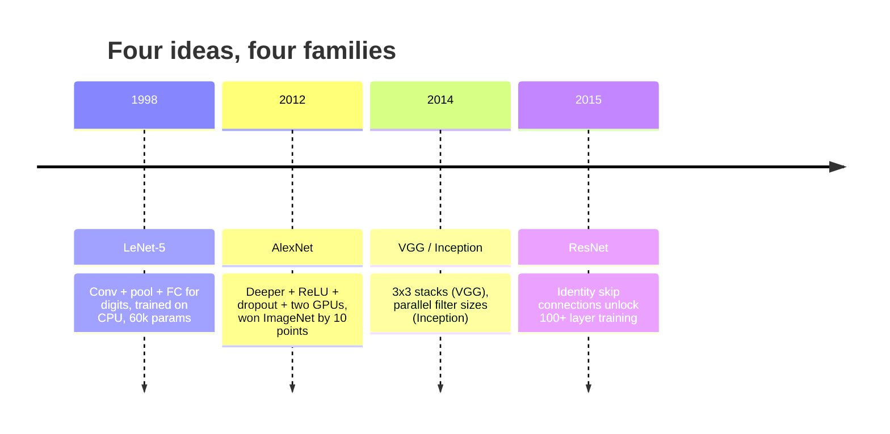
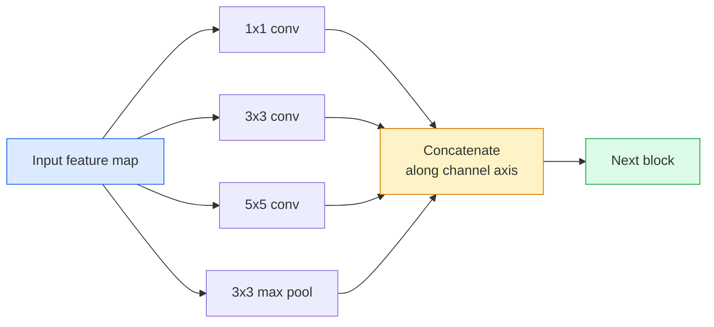
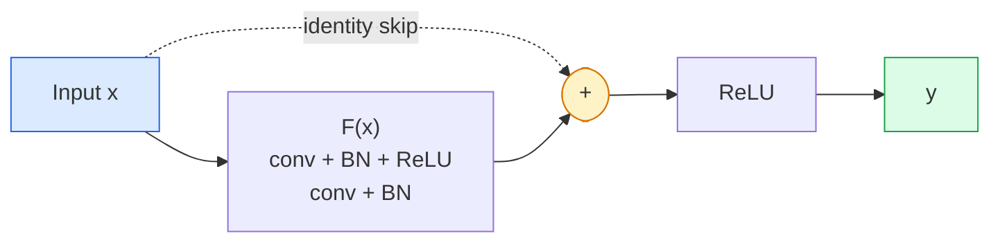

# CNN — LeNet부터 ResNet까지

> 지난 30년간 등장한 모든 주요 CNN은 동일한 합성곱-비선형성-다운샘플링 레시피에 새로운 아이디어 하나를 덧붙인 것에 불과합니다. 이 아이디어들을 순서대로 학습해 봅니다.

**유형:** Learn + Build
**사용 언어:** Python
**선수 레슨:** Phase 3 Lesson 11 (PyTorch), Phase 4 Lesson 01 (Image Fundamentals), Phase 4 Lesson 02 (Convolutions from Scratch)
**소요 시간:** ~75분

## 학습 목표

- LeNet-5 -> AlexNet -> VGG -> Inception -> ResNet으로 이어지는 아키텍처 계보를 추적하고 각 패밀리가 기여한 핵심 아이디어 하나를 설명할 수 있습니다.
- LeNet-5, VGG 스타일 블록, ResNet BasicBlock을 PyTorch로 각각 40줄 이내로 구현할 수 있습니다.
- 잔차 연결(residual connection)이 왜 1,000개 레이어를 가진 네트워크를 학습 불가능 상태에서 최고 수준(state-of-the-art)으로 탈바꿈시키는지 설명할 수 있습니다.
- 최신 백본(ResNet-18, ResNet-50)의 소스 코드를 확인하기 전에 출력 형상(shape), 수용 영역(receptive field), 파라미터 수를 예측할 수 있습니다.

## 문제

2011년 최고의 ImageNet 분류기는 Top-5 정확도 약 74%를 기록했습니다. 2012년 AlexNet은 85%를 기록했습니다. 2015년 ResNet은 96%를 기록했습니다. 새로운 데이터도 없었습니다. 새로운 세대의 GPU도 없었습니다. 이러한 성능 향상은 아키텍처 아이디어에서 비롯되었습니다. 현업 비전 엔지니어는 어떤 아이디어가 어떤 논문에서 나왔는지 반드시 알아야 합니다. 2026년에 배포하는 모든 프로덕션 백본이 이 동일한 구성 요소들의 재조합이기 때문입니다. 게다가 이 아이디어들은 계속해서 다른 분야로 전이되고 있습니다. 그룹 합성곱(grouped convolution)은 CNN에서 Transformer로 전이되었고, 잔차 연결은 ResNet에서 현존하는 모든 LLM으로 전이되었으며, 배치 정규화(batch normalization)는 확산 모델(diffusion model)에 활용되고 있습니다.

이러한 네트워크들을 순서대로 공부하면 흔히 저지르는 실수를 방지할 수 있습니다. 바로 LeNet 크기의 네트워크로도 해결할 수 있는 문제에 가장 큰 모델을 꺼내 드는 실수입니다. MNIST에는 ResNet이 필요하지 않습니다. 각 패밀리의 스케일링 곡선을 알고 있으면 어느 지점을 선택해야 할지 판단할 수 있습니다.

## 개념

### 비전 분야를 바꾼 네 가지 아이디어



고전 비전 분야에서 이 네 번의 도약만큼 중요했던 것은 없습니다.

### LeNet-5 (1998)

Yann LeCun의 숫자 인식기입니다. 60,000개의 파라미터를 가집니다. 두 개의 합성곱-풀링 블록, 두 개의 완전 연결 계층(fully connected layer), tanh 활성화 함수로 구성됩니다. 모든 CNN이 물려받은 템플릿을 정의했습니다.

```
input (1, 32, 32)
  conv 5x5 -> (6, 28, 28)
  avg pool 2x2 -> (6, 14, 14)
  conv 5x5 -> (16, 10, 10)
  avg pool 2x2 -> (16, 5, 5)
  flatten -> 400
  dense -> 120
  dense -> 84
  dense -> 10
```

현대 비전 분야에서 CNN이라 부르는 모든 구조, 즉 합성곱과 다운샘플링을 번갈아 적용한 뒤 소규모 분류기 헤드에 전달하는 구조는 LeNet에 더 많은 계층, 더 큰 채널, 더 나은 활성화 함수를 더한 형태입니다.

### AlexNet (2012)

ImageNet을 단숨에 제패한 세 가지 변화:

1. tanh 대신 **ReLU**를 사용했습니다. 기울기 소실(vanishing gradient)이 사라졌습니다. 학습 속도가 6배 빨라졌습니다.
2. 완전 연결 헤드에 **드롭아웃(Dropout)**을 적용했습니다. 정규화(regularization)가 단순한 기법이 아닌 하나의 계층이 되었습니다.
3. **깊이와 너비**. 5개의 합성곱 계층, 3개의 완전 연결 계층, 6천만 개의 파라미터로 구성되었으며, 모델을 둘로 나누어 두 대의 GPU에서 학습했습니다.

논문의 그림 2에는 여전히 두 개의 병렬 스트림으로 GPU 분할이 표시되어 있습니다. 그 병렬 처리는 하드웨어 한계를 극복하기 위한 우회책이었을 뿐 아키텍처적 통찰은 아니었습니다. 하지만 위의 세 가지 아이디어는 지금도 여러분이 사용하는 모든 모델에 남아 있습니다.

### VGG (2014)

VGG는 다음과 같은 질문을 던졌습니다. 3x3 합성곱만 사용하면서 네트워크를 깊게 쌓으면 어떻게 될까?

```
stack:   conv 3x3 -> conv 3x3 -> pool 2x2
repeat:  16 or 19 conv layers
```

두 개의 3x3 합성곱은 더 적은 파라미터($2 \cdot 9 \cdot C^2 = 18C^2$ 대 $25 \cdot C^2$)와 그 사이에 추가된 ReLU를 통해 하나의 5x5 합성곱과 동일한 5x5 입력 영역을 봅니다. VGG는 이 관찰 결과를 전체 아키텍처로 발전시켰습니다. 하나의 블록 타입을 반복하는 단순함 덕분에 이후 등장한 모든 모델의 기준점이 되었습니다.

비용: 1억 3,800만 개의 파라미터, 느린 학습 속도, 높은 추론(inference) 비용.

### Inception (2014, 같은 해)

"어떤 커널 크기를 사용해야 할까?"라는 질문에 Google이 내놓은 답은 "전부 병렬로 사용하자"였습니다.



각 브랜치가 특화됩니다. 1x1은 채널 믹싱, 3x3은 국소적 텍스처, 5x5는 더 큰 패턴, 풀링은 이동 불변(shift-invariant) 특징을 담당하며, 연결(concat)을 통해 다음 계층이 유용한 브랜치를 선택할 수 있게 합니다. Inception v1은 파라미터 수를 적정 수준으로 유지하기 위해 각 브랜치 내부에 병목(bottleneck)으로 1x1 합성곱을 사용했습니다.

### 성능 저하 문제(The degradation problem)

2015년에 이르러 VGG-19는 작동했지만 VGG-32는 작동하지 않았습니다. 깊이를 더하면 성능이 향상되어야 마땅하지만, 약 20개 계층을 넘어서면 학습 손실과 테스트 손실이 모두 악화되었습니다. 이는 과적합(overfitting)이 아닙니다. 계층을 거칠 때마다 기울기가 곱연산으로 줄어들기 때문에 옵티마이저가 유용한 가중치를 찾지 못하는 문제입니다.

```
Plain deep network:
  y = f_L( f_{L-1}( ... f_1(x) ... ) )

Gradient wrt early layer:
  dL/dW_1 = dL/dy * df_L/df_{L-1} * ... * df_2/df_1 * df_1/dW_1

Each multiplicative term has magnitude roughly (weight magnitude) * (activation gain).
Stack 100 of them with gains < 1 and the gradient is effectively zero.
```

VGG가 19개 계층에서 작동할 수 있었던 것은 거의 동시에 발표된 배치 정규화(batch normalization) 덕분에 활성화 값의 스케일이 잘 유지되었기 때문입니다. 하지만 배치 정규화로도 약 30개 계층을 넘어서는 깊이를 감당할 수는 없었습니다.

### ResNet (2015)

He, Zhang, Ren, Sun은 모든 것을 해결한 단 하나의 변화를 제안했습니다.

```math
\begin{aligned}
\text{standard block:} \quad & y = F(x) \\
\text{residual block:} \quad & y = F(x) + x
\end{aligned}
```

`+ x` 덕분에 계층은 언제든지 `F(x)`를 0으로 만들어 아무것도 하지 않는 선택을 할 수 있습니다. 이제 1,000개 계층을 가진 ResNet도 기껏해야 1개 계층 네트워크만큼의 성능은 낼 수 있습니다. 모든 추가 블록에 자명한 탈출구가 마련되어 있기 때문입니다. 이러한 보장이 있기에 옵티마이저는 모든 블록을 *조금씩* 유용하게 만들 수 있으며, 조금씩 유용한 블록을 100개 쌓아 올린 것이 바로 최고 수준의 성능(SOTA)입니다.



어디서나 쓰이는 블록 변형은 두 가지입니다.

- **BasicBlock** (ResNet-18, ResNet-34): 두 개의 3x3 합성곱, 둘을 건너뛰는 스킵 연결.
- **Bottleneck** (ResNet-50, -101, -152): 1x1 축소, 3x3 중간, 1x1 확장, 이 세 개를 건너뛰는 스킵 연결. 채널 수가 많을 때 비용이 더 저렴합니다.

스킵 경로가 다운샘플링(stride=2)을 거쳐야 할 때는, 형상을 맞추기 위해 항등(identity) 경로를 stride=2인 1x1 합성곱으로 대체합니다.

### 비전을 넘어 잔차가 중요한 이유

이 아이디어는 사실 이미지 분류에 국한된 것이 아니었습니다. 딥 네트워크를 "기울기가 살아남기만을 기도하는" 상태에서 신뢰할 수 있고 확장 가능한 엔지니어링 도구로 탈바꿈시킨 것이 핵심입니다. 다음 단계에서 배우게 될 모든 Transformer는 모든 블록에 정확히 동일한 스킵 연결을 가지고 있습니다. ResNet이 없었다면 GPT도 없었을 것입니다.

```figure
pooling
```

## 직접 만들어보기

### 1단계: LeNet-5

최소한의 코드로 구현한 충실한 LeNet입니다. Tanh 활성화 함수와 평균 풀링(average pooling)을 사용합니다. 현대적 방식에 맞춘 유일한 절충점은 원래의 가우시안 연결 대신 다운스트림에 `nn.CrossEntropyLoss`를 사용한다는 점입니다.

```python
import torch
import torch.nn as nn
import torch.nn.functional as F

class LeNet5(nn.Module):
    def __init__(self, num_classes=10):
        super().__init__()
        self.conv1 = nn.Conv2d(1, 6, kernel_size=5)
        self.conv2 = nn.Conv2d(6, 16, kernel_size=5)
        self.pool = nn.AvgPool2d(2)
        self.fc1 = nn.Linear(16 * 5 * 5, 120)
        self.fc2 = nn.Linear(120, 84)
        self.fc3 = nn.Linear(84, num_classes)

    def forward(self, x):
        x = self.pool(torch.tanh(self.conv1(x)))
        x = self.pool(torch.tanh(self.conv2(x)))
        x = torch.flatten(x, 1)
        x = torch.tanh(self.fc1(x))
        x = torch.tanh(self.fc2(x))
        return self.fc3(x)

net = LeNet5()
x = torch.randn(1, 1, 32, 32)
print(f"output: {net(x).shape}")
print(f"params: {sum(p.numel() for p in net.parameters()):,}")
```

예상 출력: `output: torch.Size([1, 10])`, `params: 61,706`. 현대 비전 분야의 시초가 된 숫자 분류기 전체 코드입니다.

### 2단계: VGG 블록

재사용 가능한 하나의 블록: 두 개의 3x3 합성곱, ReLU, 배치 정규화, 최대 풀링(max pool).

```python
class VGGBlock(nn.Module):
    def __init__(self, in_c, out_c):
        super().__init__()
        self.conv1 = nn.Conv2d(in_c, out_c, kernel_size=3, padding=1)
        self.bn1 = nn.BatchNorm2d(out_c)
        self.conv2 = nn.Conv2d(out_c, out_c, kernel_size=3, padding=1)
        self.bn2 = nn.BatchNorm2d(out_c)
        self.pool = nn.MaxPool2d(2)

    def forward(self, x):
        x = F.relu(self.bn1(self.conv1(x)))
        x = F.relu(self.bn2(self.conv2(x)))
        return self.pool(x)

class MiniVGG(nn.Module):
    def __init__(self, num_classes=10):
        super().__init__()
        self.stack = nn.Sequential(
            VGGBlock(3, 32),
            VGGBlock(32, 64),
            VGGBlock(64, 128),
        )
        self.head = nn.Sequential(
            nn.AdaptiveAvgPool2d(1),
            nn.Flatten(),
            nn.Linear(128, num_classes),
        )

    def forward(self, x):
        return self.head(self.stack(x))

net = MiniVGG()
x = torch.randn(1, 3, 32, 32)
print(f"output: {net(x).shape}")
print(f"params: {sum(p.numel() for p in net.parameters()):,}")
```

CIFAR 크기의 입력에 적용되는 세 개의 VGG 블록, 어댑티브 풀링, 하나의 선형 계층으로 구성됩니다. 파라미터는 약 29만 개입니다. CIFAR-10에는 충분한 크기입니다.

### 3단계: ResNet BasicBlock

ResNet-18과 ResNet-34의 핵심 빌딩 블록입니다.

```python
class BasicBlock(nn.Module):
    def __init__(self, in_c, out_c, stride=1):
        super().__init__()
        self.conv1 = nn.Conv2d(in_c, out_c, kernel_size=3, stride=stride, padding=1, bias=False)
        self.bn1 = nn.BatchNorm2d(out_c)
        self.conv2 = nn.Conv2d(out_c, out_c, kernel_size=3, stride=1, padding=1, bias=False)
        self.bn2 = nn.BatchNorm2d(out_c)
        if stride != 1 or in_c != out_c:
            self.shortcut = nn.Sequential(
                nn.Conv2d(in_c, out_c, kernel_size=1, stride=stride, bias=False),
                nn.BatchNorm2d(out_c),
            )
        else:
            self.shortcut = nn.Identity()

    def forward(self, x):
        out = F.relu(self.bn1(self.conv1(x)))
        out = self.bn2(self.conv2(out))
        out = out + self.shortcut(x)
        return F.relu(out)
```

합성곱 계층에 `bias=False`을 설정하는 것은 배치 정규화의 관례입니다. BN의 beta 파라미터가 이미 편향(bias)을 처리하므로, 합성곱 편향까지 유지하는 것은 낭비이기 때문입니다. `shortcut`는 stride나 채널 수가 변경될 때만 실제 합성곱이 필요하며, 그렇지 않은 경우에는 아무 작업도 하지 않는 항등(identity) 매핑입니다.

### 4단계: 초소형 ResNet

CIFAR 크기의 입력을 처리할 수 있는 작동 가능한 ResNet을 만들기 위해 BasicBlock 네 그룹을 쌓습니다.

```python
class TinyResNet(nn.Module):
    def __init__(self, num_classes=10):
        super().__init__()
        self.stem = nn.Sequential(
            nn.Conv2d(3, 32, kernel_size=3, stride=1, padding=1, bias=False),
            nn.BatchNorm2d(32),
            nn.ReLU(inplace=True),
        )
        self.layer1 = self._make_group(32, 32, num_blocks=2, stride=1)
        self.layer2 = self._make_group(32, 64, num_blocks=2, stride=2)
        self.layer3 = self._make_group(64, 128, num_blocks=2, stride=2)
        self.layer4 = self._make_group(128, 256, num_blocks=2, stride=2)
        self.head = nn.Sequential(
            nn.AdaptiveAvgPool2d(1),
            nn.Flatten(),
            nn.Linear(256, num_classes),
        )

    def _make_group(self, in_c, out_c, num_blocks, stride):
        blocks = [BasicBlock(in_c, out_c, stride=stride)]
        for _ in range(num_blocks - 1):
            blocks.append(BasicBlock(out_c, out_c, stride=1))
        return nn.Sequential(*blocks)

    def forward(self, x):
        x = self.stem(x)
        x = self.layer1(x)
        x = self.layer2(x)
        x = self.layer3(x)
        x = self.layer4(x)
        return self.head(x)

net = TinyResNet()
x = torch.randn(1, 3, 32, 32)
print(f"output: {net(x).shape}")
print(f"params: {sum(p.numel() for p in net.parameters()):,}")
```

각각 두 개의 블록으로 구성된 네 개의 그룹입니다. 그룹 2, 3, 4의 시작 부분에서 stride 2가 적용됩니다. 다운샘플링이 일어날 때마다 채널 수가 두 배로 증가합니다. 약 280만 개의 파라미터를 가집니다. 이것이 ResNet-152까지 깔끔하게 확장되는 표준 레시피입니다.

### 5단계: 파라미터 대비 특징 효율 비교

동일한 입력을 세 네트워크 모두에 통과시키고 파라미터 수를 비교합니다.

```python
def summary(name, net, x):
    y = net(x)
    params = sum(p.numel() for p in net.parameters())
    print(f"{name:12s}  input {tuple(x.shape)} -> output {tuple(y.shape)}  params {params:>10,}")

x = torch.randn(1, 3, 32, 32)
summary("LeNet5",     LeNet5(),       torch.randn(1, 1, 32, 32))
summary("MiniVGG",    MiniVGG(),      x)
summary("TinyResNet", TinyResNet(),   x)
```

세 개의 모델, 세 개의 시대, 파라미터 수에서 세 자리의 자릿수 차이를 보입니다. CIFAR-10 정확도를 기준으로 몇 에포크(epoch) 학습 후 대략 LeNet 60%, MiniVGG 89%, TinyResNet 93%의 성능을 얻을 수 있습니다.
## 활용하기

`torchvision.models`을 통해 위에서 살펴본 모든 모델의 사전 학습(pretrained) 버전을 사용할 수 있습니다. 패밀리 전반에 걸쳐 호출 시그니처가 동일하며, 이것이 바로 백본(backbone) 추상화의 핵심 목적입니다.

```python
from torchvision.models import resnet18, ResNet18_Weights, vgg16, VGG16_Weights

r18 = resnet18(weights=ResNet18_Weights.IMAGENET1K_V1)
r18.eval()

print(f"ResNet-18 params: {sum(p.numel() for p in r18.parameters()):,}")
print(r18.layer1[0])
print()

v16 = vgg16(weights=VGG16_Weights.IMAGENET1K_V1)
v16.eval()
print(f"VGG-16   params: {sum(p.numel() for p in v16.parameters()):,}")
```

ResNet-18의 파라미터 수는 1,170만 개(11.7M)입니다. 반면 VGG-16은 1억 3,800만 개(138M)입니다. 두 모델의 ImageNet top-1 정확도는 유사합니다(69.8% 대 71.6%). 잔차 연결(residual connection) 덕분에 파라미터 효율성을 12배나 확보할 수 있습니다. 이것이 바로 2016년부터 2021년 ViT가 등장할 때까지 ResNet 변형 모델들이 시장을 지배했던 이유이며, 연산량이 제약 조건인 실제 배포 환경에서는 여전히 우위를 점하고 있는 이유입니다.

전이 학습(transfer learning)의 절차는 항상 동일합니다. 사전 학습된 가중치를 로드하고, 백본을 동결(freeze)한 뒤, 분류기 헤드(head)를 교체하는 것입니다.

```python
for p in r18.parameters():
    p.requires_grad = False
r18.fc = nn.Linear(r18.fc.in_features, 10)
```

단 세 줄이면 충분합니다. 이제 ImageNet 학습에 투입된 연산 비용의 결실인 표현(representation)을 그대로 이어받은 10개 클래스 대상의 CIFAR 분류기가 완성되었습니다.

## 결과물

이번 레슨을 통해 다음 항목을 작성하게 됩니다:

- `outputs/prompt-backbone-selector.md` — 작업, 데이터셋 크기, 연산 예산을 바탕으로 적절한 CNN 패밀리(LeNet/VGG/ResNet/MobileNet/ConvNeXt)를 선정하는 프롬프트.
- `outputs/skill-residual-block-reviewer.md` — PyTorch 모듈을 읽고 스킵 연결 관련 실수(스트라이드 변경 시 숏컷 누락, 숏컷 활성화 순서, 덧셈 연산 대비 BN 배치 위치)를 찾아내는 스킬.

## 연습 문제

1. **(기초)** `TinyResNet`의 파라미터 수를 레이어별로 직접 손으로 계산해 보세요. `sum(p.numel() for p in net.parameters())`의 결과와 비교해 봅니다. 파라미터 예산의 대부분은 어디에 할당됩니까 — 합성곱(conv), BN, 분류기 헤드 중 어느 쪽인가요?
2. **(중급)** Bottleneck 블록(1x1 -> 3x3 -> 1x1과 스킵 연결)을 구현하고, 이를 활용해 CIFAR용 ResNet-50 스타일의 네트워크를 구축해 보세요. 파라미터 수를 `TinyResNet`과 비교해 봅니다.
3. **(고급)** `BasicBlock`에서 스킵 연결을 제거하고, 34개 블록으로 구성된 "일반(plain)" 네트워크와 34개 블록 ResNet을 CIFAR-10에서 각각 10 에포크 동안 학습시켜 보세요. 두 모델의 에포크별 학습 손실(loss) 그래프를 시각화해 봅니다. He 등의 논문 Figure 1에 나온 것처럼 깊은 일반 네트워크가 더 얕은 네트워크보다 더 높은 손실로 수렴하는 결과를 재현해 보세요.

## 핵심 용어

| 용어 | 흔히 쓰는 표현 | 실제 의미 |
|------|----------------|----------------------|
| 백본(Backbone) | "모델" | 작업별 헤드로 전달되는 특성 맵(feature map)을 생성하는 합성곱 블록의 스택 |
| 잔차 연결(Residual connection) | "스킵 연결(Skip connection)" | `y = F(x) + x`; 옵티마이저가 F를 0으로 만들어 항등 함수(identity)를 쉽게 학습할 수 있게 하여 임의의 깊이에서도 학습이 가능하도록 지원 |
| BasicBlock | "스킵 연결이 있는 3x3 합성곱 2개" | ResNet-18/34의 기본 빌딩 블록: conv-BN-ReLU-conv-BN-add-ReLU 구조 |
| Bottleneck | "1x1 축소, 3x3, 1x1 확장" | ResNet-50/101/152 블록; 축소된 채널 너비에서 3x3 연산이 수행되므로 채널 수가 많아도 연산 비용이 저렴함 |
| 퇴화 문제(Degradation problem) | "깊어질수록 성능 저하" | 일반 합성곱 레이어가 약 20개를 넘어가면 훈련 및 테스트 오차가 모두 증가하는 현상. 데이터 추가가 아닌 잔차 연결로 해결됨 |
| 스템(Stem) | "첫 번째 레이어" | 3채널 입력을 기본 특성 너비로 변환하는 초기 합성곱 레이어. ImageNet의 경우 보통 7x7 스트라이드 2, CIFAR의 경우 3x3 스트라이드 1 사용 |
| 헤드(Head) | "분류기" | 최종 백본 블록 뒤에 배치되는 레이어: 적응형 풀링(adaptive pool), 평탄화(flatten), 선형 레이어(linear)로 구성 |
| 전이 학습(Transfer learning) | "사전 학습된 가중치" | ImageNet으로 사전 학습된 백본을 로드하고, 풀고자 하는 작업에 맞게 헤드만 미세 조정(fine-tuning)하는 기법 |

## 추천 자료

- [Deep Residual Learning for Image Recognition (He et al., 2015)](https://arxiv.org/abs/1512.03385) — ResNet 논문입니다. 포함된 모든 도표를 깊이 있게 연구해 볼 가치가 있습니다.
- [Very Deep Convolutional Networks (Simonyan & Zisserman, 2014)](https://arxiv.org/abs/1409.1556) — VGG 논문입니다. "왜 3x3인가"에 대해 여전히 가장 훌륭한 참고 자료입니다.
- [ImageNet Classification with Deep CNNs (Krizhevsky et al., 2012)](https://papers.nips.cc/paper_files/paper/2012/hash/c399862d3b9d6b76c8436e924a68c45b-Abstract.html) — 수작업 특성 추출(hand-crafted feature)의 시대를 끝낸 AlexNet 논문입니다.
- [Going Deeper with Convolutions (Szegedy et al., 2014)](https://arxiv.org/abs/1409.4842) — Inception v1 논문입니다. 비전 트랜스포머에서도 여전히 활용되는 병렬 필터 아이디어를 소개합니다.
