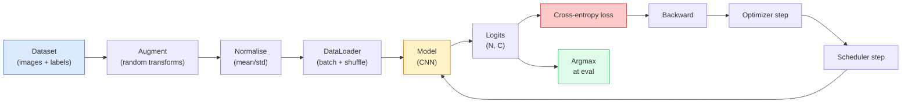

# 이미지 분류(Image Classification)

> 분류기(classifier)는 픽셀을 클래스에 대한 확률 분포로 매핑하는 함수입니다. 그 외의 모든 것은 배관 작업에 불과합니다.

**유형:** Build (실습)
**사용 언어:** Python
**선수 레슨:** Phase 2 Lesson 09 (Model Evaluation), Phase 3 Lesson 10 (Mini Framework), Phase 4 Lesson 03 (CNNs)
**소요 시간:** ~75분

## 학습 목표

- CIFAR-10 기반의 엔드투엔드 이미지 분류 파이프라인(데이터셋, 증강, 모델, 학습 루프, 평가)을 구축합니다.
- 각 구성 요소(데이터로더, 손실, 옵티마이저, 스케줄러, 증강)의 역할을 설명하고, 그중 하나라도 망가졌을 때 손실 곡선에 어떤 현상이 나타나는지 예측합니다.
- 믹스업(mixup), 컷아웃(cutout), 라벨 스무딩(label smoothing)을 밑바닥부터 구현하고 각각을 추가할 타당한 이유를 제시합니다.
- 혼동 행렬(confusion matrix)과 클래스별 정밀도/재현율 표를 분석하여 종합 정확도만으로는 파악할 수 없는 데이터셋 및 모델의 결함을 진단합니다.

## 문제

배포되는 모든 컴퓨터 비전(vision) 태스크는 어느 수준에서든 결국 이미지 분류로 귀결됩니다. 객체 탐지(detection)는 영역을 분류하고, 세그멘테이션(segmentation)은 픽셀을 분류하며, 검색(retrieval)은 클래스 중심점(centroid)과의 유사도로 순위를 매깁니다. 분류를 올바르게 구현하는 것(데이터셋 루프, 증강 정책, 손실 함수, 평가)은 이 단계의 다른 모든 태스크로 전이되는 핵심 기술입니다.

대부분의 분류 버그는 모델 자체에 있지 않습니다. 버그는 파이프라인에 숨어 있습니다. 잘못된 정규화, 셔플되지 않은 학습 세트, 라벨을 왜곡하는 증강, 학습 데이터에 오염된 검증 분할, 30번째 에폭(epoch) 이후 조용히 발산하는 학습률(learning rate) 등이 그렇습니다. 올바른 설정을 갖추면 CIFAR-10에서 93%를 기록할 CNN도 설정이 망가지면 흔히 70~75%의 점수를 내며, 그 와중에도 손실 곡선은 그럴듯해 보입니다.

본 강의에서는 모든 부분을 점검할 수 있도록 전체 파이프라인을 직접 수작업으로 연결합니다. 버그를 감출 수 있는 `torchvision.datasets`의 어떤 요소도 사용하지 않습니다.

## 개념

### 분류 파이프라인



이 루프의 모든 줄에는 버그가 숨어 있을 수 있습니다. 교차 엔트로피(cross-entropy)는 소프트맥스(softmax) 출력이 아닌 원시 로짓(raw logits)을 입력으로 받으므로, 손실 함수 앞의 어떤 `model(x).softmax()` 호출이든 조용히 잘못된 기울기(gradient)를 계산하게 만듭니다. 증강은 라벨이 아닌 입력에만 적용되어야 하지만, 둘 다 혼합하는 mixup은 예외입니다. `optimizer.zero_grad()`은 스텝마다 한 번씩 실행되어야 하며, 이를 건너뛰면 기울기가 누적되어 마치 극도로 불안정한 학습률처럼 보입니다. 이러한 버그들은 오류를 발생시키지 않은 채 학습 곡선을 평평하게 만듭니다.

### 교차 엔트로피, 로짓, 소프트맥스

분류기는 이미지당 로짓(logits)이라고 불리는 `C`개의 숫자를 생성합니다. 소프트맥스를 적용하면 이를 확률 분포로 변환합니다.

```math
\mathop{\mathrm{softmax}}(z)_i = \frac{\exp(z_i)}{\sum_j \exp(z_j)}
```

교차 엔트로피는 정답 클래스의 음의 로그 확률(negative log probability)을 측정합니다.

```math
\begin{aligned}
\mathrm{CE}(z, y) &= -\log\left( \mathop{\mathrm{softmax}}(z)_y \right) \\
&= -z_y + \log\left( \sum_j \exp(z_j) \right)
\end{aligned}
```

우변의 형태가 수치적으로 안정적인(numerically stable) 형태(log-sum-exp)입니다. PyTorch의 `nn.CrossEntropyLoss`는 softmax + NLL을 하나의 연산으로 융합하며 원시 로짓을 직접 받습니다. 소프트맥스를 먼저 직접 적용하는 것은 거의 항상 버그이며, 이 경우 의미 없는 값인 $\log(\mathop{\mathrm{softmax}}(\mathop{\mathrm{softmax}}(z)))$를 계산하게 됩니다.

### 데이터 증강이 효과적인 이유

CNN은 (가중치 공유 덕분에) 이동(translation)에 대한 귀납적 편향(inductive bias)을 가지지만, 크롭(crop), 뒤집기(flip), 색상 변화(color jitter), 가림(occlusion)에 대해서는 내장된 불변성(invariance)이 없습니다. 이러한 불변성을 학습시키는 유일한 방법은 해당 변형을 가한 픽셀을 모델에 보여주는 것입니다. 학습 중의 모든 무작위 변환(random transform)은 모델에게 이렇게 말하는 것과 같습니다. "이 두 이미지는 같은 라벨을 가진다. 차이를 무시하는 특징을 학습하라."

```
Original crop:  "dog facing left"
Flip:           "dog facing right"       <- same label, different pixels
Rotate(+15):    "dog, slight tilt"
Colour jitter:  "dog in warmer light"
RandomErasing:  "dog with patch missing"
```

원칙: 증강은 라벨을 보존해야 합니다. 숫자에 대한 cutout이나 회전은 "6"을 "9"로 바꿀 수 있습니다. 이러한 데이터셋에서는 회전 범위를 더 작게 설정하고 숫자 고유의 불변성을 해치지 않는 증강을 선택해야 합니다.

### Mixup과 cutmix

일반적인 증강은 픽셀을 변환하지만 라벨은 원-핫(one-hot) 상태를 유지합니다. **Mixup**과 **cutmix**는 픽셀과 라벨을 모두 보간(interpolation)하여 이 규칙을 깹니다.

```
Mixup:
  lambda ~ Beta(a, a)
  x = lambda * x_i + (1 - lambda) * x_j
  y = lambda * y_i + (1 - lambda) * y_j

Cutmix:
  paste a random rectangle of x_j into x_i
  y = area-weighted mix of y_i and y_j
```

도움이 되는 이유: 모델이 뾰족한 원-핫 타깃을 암기하는 것을 멈추고 클래스 간을 보간하는 방법을 배웁니다. 학습 손실은 증가하지만, 테스트 정확도는 향상됩니다. 이는 어떤 분류기에서든 가장 저렴한 비용으로 견고성(robustness)을 끌어올릴 수 있는 방법입니다.

### 라벨 스무딩

Mixup의 사촌 격인 기법입니다. `[0, 0, 1, 0, 0]`을 타깃으로 학습하는 대신, 0.1과 같이 작은 `eps`에 대해 `[eps/C, eps/C, 1-eps+eps/C, eps/C, eps/C]`을 타깃으로 학습합니다(원-핫 타깃을 균등 분포와 혼합하므로 여전히 합은 1이 됩니다). 모델이 임의로 극단적인 로짓을 생성하지 못하게 방지하며, 거의 비용을 들이지 않고 캘리브레이션(calibration)을 개선합니다. PyTorch 1.10부터 `nn.CrossEntropyLoss(label_smoothing=0.1)`에 내장되어 있습니다.

### 정확도를 넘어선 평가

종합 정확도(aggregate accuracy)는 클래스 불균형을 은폐합니다. 항상 다수 클래스만 예측하는 90-10 이진 분류기도 90%의 정확도를 기록합니다. 실제로 무슨 일이 일어나고 있는지 알려주는 도구는 다음과 같습니다.

- **클래스별 정확도(Per-class accuracy)** — 클래스당 하나의 숫자로, 성능이 떨어지는 카테고리를 즉시 드러냅니다.
- **혼동 행렬(Confusion matrix)** — 행 $i$, 열 $j$이 실제 클래스 $i$을 클래스 $j$로 예측한 횟수를 나타내는 $C \times C$ 격자입니다. 대각선은 올바른 예측이며, 비대각선(off-diagonal)에 모델의 실제 상태가 드러납니다.
- **Top-1 / Top-5** — 정답 클래스가 상위 1개 또는 상위 5개 예측 안에 포함되는지 여부입니다. Top-5는 ImageNet에서 중요한데, "노리치 테리어" 대 "노퍽 테리어"처럼 클래스 간에 본질적으로 모호한 경우가 있기 때문입니다.
- **캘리브레이션(Calibration, ECE)** — 0.8의 신뢰도(confidence)를 가진 예측이 실제로 80%의 확률로 맞습니까? 현대의 신경망은 구조적으로 과도한 확신(over-confident)을 갖는 경향이 있습니다. 온도 스케일링(temperature scaling)이나 라벨 스무딩으로 이를 해결합니다.

```figure
receptive-field
```

## 직접 만들어보기

### 1단계: 결정론적 합성 데이터셋

CIFAR-10은 디스크에 저장되어 있습니다. 본 강의를 재현 가능하고 빠르게 진행하기 위해 CIFAR와 유사한 합성 데이터셋을 구축합니다. 이는 모델이 학습해야 할 클래스별 구조를 가진 32x32 RGB 이미지입니다. 완전히 동일한 파이프라인이 실제 CIFAR-10에서도 수정 없이 동작합니다.

```python
import numpy as np
import torch
from torch.utils.data import Dataset


def synthetic_cifar(num_per_class=1000, num_classes=10, seed=0):
    rng = np.random.default_rng(seed)
    X = []
    Y = []
    for c in range(num_classes):
        centre = rng.uniform(0, 1, (3,))
        freq = 2 + c
        for _ in range(num_per_class):
            yy, xx = np.meshgrid(np.linspace(0, 1, 32), np.linspace(0, 1, 32), indexing="ij")
            r = np.sin(xx * freq) * 0.5 + centre[0]
            g = np.cos(yy * freq) * 0.5 + centre[1]
            b = (xx + yy) * 0.5 * centre[2]
            img = np.stack([r, g, b], axis=-1)
            img += rng.normal(0, 0.08, img.shape)
            img = np.clip(img, 0, 1)
            X.append(img.astype(np.float32))
            Y.append(c)
    X = np.stack(X)
    Y = np.array(Y)
    idx = rng.permutation(len(X))
    return X[idx], Y[idx]


class ArrayDataset(Dataset):
    def __init__(self, X, Y, transform=None):
        self.X = X
        self.Y = Y
        self.transform = transform

    def __len__(self):
        return len(self.X)

    def __getitem__(self, i):
        img = self.X[i]
        if self.transform is not None:
            img = self.transform(img)
        img = torch.from_numpy(img).permute(2, 0, 1)
        return img, int(self.Y[i])
```

각 클래스는 고유한 색상 팔레트와 주파수 패턴을 가지며, 모델이 픽셀을 단순히 암기하지 않고 신호를 학습하도록 가우시안 노이즈(Gaussian noise)가 추가됩니다. 10개 클래스, 클래스당 1,000장의 이미지가 무작위 순서로 섞입니다.

### 2단계: 정규화 및 증강

모든 비전 파이프라인에 포함되는 두 가지 변환입니다.

```python
def standardize(mean, std):
    mean = np.array(mean, dtype=np.float32)
    std = np.array(std, dtype=np.float32)
    def _fn(img):
        return (img - mean) / std
    return _fn


def random_hflip(p=0.5):
    def _fn(img):
        if np.random.random() < p:
            return img[:, ::-1, :].copy()
        return img
    return _fn


def random_crop(pad=4):
    def _fn(img):
        h, w = img.shape[:2]
        padded = np.pad(img, ((pad, pad), (pad, pad), (0, 0)), mode="reflect")
        y = np.random.randint(0, 2 * pad)
        x = np.random.randint(0, 2 * pad)
        return padded[y:y + h, x:x + w, :]
    return _fn


def compose(*fns):
    def _fn(img):
        for fn in fns:
            img = fn(img)
        return img
    return _fn
```

크롭 전에 제로 패딩(zero-pad)이 아닌 반사 패딩(reflect-pad)을 적용하는데, 검은색 테두리는 모델이 무의미한 방식으로 무시하도록 학습할 수 있는 신호가 되기 때문입니다.

### 3단계: Mixup

학습 스텝 내부에서 두 이미지와 두 라벨을 혼합합니다. 데이터셋 내부가 아닌 순전파(forward pass) 바로 옆에 위치하도록 배치(batch) 변환으로 구현합니다.

```python
def mixup_batch(x, y, num_classes, alpha=0.2):
    if alpha <= 0:
        return x, torch.nn.functional.one_hot(y, num_classes).float()
    lam = float(np.random.beta(alpha, alpha))
    idx = torch.randperm(x.size(0), device=x.device)
    x_mixed = lam * x + (1 - lam) * x[idx]
    y_onehot = torch.nn.functional.one_hot(y, num_classes).float()
    y_mixed = lam * y_onehot + (1 - lam) * y_onehot[idx]
    return x_mixed, y_mixed


def soft_cross_entropy(logits, soft_targets):
    log_probs = torch.log_softmax(logits, dim=-1)
    return -(soft_targets * log_probs).sum(dim=-1).mean()
```

`soft_cross_entropy`는 소프트 라벨 분포에 대한 교차 엔트로피입니다. 타깃이 완전한 원-핫 형태일 때는 일반적인 원-핫 교차 엔트로피로 단순화됩니다.

### 4단계: 학습 루프

완성된 레시피: 데이터에 대한 1회 순회, 배치당 한 번의 기울기 계산, 에폭당 한 번의 스케줄러 스텝.

```python
import torch
import torch.nn as nn
from torch.utils.data import DataLoader
from torch.optim import SGD
from torch.optim.lr_scheduler import CosineAnnealingLR

def train_one_epoch(model, loader, optimizer, device, num_classes, use_mixup=True):
    model.train()
    total, correct, loss_sum = 0, 0, 0.0
    for x, y in loader:
        x, y = x.to(device), y.to(device)
        if use_mixup:
            x_m, y_soft = mixup_batch(x, y, num_classes)
            logits = model(x_m)
            loss = soft_cross_entropy(logits, y_soft)
        else:
            logits = model(x)
            loss = nn.functional.cross_entropy(logits, y, label_smoothing=0.1)
        optimizer.zero_grad()
        loss.backward()
        optimizer.step()
        loss_sum += loss.item() * x.size(0)
        total += x.size(0)
        # Training accuracy vs the un-mixed labels `y` is only an approximation
        # when mixup is on (the model saw soft targets, not y). Treat it as a
        # rough progress signal; rely on val accuracy for real performance.
        with torch.no_grad():
            pred = logits.argmax(dim=-1)
            correct += (pred == y).sum().item()
    return loss_sum / total, correct / total


@torch.no_grad()
def evaluate(model, loader, device, num_classes):
    model.eval()
    total, correct = 0, 0
    loss_sum = 0.0
    cm = torch.zeros(num_classes, num_classes, dtype=torch.long)
    for x, y in loader:
        x, y = x.to(device), y.to(device)
        logits = model(x)
        loss = nn.functional.cross_entropy(logits, y)
        pred = logits.argmax(dim=-1)
        for t, p in zip(y.cpu(), pred.cpu()):
            cm[t, p] += 1
        loss_sum += loss.item() * x.size(0)
        total += x.size(0)
        correct += (pred == y).sum().item()
    return loss_sum / total, correct / total, cm
```

학습 루프를 작성할 때마다 확인해야 할 5가지 불변 규칙(invariant):

1. 학습 전에는 `model.train()`, 평가 전에는 `model.eval()` — 드롭아웃(dropout)과 배치 정규화(batchnorm)의 동작을 전환합니다.
2. `.backward()` 전에는 `.zero_grad()`.
3. 메트릭을 누적할 때는 연산 그래프(computation graph)가 유지되지 않도록 `.item()`.
4. 평가 중에는 `@torch.no_grad()` — 메모리와 시간을 절약하고 미묘한 실수를 방지합니다.
5. 소프트맥스가 아닌 원시 로짓을 대상으로 argmax 수행 — 결과는 같으면서 연산 하나를 줄입니다.
### Step 5: 전체 과정 종합하기

이전 단원의 `TinyResNet`을(를) 사용하여 몇 에포크(epoch) 동안 훈련하고 평가합니다.

```python
from main import synthetic_cifar, ArrayDataset
from main import standardize, random_hflip, random_crop, compose
from main import mixup_batch, soft_cross_entropy
from main import train_one_epoch, evaluate
# TinyResNet comes from the previous lesson (03-cnns-lenet-to-resnet).
# Adjust the import path to wherever you stored the previous lesson's code.
from cnns_lenet_to_resnet import TinyResNet  # example placeholder

X, Y = synthetic_cifar(num_per_class=500)
split = int(0.9 * len(X))
X_train, Y_train = X[:split], Y[:split]
X_val, Y_val = X[split:], Y[split:]

mean = [0.5, 0.5, 0.5]
std = [0.25, 0.25, 0.25]
train_tf = compose(random_hflip(), random_crop(pad=4), standardize(mean, std))
eval_tf = standardize(mean, std)

train_ds = ArrayDataset(X_train, Y_train, transform=train_tf)
val_ds = ArrayDataset(X_val, Y_val, transform=eval_tf)

train_loader = DataLoader(train_ds, batch_size=128, shuffle=True, num_workers=0)
val_loader = DataLoader(val_ds, batch_size=256, shuffle=False, num_workers=0)

device = "cuda" if torch.cuda.is_available() else "cpu"
model = TinyResNet(num_classes=10).to(device)
optimizer = SGD(model.parameters(), lr=0.1, momentum=0.9, weight_decay=5e-4, nesterov=True)
scheduler = CosineAnnealingLR(optimizer, T_max=10)

for epoch in range(10):
    tr_loss, tr_acc = train_one_epoch(model, train_loader, optimizer, device, 10, use_mixup=True)
    va_loss, va_acc, _ = evaluate(model, val_loader, device, 10)
    scheduler.step()
    print(f"epoch {epoch:2d}  lr {scheduler.get_last_lr()[0]:.4f}  "
          f"train {tr_loss:.3f}/{tr_acc:.3f}  val {va_loss:.3f}/{va_acc:.3f}")
```

합성 데이터셋의 경우 5에포크 이내에 거의 완벽한 검증 정확도에 도달하며, 이것이 바로 핵심입니다. 즉 파이프라인이 올바르게 동작하고 모델이 학습 가능한 대상을 제대로 학습할 수 있음을 보여줍니다. 데이터셋을 실제 CIFAR-10으로 바꾸더라도 코드 변경 없이 동일한 루프로 약 90%까지 훈련됩니다.

### Step 6: 혼동 행렬(confusion matrix) 읽기

정확도만으로는 모델이 어디서 실패하고 있는지 절대 알 수 없습니다. 혼동 행렬을 확인해야 합니다.

```python
def print_confusion(cm, labels=None):
    c = cm.shape[0]
    labels = labels or [str(i) for i in range(c)]
    print(f"{'':>6}" + "".join(f"{l:>5}" for l in labels))
    for i in range(c):
        row = cm[i].tolist()
        print(f"{labels[i]:>6}" + "".join(f"{v:>5}" for v in row))
    print()
    tp = cm.diag().float()
    fp = cm.sum(dim=0).float() - tp
    fn = cm.sum(dim=1).float() - tp
    prec = tp / (tp + fp).clamp_min(1)
    rec = tp / (tp + fn).clamp_min(1)
    f1 = 2 * prec * rec / (prec + rec).clamp_min(1e-9)
    for i in range(c):
        print(f"{labels[i]:>6}  prec {prec[i]:.3f}  rec {rec[i]:.3f}  f1 {f1[i]:.3f}")

_, _, cm = evaluate(model, val_loader, device, 10)
print_confusion(cm)
```

행은 실제 클래스이고, 열은 예측 클래스입니다. 클래스 3과 5 사이에 비대각선 카운트가 집중되어 있다면 모델이 두 클래스를 혼동하고 있다는 뜻이며, 타깃 데이터 수집이나 클래스별 맞춤 증강(augmentation)을 시작하기 위한 출발점이 됩니다.

## 적용하기

`torchvision`은(는) 위의 모든 과정을 관용적인(idiomatic) 컴포넌트로 래핑합니다. 실제 CIFAR-10의 경우 전체 파이프라인은 네 줄의 코드와 훈련 루프로 구성됩니다.

```python
from torchvision.datasets import CIFAR10
from torchvision.transforms import Compose, RandomCrop, RandomHorizontalFlip, ToTensor, Normalize

mean = (0.4914, 0.4822, 0.4465)
std = (0.2470, 0.2435, 0.2616)
train_tf = Compose([
    RandomCrop(32, padding=4, padding_mode="reflect"),
    RandomHorizontalFlip(),
    ToTensor(),
    Normalize(mean, std),
])
eval_tf = Compose([ToTensor(), Normalize(mean, std)])

train_ds = CIFAR10(root="./data", train=True,  download=True, transform=train_tf)
val_ds   = CIFAR10(root="./data", train=False, download=True, transform=eval_tf)
```

여기서 주목할 점 두 가지는 평균/표준편차가 ImageNet이 아닌 CIFAR-10 훈련 세트에서 계산된 **데이터셋 전용** 값이라는 점과, 반사 패딩(reflect pad)이 커뮤니티 기본 크롭(crop) 정책이라는 점입니다. 여기에 ImageNet 통계치를 복사하여 붙여넣으면 모델을 프로파일링하기 전까지는 아무도 알아채지 못하는 약 1%의 정확도 손실이 발생합니다.

## 결과물

이 단원의 결과물은 다음과 같습니다.

- `outputs/prompt-classifier-pipeline-auditor.md` — 훈련 스크립트가 위의 다섯 가지 불변 조건을 준수하는지 감사(audit)하고 첫 번째 위반 사항을 표시하는 프롬프트.
- `outputs/skill-classification-diagnostics.md` — 혼동 행렬과 클래스 이름 목록이 주어지면 클래스별 실패를 요약하고 가장 효과적인 단일 해결책을 제안하는 스킬.

## 연습 문제

1. **(쉬움)** 합성 데이터셋에서 mixup을 적용한 경우와 적용하지 않은 경우로 동일한 모델을 5에포크 동안 훈련하세요. 두 경우의 훈련 손실과 검증 손실을 시각화하세요. mixup을 적용했을 때 훈련 손실은 더 높지만 검증 정확도는 비슷하거나 더 우수한 이유를 설명하세요.
2. **(중간)** 각 훈련 이미지에서 8x8 무작위 사각형 영역을 0으로 채우는 Cutout을 구현하고, 증강 없음, hflip+crop, hflip+crop+cutout, hflip+crop+mixup에 대한 제거 연구(ablation study)를 진행하세요. 각각의 검증 정확도를 보고하세요.
3. **(어려움)** CIFAR-100 파이프라인(100개 클래스, 동일한 입력 크기)을 구축하고, 논문에 발표된 정확도의 1% 오차 범위 내로 ResNet-34 훈련을 재현하세요. 추가 과제: 세 가지 학습률(learning rate)과 두 가지 가중치 감쇠(weight decay)를 스윕하고, 로컬 CSV에 기록하며, 최종 혼동 행렬의 상위 혼동(top-confusions) 표를 생성하세요.

## 핵심 용어

| 용어 | 일반적인 표현 | 실제 의미 |
|------|----------------|----------------------|
| 로짓(Logits) | "가공되지 않은 출력" | 이미지당 C개 숫자로 이루어진 softmax 적용 전 벡터. cross-entropy는 softmax가 적용된 값이 아닌 이 값을 입력으로 기대함 |
| 크로스 엔트로피(Cross-entropy) | "손실" | 정답 클래스의 음의 로그 확률. log-softmax와 NLL을 하나의 안정적인 연산으로 결합함 |
| DataLoader | "배치 생성기" | 셔플링, 배치 처리, (선택적인) 멀티워커 로딩으로 데이터셋을 래핑함. 훈련 버그의 절반 이상에서 원인으로 지목됨 |
| 증강(Augmentation) | "무작위 변환" | 레이블을 보존하면서 훈련 시점에 적용하는 모든 픽셀 수준 변환. CNN이 본래 지니지 못한 불변성(invariance)을 학습시킴 |
| Mixup / Cutmix | "두 이미지 섞기" | 분류기가 엄격한 경계 대신 부드러운 보간(interpolation)을 학습하도록 입력과 레이블을 모두 혼합함 |
| 레이블 스무딩(Label smoothing) | "부드러운 타깃" | 원-핫(one-hot) 벡터를 (1-eps+eps/C, eps/C, ...)로 대체함. 캘리브레이션(calibration)을 개선하고 정확도를 소폭 향상시킴 |
| Top-k 정확도 | "Top-5" | 정답 클래스가 확률이 가장 높은 k개의 예측 안에 포함됨. 본질적으로 모호한 클래스가 있는 데이터셋에서 사용됨 |
| 혼동 행렬(Confusion matrix) | "오류가 발생하는 지점" | (i, j) 원소가 실제 클래스 i를 j로 예측한 이미지 수를 나타내는 C x C 표. 대각선은 정답을 나타내며, 비대각선은 무엇을 수정해야 하는지 알려줌 |

## 추가 자료

- [CS231n: Training Neural Networks](https://cs231n.github.io/neural-networks-3/) — 단 한 페이지로 훈련 파이프라인을 가장 명확하게 둘러볼 수 있는 자료
- [Bag of Tricks for Image Classification (He et al., 2019)](https://arxiv.org/abs/1812.01187) — ImageNet에서 ResNet의 정확도를 3~4% 끌어올리는 사소한 팁들의 모음
- [mixup: Beyond Empirical Risk Minimization (Zhang et al., 2017)](https://arxiv.org/abs/1710.09412) — mixup의 원작 논문. 3페이지의 이론과 설득력 있는 실험 수록
- [Why temperature scaling matters (Guo et al., 2017)](https://arxiv.org/abs/1706.04599) — 최신 네트워크의 캘리브레이션 불일치를 입증하고 단 하나의 스칼라 파라미터로 이를 해결한 논문
