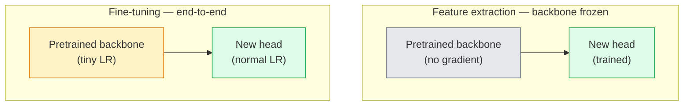

# 전이 학습과 미세 조정

> 누군가 100만 GPU 시간을 들여 네트워크에 에지(edge), 텍스처(texture), 객체의 부분들이 어떻게 생겼는지 가르쳐 두었습니다. 직접 학습을 시작하기 전에 이 특성(feature)들을 빌려와야 합니다.

**유형:** Build (실습)
**사용 언어:** Python
**선수 레슨:** Phase 4 Lesson 03 (CNNs), Phase 4 Lesson 04 (Image Classification)
**소요 시간:** ~75분

## 학습 목표

- 특성 추출(feature extraction)과 미세 조정(fine-tuning)을 구분하고, 데이터셋 크기, 도메인 거리, 컴퓨팅 예산에 따라 적절한 방식을 선택합니다.
- 사전 학습된(pretrained) 백본을 로드하고, 분류기 헤드(classifier head)를 교체한 후 헤드만 학습시켜 20줄 이내로 동작하는 베이스라인을 구축합니다.
- 차등 학습률(discriminative learning rates)을 적용하여 점진적으로 레이어 동결을 해제함으로써, 초기 단계의 일반적인 특성은 후기 단계의 태스크별 특성보다 더 작게 업데이트되도록 만듭니다.
- 세 가지 흔한 실패 사례를 진단합니다: 동결 해제된 블록의 과도한 LR로 인한 특성 표류(feature drift), 극소 데이터셋에서의 BN 통계량 붕괴, 그리고 치명적 망각(catastrophic forgetting).

## 문제

ImageNet에서 ResNet-50을 학습시키려면 약 2,000 GPU 시간이 소요됩니다. 배포하는 모든 태스크마다 이 정도의 예산을 감당할 수 있는 팀은 거의 없습니다. 거의 모든 팀이 실제로 배포하는 방식은 사전 학습된 백본에 수백 또는 수천 장의 태스크 특화 이미지로 학습된 새로운 헤드를 올리는 것입니다.

이는 단순한 편법이 아닙니다. ImageNet으로 학습된 CNN의 첫 번째 합성곱 블록은 에지와 가버 유사(Gabor-like) 필터를 학습합니다. 다음 몇 개 블록은 텍스처와 단순한 모티프를 학습합니다. 중간 블록들은 객체의 부분을 학습합니다. 마지막 블록들은 1,000개의 ImageNet 카테고리처럼 보이기 시작하는 조합들을 학습합니다. 자연계가 가진 에지와 텍스처의 어휘에는 한계가 있기 때문에, 이러한 계층 구조의 초기 90%는 의료 영상, 산업 검사, 위성 데이터 등 거의 모든 다른 컴퓨터 비전 태스크로 거의 그대로 전이됩니다. 실제로 여러분이 학습시키는 것은 마지막 10%뿐입니다.

전이 학습을 제대로 수행하기 위해서는 도사리고 있는 세 가지 버그를 극복해야 합니다. 지나치게 높은 학습률로 사전 학습된 특성을 파괴하는 것, 너무 많이 동결하여 모델에 정보가 전달되지 못하게 굶주리게 하는 것, 그리고 네트워크의 나머지 부분이 전혀 학습하지 않은 극소 데이터셋에 BatchNorm의 이동 평균 통계량이 표류하도록 방치하는 것입니다. 이번 강의에서는 이 세 가지 버그를 의도적으로 하나씩 짚어봅니다.

## 개념

### 특성 추출 vs 미세 조정

사전 학습된 특성을 얼마나 신뢰하는지, 그리고 보유한 데이터가 얼마나 많은지에 따라 선택하는 두 가지 방식입니다.



경험 법칙:

| 데이터셋 크기 | 도메인 거리 | 방법 |
|--------------|-----------------|--------|
| 1,000장 미만 | ImageNet과 가까움 | 백본 동결, 헤드만 학습 |
| 1,000~10,000장 | 가까움 | 처음 2~3개 스테이지 동결, 나머지는 미세 조정 |
| 10,000~100,000장 | 무관 | 차등 LR을 적용하여 종단간(end-to-end) 미세 조정 |
| 100,000장 이상 | 멂 | 전체 미세 조정; 도메인이 충분히 멀다면 처음부터 학습(from scratch) 고려 |

"ImageNet과 가깝다"는 것은 대략 객체 위주의 콘텐츠를 담은 자연스러운 RGB 사진을 의미합니다. 의료용 CT 스캔, 상공 위성 영상, 현미경 영상 등은 먼 도메인입니다. 여전히 특성이 도움은 되지만, 더 많은 레이어가 적응할 수 있도록 열어주어야 합니다.

### 동결이 효과적인 이유

CNN이 학습하는 ImageNet 특성은 1,000개 카테고리에만 특화된 것이 아닙니다. 특정 방향의 에지, 텍스처, 대비 패턴, 기본 형태 등 자연 이미지의 통계적 특성에 특화되어 있습니다. 이러한 통계적 특성은 인간이 이름을 붙일 수 있는 거의 모든 시각적 도메인에 걸쳐 안정적입니다. ImageNet으로 학습된 모델에 새로운 선형 헤드만 부착하고(백본의 미세 조정 없이) CIFAR-10에서 제로샷으로 평가해도 80% 이상의 정확도를 달성하는 이유가 바로 여기에 있습니다. 헤드는 이미 학습된 특성 중 이 태스크를 위해 어떤 것에 가중치를 둘지 학습하는 것입니다.

### 차등 학습률

동결을 해제할 때는 초기 레이어가 후기 레이어보다 더 느리게 학습해야 합니다. 초기 레이어는 보존해야 할 일반적인 특성을 인코딩하고, 후기 레이어는 크게 변경해야 하는 태스크 특화 구조를 인코딩하기 때문입니다.

```
Typical recipe:

  stage 0 (stem + first group): lr = base_lr / 100    (mostly fixed)
  stage 1:                       lr = base_lr / 10
  stage 2:                       lr = base_lr / 3
  stage 3 (last backbone group): lr = base_lr
  head:                          lr = base_lr  (or slightly higher)
```

PyTorch에서는 옵티마이저에 파라미터 그룹 리스트를 전달하기만 하면 됩니다. 모델 하나, 다섯 개의 학습률, 추가 코드는 거의 없습니다.

### BatchNorm 문제

BN 레이어는 ImageNet에서 계산된 `running_mean` 및 `running_var` 버퍼를 보유하고 있습니다. 여러분의 태스크가 다른 조명, 다른 센서, 다른 색 공간 등 상이한 픽셀 분포를 갖는다면 이 버퍼들은 맞지 않습니다. 선호도 순으로 정리한 세 가지 선택지는 다음과 같습니다.

1. **train 모드의 BN으로 미세 조정.** BN이 다른 모든 것과 함께 이동 통계량을 업데이트하도록 둡니다. 태스크 데이터셋이 중간 크기(>= 5,000개 샘플)일 때의 기본 선택지입니다.
2. **eval 모드로 BN 동결.** ImageNet 통계량을 유지하고 가중치만 학습합니다. 데이터셋이 작아서 BN의 이동 평균에 노이즈가 심할 때 올바른 선택입니다.
3. **BN을 GroupNorm으로 교체.** 이동 평균 문제를 완전히 제거합니다. GPU당 배치 크기가 매우 작은 검출(detection) 및 세그멘테이션(segmentation) 백본에서 사용됩니다.

이를 잘못 처리하면 아무런 경고도 없이 정확도가 5~15% 급락할 수 있습니다.

### 헤드 설계

분류기 헤드는 1~3개의 선형 레이어와 선택적인 드롭아웃(dropout)으로 구성됩니다. 모든 torchvision 백본은 교체할 수 있는 기본 헤드를 제공합니다.

```
backbone.fc = nn.Linear(backbone.fc.in_features, num_classes)          # ResNet
backbone.classifier[1] = nn.Linear(..., num_classes)                    # EfficientNet, MobileNet
backbone.heads.head = nn.Linear(..., num_classes)                       # torchvision ViT
```

작은 데이터셋의 경우 대개 단일 선형 레이어로 충분합니다. 태스크 분포가 백본의 학습 분포에서 더 멀어질 때는 은닉 레이어(Linear -> ReLU -> Dropout -> Linear)를 추가하는 것이 도움이 됩니다.

### 레이어별 LR 감쇠

현대적인 미세 조정(BEiT, DINOv2, ViT-B 미세 조정)에서 사용되는 차등 LR의 보다 완만한 형태입니다. 레이어를 스테이지로 그룹화하는 대신, 모든 레이어에 바로 위 레이어보다 약간 더 작은 LR을 부여합니다.

```math
\text{lr\_layer}_k = \text{base\_lr} \cdot \text{decay}^{L - k}
```

decay = 0.75이고 L = 12개의 트랜스포머 블록인 경우, 첫 번째 블록은 헤드 LR의 `0.75^11 ≈ 0.04x` 수준으로 학습합니다. 스테이지별로 그룹화된 LR로도 대체로 충분한 CNN보다는 트랜스포머 미세 조정에서 더 중요합니다.

### 무엇을 평가해야 하는가

전이 학습 실행 시에는 처음부터 학습할 때는 추적하지 않을 두 가지 수치를 확인해야 합니다.

- **사전 학습 전용 정확도(Pretrained-only accuracy)** — 백본이 동결된 상태에서의 헤드 정확도입니다. 이것이 여러분의 하한선(floor)입니다.
- **미세 조정 정확도(Fine-tuned accuracy)** — 종단간 학습 후의 동일한 모델 정확도입니다. 이것이 여러분의 상한선(ceiling)입니다.

미세 조정 정확도가 사전 학습 전용 정확도보다 낮다면 학습률이나 BN 관련 버그가 있는 것입니다. 항상 두 수치를 모두 출력해 보아야 합니다.

```figure
transfer-learning
```

## 구현하기

### 1단계: 사전 학습된 백본 로드 및 검사

```python
import torch
import torch.nn as nn
from torchvision.models import resnet18, ResNet18_Weights

backbone = resnet18(weights=ResNet18_Weights.IMAGENET1K_V1)
print(backbone)
print()
print("classifier head:", backbone.fc)
print("feature dim:", backbone.fc.in_features)
```

`ResNet18`은 4개의 스테이지(`layer1..layer4`)와 stem, 그리고 `fc` 헤드로 구성됩니다. 모든 torchvision 분류 백본은 이와 유사한 구조를 갖습니다.

### 2단계: 특성 추출 — 모든 것을 동결하고 헤드 교체

```python
def make_feature_extractor(num_classes=10):
    model = resnet18(weights=ResNet18_Weights.IMAGENET1K_V1)
    for p in model.parameters():
        p.requires_grad = False
    model.fc = nn.Linear(model.fc.in_features, num_classes)
    return model

model = make_feature_extractor(num_classes=10)
trainable = sum(p.numel() for p in model.parameters() if p.requires_grad)
frozen = sum(p.numel() for p in model.parameters() if not p.requires_grad)
print(f"trainable: {trainable:>10,}")
print(f"frozen:    {frozen:>10,}")
```

`model.fc`만 학습 가능합니다. 백본은 동결된 특성 추출기 역할을 합니다.

### 3단계: 차등 미세 조정

스테이지별 학습률을 갖는 파라미터 그룹을 생성하는 유틸리티입니다.

```python
def discriminative_param_groups(model, base_lr=1e-3, decay=0.3):
    stages = [
        ["conv1", "bn1"],
        ["layer1"],
        ["layer2"],
        ["layer3"],
        ["layer4"],
        ["fc"],
    ]
    groups = []
    for i, names in enumerate(stages):
        lr = base_lr * (decay ** (len(stages) - 1 - i))
        params = [p for n, p in model.named_parameters()
                  if any(n.startswith(k) for k in names)]
        if params:
            groups.append({"params": params, "lr": lr, "name": "_".join(names)})
    return groups

model = resnet18(weights=ResNet18_Weights.IMAGENET1K_V1)
model.fc = nn.Linear(model.fc.in_features, 10)
for p in model.parameters():
    p.requires_grad = True

groups = discriminative_param_groups(model)
for g in groups:
    print(f"{g['name']:>10s}  lr={g['lr']:.2e}  params={sum(p.numel() for p in g['params']):>8,}")
```

`decay=0.3`는 각 스테이지가 다음 스테이지 속도의 30%로 학습함을 의미합니다. `fc`는 `base_lr`, `layer4`는 `0.3 * base_lr`, `conv1`는 `0.3^5 * base_lr ≈ 0.00243 * base_lr`를 적용받습니다. 극단적으로 들릴 수 있지만, 경험적으로 잘 동작합니다.

### 4단계: BatchNorm 처리

가중치는 동결하지 않으면서 BN 이동 통계량만 동결하는 헬퍼 함수입니다.

```python
def freeze_bn_stats(model):
    for m in model.modules():
        if isinstance(m, (nn.BatchNorm1d, nn.BatchNorm2d, nn.BatchNorm3d)):
            m.eval()
            for p in m.parameters():
                p.requires_grad = False
    return model
```

매 에폭 시작 시 `model.train()`을 설정한 후 이 함수를 호출합니다. `model.train()`은 모든 것을 학습 모드로 전환하므로, 이 함수는 오직 BN 레이어에 대해서만 이를 평가 모드로 되돌립니다.
### Step 5: 최소한의 엔드투엔드 미세 조정 루프

```python
from torch.optim import SGD
from torch.utils.data import DataLoader
from torch.optim.lr_scheduler import CosineAnnealingLR
import torch.nn.functional as F

def fine_tune(model, train_loader, val_loader, device, epochs=5, base_lr=1e-3, freeze_bn=False):
    model = model.to(device)
    groups = discriminative_param_groups(model, base_lr=base_lr)
    optimizer = SGD(groups, momentum=0.9, weight_decay=1e-4, nesterov=True)
    scheduler = CosineAnnealingLR(optimizer, T_max=epochs)

    for epoch in range(epochs):
        model.train()
        if freeze_bn:
            freeze_bn_stats(model)
        tr_loss, tr_correct, tr_total = 0.0, 0, 0
        for x, y in train_loader:
            x, y = x.to(device), y.to(device)
            logits = model(x)
            loss = F.cross_entropy(logits, y, label_smoothing=0.1)
            optimizer.zero_grad()
            loss.backward()
            optimizer.step()
            tr_loss += loss.item() * x.size(0)
            tr_total += x.size(0)
            tr_correct += (logits.argmax(-1) == y).sum().item()
        scheduler.step()

        model.eval()
        va_total, va_correct = 0, 0
        with torch.no_grad():
            for x, y in val_loader:
                x, y = x.to(device), y.to(device)
                pred = model(x).argmax(-1)
                va_total += x.size(0)
                va_correct += (pred == y).sum().item()
        print(f"epoch {epoch}  train {tr_loss/tr_total:.3f}/{tr_correct/tr_total:.3f}  "
              f"val {va_correct/va_total:.3f}")
    return model
```

CIFAR-10에서 위 레시피로 5 에포크(epoch)를 학습하면 `ResNet18-IMAGENET1K_V1`의 정확도가 약 70%의 제로샷 선형 프로브(linear probe) 수준에서 약 93%의 미세 조정(fine-tuning) 수준으로 향상됩니다. 백본(backbone)을 전혀 건드리지 않고 헤드만 학습할 경우 대략 86% 수준에서 정체됩니다.

### Step 6: 점진적 동결 해제(Progressive unfreezing)

마지막 단계부터 시작하여 에포크마다 한 스테이지씩 역방향으로 동결을 해제하는 스케줄입니다. 몇 번의 추가 에포크가 소요되지만 특징 드리프트(feature drift)를 완화해 줍니다.

```python
def progressive_unfreeze_schedule(model):
    stages = ["layer4", "layer3", "layer2", "layer1"]
    yielded = set()

    def start():
        for p in model.parameters():
            p.requires_grad = False
        for p in model.fc.parameters():
            p.requires_grad = True

    def unfreeze(epoch):
        if epoch < len(stages):
            name = stages[epoch]
            yielded.add(name)
            for n, p in model.named_parameters():
                if n.startswith(name):
                    p.requires_grad = True
            return name
        return None

    return start, unfreeze
```

첫 번째 에포크 전에 `start()`을 한 번 호출합니다. 각 에포크 시작 시점에는 `unfreeze(epoch)`를 호출합니다. 학습 가능한 파라미터 집합이 변경될 때마다 옵티마이저(optimizer)를 다시 빌드해야 합니다. 그렇지 않으면 동결된 파라미터가 여전히 캐시된 모멘텀 값을 유지하여 옵티마이저 동작에 혼선을 줍니다.

## 활용하기

대부분의 실제 작업에서는 `torchvision.models`와 세 줄의 코드만으로 충분합니다. 위에서 다룬 더 복잡한 기법들은 라이브러리의 기본 설정으로 해결되지 않는 문제에 직면했을 때 중요해집니다.

```python
from torchvision.models import resnet50, ResNet50_Weights

model = resnet50(weights=ResNet50_Weights.IMAGENET1K_V2)
model.fc = nn.Linear(model.fc.in_features, num_classes)
optimizer = torch.optim.AdamW(model.parameters(), lr=1e-4, weight_decay=1e-4)
```

프로덕션 환경에서 활용할 수 있는 두 가지 기본 구성은 다음과 같습니다.

- `timm`은 일관된 API(`timm.create_model("resnet50", pretrained=True, num_classes=10)`)를 통해 약 800개의 사전 학습된 비전 백본을 제공합니다. torchvision 모델 외의 미세 조정을 수행할 때 사실상의 표준(standard)입니다.
- 트랜스포머(Transformer)의 경우, `transformers.AutoModelForImageClassification.from_pretrained(name, num_labels=N)`를 사용하면 텍스트 모델과 동일한 로딩 방식으로 ViT / BEiT / DeiT를 활용할 수 있습니다.

## 결과물

본 레슨을 마치면 다음 결과물이 완성됩니다.

- `outputs/prompt-fine-tune-planner.md` — 데이터셋 크기, 도메인 간 거리, 컴퓨팅 예산에 따라 특징 추출(feature-extraction), 점진적 동결 해제, 엔드투엔드 미세 조정 중 최적의 방식을 선택하는 프롬프트입니다.
- `outputs/skill-freeze-inspector.md` — 주어진 PyTorch 모델에 대해 학습 가능한 파라미터, eval 모드 상태인 BatchNorm 레이어, 옵티마이저에 학습 가능한 파라미터가 실제로 전달되고 있는지를 보고하는 도구입니다.

## 실습 과제

1. **(초급)** 동일한 합성 CIFAR 데이터셋에서 `ResNet18`을 선형 프로브(백본 동결) 방식과 전체 미세 조정 방식으로 각각 학습해 보세요. 두 정확도를 나란히 비교하여 보고하세요. 어떤 격차가 특징 전이가 잘 되었음을 나타내고, 어떤 격차가 그렇지 않음을 나타내는지 설명하세요.
2. **(중급)** 의도적인 버그를 만들어 보세요. 헤드 대신 백본 스테이지에 `base_lr = 1e-1`을 설정합니다. 학습 손실(loss)이 폭발하는 현상을 확인한 뒤, `discriminative_param_groups` 헬퍼 함수를 적용하여 복구해 보세요. 각 스테이지가 발산하기 시작하는 학습률(LR)을 기록하세요.
3. **(고급)** 의료 영상 데이터셋(예: CheXpert-small, PatchCamelyon, HAM10000)을 사용하여 세 가지 방식을 비교해 보세요: (a) ImageNet 사전 학습 백본 동결 + 선형 헤드, (b) ImageNet 사전 학습 엔드투엔드 미세 조정, (c) 처음부터 새로 학습(scratch training). 각각의 정확도와 컴퓨팅 비용을 보고하세요. 데이터셋 크기가 어느 정도에 도달해야 처음부터 새로 학습하는 방식의 경쟁력이 확보되나요?

## 핵심 용어

| 용어 | 일반적인 표현 | 실제 의미 |
|------|----------------|----------------------|
| 특징 추출(Feature extraction) | "동결 후 헤드만 학습" | 백본 파라미터는 동결되고 새로운 분류기 헤드만 그래디언트를 받음 |
| 미세 조정(Fine-tuning) | "엔드투엔드로 재학습" | 모든 파라미터가 학습 가능하며, 보통 처음부터 학습할 때보다 훨씬 작은 LR을 사용함 |
| 차등 학습률(Discriminative LR) | "초기 레이어에 더 작은 LR 적용" | 초기 스테이지의 LR이 후반 스테이지 LR의 일부 비율로 설정된 옵티마이저 파라미터 그룹 |
| 레이어별 학습률 감쇠(Layer-wise LR decay) | "부드러운 LR 그래디언트" | 레이어별 LR에 decay^(L - k)를 곱하는 방식. 트랜스포머 미세 조정에서 흔히 사용됨 |
| 파국적 망각(Catastrophic forgetting) | "모델이 ImageNet 지식을 잃음" | 과도하게 높은 LR로 인해 새로운 작업의 신호를 학습하기 전에 사전 학습된 특징이 덮어씌워짐 |
| BN 통계치 드리프트(BN statistics drift) | "running mean이 잘못됨" | BatchNorm의 running_mean/var가 현재 작업과 다른 분포를 기반으로 계산되어 성능을 은연중에 저하시킴 |
| 선형 프로브(Linear probe) | "동결된 백본 + 선형 헤드" | 사전 학습된 특징의 평가 방법 — 동결된 표현 위에 얹은 최적 선형 분류기의 정확도 |
| 파국적 붕괴(Catastrophic collapse) | "모든 것을 하나의 클래스로 예측함" | 헤드에서 발생하는 그래디언트가 안정화되기 전에 특징을 파괴할 정도로 높은 LR로 미세 조정을 수행할 때 발생함 |

## 추가 참고 자료

- [How transferable are features in deep neural networks? (Yosinski et al., 2014)](https://arxiv.org/abs/1411.1792) — 레이어 전반에 걸친 특징의 전이 가능성을 정량화한 논문
- [Universal Language Model Fine-tuning (ULMFiT, Howard & Ruder, 2018)](https://arxiv.org/abs/1801.06146) — 차등 학습률 및 점진적 동결 해제 레시피를 처음 제시한 논문으로, 해당 개념은 비전 분야에도 그대로 적용됨
- [timm documentation](https://huggingface.co/docs/timm) — 최신 비전 백본 및 모델 학습 시 사용된 정확한 미세 조정 기본 설정을 다룬 레퍼런스
- [A Simple Framework for Linear-Probe Evaluation (Kornblith et al., 2019)](https://arxiv.org/abs/1805.08974) — 선형 프로브 정확도가 중요한 이유와 이를 올바르게 보고하는 방법
