# 객체 탐지 — 밑바닥부터 구현하는 YOLO

> 탐지(detection)는 특성 맵(feature map)의 모든 위치에서 분류(classification)와 회귀(regression)를 수행한 뒤, 비최대 억제(non-maximum suppression)를 통해 정리하는 과정입니다.

**유형:** Build (실습)
**사용 언어:** Python
**선수 레슨:** Phase 4 Lesson 03 (CNNs), Phase 4 Lesson 04 (Image Classification), Phase 4 Lesson 05 (Transfer Learning)
**소요 시간:** ~75분

## 학습 목표

- 탐지를 밀집 예측(dense prediction) 문제로 변환하는 그리드 및 앵커(anchor) 설계를 설명하고, 출력 텐서의 각 숫자가 의미하는 바를 기술합니다.
- 바운딩 박스 간의 IoU(Intersection-over-Union)를 계산하고 비최대 억제(NMS)를 밑바닥부터 구현합니다.
- 사전 학습된 백본(backbone) 위에 분류, 객체성(objectness), 박스 회귀 손실을 포함한 최소한의 YOLO 스타일 헤드를 구축합니다.
- 탐지 평가 지표(precision@0.5, recall, mAP@0.5, mAP@0.5:0.95)를 해석하고 다음에 조정할 하이퍼파라미터를 결정합니다.

## 문제 정의

분류(classification)는 "이 이미지는 개입니다"라고 말합니다. 탐지(detection)는 "픽셀 (112, 40, 280, 210)에 개가 있고, (400, 180, 560, 310)에 고양이가 있으며, 프레임 안의 다른 곳에는 아무것도 없습니다"라고 말합니다. 이미지당 하나의 레이블을 예측하는 대신 레이블이 지정된 가변적인 수의 박스를 예측하는 이 구조적 변화야말로 모든 자율주행 시스템, 감시 제품, 문서 레이아웃 분석기, 공장 비전 생산 라인이 의존하는 핵심입니다.

탐지는 비전 분야의 모든 엔지니어링 트레이드오프가 한 번에 드러나는 영역이기도 합니다. 정확한 박스(회귀 헤드)를 얻어야 하고, 각 박스에 맞는 클래스(분류 헤드)를 찾아야 하며, 탐지할 객체가 없을 때 모델이 이를 알아차려야 하고(객체성 점수), 실제 객체당 정확히 하나의 예측만 나와야 합니다(비최대 억제). 이 중 하나라도 놓치면 파이프라인은 객체를 놓치거나, 존재하지 않는 박스를 출력(hallucination)하거나, 동일한 객체를 약간씩 다른 위치에서 15번씩 중복 예측하게 됩니다.

YOLO(You Only Look Once, Redmon et al. 2016)는 합성곱 신경망(conv net)의 단일 순전파(forward pass)로 이 모든 과정을 처리하여 실시간 구동을 가능하게 만든 설계였으며, 이 구조적 결정은 현대 탐지기(YOLOv8, YOLOv9, YOLO-NAS, RT-DETR)의 중추로 여전히 남아 있습니다. 핵심을 익히고 나면 모든 변형 모델은 동일한 부품들의 재배열에 불과하다는 것을 알 수 있습니다.

## 핵심 개념

### 밀집 예측으로서의 탐지

분류기는 이미지당 C개의 숫자를 출력합니다. YOLO 스타일의 탐지기는 이미지당 `(S x S x (5 + C))`개의 숫자를 출력하며, 여기서 S는 공간 그리드 크기입니다.

```mermaid
flowchart LR
    IMG["Input 416x416 RGB"] --> BB["Backbone<br/>(ResNet, DarkNet, ...)"]
    BB --> FM["Feature map<br/>(C_feat, 13, 13)"]
    FM --> HEAD["Detection head<br/>(1x1 convs)"]
    HEAD --> OUT["Output tensor<br/>(13, 13, B * (5 + C))"]
    OUT --> DEC["Decode<br/>(grid + sigmoid + exp)"]
    DEC --> NMS["Non-max suppression"]
    NMS --> RESULT["Final boxes"]

    style IMG fill:#dbeafe,stroke:#2563eb
    style HEAD fill:#fef3c7,stroke:#d97706
    style NMS fill:#fecaca,stroke:#dc2626
    style RESULT fill:#dcfce7,stroke:#16a34a
```



`S * S`개의 그리드 셀은 각각 `B`개의 박스를 예측합니다. 각 박스마다 다음과 같은 값이 예측됩니다.

- 4개의 숫자는 기하학적 형태를 나타냅니다: `tx, ty, tw, th`.
- 1개의 숫자는 객체성 점수(objectness score)입니다: "이 셀에 중심을 둔 객체가 존재하는가?"
- C개의 숫자는 클래스 확률입니다.

셀당 총 출력: `B * (5 + C)`. `S=13, B=2, C=20`인 VOC의 경우, 셀당 50개의 숫자가 됩니다.

### 그리드와 앵커를 사용하는 이유

단순 회귀 방식은 모든 객체에 대해 절대 좌표인 `(x, y, w, h)`를 예측합니다. 하지만 이미지를 평행 이동했을 때 모든 예측값이 동일한 양만큼 이동해서는 안 되므로(각 객체는 공간적으로 고정되어 있음), 이는 합성곱 신경망에게 어려운 문제입니다. 그리드는 각 정답(ground-truth) 박스의 중심이 위치하는 그리드 셀에 해당 객체를 할당함으로써 이 문제를 해결합니다. 즉, 해당 셀만이 그 객체를 담당하게 됩니다.

앵커는 두 번째 문제를 해결합니다. 16픽셀의 수용 영역(receptive field)을 갖는 특성 셀에서 3x3 합성곱으로 500픽셀 너비의 박스를 회귀하는 것은 쉽지 않습니다. 대신 셀당 사전에 정의된 `B`개의 박스 모양(앵커)을 두고, 각 앵커로부터의 미세한 변화량(delta)을 예측합니다. 모델은 아무것도 없는 상태에서 회귀하는 대신, 적절한 앵커를 선택하고 이를 조금씩 조정하는 법을 학습합니다.

```
Anchor box priors (example for 416x416 input):

  small:   (30,  60)
  medium:  (75,  170)
  large:   (200, 380)

At each grid cell, every anchor emits (tx, ty, tw, th, obj, c_1, ..., c_C).
```

현대적인 탐지기는 해상도별로 서로 다른 앵커 세트를 적용한 FPN을 자주 사용합니다. 즉, 얕은 고해상도 맵에는 작은 앵커를, 깊은 저해상도 맵에는 큰 앵커를 배치합니다. 기본 아이디어는 동일하며 스케일이 더 다양해진 것입니다.

### 예측값 디코딩

원시(raw) 값인 `tx, ty, tw, th`는 박스 좌표가 아니며, 시각화하기 전에 변환해야 하는 회귀 타깃입니다.

```math
\begin{aligned}
\text{centre } x &= (\sigma(t_x) + \text{cell}_x) \cdot \text{stride} \\
\text{centre } y &= (\sigma(t_y) + \text{cell}_y) \cdot \text{stride} \\
\text{width} &= \text{anchor}_w \cdot \exp(t_w) \\
\text{height} &= \text{anchor}_h \cdot \exp(t_h)
\end{aligned}
```

`sigmoid`는 중심 오프셋을 셀 내부에 유지합니다. `exp`는 부호 반전 없이 앵커 기준으로 너비를 자유롭게 스케일링할 수 있게 합니다. `stride`는 그리드 좌표를 다시 픽셀 단위로 변환합니다. 이 디코딩 단계는 v2 이후의 모든 YOLO 버전에서 동일합니다.

### IoU

두 박스 사이의 범용 유사도 지표:

```math
\mathrm{IoU}(A, B) = \frac{\mathop{\mathrm{area}}(A \cap B)}{\mathop{\mathrm{area}}(A \cup B)}
```

$\mathrm{IoU} = 1$은 완전히 일치함을 의미하고, $\mathrm{IoU} = 0$은 겹치는 부분이 없음을 의미합니다. 예측 박스와 정답 박스 사이의 IoU는 해당 예측이 참 양성(true positive)으로 인정될지 여부를 결정합니다(일반적으로 $\mathrm{IoU} \ge 0.5$). 두 예측 박스 사이의 IoU는 NMS가 중복을 제거할 때 사용됩니다.

### 비최대 억제

인접한 앵커에 대해 학습된 합성곱 신경망은 동일한 객체에 대해 겹치는 여러 박스를 예측하는 경우가 많습니다. NMS는 신뢰도(confidence)가 가장 높은 예측을 유지하고, 임계값을 초과하는 IoU를 가진 다른 모든 예측을 제거합니다.

```
NMS(boxes, scores, iou_threshold):
    sort boxes by score descending
    keep = []
    while boxes not empty:
        pick the top-scoring box, add to keep
        remove every box with IoU > iou_threshold to the picked box
    return keep
```

일반적인 임계값은 객체 탐지의 경우 0.45입니다. 최근 탐지기들은 표준 NMS를 `soft-NMS`, `DIoU-NMS`로 대체하거나 억제 과정을 직접 학습(RT-DETR)하기도 하지만, 구조적 목적은 동일합니다.

### 손실 함수

YOLO 손실은 가중치를 적용하여 합산한 세 가지 손실로 구성됩니다.

```math
\begin{aligned}
L = {} & \lambda_{\text{coord}} \cdot L_{\text{box}}(\text{pred}, \text{target}, \text{where obj}=1) \\
+ {} & \lambda_{\text{obj}} \cdot L_{\text{obj}}(\text{pred}, 1, \text{where obj}=1) \\
+ {} & \lambda_{\text{noobj}} \cdot L_{\text{obj}}(\text{pred}, 0, \text{where obj}=0) \\
+ {} & \lambda_{\text{cls}} \cdot L_{\text{cls}}(\text{pred}, \text{target}, \text{where obj}=1)
\end{aligned}
```

객체를 포함하고 있는 셀만이 박스 회귀 손실과 분류 손실에 기여합니다. 객체가 없는 셀은 객체성 손실에만 기여합니다(모델이 침묵하도록 학습시킴). 대다수의 셀이 비어 있어 전체 손실을 압도할 수 있기 때문에 `lambda_noobj`는 보통 작은 값(~0.5)으로 설정됩니다.

최신 변형 모델들은 MSE 박스 손실을 CIoU / DIoU(IoU를 직접 최적화)로 교체하고, 클래스 불균형을 해소하기 위해 포컬 손실(focal loss)을 사용하며, 퀄리티 포컬 손실(quality focal loss)로 객체성의 균형을 맞춥니다. 세 가지 구성 요소로 이루어진 구조 자체는 변함이 없습니다.

### 탐지 평가 지표

정확도(accuracy)는 탐지 작업에 그대로 적용할 수 없습니다. 대신 다음 네 가지 지표를 사용합니다.

- **Precision@IoU=0.5** — 양성으로 판정된 예측 중 실제로 올바른 예측의 비율.
- **Recall@IoU=0.5** — 실제 객체 중 찾아낸 객체의 비율.
- **AP@0.5** — IoU 임계값 0.5에서의 정밀도-재현율 곡선 면적. 클래스당 하나의 값입니다.
- **mAP@0.5:0.95** — IoU 임계값 0.5, 0.55, ..., 0.95에 걸친 AP의 평균. COCO 벤치마크 지표로, 가장 엄격하고 많은 정보를 제공합니다.

네 가지 지표를 모두 보고해야 합니다. mAP@0.5는 높지만 mAP@0.5:0.95가 낮은 탐지기는 대략적인 위치는 잘 잡지만 경계를 정밀하게 맞추지 못하는 상태이므로, 박스 회귀 손실을 개선해야 합니다. 정밀도가 높고 재현율이 낮은 탐지기는 지나치게 보수적이므로, 신뢰도 임계값을 낮추거나 객체성 가중치를 높여야 합니다.

```figure
object-detection-nms
```

## 직접 구현해보기

### 1단계: IoU

이번 레슨 전체의 핵심 도구입니다. `(x1, y1, x2, y2)` 형식의 두 박스 배열을 입력받아 작동합니다.

```python
import numpy as np

def box_iou(boxes_a, boxes_b):
    ax1, ay1, ax2, ay2 = boxes_a[:, 0], boxes_a[:, 1], boxes_a[:, 2], boxes_a[:, 3]
    bx1, by1, bx2, by2 = boxes_b[:, 0], boxes_b[:, 1], boxes_b[:, 2], boxes_b[:, 3]

    inter_x1 = np.maximum(ax1[:, None], bx1[None, :])
    inter_y1 = np.maximum(ay1[:, None], by1[None, :])
    inter_x2 = np.minimum(ax2[:, None], bx2[None, :])
    inter_y2 = np.minimum(ay2[:, None], by2[None, :])

    inter_w = np.clip(inter_x2 - inter_x1, 0, None)
    inter_h = np.clip(inter_y2 - inter_y1, 0, None)
    inter = inter_w * inter_h

    area_a = (ax2 - ax1) * (ay2 - ay1)
    area_b = (bx2 - bx1) * (by2 - by1)
    union = area_a[:, None] + area_b[None, :] - inter
    return inter / np.clip(union, 1e-8, None)
```

쌍별(pairwise) IoU로 이루어진 `(N_a, N_b)` 행렬을 반환합니다. 단일 정답 박스와 비교할 때는 배열 중 하나의 형태를 `(1, 4)`로 만들어 사용합니다.

### 2단계: 비최대 억제

```python
def nms(boxes, scores, iou_threshold=0.45):
    order = np.argsort(-scores)
    keep = []
    while len(order) > 0:
        i = order[0]
        keep.append(i)
        if len(order) == 1:
            break
        rest = order[1:]
        ious = box_iou(boxes[[i]], boxes[rest])[0]
        order = rest[ious <= iou_threshold]
    return np.array(keep, dtype=np.int64)
```

결정론적(deterministic)이며 정렬 단계로 인해 `O(N log N)`의 시간 복잡도를 갖고, 동일한 입력에 대해 `torchvision.ops.nms`의 동작과 일치합니다.
### Step 3: 박스 인코딩 및 디코딩

픽셀 좌표와 네트워크가 실제로 회귀(regression)하는 `(tx, ty, tw, th)` 타깃 간을 상호 변환합니다.

```python
def encode(box_xyxy, cell_x, cell_y, stride, anchor_wh):
    x1, y1, x2, y2 = box_xyxy
    cx = 0.5 * (x1 + x2)
    cy = 0.5 * (y1 + y2)
    w = x2 - x1
    h = y2 - y1
    off_x = np.clip(cx / stride - cell_x, 1e-6, 1 - 1e-6)
    off_y = np.clip(cy / stride - cell_y, 1e-6, 1 - 1e-6)
    tx = np.log(off_x / (1 - off_x))
    ty = np.log(off_y / (1 - off_y))
    tw = np.log(w / anchor_wh[0] + 1e-8)
    th = np.log(h / anchor_wh[1] + 1e-8)
    return np.array([tx, ty, tw, th])


def decode(tx_ty_tw_th, cell_x, cell_y, stride, anchor_wh):
    tx, ty, tw, th = tx_ty_tw_th
    cx = (sigmoid(tx) + cell_x) * stride
    cy = (sigmoid(ty) + cell_y) * stride
    w = anchor_wh[0] * np.exp(tw)
    h = anchor_wh[1] * np.exp(th)
    return np.array([cx - w / 2, cy - h / 2, cx + w / 2, cy + h / 2])


def sigmoid(x):
    return 1.0 / (1.0 + np.exp(-x))
```

테스트: 중심이 셀 내부에 완전히 위치하는 박스를 인코딩한 다음 디코딩하면, 부동소수점 오차 범위 내에서 원래 박스로 복원되어야 합니다. `encode`은 중심 오프셋을 로짓(logit) 형태로 저장하며, 이는 `decode`의 `sigmoid`에 대한 역함수입니다. 클리핑을 통해 로짓을 유한한 값으로 유지하며, 셀 경계에 정확히 위치한 중심은 최대 `1e-6` 셀까지만 이동합니다. 아래의 `assign_targets` 역시 동일한 로짓을 저장하므로, 헤드는 `decode`이 기대하는 공간에서 학습합니다.

### Step 4: 최소한의 YOLO 헤드

특징 맵(feature map)에 1x1 합성곱(conv)을 하나 적용하고 `(B, S, S, num_anchors, 5 + C)` 형태로 재구성(reshape)합니다.

```python
import torch
import torch.nn as nn

class YOLOHead(nn.Module):
    def __init__(self, in_c, num_anchors, num_classes):
        super().__init__()
        self.num_anchors = num_anchors
        self.num_classes = num_classes
        self.conv = nn.Conv2d(in_c, num_anchors * (5 + num_classes), kernel_size=1)

    def forward(self, x):
        n, _, h, w = x.shape
        y = self.conv(x)
        y = y.view(n, self.num_anchors, 5 + self.num_classes, h, w)
        y = y.permute(0, 3, 4, 1, 2).contiguous()
        return y
```

출력 형상(shape): `(N, H, W, num_anchors, 5 + C)`. 마지막 차원은 `[tx, ty, tw, th, obj, cls_0, ..., cls_{C-1}]`을 담고 있습니다.

### Step 5: 실측값(Ground-truth) 할당

각 실측값 박스(ground-truth box)에 대해 어떤 `(cell, anchor)`이 이를 담당할지 결정합니다.

```python
def assign_targets(boxes_xyxy, classes, anchors, stride, grid_size, num_classes):
    num_anchors = len(anchors)
    target = np.zeros((grid_size, grid_size, num_anchors, 5 + num_classes), dtype=np.float32)
    has_obj = np.zeros((grid_size, grid_size, num_anchors), dtype=bool)

    for box, cls in zip(boxes_xyxy, classes):
        x1, y1, x2, y2 = box
        cx, cy = 0.5 * (x1 + x2), 0.5 * (y1 + y2)
        gx, gy = int(cx / stride), int(cy / stride)
        bw, bh = x2 - x1, y2 - y1

        ious = np.array([
            (min(bw, aw) * min(bh, ah)) / (bw * bh + aw * ah - min(bw, aw) * min(bh, ah))
            for aw, ah in anchors
        ])
        best = int(np.argmax(ious))
        aw, ah = anchors[best]

        off_x = np.clip(cx / stride - gx, 1e-6, 1 - 1e-6)
        off_y = np.clip(cy / stride - gy, 1e-6, 1 - 1e-6)
        target[gy, gx, best, 0] = np.log(off_x / (1 - off_x))
        target[gy, gx, best, 1] = np.log(off_y / (1 - off_y))
        target[gy, gx, best, 2] = np.log(bw / aw + 1e-8)
        target[gy, gx, best, 3] = np.log(bh / ah + 1e-8)
        target[gy, gx, best, 4] = 1.0
        target[gy, gx, best, 5 + cls] = 1.0
        has_obj[gy, gx, best] = True
    return target, has_obj
```

앵커(anchor) 선택은 "실측값과 형상 IoU가 가장 높은 것"으로 이루어지며, 이는 YOLOv2/v3 할당 방식에 부합하는 가벼운 대리 지표입니다. v5 이후 버전에서는 동일한 개념을 개선한 보다 정교한 전략(과제 정렬 매칭(task-aligned matching), 동적 k)을 사용합니다.

### Step 6: 세 가지 손실 함수

```python
def yolo_loss(pred, target, has_obj, lambda_coord=5.0, lambda_obj=1.0, lambda_noobj=0.5, lambda_cls=1.0):
    has_obj_t = torch.from_numpy(has_obj).bool()
    target_t = torch.from_numpy(target).float()

    # box-regression loss: only on cells with objects
    box_pred = pred[..., :4][has_obj_t]
    box_true = target_t[..., :4][has_obj_t]
    loss_box = torch.nn.functional.mse_loss(box_pred, box_true, reduction="sum")

    # objectness loss
    obj_pred = pred[..., 4]
    obj_true = target_t[..., 4]
    loss_obj_pos = torch.nn.functional.binary_cross_entropy_with_logits(
        obj_pred[has_obj_t], obj_true[has_obj_t], reduction="sum")
    loss_obj_neg = torch.nn.functional.binary_cross_entropy_with_logits(
        obj_pred[~has_obj_t], obj_true[~has_obj_t], reduction="sum")

    # classification loss on cells with objects
    cls_pred = pred[..., 5:][has_obj_t]
    cls_true = target_t[..., 5:][has_obj_t]
    loss_cls = torch.nn.functional.binary_cross_entropy_with_logits(
        cls_pred, cls_true, reduction="sum")

    total = (lambda_coord * loss_box
             + lambda_obj * loss_obj_pos
             + lambda_noobj * loss_obj_neg
             + lambda_cls * loss_cls)
    return total, {"box": loss_box.item(), "obj_pos": loss_obj_pos.item(),
                   "obj_neg": loss_obj_neg.item(), "cls": loss_cls.item()}
```

모든 YOLO 튜토리얼에서 하드코딩하거나 스윕(sweep)하는 네 가지 손실 가중치입니다. 비율이 중요합니다. `lambda_coord=5, lambda_noobj=0.5` 비율은 원본 YOLOv1 논문을 반영한 것이며, 여전히 합리적인 기본값으로 잘 작동합니다.

### Step 7: 추론 파이프라인

원시 헤드 출력을 디코딩하고, sigmoid/exp를 적용한 뒤, 객체성(objectness) 임계값을 적용하고 비최대 억제(NMS, Non-Maximum Suppression)를 수행합니다.

```python
def postprocess(pred_tensor, anchors, stride, img_size, conf_threshold=0.25, iou_threshold=0.45):
    pred = pred_tensor.detach().cpu().numpy()
    grid_h, grid_w = pred.shape[1], pred.shape[2]
    num_anchors = len(anchors)

    boxes, scores, classes = [], [], []
    for gy in range(grid_h):
        for gx in range(grid_w):
            for a in range(num_anchors):
                tx, ty, tw, th, obj, *cls = pred[0, gy, gx, a]
                score = sigmoid(obj) * sigmoid(np.array(cls)).max()
                if score < conf_threshold:
                    continue
                cls_idx = int(np.argmax(cls))
                cx = (sigmoid(tx) + gx) * stride
                cy = (sigmoid(ty) + gy) * stride
                w = anchors[a][0] * np.exp(tw)
                h = anchors[a][1] * np.exp(th)
                boxes.append([cx - w / 2, cy - h / 2, cx + w / 2, cy + h / 2])
                scores.append(float(score))
                classes.append(cls_idx)

    if not boxes:
        return np.zeros((0, 4)), np.zeros((0,)), np.zeros((0,), dtype=int)
    boxes = np.array(boxes)
    scores = np.array(scores)
    classes = np.array(classes)
    keep = nms(boxes, scores, iou_threshold)
    return boxes[keep], scores[keep], classes[keep]
```

이것이 전체 평가 경로입니다: 헤드 -> 디코드 -> 임계값 처리 -> NMS.

## 활용하기

`torchvision.models.detection`는 동일한 개념적 구조를 갖춘 프로덕션용 탐지기(detector)를 제공합니다. 사전 학습된(pretrained) 모델을 불러오는 데는 세 줄이면 충분합니다.

```python
import torch
from torchvision.models.detection import fasterrcnn_resnet50_fpn_v2

model = fasterrcnn_resnet50_fpn_v2(weights="DEFAULT")
model.eval()
with torch.no_grad():
    predictions = model([torch.randn(3, 400, 600)])
print(predictions[0].keys())
print(f"boxes:  {predictions[0]['boxes'].shape}")
print(f"scores: {predictions[0]['scores'].shape}")
print(f"labels: {predictions[0]['labels'].shape}")
```

실시간 추론(inference) 파이프라인에서는 `ultralytics` (YOLOv8/v9)가 표준입니다: `from ultralytics import YOLO; model = YOLO('yolov8n.pt'); model(img)`. 모델은 내부적으로 디코딩과 NMS를 처리하며 위에서 만든 것과 동일한 `boxes / scores / labels` 튜플을 반환합니다.

## 배포하기

이 레슨의 결과물은 다음과 같습니다:

- `outputs/prompt-detection-metric-reader.md` — `precision, recall, AP, mAP@0.5:0.95` 행을 한 줄 진단과 가장 유용한 다음 실험 한 가지로 변환해 주는 프롬프트입니다.
- `outputs/skill-anchor-designer.md` — 실측값 박스 데이터셋이 주어졌을 때 `(w, h)`에 대해 k-평균(k-means)을 실행하고, 적절한 앵커 수를 선택하는 데 필요한 커버리지 통계와 함께 FPN 레벨별 앵커 세트를 반환하는 스킬입니다.

## 연습 문제

1. **(Easy)** `box_iou`를 구현하고 1,000개의 무작위 박스 쌍에 대해 `torchvision.ops.box_iou`과 대조 실행해 보세요. 최대 절댓값 오차가 `1e-6` 미만인지 확인합니다.
2. **(Medium)** `yolo_loss`를 MSE 대신 `CIoU` 박스 손실을 사용하는 버전으로 포팅하세요. 100장의 합성 데이터셋에서 동일한 에포크(epoch) 수 동안 CIoU가 MSE보다 더 우수한 최종 mAP@0.5:0.95로 수렴함을 보여주세요.
3. **(Hard)** 다중 스케일 추론(multi-scale inference)을 구현하세요. 동일한 이미지를 세 가지 해상도로 모델에 전달하고, 박스 예측값을 결합(union)한 다음, 마지막에 단일 NMS를 실행합니다. 별도로 분리된 테스트 세트(held-out set)에서 단일 스케일 추론 대비 mAP 향상도를 측정하세요.

## 핵심 용어

| 용어 | 일상적 표현 | 실제 의미 |
|------|----------------|----------------------|
| Anchor | "박스 사전 확률" | 네트워크가 절대 좌표 대신 델타(변화량)를 예측할 수 있도록 각 격자 셀에 미리 정의된 박스 형상 |
| IoU | "겹침" | 두 박스의 교집합 대 합집합 비율(Intersection-over-union). 객체 탐지에서 범용적으로 쓰이는 유사도 측정 지표 |
| NMS | "중복 제거" | 점수가 가장 높은 예측은 유지하고 임계값을 초과하는 중복 예측은 제거하는 탐욕(greedy) 알고리즘 |
| Objectness | "여기에 무언가 있는가" | 해당 셀에 객체의 중심이 위치하는지 여부를 예측하는 앵커별, 셀별 스칼라값 |
| Grid stride | "다운샘플 배율" | 격자 셀당 픽셀 수. 13개 격자 헤드를 갖는 416픽셀 입력의 스트라이드는 32입니다. |
| mAP | "평균 정밀도 평균" | 정밀도-재현율 곡선(precision-recall curve) 아래 면적의 평균값으로, 클래스 및 (COCO의 경우) IoU 임계값 전반에 걸쳐 평균을 낸 지표 |
| AP@0.5 | "PASCAL VOC AP" | IoU 임계값 0.5를 적용한 평균 정밀도. 비교적 관대한 버전의 지표 |
| mAP@0.5:0.95 | "COCO AP" | IoU 임계값 0.5부터 0.95까지 0.05 단위로 평균을 낸 지표. 엄격한 버전이며 현재 커뮤니티 표준 |

## 참고 자료

- [YOLOv1: You Only Look Once (Redmon et al., 2016)](https://arxiv.org/abs/1506.02640) — 창시 논문. 이후의 모든 YOLO는 이 구조를 개선한 것입니다.
- [YOLOv3 (Redmon & Farhadi, 2018)](https://arxiv.org/abs/1804.02767) — 다중 스케일 FPN 스타일 헤드를 도입한 논문. 여전히 가장 명확한 다이어그램을 제공합니다.
- [Ultralytics YOLOv8 문서](https://docs.ultralytics.com) — 현재 프로덕션 기준 문서. 데이터셋 포맷, 데이터 증강(augmentation), 학습 레시피를 다룹니다.
- [The Illustrated Guide to Object Detection (Jonathan Hui)](https://jonathan-hui.medium.com/object-detection-series-24d03a12f904) — 다양한 객체 탐지기들을 알기 쉽게 둘러볼 수 있는 최고의 가이드. DETR, RetinaNet, FCOS, YOLO의 상호 연관성을 이해하는 데 매우 유용합니다.
